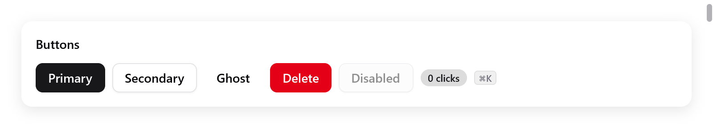

<a id="myzig-documentation"></a>

# Tài liệu myzig

myzig dùng để viết app desktop bằng Zig. Mỗi cửa sổ hiển thị một trong hai loại giao diện, và một app có thể có cửa sổ của cả hai loại.

**Trang web** hiển thị trong webview của hệ điều hành thay vì một trình duyệt đóng gói kèm: WKWebView trên macOS, WebKitGTK trên Linux, WebView2 trên Windows.

- Frontend là HTML, CSS và JavaScript, build bằng công cụ nào cũng được.
- Nó gọi code Zig của bạn qua một JavaScript client. myzig sinh client này từ các kiểu Zig của bạn lúc compile, kèm khai báo TypeScript.

**Native UI** do chính myzig vẽ, viết hoàn toàn bằng Zig với `myzig.ui`.

- Không có HTML, không có JavaScript và không phải khởi động webview, nên cửa sổ mở ngay và tốn ít bộ nhớ.
- Nó được vẽ bằng Metal trên macOS, Direct3D 11 trên Windows, OpenGL trên Linux và WebGL 2 trên trình duyệt.
- Ở đâu không có GPU, bộ render CPU của myzig vẽ ra đúng những pixel đó.

Cửa sổ của cả hai loại dùng chung tùy chọn và event của cửa sổ, menu và các API desktop. Một app là một chương trình Zig duy nhất, nhỏ hơn hẳn một megabyte. Native UI cũng chạy trên trình duyệt khi build cho `wasm32-wasi`.

Một cửa sổ có trang web, với frontend gọi một service Zig:

```zig
const Greeter = struct {
    pub const myzig_params = .{ .greet = .{"name"} };

    /// Returns a greeting.
    pub fn greet(_: *Greeter, call: *myzig.Call, name: []const u8) ![]const u8 {
        return std.fmt.allocPrint(call.arena, "Hello, {s}!", .{name});
    }
};

const assets = [_]myzig.Asset{
    .{ .path = "/index.html", .data = @embedFile("frontend/index.html") },
};

pub fn main(init: std.process.Init) !void {
    const app = try myzig.App.create(init, .{ .name = "Hello" });
    defer app.destroy();
    var greeter: Greeter = .{};
    try app.bind(&greeter);
    _ = try app.newWindow(.{ .title = "Hello", .content = .{ .page = .{ .url = "/", .assets = &assets } } });
    try app.run();
}
```

```js
import { Greeter } from "/myzig.js"; // được sinh ra, app phục vụ file này

document.body.textContent = await Greeter.greet("Ada");
```

Một cửa sổ có native UI, với view là một hàm Zig của state của app:

```zig
const Counter = struct {
    n: i64 = 0,

    fn view(s: *Counter, c: *ui.Context) void {
        ui.column(c, .{ .width = .fill, .height = .fill, .align_items = .center, .justify = .center, .gap = 16 });
        defer ui.end(c);
        ui.textf(c, .{ .size = 56, .weight = .bold }, "{d}", .{s.n});
        if (ui.button(c, "Increment", .{ .variant = .primary }).clicked) s.n += 1;
    }
};

pub fn main(init: std.process.Init) !void {
    const app = try myzig.App.create(init, .{ .name = "Counter" });
    defer app.destroy();
    var state: Counter = .{};
    _ = try app.newWindow(.{ .title = "Counter", .content = .{ .view = .init(&state, Counter.view) } });
    try app.run();
}
```

<a id="guides"></a>

## Hướng dẫn

Bắt đầu từ đây:

- [Kiến trúc tổng quan](architecture.md#architecture-at-a-glance): bản đồ trực quan về các tầng, các adapter nền tảng và hai hướng làm UI, kèm sơ đồ IPC của trang và quá trình render native.
- [Bắt đầu](getting-started.md): Zig 0.17, CLI, `myzig init`, build và chạy, mọi ví dụ.

App và desktop:

- [App](app.md): tạo và chạy app, tùy chọn và handler, thread, thoát và tín hiệu, một instance duy nhất, deep link, thông báo, trạng thái mạng, khởi động cùng hệ thống.
- [Cửa sổ](windows.md): mọi tùy chọn, method và event của cửa sổ, state được ghi nhớ, đóng cửa sổ, thanh tiêu đề và cửa sổ không viền, material, flyout, tiến trình, file được thả vào cửa sổ.
- [Menu, tray và phím tắt toàn cục](menus.md): template menu, role, phím tắt, thanh menu trên từng nền tảng, icon tray, hotkey toàn cục.
- [Hệ thống quanh app](system.md): hộp thoại, shell, các thư mục của app, giao diện sáng tối, locale, tài liệu gần đây, mở khi đăng nhập, URL scheme và loại file, giữ máy thức, secret, theo dõi file và descriptor.
- [Tài liệu](documents.md): app dựa trên tài liệu với `myzig.Documents`: mỗi tài liệu một cửa sổ, lưu, tự lưu, khôi phục, menu File.
- [Âm thanh](audio.md): âm thanh, stream và player, trộn âm, output của hệ thống.
- [Clipboard và dữ liệu kéo thả](data-transfer.md): clipboard, dữ liệu kéo có kiểu, kéo ra khỏi cửa sổ.

Trang web:

- [Trang](pages.md): tùy chọn của trang, scheme `myzig://`, scheme riêng của app, eval, event của trang, quyền, tải xuống, độ tin cậy, tìm kiếm, PDF, cookie, test trang headless.
- [Binding](bindings.md): service được bind, `myzig.Call`, lỗi, event có kiểu, channel, client được sinh ra và cách ánh xạ kiểu.
- [Frontend](frontend.md): runtime `window.myzig`, frontend đã build, dev server, vùng kéo được, user script, web inspector.

Native UI:

- [Native UI](ui/README.md): hướng dẫn về `myzig.ui`, kèm mục lục các trang: view, layout, styling, chữ, mọi nhóm widget, overlay, cấu trúc, danh sách, chuyển động, biến đổi, vẽ, biểu đồ, Markdown, text area, code editor, rich text, shader, accessibility, phải sang trái, inspector, test, render và hiệu năng.
- [Native UI trên trình duyệt](browsers.md): target `wasm32-wasi`, site tĩnh, những gì chạy được trên trình duyệt.

Những phần khác:

- [Ngôn ngữ](i18n.md): danh mục thông điệp, số nhiều, số và ngày tháng, phải sang trái, chuỗi riêng của myzig, trang đã dịch.
- [Plugin](plugins.md): dùng và viết plugin, và các plugin chính thức: [fetch](plugins/fetch.md), [websocket](plugins/websocket.md), [sqlite](plugins/sqlite.md), [watch](plugins/watch.md), [updater](plugins/updater.md), [terminal](plugins/terminal.md), [glass](plugins/glass.md), [game](plugins/game.md), [signals](plugins/signals.md) và [mainthread](plugins/mainthread.md).
- [CLI myzig](cli.md): `init`, `dev`, `build`, `generate`, `icon`, `keygen`, `doctor`, `version`, và các cờ `--myzig-*` của app.
- [Cấu hình](configuration.md): mọi trường của `myzig.zon`.
- [Build và phân phối](distribution.md): những gì `myzig build` tạo ra trên từng nền tảng (`.app` và `.dmg`, `.exe`, `.zip` và bộ cài NSIS, `.tar.gz` và `.deb`), ký, build chéo.
- [Cập nhật](updates.md): cập nhật có chữ ký với `myzig keygen`, `myzig build` và `--upload` (GitHub, S3), cho plugin updater.
- [Benchmark](benchmarks.md): bộ nhớ của một cửa sổ trang so với mygo và Electron, các process của WebView2 là gì, các cờ Chromium giúp tốn ít hơn.

myzig hoạt động thế nào, dành cho người đóng góp:

- [Kiến trúc](architecture.md): các tầng, chọn nền tảng lúc compile, thread, code native không cần C.
- [IPC và sinh TypeScript](architecture-ipc.md): giao thức giữa trang và Zig, outbox, channel, scheme, `tsgen`.
- [Render native UI](architecture-rendering.md): một frame, các instance, năm renderer và bản sao trên CPU, chữ và atlas, surface.
- [Test, kích thước binary và thêm tính năng](architecture-testing.md): mọi bước test, container Linux và Wine, hill climb, và checklist cho một tính năng mới.

Các quy tắc để sửa myzig, bằng tay hay qua agent, nằm trong [AGENTS.md](../../AGENTS.md).

<a id="this-documentation-as-a-site"></a>

## Tài liệu này dưới dạng website

Các trang này cũng là một site [VitePress](https://vitepress.dev), có sidebar, tìm kiếm và dark mode. Khi đã cài Node:

```sh
cd docs
npm install
npm run dev       # phục vụ site tại http://localhost:5173, cập nhật trực tiếp
npm run build     # ghi site vào docs/.vitepress/dist, lỗi nếu có link chết
npm run preview   # phục vụ những gì build đã ghi
```

- `docs/.vitepress/config.mts` chứa phần điều hướng và sidebar. Trang mới cần có chỗ ở đó.
- Các trang vẫn là Markdown thuần và đọc giống nhau trên GitHub.
- Link ra ngoài `docs/` (tới `AGENTS.md`, mã nguồn, ghi chú benchmark) thành link tới repository trên site.

Site mặc định là tiếng Anh ở URL gốc. Chọn **Tiếng Việt** trong menu ngôn ngữ để tới trang tương ứng dưới `/vi/`, hoặc đọc thẳng [bản tiếng Anh](../README.md) trên GitHub. Hai bản giữ nguyên tên API, lệnh và ví dụ code.

<a id="live-demos"></a>

## Demo trực tiếp

Một trang chạy demo ở chỗ có comment ghi tên demo phía trên một hình:

```md
<!-- demo: buttons height=76 -->


```

- GitHub chỉ hiện hình.
- Trên site, demo thay cho hình khi nó tới gần vùng đang xem. Hình là poster của demo, và ở lại những chỗ demo không chạy được.
- Tên không phải demo sẽ làm build lỗi.

Các demo là một file WebAssembly mà mọi trang dùng chung:

- `examples/gallery/live_demos.zig`: các view nhỏ riêng;
- `examples/gallery/live_gallery.zig`: các trang của Gallery mà hình được chụp từ đó, chỉ hiện card của hình.

Site được build ở nơi không có Zig, nên `docs/public/live` được commit. Sau khi sửa một demo hoặc những gì nó vẽ, chạy `npm run live` (cần Zig). `zig build test-web` chạy mọi demo. Với `-Dweb-browser=...`, nó chạy một demo nhúng trong trình duyệt thật.
