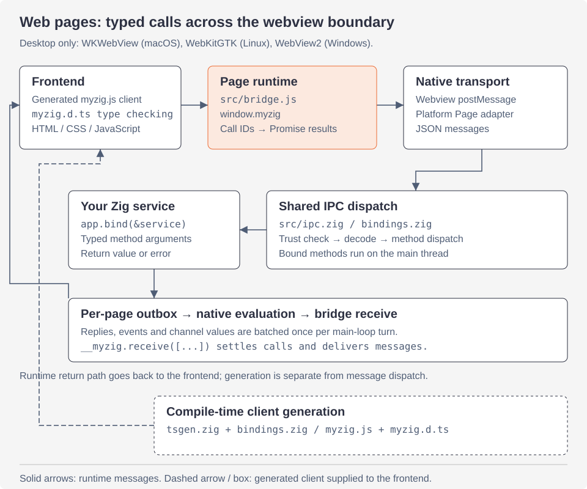

<a id="ipc-and-typescript-generation"></a>

# IPC và sinh TypeScript

Cách một page và app Zig nói chuyện với nhau: runtime của page, giao thức truyền tin, outbox, event, channel, evaluation, độ tin cậy, các scheme của app, và client sinh ra từ các kiểu Zig. Về cách app dùng chúng, xem [bindings](bindings.md) và [pages](pages.md). Về phần còn lại của kiến trúc, xem [phần tổng quan](architecture.md).

<a id="the-pieces"></a>

## Các thành phần



- Mũi tên liền là một lời gọi lúc chạy và reply của nó.
- Đường nét đứt là bước sinh code, diễn ra lúc compile. Các kiểu service của Zig sinh ra client JavaScript và các khai báo TypeScript mà frontend dùng.
- Event và giá trị của channel dùng chung đường trả về qua outbox.

| file | nội dung |
|---|---|
| `src/bridge.js` | runtime của page, `window.myzig`, được chèn vào main frame của mọi document |
| `src/ipc.zig` | `Call`, `Event`, điều phối tới các service đã bind, `handleMessage` (mọi message từ page) |
| `src/bindings.zig` | các service đã bind, các event và loại channel đã đăng ký của app; client đã sinh |
| `src/channel.zig` | `myzig.Channel(T)` và `myzig.ChannelKind(name, T)` |
| `src/page_channel.zig` | các channel của một page: id, số thứ tự, điều khiển luồng |
| `src/page_core.zig` | những gì mọi page dùng chung: dev server, độ tin cậy, evaluation, user script, event của page |
| `src/page_serve.zig` | những gì các scheme của app phục vụ (`myzig://` và `PageOptions.schemes`) |
| `src/page_find.zig` | tìm trong page, qua bridge |
| `src/tsgen.zig` | khai báo TypeScript và client JavaScript, sinh lúc compile |
| `page.zig`, `linux/page.zig`, `windows/page.zig` | webview của từng nền tảng: chèn bridge, gửi message, outbox, scheme |

Giao thức giống nhau trên mọi nền tảng. Chỉ tầng truyền là khác:

| | page → Zig | Zig → page | scheme của app |
|---|---|---|---|
| macOS | `webkit.messageHandlers.myzig.postMessage` | `evaluateJavaScript:` | `myzig://localhost/` (WKURLSchemeHandler) |
| Linux | `webkit.messageHandlers.myzig.postMessage` | `webkit_web_view_run_javascript` | `myzig://localhost/` (đăng ký trên web context) |
| Windows | `chrome.webview.postMessage` | `ExecuteScript` | `http://myzig.localhost/` (WebResourceRequested) |

WebView2 không đăng ký được scheme riêng theo cách WebKit làm. Vì vậy ở đó, một scheme `<s>` của app được phục vụ tại `http://<s>.localhost/` (`page_core.scheme_hosts`). Các request của nó được đổi ngược lại thành `SchemeRequest` của `<s>://localhost/` trước khi tới app.

<a id="the-page-runtime"></a>

## Runtime của page

`bridge.js` chạy lúc document bắt đầu, trong main frame, trước các script của chính page. Nó là một `WKUserScript`, một script của user content manager trong WebKitGTK, hoặc `AddScriptToExecuteOnDocumentCreated` của WebView2. Nó định nghĩa hai biến toàn cục đã bị đóng băng:

- `window.myzig`: `call`, `on`, `once`, `onChannel`, `Channel`, `log`, `window` (`close`, `minimize`, `toggleMaximize`, `setTitle`), `platform` (`"macos"`, `"linux"` hoặc `"windows"`) và `version`.
- `window.__myzig`: `receive`, `settle`, `find`, `stopFind`, chỉ Zig gọi.

Nó còn:

- gửi `dom-ready` khi DOM đã nạp xong;
- biến một lần nhấn chuột trái trong phần tử có style `--app-region: drag` thành message `drag`, hoặc `dblclick` khi bấm đúp. Nhờ vậy cửa sổ không viền có thể được kéo từ page.
- dừng việc dò ngược lên cây DOM tại `--app-region: no-drag`.

<a id="wire-protocol"></a>

## Giao thức truyền tin

Mỗi message là một object JSON có kiểu `t`. Page gửi từng message dưới dạng chuỗi.

Zig trả lời theo lô. Message chờ trong **outbox** của page. Mỗi vòng của main loop, outbox được xả ra thành một script duy nhất, `__myzig.receive([m1, m2, ...])`.

Page → Zig:

| message | ý nghĩa |
|---|---|
| `{"t":"call","id":N,"m":"Service.method","a":[...]}` | gọi một method đã bind với các tham số JSON |
| `{"t":"eval","id":N,"k":TOKEN,"ok":true,"v":"JSON"}` | kết quả của một evaluation (`ok:false,"e":...` cho lỗi của nó) |
| `{"t":"chan-msg","c":ID,"v":"JSON","n":SEQ[,"a":1]}` | một giá trị của channel (`a`: yêu cầu xác nhận) |
| `{"t":"chan-ack","c":ID,"n":SEQ}` | page đã nhận các giá trị của Zig tới SEQ |
| `{"t":"chan-close","c":ID}` | page đã đóng một channel |
| `{"t":"dom-ready"}` | DOM của document đã sẵn sàng |
| `{"t":"log","v":"..."}` | `myzig.log(...)`: in ra stderr dạng `page: ...` |
| `{"t":"drag"}`, `{"t":"dblclick"}` | một vùng kéo vừa được nhấn (di chuyển, hoặc phóng to cửa sổ) |
| `{"t":"win","op":"close"\|"minimize"\|"zoom"\|"title","v":...}` | `myzig.window.*` |

Zig → page:

| message | ý nghĩa |
|---|---|
| `{"t":"reply","id":N,"ok":true,"v":VALUE}` | kết quả của một lời gọi |
| `{"t":"reply","id":N,"ok":false,"e":"Service.method: ErrorName"}` | lỗi của một lời gọi |
| `{"t":"event","n":NAME,"p":PAYLOAD}` | một event có kiểu |
| `{"t":"chan","c":ID,"p":VALUE[,"a":1]}` | một giá trị của channel (`a`: yêu cầu xác nhận) |
| `{"t":"chan","c":ID,"end":true}` | Zig đã đóng channel |
| `{"t":"chan-open","c":ID,"n":NAME}` | Zig đã mở một channel loại NAME (id dưới 0) |
| `{"t":"chan-ack","c":ID,"n":SEQ}` | Zig đã nhận các giá trị của page tới SEQ |

<a id="calls"></a>

### Lời gọi

`ipc.handleMessage` chạy trên main thread cho mọi message. Một lời gọi:

1. được parse thành một envelope, trong một arena được giải phóng khi reply đã gửi;
2. bị từ chối với `Untrusted` nếu URL hiện tại của page không được tin cậy (xem bên dưới);
3. tìm service theo phần trước dấu chấm (`UnknownService`), rồi điều phối method theo tên. Việc điều phối là một `inline for` qua các method của service, sinh ra lúc compile (`UnknownMethod`).
4. giải mã từng tham số thành kiểu Zig của tham số đó, bằng `std.json.parseFromValueLeaky`, bỏ qua các trường lạ (`InvalidArgument`, `MissingArgument`, `TooManyArguments`).
   - Tham số `*myzig.Call` do myzig điền (`arena` và `window` của lời gọi) và không nhận đối số nào.
   - Tham số `myzig.Channel(T)` nhận id của một channel mà page đã tạo.
5. gọi method, mở error union, và ghi kết quả bằng `std.json.Stringify` (`void` là `null`).

- Lỗi trở thành `"ok":false` kèm `"Service.method: ErrorName"`. Nó reject promise của page bằng một `Error` có message đó.
- Nếu method đã tự đóng cửa sổ của nó thì không có reply nào được gửi: page đã không còn.
- Id của lời gọi và evaluation phải là số nguyên không âm, nằm trong khoảng an toàn của JavaScript. Message thiếu id hoặc id không hợp lệ bị bỏ qua.

<a id="the-outbox"></a>

### Outbox

`Page.enqueue(msg, hold)` thêm một message vào outbox. Nó lên lịch một lần xả nếu chưa có: `objc.dispatchMain` trên macOS, `g_idle_add` trên Linux, gửi `WM_FLUSH` trên Windows. Một vòng loop có sinh ra bao nhiêu reply, event và giá trị channel đi nữa, page cũng chỉ chạy một script.

Event và giá trị channel được gửi với `hold = true`:

- Cho tới khi document gửi `dom-ready`, chúng chờ trong một danh sách message bị giữ lại, tối đa 1024.
- Khi document gửi `dom-ready`, chúng được chuyển vào outbox. Nhờ vậy page không bao giờ lỡ event nào được gửi trong lúc nó đang tải.
- Một lần điều hướng (`Page.navigated`) bỏ những gì đang giữ và làm các evaluation đang chạy thất bại. Nó đóng các channel của document cũ với lý do `lost`.

<a id="events"></a>

### Event

`myzig.Event("tick", T)` là một kiểu có `name`, `Payload` và client đã sinh của nó.

- `emit(window, payload)` mã hóa `{"t":"event","n":"tick","p":...}` trên thread đang gọi. Nó chuyển message cho thread của cửa sổ (`Window.sendOwned`), nên gọi từ thread nào cũng an toàn.
- `broadcast(app, payload)` đưa nó vào hàng đợi của mọi cửa sổ có page, trên main thread.
- `myzig.on("tick", fn)` của page, hoặc `onTick(fn)` đã sinh, nhận payload.

<a id="channels"></a>

### Channel

Channel là luồng giá trị có kiểu, có thứ tự, đi cả hai chiều, cho tới khi một bên đóng nó.

- Page tạo channel bằng `new Channel()` và truyền nó cho một method đã bind nhận `myzig.Channel(T)`. Id của nó lớn hơn 0.
- Zig mở channel bằng `myzig.ChannelKind("logs", T).open(window)`. Id của nó nhỏ hơn 0. Page biết được qua `myzig.onChannel("logs", fn)` hoặc `onLogsChannel(fn)` đã sinh.
- Channel Zig còn được giữ sẽ báo là đã đóng sau khi cửa sổ của nó đóng. App phải sống lâu hơn các channel của nó.
- Một listener `onClose` có thể đóng cửa sổ của nó hoặc điều hướng. Message kết thúc của channel cũ không được gửi tới page đã biến mất hay tới document mới.

**Điều khiển luồng** là một cửa sổ byte ở mỗi bên (`page_channel.window_bytes`, 1 MiB).

- Giá trị từ Zig chờ trong page cho tới khi page nhận chúng, bằng một handler `onmessage` hoặc `for await`.
- Cứ mỗi nửa cửa sổ, bên gửi yêu cầu xác nhận (`"a":1`).
- Bên nhận trả lời bằng `chan-ack` với số thứ tự đó, khi đã nhận giá trị ấy.

Khi phần chưa được xác nhận vượt quá một cửa sổ:

- trong Zig, `Channel.send` thất bại với `error.ChannelFull`, và listener `onDrain` của channel chạy khi page đã nhận đủ;
- trong page, `channel.send(v)` trả về một promise, resolve khi Zig lại có chỗ.

Channel đóng với một `CloseReason`: `zig`, `page`, hoặc `lost` (page đã điều hướng hoặc đóng). `Channel.onClose` nhận được lý do này. Giá trị gửi sau đó bị từ chối với `error.ChannelClosed`.

<a id="evaluation"></a>

### Evaluation

`Page.eval(js)` chạy một script mà không chờ. `Page.evalResult(js, cb)` bọc biểu thức thành

```js
window.__myzig&&__myzig.settle(ID,"TOKEN",async()=>(
  <expression>
))
```

- Bridge chờ nó và gửi `{"t":"eval","id":ID,"k":TOKEN,...}`.
- Token là 8 byte ngẫu nhiên cho mỗi page (16 chữ số hex), nên script của chính page không giả mạo được kết quả.
- Điều hướng hoặc đóng page làm những gì đang chờ thất bại ("the page navigated", "the page closed").
- Giá trị không mã hóa được thành JSON, như `BigInt` hay object có tham chiếu vòng, cũng báo lỗi evaluation.

<a id="trust"></a>

### Độ tin cậy

Chỉ document được tin cậy mới được gọi service đã bind, mở channel và nhận quyền. `page_core.trusted` tin cậy:

- URL `about:`, `file:` và `blob:` của một origin được tin cậy;
- các scheme của app (`myzig` và các scheme trong `PageOptions.schemes`, trên Windows là các host `http://<scheme>.localhost` của chúng);
- origin của dev server (`MYZIG_DEV_URL`, nếu không có thì `PageOptions.dev_url`);
- các origin trong `PageOptions.trusted_origins` (`"*"` tin cậy mọi origin).

Cách kiểm tra:

- Theo URL hiện tại của page, ở mỗi lời gọi. Page điều hướng đi nơi khác sẽ mất độ tin cậy.
- Origin được so sánh đầy đủ, kể cả phần authority dài. Các buffer header có kích thước cố định không bao giờ quyết định một origin có được tin cậy hay không.
- Message từ subframe bị từ chối trước khi điều phối IPC. macOS kiểm tra frame, còn WebView2 chỉ chuyển message của frame trên cùng. Trên Linux, message của bridge mang token của page, thứ mà subframe không bao giờ thấy.

<a id="the-app-s-schemes"></a>

## Các scheme của app

`page_serve.dispatch` trả lời mọi request tới một scheme của app, giống nhau trên mọi nền tảng:

1. Page được tin cậy thuộc origin khác nhận header CORS (`Access-Control-Allow-Origin` là origin của nó; `OPTIONS` được trả `204`).
2. Scheme trong `PageOptions.schemes` được chuyển tới handler của nó. Handler trả lời `SchemeRequest` ngay hoặc sau (`req.respond(status, headers, body)`).
3. `myzig://` phục vụ frontend, thử lần lượt:
   - `/myzig.js`, client đã sinh (`App.clientJs`);
   - file trong `assets_dir`. `MYZIG_ASSETS_DIR` ghi đè nó. Đường dẫn được percent-decode một lần, rồi đường dẫn có `..`, dấu gạch ngược, ổ đĩa hoặc byte NUL bị từ chối.
   - các `assets` đã nhúng;
   - với đường dẫn không có phần mở rộng và không phải file: `/index.html`. Đó là một route phía client.
4. Mọi thứ khác là `404 Not Found`.

Response mang `Cache-Control: no-cache`, nên frontend build lại sẽ hiện ra khi tải lại page.

<a id="typescript-generation-tsgen-zig"></a>

## Sinh TypeScript (`tsgen.zig`)

Zig giữ kiểu lúc compile, nên chính trình biên dịch sinh ra client.

- `App.bind(&service)` lưu phần điều phối của service và `tsgen.service(T)` của nó.
- `App.registerEvent(E)` lưu `E.client`, của một event hoặc một loại channel.
- Lúc chạy không sinh gì ngoài việc nối chuỗi.

Một service lộ ra các hàm public có tham số đầu là chính service (`T`, `*T` hoặc `*const T`), không generic và không bắt đầu bằng `_`. Tên của nó trong client là `T.myzig_name`, nếu không có thì là phần cuối của `@typeName(T)`.

Zig không giữ tên tham số trong kiểu hàm, nên service tự đặt tên cho chúng:

```zig
pub const myzig_params = .{ .greet = .{"name"} };
```

Tham số không được đặt tên là `arg0`, `arg1`, ... Tham số `*myzig.Call` bị bỏ khỏi client.

Ánh xạ kiểu như sau:

| Zig | TypeScript |
|---|---|
| `void` | `void` |
| `bool` | `boolean` |
| số nguyên, số thực | `number` |
| `[]const u8`, `[N]u8` | `string` |
| `[]T`, `[N]T` | `T[]` (`(A \| B)[]` khi cần) |
| `?T` | `T \| null`; trường optional của struct còn là `field?:` |
| `E!T` | `T` (lỗi reject promise) |
| `enum { a, b }` | `export type E = "a" \| "b";` |
| `struct {...}` | `export interface S {...}`, loại trùng theo tên; kiểu đệ quy vẫn dừng được |
| `std.json.Value` | `unknown` |
| `myzig.Channel(T)` | `Channel<T>` |

Tuple và các kiểu khác là lỗi compile có ghi tên kiểu.

Kết quả:

- `myzig.d.ts` (`Bindings.clientDts`) chứa, theo thứ tự:
  - `runtime_dts`: interface `Channel<T>` và khai báo của `myzig`;
  - khai báo của mọi kiểu;
  - mọi service, dạng `export declare const Greeter: { greet(name: string): Promise<string>; }`;
  - mọi event dạng `onTick(listener)`, mọi loại channel dạng `onLogsChannel(listener)`.
- `myzig.js` (`Bindings.clientJs`) export lại `myzig` và `Channel`. Tiếp theo:
  - mỗi service là một object đã đóng băng gồm các method gọi `window.myzig.call("Greeter.greet", ...a)`;
  - mỗi event là `(fn) => window.myzig.on("tick", fn)`.

  Nó được phục vụ tại `/myzig.js` và được dựng một lần cho mỗi app.

Tên event được viết PascalCase sau `on`: `build-logs` thành `onBuildLogsChannel`. Các service được sắp xếp, nên kết quả ổn định.

- `--myzig-generate=DIR` làm `App.run` ghi cả hai file vào `DIR` rồi thoát. `zig build gen` làm việc này cho ví dụ hello, `myzig generate` cho một app.
- Mỗi ánh xạ kiểu mới đều có một test trong `tsgen.zig`.
- Plugin có phần chạy trong page tự kèm JavaScript của nó dưới dạng một `Asset`, gọi service đã bind của nó qua `window.myzig`. Ví dụ là `fetch.asset` của plugin fetch, tại `/plugins/fetch.js`.
