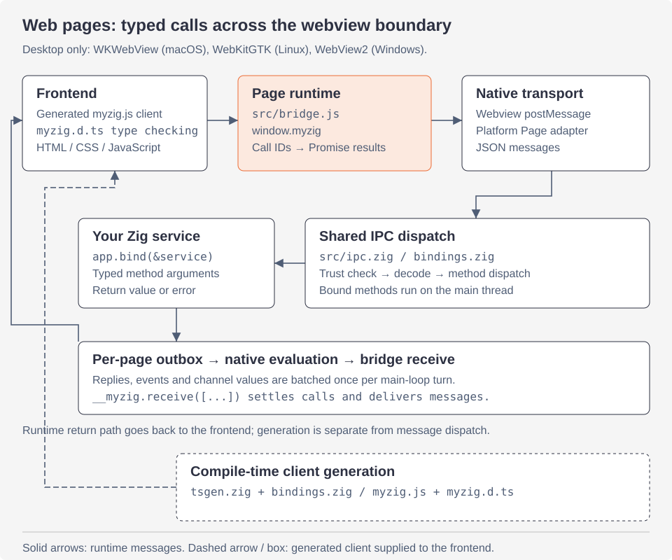

<a id="ipc-and-typescript-generation"></a>

# Thế hệ IPC và TypeScript

Cách một trang và ứng dụng Zig giao tiếp: thời gian chạy trang, giao thức dây, hộp thư đi, sự kiện, kênh, đánh giá, độ tin cậy, sơ đồ của ứng dụng và client được tạo từ các kiểu Zig. Để biết cách ứng dụng sử dụng chúng, hãy xem [liên kết](bindings.md) và [trang](pages.md); đối với phần còn lại của kiến ​​trúc, [tổng quan](architecture.md).

<a id="the-pieces"></a>

## Các mảnh



Thực hiện theo các mũi tên liền để biết lệnh gọi thời gian chạy và câu trả lời của nó. Đường dẫn tạo nét đứt xảy ra tại thời điểm biên dịch: các loại dịch vụ Zig tạo ra các khai báo JavaScript client và TypeScript được frontend sử dụng. Các sự kiện và giá trị kênh chia sẻ đường dẫn trả về hộp thư đi.

| tập tin | cái gì |
|---|---|
| `src/bridge.js` | thời gian chạy trang, `window.myzig`, được đưa vào khung chính của mọi tài liệu |
| `src/ipc.zig` | `Call`, `Event`, công văn của các dịch vụ bị ràng buộc, `handleMessage` (mọi tin nhắn từ một trang) |
| `src/bindings.zig` | các dịch vụ ràng buộc của ứng dụng cũng như các sự kiện đã đăng ký và loại kênh; khách hàng được tạo ra |
| `src/channel.zig` | `myzig.Channel(T)` và `myzig.ChannelKind(name, T)` |
| `src/page_channel.zig` | các kênh của một trang: id, số thứ tự, điều khiển luồng |
| `src/page_core.zig` | nội dung mọi trang chia sẻ: máy chủ nhà phát triển, độ tin cậy, đánh giá, tập lệnh của người dùng, sự kiện trên trang |
| `src/page_serve.zig` | kế hoạch của ứng dụng phục vụ những gì (`myzig://` và `PageOptions.schemes`) |
| `src/page_find.zig` | tìm trong trang, qua cây cầu |
| `src/tsgen.zig` | comptime TypeScript và client JavaScript |
| `page.zig`, `linux/page.zig`, `windows/page.zig` | view web của mỗi nền tảng: chèn cầu nối, đăng bài, hộp thư đi, các kế hoạch |

Giao thức giống nhau trên mọi nền tảng; chỉ có phương tiện vận chuyển là khác nhau:

| | trang → Zig | Zig → trang | sơ đồ ứng dụng |
|---|---|---|---|
| macOS | `webkit.messageHandlers.myzig.postMessage` | `evaluateJavaScript:` | `myzig://localhost/` (WKURLSchemeHandler) |
| Linux | `webkit.messageHandlers.myzig.postMessage` | `webkit_web_view_run_javascript` | `myzig://localhost/` (đã đăng ký trên ngữ cảnh web) |
| Windows | `chrome.webview.postMessage` | `ExecuteScript` | `http://myzig.localhost/` (WebResourceRequested) |

WebView2 không thể đăng ký lược đồ tùy chỉnh theo cách WebKit thực hiện, do đó, lược đồ ứng dụng `<s>` được cung cấp tại `http://<s>.localhost/` tại đó (`page_core.scheme_hosts`) và các yêu cầu của nó được chuyển trở lại thành `SchemeRequest`s của `<s>://localhost/` trước khi ứng dụng nhìn thấy chúng.

<a id="the-page-runtime"></a>

## Thời gian chạy trang

`bridge.js` chạy khi bắt đầu tài liệu trong khung chính (một `WKUserScript`, trình quản lý nội dung người dùng của WebKitGTK, `AddScriptToExecuteOnDocumentCreated` của WebView2), trước các tập lệnh riêng của trang và xác định hai tập lệnh cố định:

- `window.myzig`: `call`, `on`, `once`, `onChannel`, `Channel`, `log`, `window` (`close`, `minimize`, `toggleMaximize`, `setTitle`), `platform` (`"macos"`, `"linux"` hoặc `"windows"`) và `version`.
- `window.__myzig`: `receive`, `settle`, `find`, `stopFind`, chỉ Zig gọi.

Nó cũng đăng `dom-ready` khi DOM được tải và chuyển chuột trái xuống trong phần tử được tạo kiểu `--app-region: drag` thành thông báo `drag` (hoặc `dblclick` cho cú nhấp đúp), để các cửa sổ không khung di chuyển khỏi trang; `--app-region: no-drag` dừng tìm kiếm trên cây.

<a id="wire-protocol"></a>

## Giao thức dây

Mỗi tin nhắn là một đối tượng JSON có loại `t`. Trang đăng mỗi cái dưới dạng một chuỗi. Zig trả lời theo đợt: tin nhắn chờ trong **hộp thư đi** của trang và mỗi lượt của vòng lặp chính, hộp thư đi sẽ được xóa dưới dạng một tập lệnh, `__myzig.receive([m1, m2, ...])`.

Trang → Zig:

| tin nhắn | ý nghĩa |
|---|---|
| `{"t":"call","id":N,"m":"Service.method","a":[...]}` | gọi một phương thức bị ràng buộc với các đối số JSON |
| `{"t":"eval","id":N,"k":TOKEN,"ok":true,"v":"JSON"}` | kết quả đánh giá (`ok:false,"e":...` vì lỗi của nó) |
| `{"t":"chan-msg","c":ID,"v":"JSON","n":SEQ[,"a":1]}` | một giá trị kênh (`a`: thừa nhận nó) |
| `{"t":"chan-ack","c":ID,"n":SEQ}` | trang này đã lấy giá trị của Zig lên tới SEQ |
| `{"t":"chan-close","c":ID}` | trang đã đóng một kênh |
| `{"t":"dom-ready"}` | DOM của tài liệu đã sẵn sàng |
| `{"t":"log","v":"..."}` | `myzig.log(...)`: được in dưới dạng `page: ...` trên thiết bị lỗi chuẩn |
| `{"t":"drag"}`, `{"t":"dblclick"}` | một vùng kéo đã được nhấn (di chuyển hoặc thu phóng cửa sổ) |
| `{"t":"win","op":"close"\|"minimize"\|"zoom"\|"title","v":...}` | `myzig.window.*` |

Zig → trang:

| tin nhắn | ý nghĩa |
|---|---|
| `{"t":"reply","id":N,"ok":true,"v":VALUE}` | kết quả cuộc gọi |
| `{"t":"reply","id":N,"ok":false,"e":"Service.method: ErrorName"}` | lỗi cuộc gọi |
| `{"t":"event","n":NAME,"p":PAYLOAD}` | một sự kiện được đánh máy |
| `{"t":"chan","c":ID,"p":VALUE[,"a":1]}` | một giá trị kênh (`a`: thừa nhận nó) |
| `{"t":"chan","c":ID,"end":true}` | Zig đã đóng kênh |
| `{"t":"chan-open","c":ID,"n":NAME}` | Zig đã mở một kênh thuộc loại NAME (id dưới 0) |
| `{"t":"chan-ack","c":ID,"n":SEQ}` | Zig đã nâng giá trị của trang lên tới SEQ |

<a id="calls"></a>

### Cuộc gọi

`ipc.handleMessage` chạy trên luồng chính cho mọi tin nhắn. Một cuộc gọi:

1. được phân tích thành một phong bì trong một arena được giải phóng khi trả lời được gửi đi;
2. bị từ chối với `Untrusted` trừ khi URL hiện tại của trang được tin cậy (bên dưới);
3. tìm dịch vụ theo phần trước dấu chấm (`UnknownService`) và gửi phương thức theo tên; công văn là `inline for` trên các phương thức của dịch vụ được tạo tại thời điểm biên dịch (`UnknownMethod`);
4. giải mã từng đối số có `std.json.parseFromValueLeaky` thành kiểu Zig của tham số, bỏ qua các trường không xác định (`InvalidArgument`, `MissingArgument`, `TooManyArguments`). Tham số `*myzig.Call` được điền bởi myzig (của lệnh gọi `arena` và `window` của nó) và không có đối số; tham số `myzig.Channel(T)` lấy id của kênh mà trang đã tạo;
5. gọi phương thức, mở liên kết lỗi và ghi kết quả bằng `std.json.Stringify` (`void` là `null`).

Lỗi trở thành `"ok":false` với `"Service.method: ErrorName"`, từ chối lời hứa của trang với `Error` của thông báo đó. Nếu phương thức đóng cửa sổ riêng của nó thì không có phản hồi nào được gửi: trang đã biến mất. ID cuộc gọi và đánh giá phải là số nguyên an toàn không âm JavaScript; tin nhắn có ID bị thiếu hoặc không hợp lệ sẽ bị bỏ qua.

<a id="the-outbox"></a>

### Hộp thư đi

`Page.enqueue(msg, hold)` thêm tin nhắn vào hộp thư đi và lên lịch một lần xả nếu không có lịch nào được lên lịch: `objc.dispatchMain` trên macOS, `g_idle_add` trên Linux, a `WM_FLUSH` đã đăng trên Windows. Cho dù vòng lặp tạo ra bao nhiêu câu trả lời, sự kiện và giá trị kênh thì trang vẫn chạy một tập lệnh.

Các sự kiện và giá trị kênh được gửi bằng `hold = true`: cho đến khi tài liệu đăng `dom-ready`, chúng sẽ đợi trong danh sách các tin nhắn được giữ lại (tối đa 1024), được chuyển đến hộp thư đi khi có, do đó, trang sẽ không bao giờ bỏ lỡ sự kiện được gửi trong khi tải. Điều hướng (`Page.navigated`) loại bỏ nội dung được giữ lại, thực hiện đánh giá không thành công và đóng các kênh của tài liệu cũ với lý do `lost`.

<a id="events"></a>

### Sự kiện

`myzig.Event("tick", T)` là loại có `name`, `Payload` và client được tạo bởi nó. `emit(window, payload)` mã hóa `{"t":"event","n":"tick","p":...}` trên chuỗi cuộc gọi và chuyển nó tới chuỗi của cửa sổ (`Window.sendOwned`), vì vậy nó an toàn trước mọi chuỗi; `broadcast(app, payload)` xếp nó vào hàng đợi cho mọi cửa sổ có một trang, trên luồng chính. `myzig.on("tick", fn)` của trang (hoặc `onTick(fn)`) được tạo sẽ nhận tải trọng.

<a id="channels"></a>

### Kênh

Các kênh được sắp xếp theo thứ tự các luồng giá trị được nhập theo cả hai cách, cho đến khi một trong hai bên đóng chúng lại. Một trang tạo một trang có `new Channel()` và chuyển nó sang một phương thức bị ràng buộc lấy `myzig.Channel(T)` (id trên 0); Zig mở một trang có `myzig.ChannelKind("logs", T).open(window)` (id dưới 0), trang này nghe thấy thông qua `myzig.onChannel("logs", fn)` hoặc `onLogsChannel(fn)` được tạo. Báo cáo kênh Zig được giữ lại đã đóng sau khi cửa sổ của chúng đóng. Ứng dụng phải tồn tại lâu hơn các kênh của nó. Trình nghe `onClose` có thể đóng cửa sổ hoặc điều hướng: thông báo kết thúc của kênh cũ không được gửi đến trang đã biến mất hoặc tài liệu mới.

Kiểm soát luồng là một cửa sổ byte (`page_channel.window_bytes`, 1 MiB) ở mỗi bên. Các giá trị từ Zig đợi trong trang cho đến khi nó nhận được chúng (trình xử lý `onmessage` hoặc `for await`). Cứ sau nửa cửa sổ người gửi lại yêu cầu xác nhận (`"a":1`); người nhận trả lời bằng `chan-ack` số thứ tự sau khi nhận được giá trị đó. Trong khi có nhiều hơn một cửa sổ không được thừa nhận:

- trong Zig, `Channel.send` không thành công với `error.ChannelFull` và trình nghe `onDrain` của kênh chạy khi trang đã đủ tải;
- trong trang, `channel.send(v)` trả lại lời hứa sẽ được giải quyết sau khi Zig có chỗ trống trở lại.

Kênh đóng với `CloseReason`: `zig`, `page` hoặc `lost` (trang được điều hướng hoặc đóng). `Channel.onClose` nghe thấy; các giá trị được gửi sau bị từ chối bằng `error.ChannelClosed`.

<a id="evaluation"></a>

### Đánh giá

`Page.eval(js)` chạy tập lệnh mà không cần chờ đợi. `Page.evalResult(js, cb)` gói biểu thức dưới dạng

```js
window.__myzig&&__myzig.settle(ID,"TOKEN",async()=>(
  <expression>
))
```

Cây cầu đang chờ nó và đăng `{"t":"eval","id":ID,"k":TOKEN,...}`. Mã thông báo có 8 byte ngẫu nhiên trên mỗi trang (16 chữ số hex), do đó, tập lệnh của chính trang đó không thể giả mạo kết quả. Việc điều hướng hoặc đóng không thành công những nội dung đang chờ xử lý ("trang được điều hướng", "trang đã đóng"). Các giá trị không thể mã hóa dưới dạng JSON, chẳng hạn như `BigInt` hoặc một đối tượng có tham chiếu vòng tròn, cũng báo cáo lỗi đánh giá.

<a id="trust"></a>

### Tin tưởng

Chỉ tài liệu đáng tin cậy mới có thể gọi các dịch vụ bị ràng buộc, mở kênh và nhận quyền. `page_core.trusted` tin tưởng:

- `about:`, `file:` và `blob:` URL có nguồn gốc đáng tin cậy;
- các sơ đồ của ứng dụng (`myzig` và của `PageOptions.schemes` và trên Windows máy chủ `http://<scheme>.localhost` của họ);
- nguồn gốc của máy chủ nhà phát triển (`MYZIG_DEV_URL`, nếu không thì `PageOptions.dev_url`);
- nguồn gốc trong `PageOptions.trusted_origins` (`"*"` tin tưởng bất kỳ nguồn nào).

Độ tin cậy được kiểm tra dựa trên URL hiện tại của trang trong mỗi lệnh gọi, do đó, trang điều hướng đến nơi khác sẽ mất URL đó. Nguồn gốc được so sánh đầy đủ, kể cả chính quyền dài hạn; bộ đệm tiêu đề có kích thước cố định không bao giờ xác định liệu nguồn gốc có đáng tin cậy hay không. Tin nhắn từ các khung con bị từ chối trước khi gửi IPC: macOS kiểm tra khung, WebView2 chỉ gửi khung trên cùng và trên Linux tin nhắn của cầu nối mang mã thông báo của trang mà các khung con không bao giờ nhìn thấy.

<a id="the-app-s-schemes"></a>

## Đề án của ứng dụng

`page_serve.dispatch` trả lời mọi yêu cầu của sơ đồ ứng dụng, theo cách giống nhau trên mọi nền tảng:

1. Một trang đáng tin cậy có nguồn gốc khác nhận được các tiêu đề CORS (`Access-Control-Allow-Origin` nguồn gốc của nó; `OPTIONS` đã trả lời `204`).
2. Một sơ đồ `PageOptions.schemes` sẽ được chuyển tới trình xử lý của nó, trả lời `SchemeRequest` bây giờ hoặc sau này (`req.respond(status, headers, body)`).
3. `myzig://` phục vụ frontend: `/myzig.js` là client được tạo (`App.clientJs`); sau đó tệp của `assets_dir` (`MYZIG_ASSETS_DIR` sẽ ghi đè lên nó; các đường dẫn được giải mã phần trăm một lần, sau đó các đường dẫn có `..`, dấu gạch chéo ngược, ổ đĩa hoặc byte NUL bị từ chối), sau đó là `assets` được nhúng; một đường dẫn không có phần mở rộng và không có tệp là tuyến phía client và nhận được `/index.html`.
4. Bất cứ điều gì khác là `404 Not Found`.

Phản hồi mang `Cache-Control: no-cache`, vì vậy frontend được xây dựng lại sẽ hiển thị khi tải lại.

<a id="typescript-generation-tsgen-zig"></a>

## Sinh TypeScript (`tsgen.zig`)

Zig giữ các loại tại thời điểm biên dịch, do đó client được tạo bởi trình biên dịch: `App.bind(&service)` lưu trữ, với công văn của dịch vụ, `tsgen.service(T)` của nó và `App.registerEvent(E)` lưu trữ `E.client` (một sự kiện hoặc một loại kênh). Không có gì được tạo ra trong thời gian chạy ngoài việc nối.

Nội dung của một dịch vụ: các hàm công khai có tham số đầu tiên là dịch vụ (`T`, `*T` hoặc `*const T`), không chung chung, không bắt đầu bằng `_`. Tên của nó trong client là `T.myzig_name`, nếu không thì phần cuối cùng của `@typeName(T)`. Zig không giữ tên tham số trong các loại hàm, vì vậy dịch vụ sẽ đặt tên cho chúng:

```zig
pub const myzig_params = .{ .greet = .{"name"} };
```

(các tham số chưa được đặt tên là `arg0`, `arg1`, ...). Các tham số `*myzig.Call` bị loại khỏi client.

Các loại bản đồ như sau:

| Zig | TypeScript |
|---|---|
| `void` | `void` |
| `bool` | `boolean` |
| số nguyên, số float | `number` |
| `[]const u8`, `[N]u8` | `string` |
| `[]T`, `[N]T` | `T[]` (`(A \| B)[]` khi cần) |
| `?T` | `T \| null`; trường cấu trúc tùy chọn cũng là `field?:` |
| `E!T` | `T` (lỗi từ chối lời hứa) |
| `enum { a, b }` | `export type E = "a" \| "b";` |
| `struct {...}` | `export interface S {...}`, được loại bỏ trùng lặp theo tên; các kiểu đệ quy chấm dứt |
| `std.json.Value` | `unknown` |
| `myzig.Channel(T)` | `Channel<T>` |

Bộ dữ liệu và các loại khác là lỗi biên dịch khi đặt tên loại.

Đầu ra:

- `myzig.d.ts` (`Bindings.clientDts`): `runtime_dts` (giao diện `Channel<T>` và phần khai báo của `myzig`), sau đó khai báo mọi loại, mọi dịch vụ là `export declare const Greeter: { greet(name: string): Promise<string>; }`, mọi sự kiện là `onTick(listener)`, mọi loại kênh là `onLogsChannel(listener)`.
- `myzig.js` (`Bindings.clientJs`): tái xuất `myzig` và `Channel`, sau đó mỗi dịch vụ dưới dạng đối tượng cố định của các phương thức gọi `window.myzig.call("Greeter.greet", ...a)` và mỗi sự kiện là `(fn) => window.myzig.on("tick", fn)`. Nó được phục vụ tại `/myzig.js` và được xây dựng một lần cho mỗi ứng dụng.

Tên sự kiện trở thành PascalCase sau `on` (`build-logs` cho `onBuildLogsChannel`). Dịch vụ được sắp xếp nên đầu ra ổn định.

`--myzig-generate=DIR` khiến `App.run` ghi cả hai tệp vào `DIR` và thoát (`zig build gen` thực hiện điều đó cho ví dụ xin chào, `myzig generate` cho một ứng dụng). Mọi ánh xạ kiểu mới đều được kiểm tra trong `tsgen.zig`.

Các plugin có một bên trang gửi JavaScript của riêng chúng dưới dạng `Asset` (ví dụ: `fetch.asset` của plugin tìm nạp tại `/plugins/fetch.js`), gọi dịch vụ ràng buộc của chúng thông qua `window.myzig`.
