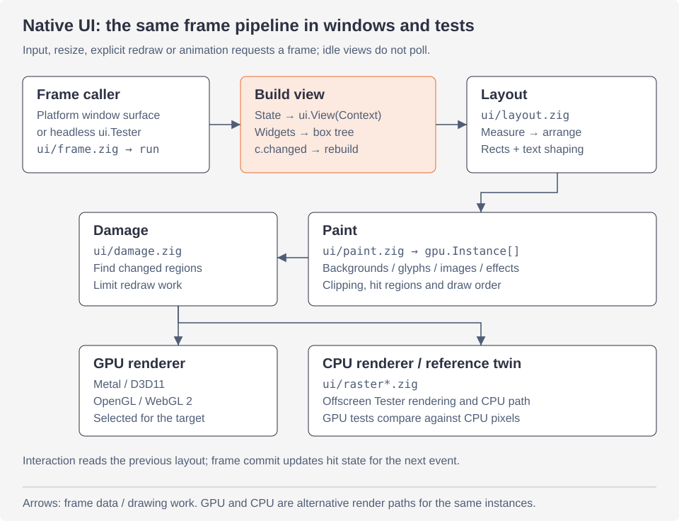

<a id="rendering-native-ui"></a>

# Render native UI

Một view trở thành pixel như thế nào. Trang này gồm:

- pipeline dựng frame, dùng chung cho cửa sổ và `ui.Tester`;
- các instance mà mọi renderer vẽ;
- năm renderer: Metal, Direct3D 11, OpenGL, WebGL 2 và CPU;
- bản sao CPU (CPU twin) chứng minh chúng cho cùng kết quả;
- chữ và atlas, và surface của từng nền tảng.

Cách dùng native UI có trong [hướng dẫn native UI](ui/README.md). Render và hiệu năng nhìn từ phía app có trong [rendering](ui/rendering.md) và [performance](ui/performance.md). Quay lại [tổng quan](architecture.md).

<a id="one-frame"></a>

## Một frame



Đọc các mũi tên từ nơi gọi frame qua build, layout và paint, rồi xuống renderer. `gpu.Instance` là giao ước vẽ dùng chung. Nhánh CPU còn cung cấp pixel tham chiếu cho các test GPU. Việc shape chữ diễn ra trong layout; glyph atlas được đọc trong paint.

`run` của `ui/frame.zig` dựng một frame. Surface của mọi cửa sổ và `ui.Tester` đều gọi nó, nên test thấy gì thì cửa sổ hiện đúng như thế:

1. **Build.** View (`ui.View`: một con trỏ và một hàm `build`) chạy với một `*ui.Context`.
   - Widget mở và đóng box (`Context.open`, `leaf`, `end`) thành một cây node phẳng cho frame này.
   - Chúng trả lời tương tác (bấm, hover, kéo, phím) theo layout của frame **trước**.
   - Widget nào làm đổi state của app thì đặt `c.changed`. Khi đó frame được build lại (`c.rebuild()`), tối đa bốn lượt, nên màn hình không bao giờ chậm hơn state.
   - Một box quên đóng sẽ panic, kèm số box còn mở.
2. **Layout** (`ui/layout.zig`). Flexbox chạy hai lượt:
   - `measure` đo box theo nội dung, từ dưới lên. Chữ được shape và xuống dòng ở đây, từ layout đã cache.
   - Chiều rộng và các chỗ xuống dòng của mỗi box chữ được giữ theo id qua các frame và so sánh, trong `layout_cache.zig`. Một box được đo lại ở cùng chiều rộng trong một frame thì giữ nguyên kết quả.
   - `arrange` đặt chúng từ trên xuống. Nó chia khoảng trống thừa cho các box grow và lấy bớt từ các box shrink, như CSS flexbox (`layout_flex.zig`). Nó căn baseline (`layout_baseline.zig`).
   - Box absolute, scroll view, grid (`grid_layout.zig`) và phải sang trái (`direction.zig`) được xử lý ở đây.
   - Hình chữ nhật của mỗi node được ghi theo id cho tương tác ở frame sau.
3. **Paint** (`ui/paint.zig`). Cây đã layout trở thành các **instance** của renderer, theo thứ tự vẽ.
   - Instance là nền, viền, bóng, dãy glyph, icon, ảnh, gradient, hiệu ứng và mốc layer.
   - Mỗi instance có vùng clip của nó, kể cả clip bo góc. Box nằm ngoài vùng clip bị loại.
   - Box có transform vẽ cây con trong không gian riêng của nó (`paint_xf.zig`). Gradient, transform và hiệu ứng thêm các hàng dữ liệu phía sau các instance.
   - Box tương tác ghi lại hình chữ nhật nhìn thấy được (`hit.zig`), kèm phép ánh xạ ngược cho box có transform. Nhờ đó con trỏ khớp với những gì được vẽ.
   - Box nào có **ink** nằm hẳn ngoài vùng clip thì bị bỏ qua cùng mọi thứ bên trong, như Blink và Flutter bỏ qua những gì ngoài cull rect. Một trang nghìn hàng bị clip chỉ vẽ các hàng đang thấy.
   - Ink là box nới rộng thêm phần bóng, blur, chữ và icon tràn ra ngoài, cộng với ink của các box bên trong. Nó được tính từ cây trong một lượt, từ sau ra trước.
   - Box có transform và chữ chọn được thì luôn được vẽ, ở đâu cũng vậy. Không gì bị bỏ qua khi transition đang di chuyển box, hoặc khi có webview.
   - `tests_paint_cull.zig` kiểm tra rằng các instance đúng bằng các instance vẽ khi không bỏ qua gì.
   - Nếu một atlas đầy và bị reset trong lúc paint, frame được paint lại.
4. **Commit.** Thứ đang nằm dưới con trỏ được cập nhật theo các hit mới. Nếu nó đổi trong khi con trỏ đứng yên, `Result.hot_changed` yêu cầu thêm một frame.

Những gì view truyền vào được đọc ở các giai đoạn sau, khi view đã return:

- shape và xuống dòng chữ trong layout;
- glyph của chữ trong paint;
- cây accessibility sau cả hai.

Vì vậy `Context.leaf` chép chuỗi và span của box chữ vào arena của frame (`c.alloc()`, reset khi frame sau bắt đầu). `access.describe` cũng chép chuỗi của nó. Giải phóng các chuỗi đó trong view, kể cả giữa hai widget hiển thị chúng, không thể khiến layout đọc vùng nhớ đã giải phóng (`tests_frame_strings.zig`).

Việc chép tốn 0,04 đến 0,06 ms mỗi frame cho mỗi nghìn box chữ trong các cảnh của hill climb.

Mọi thứ khác mà node trỏ tới phải sống đến khi frame được vẽ: byte của ảnh, tên icon, gradient, path của canvas. App giải phóng dữ liệu này sau frame (một frame sau, hoặc ở event kế tiếp). Hoặc app giữ bản cũ thêm một lần cập nhật.

`c.stats` (`ui.FrameStats`) ghi số mili giây của từng giai đoạn, số lượt, số node và số instance. Inspector và hill climb đọc nó.

Frame chỉ chạy khi có thứ yêu cầu:

- input;
- đổi kích thước;
- thay đổi từ ngoài view: `Window.redraw()`, gọi trên main thread, cho state bị đổi bởi timer hay output của một process;
- một animation đang chạy (`c.animating`, do `Context.animate` và motion đặt).

Khi rảnh, cửa sổ không vẽ gì. `tests_idle.zig` hover một nút có tooltip, bấm, bật tắt, gõ phím, rời một trường, chuyển sang giao diện tối và đổi kích thước. Sau mỗi bước, nó kiểm tra ba điều:

- cửa sổ đã ổn định không animate gì;
- nó không xin thêm frame nào;
- một frame có build thì cũng không vẽ gì.

Khi cửa sổ không có phần nào đang hiện, các frame không do input yêu cầu sẽ chờ đến khi có phần hiện ra. Trình duyệt cũng không vẽ gì cho cửa sổ khuất tầm nhìn.

- Không hiện nghĩa là bị che khuất, ở Space khác hoặc thu nhỏ trên macOS. Trên Windows là thu nhỏ hoặc bị ẩn.
- Các frame đó là của display link hay timer animation, yêu cầu từ bên ngoài, và đổi kích thước.
- Input vẫn build một frame, chẳng hạn phím gõ vào key window đang bị cửa sổ khác che.

<a id="instances"></a>

## Instance

`ui/gpu.zig` là giao ước giữa paint và mọi renderer. Một frame là một mảng `gpu.Instance`, mỗi phần tử là một quad:

```zig
pub const Instance = extern struct {
    rect: [4]f32,
    color: [4]f32,
    border_color: [4]f32 = .{ 0, 0, 0, 0 },
    uv: [4]f32 = .{ 0, 0, 0, 0 },
    clip: [4]f32 = .{ -1e6, -1e6, 1e6, 1e6 },
    radius: f32 = 0,
    border_width: f32 = 0,
    kind: f32 = 0,
    clip_round: f32 = 0,
};
```

`kind` (`gpu.Kind`) cho biết quad là gì:

| `kind` | |
|---|---|
| `quad` | hình chữ nhật bo góc có viền |
| `text` | một glyph hoặc icon lấy từ glyph atlas |
| `shadow` | Gaussian blur của một box bo góc, như GPUI vẽ |
| `image` | lấy từ image atlas |
| `effect` | mốc của một backdrop effect |
| `gradient` | một gradient |
| `layer`, `layer_end` | một nhóm bị blur hoặc làm mờ dần |
| `trailer` | trỏ tới các hàng dữ liệu |

Các bit cao của `kind` mang số hàng của một transform. `gpu.Frame.of(instances)` tách các instance cần vẽ khỏi các hàng dữ liệu xếp sau chúng; instance `trailer` cuối cùng trỏ tới các hàng đó. Renderer vẽ một frame bằng một lệnh instanced draw. Nó chỉ tách lệnh ở hiệu ứng và layer.

**Góc liên tục.** `radius` âm yêu cầu góc liên tục (`Style.corners`, `raster_corner.zig`, theo mygo: đường cong của Core Animation). Một `clip_round` tạo bởi `gpu.clipContinuous` yêu cầu điều đó cho vùng clip: các bit góc cộng 16.

- Mọi renderer tính đường cong bằng cùng một phép tính, các hàm `cont_*` của shader.
- Đường cong chỉ áp dụng trong box của góc: `extent` lần bán kính tính từ góc. Ngoài đó là khoảng cách tới cạnh gần nhất, như góc vuông.
- Mép của nó được làm mượt theo gradient của giá trị, tính bằng hiệu số cách nhau một phần mười sáu pixel.
- Các hàng của bóng bị blur được thu hẹp ở chỗ có đường cong, tìm bằng regula falsi.

<details>
<summary>Nine-patch cho bóng lớn</summary>

Các renderer GPU cắt bóng lớn có góc liên tục thành nine-patch (`gpu_corners.zig`, theo commit 8b35d8e và 3e9f9c6 của mygo):

- Các dải hàng đi qua góc được vẽ nguyên dạng ở hai đầu, và vẽ như bản sao góc vuông ở giữa.
- Dải nằm giữa chúng được vẽ như bản sao góc vuông. Bản sao này tính ra đúng những giá trị đó mà không cần tìm kiếm.
- Một dải chỉ được cắt khi pixel của bản sao tiết kiệm hơn chi phí các mảnh (mỗi mảnh một instance).

Renderer CPU vẽ nguyên khối; pixel của nó vẫn giống hệt.

</details>

<a id="the-renderers"></a>

## Các renderer

| renderer | file và shader | ở đâu |
|---|---|---|
| Metal | `ui/metal.zig`, `shader.metal`, hiệu ứng trong `metal_fx.zig`/`metal_fx.metal` | macOS, vẽ vào một `CAMetalLayer` do native view chứa |
| Direct3D 11 | `ui/d3d11.zig`, `d3d11.hlsl` (biên dịch trước thành `d3d11.cso`), `d3d11_fx.*` | Windows, vẽ vào một flip sequential swap chain |
| OpenGL | `ui/gl.zig`, `gl.glsl`, `gl_fx.*`, nạp qua `gl_api.zig` (libepoxy) | Linux, trong một GtkGLArea (`gl_gtk.zig`); OpenGL 3.3 core hoặc ES 3.0 |
| WebGL 2 | `ui/webgl.zig`, `webgl_shaders.zig` (`gl.glsl` dưới dạng GLSL ES 3.0) | trình duyệt; context nằm trong `web/host_gl.js` |
| CPU | `ui/raster.zig`, `raster_lanes.zig`, `raster_fill.zig`, `raster_shadow.zig`, `raster_xf.zig`, `raster_fx.zig`, `raster_pool.zig` | mọi nơi: phương án dự phòng, `ui.Tester` ngoài macOS, bản tham chiếu |

Mỗi renderer GPU dùng một pipeline. Nó upload các instance của frame và các hàng atlas đã đổi từ lần trước (`dirty`). Rồi nó vẽ các instance trong một lệnh. Metal và Direct3D 11 đưa ảnh thẳng vào texture, không giữ bản sao image atlas trong bộ nhớ.

Hiệu ứng và layer bị blur cần những gì đã vẽ trước đó. Tại một mốc `effect`, renderer:

1. đọc các pixel quanh hình;
2. blur chúng (`backdrop.zig`): thu nhỏ lấy trung bình cho blur lớn, rồi Gaussian theo hàng và cột;
3. vẽ box từ các pixel đó, qua shader của hiệu ứng hoặc giữ nguyên.

`d3d11.cso` là HLSL được biên dịch trước bằng `zig run src/ui/d3d11_gen.zig`. Chạy lệnh này trên Windows sau khi sửa shader. Nhờ vậy cửa sổ mở ra mà không phải nạp trình biên dịch shader. File bắt đầu bằng hash của mã nguồn. Renderer nào có hash nhúng khác với mã nguồn thì biên dịch mã nguồn lúc khởi động.

<a id="drawing-only-what-changed"></a>

### Chỉ vẽ phần thay đổi

Frame nào chỉ đổi một phần nhỏ của cửa sổ thì chỉ vẽ các pixel có thể khác frame trước. Ví dụ con trỏ nhập liệu nhấp nháy, spinner quay, nút dưới con trỏ chuột. Phần còn lại giữ nguyên. Cách này theo `scene.Differ` của mygo (`ui/damage.zig`).

- `Differ` so sánh instance của frame này với frame trước, từ cả hai đầu.
- Các instance khác nhau đánh dấu hỏng (damage) các pixel chúng đã vẽ và sẽ vẽ. `boundsOf` cho ra bounds của renderer CPU, thêm hai pixel cho quad của GPU, thêm năm khi có transform.
- Instance được so sánh kèm các hàng dữ liệu chúng đọc (của transform, gradient, hiệu ứng), dù các hàng đó nằm ở đâu.
- Ảnh được tính là đã đổi khi image atlas đổi.
- Frame được vẽ toàn bộ nếu đổi kích thước, scale hay màu nền, hoặc sau khi glyph atlas bị làm rỗng (`Atlas.resets`).
- Hiệu ứng và layer bị blur đọc những gì nằm dưới chúng. Vùng nào chạm một hiệu ứng sẽ nới rộng thêm toàn bộ phần hiệu ứng đọc (`grow`, đến điểm bất động). Nhờ vậy hiệu ứng không đọc gì của frame trước.
- Khi vẽ một phần, frame chỉ vẽ các hiệu ứng và layer trong vùng của nó (`Markers`).
- Quá nửa cửa sổ thì frame được vẽ toàn bộ.
- `MYZIG_PARTIAL=0` vẽ toàn bộ mọi frame.

Khi vẽ một phần, mọi pixel giống hệt từng byte so với vẽ toàn bộ frame. `damage_test.zig` vẽ các frame ngẫu nhiên với mọi loại instance thay đổi qua từng frame, theo cả hai cách. Nó chạy trên CPU và với từng renderer GPU.

| renderer | đích giữ frame trước | vẽ một phần |
|---|---|---|
| CPU | pixel của cửa sổ | trong tối đa tám hình chữ nhật rời nhau (`raster.drawPart`), mỗi dải được clip theo chúng |
| Direct3D 11 | swap chain, flip *sequential*: khi một frame được present với vùng nó vẽ làm dirty rectangle (`Present1`), DXGI lấp phần còn lại của buffer từ frame present trước đó | dùng scissor, xóa bằng một quad đặc màu của frame (`damage.clearQuad`); frame không đổi gì thì không present |
| OpenGL | framebuffer của GtkGLArea, GTK giữ nó giữa các lần render nhưng tạo mới khi cấp phát lại vùng (`Gpu.invalidate`) | scissor test, `glClear` cũng tuân theo |
| WebGL 2 | canvas, với `preserveDrawingBuffer` | scissor test, như OpenGL |
| Metal | các drawable của layer, mỗi cái giữ frame đã vẽ vào nó vài frame trước: `damage.Ages` lưu theo texture của drawable (được retain để không cái nào khác lấy địa chỉ đó) những gì đã đổi kể từ đó | các pass nạp drawable, dùng scissor, xóa bằng quad; frame không đổi gì thì không lấy drawable |

Số đo, tính bằng ms mỗi frame: vẽ một phần (vẽ toàn bộ).

| cảnh | con trỏ nhập liệu nhấp nháy | spinner |
|---|---|---|
| cửa sổ 2560 × 1600, 108 thẻ, Intel Iris Xe: CPU | 0,15 (9,3) | 0,34 (10,4) |
| như trên, Direct3D, vẽ xong hẳn | 0,64 (5,6) | 0,78 (6,0) |
| cảnh `caret` và `spinner` của hill climb (900 × 640 ở 2x): CPU | 0,07 (6,7) | 0,19 (6,8) |
| như trên với `--gpu`: thời gian GPU của Direct3D | 0,02 (2,2) | 0,03 (2,2) |

Các pass của hiệu ứng và layer bị blur vẽ qua các texture được giữ từ frame này sang frame khác theo kích thước. Đó là `Pool` trong `d3d11_fx.zig`, `gl_fx.zig` và `metal_fx.zig`, theo effect layer của mygo.

- Hiệu ứng có box di chuyển sẽ đọc qua texture của frame trước, thay vì tạo texture mới.
- 40 frame của một hiệu ứng và layer di chuyển tạo ra 13 texture, không phải 240.
- Texture không frame nào dùng trong 120 frame thì bị bỏ.

<a id="falling-back-to-the-cpu"></a>

### Chuyển sang CPU

Renderer GPU không khởi động được thì cũng không bao giờ ngăn cửa sổ hiện ra. Các frame đó được vẽ trên CPU:

- **Windows**: một thread tạo device Direct3D. Trong lúc đó các frame đầu của cửa sổ được vẽ trên CPU và GDI hiển thị chúng. Sau đó main thread tạo swap chain (`Startup` trong `windows/surface_present.zig`), và frame tiếp theo present qua nó. Nếu không có device hay swap chain, GDI tiếp tục hiển thị pixel của renderer CPU (`windows/surface.zig`).
- **Linux**: khi không có OpenGL, một GtkDrawingArea và cairo hiển thị chúng. Tức là không có libepoxy, không có GL context, hoặc renderer bị lỗi. `MYZIG_GPU=0` giữ frame trên CPU. `MYZIG_GPU=1` dùng OpenGL kể cả trên llvmpipe của Mesa, vốn bị bỏ qua vì chậm hơn renderer CPU của myzig.
- **Trình duyệt**: khi không có WebGL 2, một canvas 2D hiển thị chúng.

<a id="the-cpu-renderer"></a>

### Renderer CPU

`raster.zig` vẽ đúng các instance mà `shader.metal` vẽ, vào bộ nhớ: BGRA, premultiplied, giá trị mã hóa sRGB được blend như GPU blend.

- Frame được vẽ theo dải 64 hàng. Khi frame lớn, nhiều core lần lượt nhận các dải.
- Mỗi pixel giống hệt khi vẽ riêng nó, nên các dải có thể vẽ theo thứ tự bất kỳ.
- Các core là thread của `raster_pool.zig`. Chúng khởi động khi một frame cần lần đầu, rồi chờ trên futex giữa các frame. Khởi động thread mỗi frame tốn ngang vẽ một frame nhỏ.
- Frame được chia cho nhiều core khi mỗi core có khoảng 2¹⁸ pixel việc.
- Bước xóa bỏ qua các pixel mà instance đầu tiên tô kín, bất kể bên dưới là gì, để không ghi hai lần. Điều này áp dụng khi instance đó là quad đặc không bị clip góc, như nền cửa sổ (`Frame.clearRows`, `raster_fill.zig`).
- Trong một instance, phần giống nhau dọc một hàng hay một cột chỉ tính một lần. Vùng tô đặc được copy, texel rỗng được bỏ qua.
- `raster_lanes.zig` tính tám pixel một lúc.
- Mỗi đường tắt cho đúng giá trị của đường tổng quát.

<a id="the-cpu-twin"></a>

## Bản sao CPU

Renderer CPU là bản tham chiếu mà mọi renderer GPU phải khớp. Mỗi shader được viết để tính, trên từng pixel, đúng những gì `raster.zig` tính, bằng cùng phép tính:

- bounds của instance được làm tròn cùng một cách;
- gradient khoảng cách chính xác thay vì `fwidth`;
- texture được lọc thủ công từ texel, với trọng số độ chính xác đầy đủ.

Test render cùng các frame theo cả hai cách rồi so sánh, sai lệch chỉ trong một hai mức làm tròn của blend:

| test | so sánh |
|---|---|
| `ui/tests_raster.zig` | renderer CPU với Metal (macOS): widget, chữ, icon, viền, góc bo và clip, bóng, một ảnh |
| `ui/d3d11_test.zig` | Direct3D 11 offscreen (đọc ngược một texture) với CPU; bỏ qua nếu không có GPU |
| `ui/gl_test.zig` | OpenGL 3.3 và ES 3.0 offscreen (EGL không có surface, `gl_offscreen.zig`; llvmpipe của Mesa không cần GPU) với CPU |
| `ui/gl_gtk_test.zig` | nhánh GtkGLArea |
| `ui/gpu_fx_test.zig` | mọi renderer GPU với CPU trên đường tổng quát: transform ngẫu nhiên mọi loại, gradient, backdrop effect thường và có shader, layer bị blur, trong frame widget và frame ngẫu nhiên |
| `ui/shader/tests_gpu.zig` | shader của `ui.shader` trên từng GPU với bản sao CPU của chúng |
| `ui/damage_test.zig` | frame vẽ một phần với frame vẽ toàn bộ, từng byte: CPU, Direct3D 11 (một texture, và swap chain của một cửa sổ ẩn), OpenGL 3.3 và ES 3.0 |

`ui.gpu_testing` export `gpu_fx_test.zig`, để plugin giữ hiệu ứng của mình theo cùng chuẩn. Shader của plugin glass có bản sao CPU phải vẽ ra đúng các pixel đó.

Shader do app viết cũng theo quy tắc này: `ui.shader`, các file như `examples/*/*.zsl`. Một ngôn ngữ nhỏ theo cú pháp Zig (`ui/shader/parse.zig`) được biên dịch lúc compile time thành:

- HLSL;
- GLSL (3.3, ES 3.0, WebGL 2);
- Metal;
- một bản sao CPU bằng mã Zig (`shader/cpu.zig`) mà renderer CPU và `ui.Tester` chạy.

Xem [shaders](ui/shaders.md).

Canvas (`ui.canvas`) và ảnh SVG được rasterize trên CPU vào image atlas (`canvas_render.zig`, `path_raster.zig`). Bộ rasterize dùng cách tích lũy, theo font-rs, hỗ trợ cả hai fill rule. Sau đó mọi renderer vẽ atlas như vẽ `ui.image`, nên ở đâu chúng cũng trông giống nhau.

<a id="text"></a>

## Chữ

`ui/text.zig` chọn hệ thống chữ lúc compile time:

- **CoreText** trên macOS (`text_mac.zig`, `atlas.zig`). Hệ thống lo font, shape và rasterize glyph, vào một texture atlas R8. ASCII in được đi qua một đường tắt chính xác (`shaper.zig`), được test với chính cách shape của CoreText.
- **TrueType của myzig** ở mọi nơi khác, và trên macOS khi dùng `-Dportable=true` (`text_tt.zig`, `ui/tt/`):
  - `tt/fontdb.zig` tìm các font đã cài một lần, theo family, weight, nghiêng và độ rộng. Font được nạp khi dùng lần đầu. Ký tự thiếu sẽ tìm trong các family dự phòng, rồi đến bất kỳ face nào.
  - `tt/font.zig` đọc file font.
  - `tt/raster.zig` biến outline thành coverage.
  - `atlas_tt.zig` giữ glyph trong một ảnh mỗi texel một byte trong bộ nhớ. Renderer CPU lấy mẫu từ nó, renderer GPU upload nó.
  - Icon là icon nét do myzig vẽ (`icons.zig`) thay cho SF Symbols.
  - Trên trình duyệt, font đi kèm trang web ([browsers](browsers.md)).

Cả hai có cùng giao diện: font, layout đã shape và xuống dòng được cache qua các frame, con trỏ nhập liệu, và glyph atlas.

- Mỗi glyph được rasterize một lần cho mỗi font và mỗi phần tư pixel vị trí ngang, ở scale của màn hình.
- Chúng được xếp theo kiểu shelf packing.
- Atlas đầy thì lớn lên, rồi reset, và frame được paint lại.

Ảnh (`ui.image`) được giải mã một lần: ImageIO trên macOS, `png_decode.zig` ở nơi khác. Chúng được thu nhỏ để không vượt cạnh của atlas và xếp vào một atlas BGRA (`images.zig`). Atlas đầy thì được làm rỗng và xếp lại.

<a id="surfaces"></a>

## Surface

Surface nối một cửa sổ với native UI của nó. Nó đổi event của nền tảng thành `ui.Input`, chạy frame khi cần, và present chúng.

| nền tảng | surface | present bằng | nhịp frame theo |
|---|---|---|---|
| macOS | `ui/surface.zig`: một NSView chứa Metal layer, NSTextInputClient (`textinput.zig`) | Metal | display link của view, khi có thứ đang animate; bỏ qua khi cửa sổ bị che khuất |
| Linux | `linux/surface.zig` | GtkGLArea (OpenGL), không thì GtkDrawingArea và cairo | frame clock của GTK (một tick callback) |
| Windows | `windows/surface.zig` | swap chain Direct3D 11, không thì GDI | timer 60 Hz khi có thứ đang animate; `WM_FRAME` cho yêu cầu từ bên ngoài; frame latency object của swap chain (`surface_present.zig`) |
| Trình duyệt | `web/surface.zig` | WebGL 2, không thì canvas 2D | `requestAnimationFrame`, gọi một lần cho mỗi frame cần vẽ |

Tất cả đều vẽ theo scale của màn hình: Retina, DPI theo từng màn hình, device pixel ratio. Tất cả đều đưa chữ từ bộ gõ (input method) vào trường đang focus.

**Windows.** Một frame chờ sẵn trước màn hình, và `Present` không bao giờ chặn main thread vì nó, theo mygo.

- Swap chain có một frame latency object (`FRAME_LATENCY_WAITABLE_OBJECT`, `SetMaximumFrameLatency(1)` trên `IDXGISwapChain2`). DXGI báo hiệu nó khi màn hình nhận một frame.
- Frame chỉ present sau khi chờ trên object thành công: đó là token của lần chờ.
- Frame vẽ xong khi object chưa báo hiệu thì chờ (`pending`). Một thread chờ trên object rồi post `WM_PRESENT`, lúc đó frame mới present.
- Trong lúc chờ, frame của timer animation không được build. Frame do input vẽ vào frame đang chờ, và frame đó present với vùng dirty là hợp các vùng của chúng.
- Frame của thao tác đổi kích thước present ngay.
- Mỗi lần present lấy một token, nên bộ đếm của object luôn bằng số frame màn hình có thể nhận.

**macOS.** Main thread không bao giờ bị chặn trong `-[CAMetalLayer nextDrawable]`, theo mygo. Lời gọi đó chờ khi mọi drawable của layer đang bận. Màn hình giữ chúng đến các lần refresh sau. Nên frame nối tiếp frame khác sẽ chờ gần hết một lần refresh, với input xếp hàng phía sau.

- Sau mỗi frame được present, ngay khi vẽ xong, một serial dispatch queue lấy drawable cho frame sau. Queue chạy ở độ ưu tiên của main thread (user interactive).
- Drawable được đặt vào một mailbox một chỗ (`ui/metal_present.zig`). Queue post thông báo hoàn tất về main queue.
- Frame do input đến trong lúc đó được build ngay: xử lý input, layout, paint. Phần vẽ thì chờ.
- Khi drawable đã đến, main thread vẽ các instance của surface ở trạng thái lúc đó (`wake`, `drawableCame` của surface). Frame giống frame trước thì không vẽ gì.
- Tick của display link không build frame khi đang lấy drawable (`Renderer.ready`). Frame tiếp theo được build khi drawable đến, display link vẫn tick trong lúc đó.

<details>
<summary>Các thread, khi layer thay đổi, và giải phóng</summary>

Các thread chỉ dùng chung một thứ. Queue ghi drawable vào mailbox, rồi post thông báo hoàn tất. Main thread chỉ đọc nó trong thông báo đó, hoặc sau `settle`, hàm chờ queue (`dispatch_sync_f`). Cả hai cách đều bảo đảm lần ghi xảy ra trước lần đọc. Mọi thứ khác thuộc về main thread: đang lấy, đang cần, số thông báo hoàn tất.

Trước khi layer thay đổi, main thread settle lần lấy drawable và nhả drawable ra. Thay đổi gồm kích thước drawable, định dạng của chúng, present cùng transaction, và giải phóng renderer. Frame present cùng transaction (của thao tác live resize) tự lấy drawable trên main thread, như frame đầu tiên.

Presenter bị giải phóng khi còn thông báo đã post thì tự giải phóng khi thông báo cuối chạy, nên không thông báo nào chạm vùng nhớ đã giải phóng. Lần lấy có thông báo đến sau `settle` được tính là cũ và không kết thúc lần kế tiếp. Giao thức này được test với một layer và queue giả (`ui/metal_present_test.zig`).

</details>

**Độ trễ input** là thời gian từ khi event đến tới khi frame thể hiện nó lên màn hình. `tools/inputlatency` đo nó (xem README của nó), theo mygo.

- Nó đo gõ phím, scroll, kéo và animation trong một cửa sổ nó tự mở.
- Nó chia thời gian thành: chờ main thread, xử lý, đến lúc present, và đến lúc lên màn hình.
- Nó cũng báo về thời gian main thread chờ drawable, và tỷ lệ lần refresh có frame mới.
- Nó tự tạo input vào cửa sổ của mình, nên phải do người chạy. Agent chỉ build và test nó.

Accessibility là một cây riêng dựng từ frame (`ui/access_tree.zig`), cung cấp theo từng nền tảng:

- NSAccessibility (`access_mac.zig`);
- AT-SPI qua D-Bus (`linux/atspi*.zig`);
- UI Automation (`windows/uia*.zig`).

Xem [accessibility](ui/accessibility.md).
