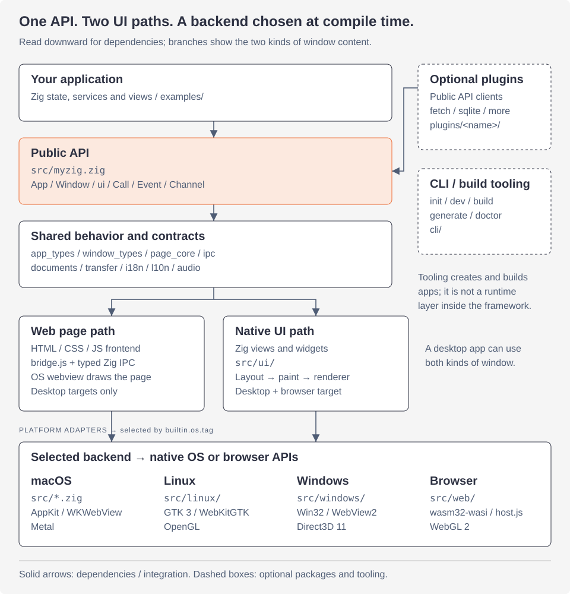

<a id="myzig-architecture"></a>

# Kiến trúc myzig

Trang này nói về cách myzig được ghép lại: các lớp, cách chọn nền tảng, mô hình thread, cách gọi code native mà không dùng C, và các quy tắc mọi file phải theo. Hãy đọc trước khi sửa code. Ba trang sau đi sâu hơn:

- [IPC và sinh TypeScript](architecture-ipc.md): giao thức giữa runtime của trang (`src/bridge.js`) và Zig, outbox, channel, các scheme của app, và client sinh ra từ kiểu Zig.
- [Render](architecture-rendering.md): pipeline của UI native (context, layout, paint, frame), các renderer (Metal, Direct3D 11, OpenGL, WebGL 2 và CPU), bản sao CPU dùng để kiểm chứng chúng, chữ, atlas và surface của từng nền tảng.
- [Test, kích thước binary và thêm tính năng](architecture-testing.md): `ui.Tester`, các cờ `--myzig-*`, các bước test của build, container Linux và image Wine, hill climb, và checklist cho một tính năng mới.

<a id="architecture-at-a-glance"></a>

## Tổng quan kiến trúc



- App của bạn gọi `src/myzig.zig`. File này cung cấp các hợp đồng dùng chung và backend được chọn lúc biên dịch.
- Bên dưới phần dùng chung, đường đi tùy vào nội dung cửa sổ. **Trang web** dùng IPC có kiểu và webview của hệ thống. **View native** dùng layout và renderer riêng của myzig.
- Đây là các thành phần phối hợp với nhau, không phải một chuỗi mà mọi lời gọi đều đi qua. Các dịch vụ desktop như menu và hộp thoại đi thẳng tới adapter của nền tảng.
- Plugin dùng API công khai. CLI tạo và build app.

Target trình duyệt chạy UI native qua `src/web/host.js` và WebGL 2. Đường IPC qua webview của desktop không phải là tính năng của backend trình duyệt. Một app desktop có thể có cả cửa sổ trang web lẫn cửa sổ UI native. UI native cũng có thể nhúng webview bằng [widget web view](ui/web-view.md).

Để xem chi tiết, hãy theo [một trang gọi Zig](architecture-ipc.md) hoặc [một view native thành pixel](architecture-rendering.md). [Trang sơ đồ độc lập](../public/architecture-diagrams.html) gom cả ba sơ đồ vào một file HTML mở được khi offline.

<a id="goals-and-constraints"></a>

## Mục tiêu và ràng buộc

- **Mỗi app là một chương trình Zig.** App là một binary duy nhất, khoảng 0,7 MB với counter ở `ReleaseSmall`. Nó không cần runtime nào ngoài những gì hệ thống đã có:
  - macOS: AppKit và WebKit.
  - Linux: GTK 3, và WebKitGTK cho trang web.
  - Windows: Win32, và WebView2 Runtime cho trang web.
  - Target web: một trình duyệt.
- **Không C.** Không `@cImport`, không file `.c` hay `.m`, không shim. Code native được khai báo trong Zig (`extern`) hoặc nạp lúc chạy (`dlopen`/`dlsym`, `GetProcAddress`). Nhờ vậy Linux và Windows build được từ bất kỳ máy nào với `-Dtarget=...`. macOS link framework từ SDK.
- **Không polling.** Frame được vẽ khi có input, khi đổi kích thước, hoặc khi animation đang chạy. Reply và event tới trang theo từng đợt, mỗi vòng main loop một đợt. App rảnh không tốn CPU.
- **Zig 0.17.** `build.zig.zon` ghi `minimum_zig_version = "0.17.0"`. Code dùng API của bản này: `std.process.Init`, `std.Io`, và `field_names`, `field_types`, `decl_names` của `std.lang.Type`.
- **Mỗi file tối đa 600 dòng**: mã nguồn, script, shader và cả các trang tài liệu này. `zig build lines` (`tools/lines.zig`) kiểm tra điều đó.
  - File sắp vượt giới hạn thì tách theo trách nhiệm trước: một bộ widget, một phần việc của backend, một lượt layout.
  - Ngoại lệ duy nhất là văn bản giấy phép của upstream giữ nguyên trong `third_party/licenses/`.

<a id="layers"></a>

## Các lớp

Từ app đi xuống:

1. **API công khai**, `src/myzig.zig`. Nó re-export những gì app dùng: `App`, `Window` và các tùy chọn của chúng, `ui`, `i18n`, `l10n`, `Call`, `Event`, `Channel`, `page`, menu, tray, hộp thoại, clipboard và shell, `system`, `secrets`, `Documents`, `audio`, `transfer`, `file_watch`, v.v. Bản thân nó không chứa logic.
2. **Code dùng chung, không phụ thuộc nền tảng.** Những gì mọi backend làm giống nhau nằm trong các file đặt tên theo chức năng, không gọi OS:
   - `app_types.zig` và `app_common.zig`: tùy chọn, handler, tham số khi khởi chạy.
   - `window_types.zig`: tùy chọn cửa sổ và trang, `Asset`, event, thanh tiêu đề.
   - `page_types.zig`, `page_core.zig`, `page_channel.zig`, `page_serve.zig` và `page_find.zig`: phần các trang dùng chung. Đó là trust, evaluate, channel, phục vụ scheme và tìm kiếm.
   - `ipc.zig`, `bindings.zig`, `channel.zig` và `tsgen.zig`: IPC có kiểu.
   - `menu_types.zig`, `dialog_types.zig`, `tray_types.zig`, `documents.zig` và các file `document_*.zig`, `transfer.zig`, `window_state.zig`, `paths.zig`, `i18n/`, `l10n/` và mixer của `audio/`.
3. **UI native**, `src/ui/`. View, cây box, layout, paint và các renderer. Nó không biết gì về cửa sổ. Một frame được dựng từ một `ui.View`, một kích thước, một tỉ lệ và một theme (`ui/frame.zig`). Cùng một hàm phục vụ cả cửa sổ lẫn `ui.Tester` chạy headless.
4. **Các backend nền tảng**, dịch các kiểu dùng chung thành lời gọi native:
   - macOS: các file ở gốc `src/` (`app.zig`, `window.zig`, `page.zig`, `menu.zig`, `tray.zig`, `dialog.zig`, `desktop.zig`, `*_mac.zig`) và `ui/surface.zig`, `ui/metal.zig`, `ui/text_mac.zig`, `ui/access_mac.zig`.
   - Linux: `src/linux/` (GTK 3, WebKitGTK, D-Bus, AT-SPI, xdg).
   - Windows: `src/windows/` (Win32, COM, WebView2, UI Automation, kéo thả OLE, registry, jump list).
   - Trình duyệt: `src/web/` (wasm32-wasi; host của trang nằm trong `host.js`).
   - `platform.zig` giữ vài thứ bên dưới UI khác nhau theo OS: chạy loop trong một khoảng thời gian, clipboard cho các peer của Tester.
5. **Plugin**, `plugins/<name>`: các package riêng (`build.zig.zon` phụ thuộc vào myzig) chỉ dùng API công khai: fetch, websocket, sqlite, watch, updater, terminal, glass, game và mainthread. Xem [plugin](plugins.md).
6. **CLI**, `cli/`: `myzig init`, `dev`, `build`, `generate`, `icon`, `doctor`, một chương trình riêng. Xem [CLI](cli.md).

Logic mới vào lớp dùng chung trước. Backend chỉ làm phần bắt buộc phải native. Tính năng có trên một nền tảng thì các nền tảng khác cũng có khai báo tương ứng, không làm gì hoặc trả về `null` hay `false`. Nhờ vậy app biên dịch được ở mọi nơi.

<a id="choosing-the-platform"></a>

### Chọn nền tảng

`myzig.zig` chọn backend lúc biên dịch dựa trên `builtin.os.tag`:

```zig
const plat = switch (builtin.os.tag) {
    .macos => struct {
        pub const app = @import("app.zig");
        pub const window = @import("window.zig");
        // menu, tray, dialog, desktop, fdwatch
    },
    .linux => struct {
        pub const app = @import("linux/app.zig");
        pub const window = @import("linux/window.zig");
        pub const menu = @import("menu_accel.zig");
        // ...
    },
    .windows => struct { pub const app = @import("windows/app.zig"); ... },
    .wasi => struct { pub const app = @import("web/app.zig"); ... },
    else => @compileError("myzig runs on macOS, Linux, Windows and in browsers (wasm32-wasi)"),
};

pub const App = plat.app.App;
pub const Window = plat.window.Window;
```

- `App` và `Window` của mọi backend có cùng các method công khai và cùng kiểu tùy chọn, lấy từ `app_types.zig` và `window_types.zig`.
- `myzig.App` là một kiểu cụ thể, không phải interface. Lời gọi là trực tiếp, và linker bỏ đi những gì app không bao giờ gọi.
- Khi một backend thiếu một phần, API công khai thể hiện điều đó ngay trong kiểu:
  - `myzig.FlyoutOptions` là `void` khi `App` không có `FlyoutOptions`.
  - `myzig.systemDrag(win)` trả về `null` khi không có nguồn kéo của hệ thống.
  - `myzig.objc` là struct rỗng ngoài macOS.

UI native chọn cách vẽ chữ và renderer theo cùng cách. `ui/text.zig` đặt

```zig
pub const portable = options.portable or builtin.os.tag != .macos;
```

- macOS dùng CoreText và Metal.
- Mọi nền tảng khác, và macOS khi build với `-Dportable=true`, dùng bộ đọc TrueType của myzig (`ui/tt/`), atlas glyph trong bộ nhớ (`ui/atlas_tt.zig`) và icon dạng nét (`ui/icons.zig`).
- Tùy chọn build `inspector` (bật ở Debug) quyết định inspector của UI native có được biên dịch vào hay không.

<a id="threading-model"></a>

## Mô hình thread

AppKit, WebKit, GTK, cửa sổ Win32 và UI native đều chạy trên **main thread**. Mọi thứ myzig gọi thay cho app cũng vậy: method của service đã bind, callback của event và cửa sổ, click menu, view. State của app không cần khóa, miễn là các thread khác chuyển kết quả về main thread thay vì đụng trực tiếp vào state.

Những gì đi qua giữa các thread:

- `Event.emit(window, payload)` an toàn khi gọi từ bất kỳ thread nào. Nó mã hóa payload ngay tại chỗ gọi rồi gửi sang thread của cửa sổ:
  - macOS: `objc.dispatchMain`.
  - Linux: `g_idle_add`.
  - Windows: `PostMessageW` tới cửa sổ (`Window.sendOwned`).

  `Event.broadcast` và `Channel` chỉ dùng trên main thread.
- Plugin `mainthread` cho plugin và app một hàng đợi về main thread từ bất kỳ đâu: `mainthread.post(job, Job.run)`.
  - Nó dùng main queue của libdispatch, context mặc định của GLib, hoặc một cửa sổ chỉ nhận message.
  - Job chạy theo thứ tự; không polling.
  - Các plugin fetch, websocket, sqlite và watch chuyển kết quả từ thread của chúng qua đây.
- Âm thanh chạy trên thread audio của hệ thống (AudioQueue, PulseAudio, WASAPI). `audio/mixer.zig` là phần đi qua lại giữa thread đó và app.

Đừng bao giờ chặn main thread để chờ việc cần chính main thread. Method đã bind mà phải chờ, như chờ HTTP response hay process con, thì trả về ngay. Nó trả lời sau qua một event hoặc một channel.

Một số đối tượng vẫn có thể bị callback chạm tới sau khi đã bị hủy. Chúng tự giải phóng khi callback đó chạy:

- Trang đã lên lịch flush thì đặt `dead` và bị hủy bởi chính lần flush đó (`page.zig`).
- `Surface` đang có frame chưa vẽ xong cũng làm như vậy.

`myzig.runFor(seconds)` chạy loop của nền tảng trong một khoảng thời gian (`CFRunLoopRunInMode`, `g_main_context_iteration`, `PeekMessageW`). Test headless dùng nó giữa các frame để reply, timer và process được xử lý.

<a id="native-interop-without-c"></a>

## Gọi code native không qua C

<a id="macos-the-objective-c-runtime-called-directly"></a>

### macOS: gọi thẳng runtime Objective-C

`src/objc.zig` khai báo các hàm của runtime dạng `extern "c"`: `objc_getClass`, `sel_registerName`, `objc_msgSend`, `objc_allocateClassPair`, `class_addMethod`, `class_addIvar`, autorelease pool. Trên nền đó:

- `objc.msg(R, target, "selector:with:", .{ a, b })` gửi một message.
  - Kiểu hàm chính xác của mỗi lời gọi được dựng lúc biên dịch từ kiểu trả về và tuple tham số. `objc_msgSend` được ép sang kiểu đó.
  - arm64 bắt buộc gọi nó với đúng chữ ký thật của hàm đích. Gọi kiểu variadic sẽ đặt tham số sai thanh ghi.
- `objc.defineClass(.{ ... })` đăng ký lúc chạy một class có method là hàm Zig.
  - Dùng cho delegate của cửa sổ, application và web view, view native của UI native, và text input client.
  - Một ivar con trỏ gắn mỗi instance với đối tượng Zig của nó (`objc.setZig`, `objc.getZig`).
- `objc.Block(Ctx, Args)` tạo block cho các API nhận block (completion handler), bố trí theo block ABI.
- `objc.dispatchMain` và `objc.dispatchAfter` gọi libdispatch (`dispatch_async_f`, `dispatch_after_f`) với một con trỏ context và một hàm `callconv(.c)`.
- `objc.Pool` bọc `objc_autoreleasePoolPush`/`Pop`.

Các framework C là khai báo `extern` nằm cạnh code dùng chúng: CoreText, CoreGraphics, CoreFoundation trong `ui/cf.zig`, Metal qua `objc.msg`, ImageIO.

- `build.zig` link các framework và `libobjc` cho target macOS. Ở đó chỉ cần macOS SDK để link, không cần gì khác.
- Framework chỉ vài app cần thì được mở bằng `dlopen` khi dùng lần đầu, nên app khác không tốn gì. Đó là Security cho Keychain (`secrets_mac.zig`) và UserNotifications (`notify_mac.zig`).

Bộ nhớ theo quy tắc của Cocoa. Đối tượng từ `alloc`/`new` thuộc quyền sở hữu của bạn và phải release (`objc.release`). Code tạo đối tượng tạm chạy bên trong một `objc.Pool`.

<a id="linux-dlopen"></a>

### Linux: dlopen

Trên Linux không link gì ngoài libc. GTK 3 được nạp khi app khởi động:

- `load()` của `linux/gtk.zig` mở `libgtk-3.so.0` bằng `std.c.dlopen`. Nó điền một struct con trỏ hàm theo tên bằng `dlsym`.
- `linux/gtk_more.zig`, `gtkmenu.zig` và `window_extras.zig` nạp thêm phần khác của GTK theo cùng cách.

Các thư viện khác cũng nạp như vậy, mỗi cái chỉ khi một tính năng cần tới lần đầu. Thiếu thư viện nào thì tính năng đó tắt đi, app không bị lỗi:

| thư viện | dùng cho |
|---|---|
| `libwebkit2gtk-4.1.so.0` hoặc `-4.0.so.37` | trang web (`linux/webkit.zig`) |
| `libepoxy.so.0` | OpenGL cho UI native (`ui/gl_api.zig`) |
| `libayatana-appindicator3.so.1` hoặc `libappindicator3.so.1` | tray |
| `libsecret-1.so.0` | secrets |
| `libgio-2.0.so.0` | trạng thái mạng |
| `libX11.so.6` | phím tắt toàn cục |

- myzig tự nói D-Bus qua socket của session bus, không qua libdbus (`linux/dbus.zig`, `dbus_conn.zig`, `atspi_proto.zig`). Phần này lo thông báo, single instance, bus trợ năng AT-SPI và launcher entry.
- Callback mà GTK gọi là hàm Zig `callconv(.c)`, truyền vào bằng `gtk.connect(instance, "signal", handler, data)`.
- Backend x86_64 riêng của Zig biên dịch sai các lời gọi vào JavaScriptCore của WebKitGTK. Vì vậy `build.zig` build các ví dụ Linux bằng LLVM (`.use_llvm = true`).

<a id="windows-extern-and-com"></a>

### Windows: extern và COM

Hàm Win32 là `extern "user32"`, `"kernel32"`, `"gdi32"`, v.v., với `callconv(.winapi)`. Chúng được khai báo trong `windows/win32.zig` và cạnh code dùng chúng.

COM cũng không cần header. `windows/com.zig`:

- gọi method của đối tượng qua vtable theo chỉ số;
- parse GUID lúc biên dịch (`GUID.parse("...")`);
- tạo các đối tượng handler mà WebView2 nhận cho event và completion của nó (IUnknown cộng một `Invoke`).

Direct3D 11 (`ui/d3d11_api.zig`), UI Automation (`windows/uia*.zig`), kéo thả OLE (`windows/oledrag.zig`), Credential Manager, jump list và taskbar là các API COM hoặc API phẳng được khai báo theo cách này.

WebView2 được tìm theo cách `WebView2Loader.dll` tìm, nhưng không cần DLL đó. `windows/webview2.zig`:

1. đọc vị trí của runtime đã cài: `WEBVIEW2_BROWSER_EXECUTABLE_FOLDER`, nếu không có thì các kênh Stable, Beta, Dev và Canary trong registry;
2. nạp DLL client của nó;
3. tạo một environment dùng cho mọi trang, ở lần dùng đầu tiên.

Nếu không có runtime, trang sẽ log ra chỗ tải về.

Các ví dụ nhúng `windows/myzig.manifest`, khai báo Windows 8 trở lên. Nút caption của thanh tiêu đề ẩn là cửa sổ con dạng layered, cần khai báo này. Khi đó Windows cũng báo về đúng phiên bản thật cho app.

<a id="browsers-webassembly-imports"></a>

### Trình duyệt: import WebAssembly

Khi build cho `wasm32-wasi`, myzig không có libc. Thư viện chuẩn của Zig nói WASI, và `web/host_wasi.js` trả lời.

- Những gì trang làm cho app là một tập hàm import từ module `"myzig"` (`extern "myzig" fn window_open(...)` trong `web/js.zig`).
- Những gì app làm cho trang là một tập export (`web/exports.zig`): event của trình duyệt cho một cửa sổ, timer và giao diện sáng/tối.
- Chuỗi đi qua dưới dạng một con trỏ và một độ dài vào bộ nhớ của module.

Xem [trình duyệt](browsers.md).

<a id="conventions-that-keep-this-working"></a>

## Các quy ước giữ cho mọi thứ chạy đúng

- Viết method nền tảng trong mọi backend: macOS, `linux/`, `windows/`, `web/`. Khối test của `myzig.zig` gọi `std.testing.refAllDecls` trên module của từng backend và trên mọi method của trang. Method biên dịch được trên nền tảng này mà không được trên nền tảng kia sẽ bị `zig build test` và việc build cho các target khác bắt được.
- Giữ API công khai cụ thể và dựa trên comptime.
  - Service đã bind, event và channel có kiểu từ lúc biên dịch (`tsgen.zig`).
  - Handler là cặp con trỏ và hàm `myzig.Handler(T).of(&state, State.method)`, không bao giờ là interface phân giải lúc chạy.
- Widget được làm từ box (`Context.open`/`leaf`), lấy style từ theme và animate bằng `Context.animate`. Widget nào thay đổi state của app khi tương tác thì đặt `c.changed`, để frame được dựng lại.
- Mọi hành vi đều có test: widget trong `src/ui/tests*.zig` qua Tester, ánh xạ kiểu IPC trong `tsgen.zig`, renderer so với renderer CPU.
- Những gì app không dùng thì không được làm app nặng thêm. Tính năng được kéo vào qua các hàm app gọi, nên linker bỏ phần còn lại. Xem [kích thước binary](architecture-testing.md#binary-size).
