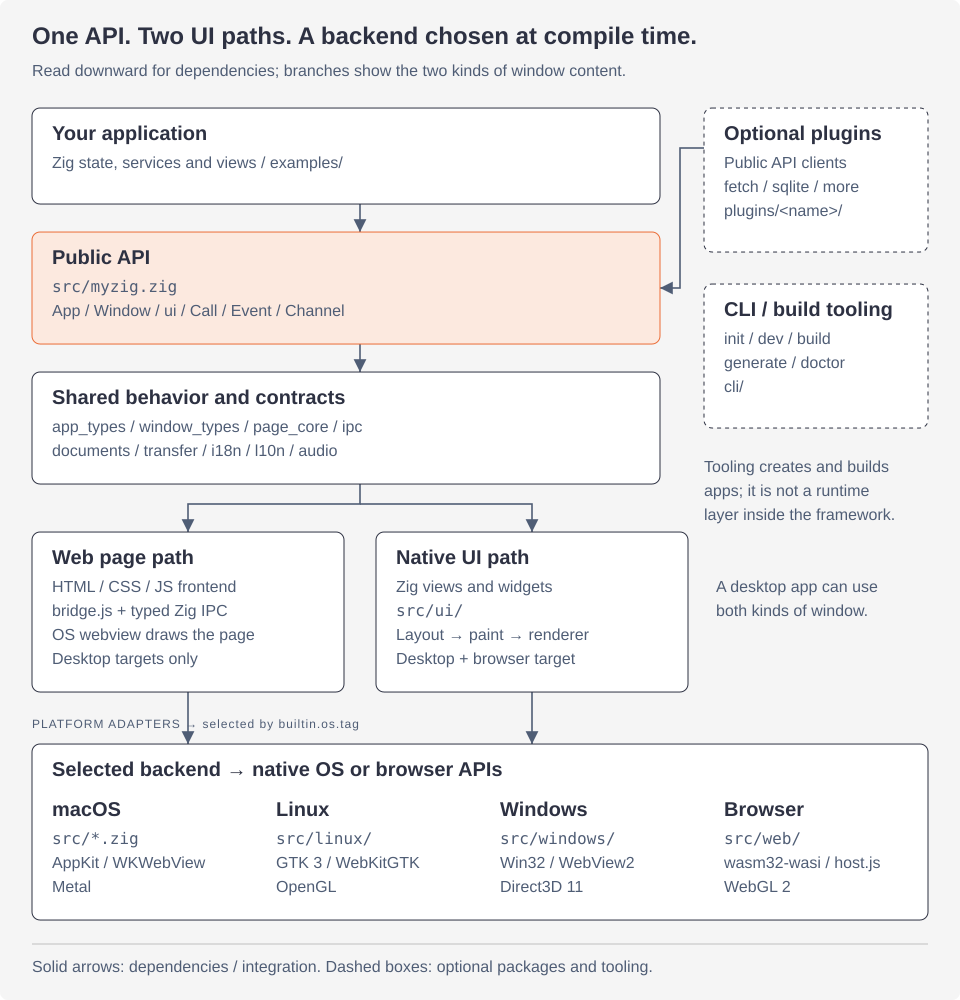

<a id="myzig-architecture"></a>

# Kiến trúc myzig

Hướng dẫn này mô tả các lớp của myzig, cách chọn backend nền tảng, mô hình luồng, cách gọi API native không dùng C và các quy tắc của repo. Hãy đọc trước khi sửa code. Ba trang sau trình bày chi tiết hơn:

- [IPC và sinh TypeScript](architecture-ipc.md): giao thức giữa runtime của trang (`src/bridge.js`) và Zig, outbox, channel, scheme của ứng dụng và client được sinh từ kiểu Zig.
- [Kết xuất](architecture-rendering.md): pipeline giao diện native (context, layout, paint, frame), các bộ kết xuất Metal, Direct3D 11, OpenGL, WebGL 2 và CPU; bản đối chiếu CPU dùng để kiểm thử, văn bản, atlas và surface của từng nền tảng.
- [Kiểm thử, kích thước binary và thêm tính năng](architecture-testing.md): `ui.Tester`, các cờ `--myzig-*`, lệnh kiểm thử, container Linux, image Wine, benchmark hill climb và quy trình thêm tính năng.

<a id="architecture-at-a-glance"></a>

## Tổng quan kiến trúc



Bắt đầu từ trên xuống: ứng dụng gọi `src/myzig.zig`, nơi công khai API dùng chung và backend được chọn lúc biên dịch. Bên dưới phần code dùng chung, luồng xử lý tùy thuộc nội dung cửa sổ: **trang web** dùng IPC có kiểu và webview hệ thống; **view native** dùng bố cục và bộ kết xuất của myzig. Các thành phần phối hợp với nhau; không phải mọi lời gọi API đều đi qua toàn bộ chuỗi. Chẳng hạn, menu và hộp thoại gọi trực tiếp adapter nền tảng. Plugin dùng API công khai; CLI tạo và build ứng dụng.

Target trình duyệt chạy giao diện native qua `src/web/host.js` và WebGL 2; nó không cung cấp đường IPC của webview desktop. Một ứng dụng desktop có thể có cả cửa sổ trang web và cửa sổ giao diện native. Giao diện native cũng có thể nhúng webview bằng [widget webview](ui/web-view.md).

Xem chi tiết đường đi của [lời gọi từ trang web đến Zig](architecture-ipc.md) hoặc [quá trình biến view native thành pixel](architecture-rendering.md). [Trang sơ đồ độc lập](../public/architecture-diagrams.html) chứa cả ba sơ đồ trong một file HTML có thể mở ngoại tuyến.

<a id="goals-and-constraints"></a>

## Mục tiêu và hạn chế

- **Một chương trình Zig cho mỗi ứng dụng.** Một ứng dụng là một tệp nhị phân duy nhất (khoảng 0,7 MB cho bộ đếm trong `ReleaseSmall`) không có thời gian chạy để cài đặt ngoài những gì hệ thống có: AppKit và WebKit trên macOS, GTK 3 (và WebKitGTK cho các trang) trên Linux, Win32 (và WebView2 Runtime cho các trang) trên Windows, một trình duyệt dành cho mục tiêu web.
- **Không C.** Không có tệp `@cImport`, không có tệp `.c` hoặc `.m`, không có shim. Mã gốc được khai báo trong Zig (`extern`) hoặc được tải trong thời gian chạy (`dlopen`/`dlsym`, `GetProcAddress`), vì vậy Linux và Windows xây dựng từ bất kỳ máy nào có `-Dtarget=...` (macOS liên kết các khung của nó từ SDK).
- **Không có polling nào.** Các khung được vẽ khi nhập, khi thay đổi kích thước hoặc khi hoạt ảnh chạy; các câu trả lời và sự kiện tiếp cận các trang theo một đợt trong mỗi lượt của vòng lặp chính; một ứng dụng nhàn rỗi không sử dụng CPU.
- **Zig 0,17.** `build.zig.zon` nói `minimum_zig_version = "0.17.0"`; mã sử dụng các API của nó (`std.process.Init`, `std.Io`, `std.lang.Type`'s `field_names`, `field_types` và `decl_names`).
- **Mỗi tệp có tối đa 600 dòng**, nguồn, tập lệnh, shader và các tài liệu này giống nhau. `zig build lines` (`tools/lines.zig`) kiểm tra nó. Trước tiên, một tệp vượt quá giới hạn sẽ được phân chia theo trách nhiệm: bộ widget, mối quan tâm phụ trợ, thẻ bố cục. Ngoại lệ duy nhất là văn bản giấy phép ngược dòng được giữ nguyên văn trong `third_party/licenses/`.

<a id="layers"></a>

## Lớp

Từ ứng dụng trở xuống:

1. **API công khai**, `src/myzig.zig`. Nó tái xuất những ứng dụng nào sử dụng: `App`, `Window` và các tùy chọn của chúng, `ui`, `i18n`, `l10n`, `Call`, `Event`, `Channel`, `page`, menu, khay, hộp thoại, bảng nhớ tạm và shell, `system`, `secrets`, `Documents`, `audio`, `transfer`, `file_watch`, v.v. Nó không có hành vi riêng của nó.
2. **Mã được chia sẻ, không có nền tảng.** Mọi chức năng phụ trợ đều hoạt động theo cách giống nhau trong các tệp được đặt tên theo mối lo ngại, không có lệnh gọi hệ điều hành nào: `app_types.zig` và `app_common.zig` (tùy chọn, trình xử lý, đối số của lần khởi chạy), `window_types.zig` (tùy chọn cửa sổ và trang, `Asset`, sự kiện, thanh tiêu đề), `page_types.zig`, `page_core.zig`, `page_channel.zig`, `page_serve.zig` và `page_find.zig` (những trang chia sẻ: tin cậy, đánh giá, kênh, kế hoạch phục vụ, tìm kiếm), `ipc.zig`, `bindings.zig`, `channel.zig` và `tsgen.zig` (đã nhập IPC), `menu_types.zig`, `dialog_types.zig`, `tray_types.zig`, `documents.zig` và `document_*.zig` tệp, `transfer.zig`, `window_state.zig`, `paths.zig`, `i18n/`, `l10n/` và bộ trộn của `audio/`.
3. **Giao diện native**, `src/ui/`. View, cây hộp, bố cục, vẽ và bộ kết xuất. Nó không biết gì về cửa sổ: khung được xây dựng từ `ui.View`, kích thước, tỷ lệ và chủ đề (`ui/frame.zig`), đồng thời chức năng tương tự phục vụ cửa sổ và headless `ui.Tester`.
4. **Phần phụ trợ của nền tảng**, giúp dịch các loại được chia sẻ thành các lệnh gọi gốc:
   - macOS: các tệp ở đầu `src/` (`app.zig`, `window.zig`, `page.zig`, `menu.zig`, `tray.zig`, `dialog.zig`, `desktop.zig`, `*_mac.zig`) và `ui/surface.zig`, `ui/metal.zig`, `ui/text_mac.zig`, `ui/access_mac.zig`.
   - Linux: `src/linux/` (GTK 3, WebKitGTK, D-Bus, AT-SPI, xdg).
   - Windows: `src/windows/` (Win32, COM, WebView2, Tự động hóa giao diện người dùng, kéo và thả OLE, sổ đăng ký, danh sách nhảy).
   - Trình duyệt: `src/web/` (wasm32-wasi; máy chủ của trang ở `host.js`).
   - `platform.zig` chứa một số thứ bên dưới giao diện người dùng khác nhau tùy theo hệ điều hành (chạy vòng lặp trong một thời gian, bảng nhớ tạm dành cho các thiết bị ngang hàng của Người kiểm tra).
5. **Plugin**, `plugins/<name>`: các gói riêng (`build.zig.zon` tùy thuộc vào myzig) chỉ sử dụng API công khai: tìm nạp, websocket, sqlite, watch, updater, terminal, glass, game và mainthread. Xem [plugin](plugins.md).
6. ** CLI**, `cli/`: `myzig init`, `dev`, `build`, `generate`, `icon`, `doctor`, một chương trình riêng. Xem [CLI](cli.md).

Hành vi mới sẽ đi vào lớp chia sẻ trước tiên; một chương trình phụ trợ chỉ làm những gì phải có nguồn gốc. Một tính năng tồn tại trên một nền tảng cũng nhận được khai báo trên các nền tảng khác (không làm gì hoặc trả về `null` hoặc `false`), vì vậy các ứng dụng sẽ biên dịch ở mọi nơi.

<a id="choosing-the-platform"></a>

### Chọn nền tảng

`myzig.zig` chọn backend tại thời điểm biên dịch từ `builtin.os.tag`:

```zig
const plat = switch (builtin.os.tag) {
    .macos => struct {
        pub const app = @import("app.zig");
        pub const window = @import("window.zig");
        // menu, tray, dialog, desktop, fdwatch
    },
    .linux => struct {
        pub const app = @import("linux/app.zig");
        pub const window = @import("linux/window.zig");
        pub const menu = @import("menu_accel.zig");
        // ...
    },
    .windows => struct { pub const app = @import("windows/app.zig"); ... },
    .wasi => struct { pub const app = @import("web/app.zig"); ... },
    else => @compileError("myzig runs on macOS, Linux, Windows and in browsers (wasm32-wasi)"),
};

pub const App = plat.app.App;
pub const Window = plat.window.Window;
```

Do đó, `App` và `Window` của mỗi chương trình phụ trợ có cùng phương thức công khai và loại tùy chọn giống nhau (chúng đến từ `app_types.zig` và `window_types.zig`) và `myzig.App` là loại cụ thể, không phải giao diện: lệnh gọi là trực tiếp và trình liên kết loại bỏ những gì ứng dụng không bao giờ gọi. Khi backend thiếu một phần, API công khai sẽ nói như vậy theo loại của nó: `myzig.FlyoutOptions` là `void` trong đó `App` không có `FlyoutOptions`; `myzig.systemDrag(win)` trả về `null` khi không có nguồn kéo hệ thống; `myzig.objc` là một cấu trúc trống ngoài macOS.

Giao diện native chọn văn bản và bộ kết xuất theo cách tương tự. `ui/text.zig` bộ

```zig
pub const portable = options.portable or builtin.os.tag != .macos;
```

vì vậy macOS sử dụng CoreText và Metal, mọi thứ khác (và macOS được xây dựng với `-Dportable=true`) sử dụng trình đọc TrueType của myzig (`ui/tt/`), atlas glyph trong bộ nhớ (`ui/atlas_tt.zig`) và các biểu tượng dòng (`ui/icons.zig`). Tùy chọn xây dựng `inspector` (bật trong Gỡ lỗi) quyết định xem trình kiểm tra giao diện native có được biên dịch hay không.

<a id="threading-model"></a>

## Mô hình luồng

Các cửa sổ AppKit, WebKit, GTK, Win32 và giao diện native đều chạy trên **luồng chính** và mọi thứ myzig gọi thay mặt ứng dụng cũng vậy: phương thức dịch vụ ràng buộc, lệnh gọi lại sự kiện và cửa sổ, lần nhấp vào menu, view. Trạng thái ứng dụng không cần khóa miễn là các luồng khác chuyển kết quả của chúng tới luồng chính thay vì chạm vào nó.

Những gì vượt qua luồng:

- `Event.emit(window, payload)` an toàn trước mọi luồng. Nó mã hóa tải trọng nơi nó được gọi và đăng nó lên luồng của cửa sổ: `objc.dispatchMain` trên macOS, `g_idle_add` trên Linux, `PostMessageW` lên cửa sổ trên Windows (`Window.sendOwned`). `Event.broadcast` và `Channel` chỉ là luồng chính.
- Plugin `mainthread` cung cấp cho các plugin và ứng dụng một hàng đợi trên luồng chính từ mọi nơi (`mainthread.post(job, Job.run)`): hàng đợi chính của libdispatch, ngữ cảnh mặc định của GLib hoặc cửa sổ chỉ có tin nhắn. Công việc diễn ra theo thứ tự; không có polling nào. Các plugin tìm nạp, websocket, sqlite và watch cung cấp kết quả của các luồng thông qua nó.
- Đầu ra âm thanh chạy trên luồng âm thanh của hệ thống (AudioQueue, PulseAudio, WASAPI); `audio/mixer.zig` là thứ kết nối giữa nó và ứng dụng.

Không bao giờ chặn luồng chính đang chờ công việc cần nó: một phương thức ràng buộc phải chờ (phản hồi HTTP, quy trình con) trả về cùng một lúc và trả lời thông qua một sự kiện hoặc một kênh sau đó.

Các đối tượng mà lệnh gọi lại vẫn có thể tiếp cận sau khi chúng được giải phóng tự do khi lệnh gọi lại đó chạy: một trang có lịch trình xóa được đặt `dead` và bị phá hủy bởi lệnh xóa (`page.zig`) và `Surface` có khung đang trong quá trình bay cũng làm điều tương tự.

`myzig.runFor(seconds)` chạy vòng lặp của nền tảng trong một thời gian (`CFRunLoopRunInMode`, `g_main_context_iteration`, `PeekMessageW`): headless các kiểm thử sử dụng nó giữa các khung để xử lý các phản hồi, bộ tính giờ và quy trình.

<a id="native-interop-without-c"></a>

## Tương tác gốc không có C

<a id="macos-the-objective-c-runtime-called-directly"></a>

### MacOS: thời gian chạy Objective-C, được gọi trực tiếp

`src/objc.zig` khai báo các hàm của thời gian chạy (`objc_getClass`, `sel_registerName`, `objc_msgSend`, `objc_allocateClassPair`, `class_addMethod`, `class_addIvar`, nhóm tự động phát hành) là `extern "c"` và xây dựng dựa trên chúng:

- `objc.msg(R, target, "selector:with:", .{ a, b })` gửi tin nhắn. Loại hàm chính xác của mỗi cuộc gọi được xây dựng tại thời điểm biên dịch từ kiểu trả về và bộ đối số và `objc_msgSend` được truyền tới nó, vì arm64 yêu cầu gọi nó bằng chữ ký thực của callee (các lệnh gọi biến đổi truyền đối số trong các thanh ghi sai).
- `objc.defineClass(.{ ... })` đăng ký một lớp trong thời gian chạy có các phương thức là các hàm Zig: đại biểu cửa sổ, ứng dụng và view web, view native của giao diện native, client nhập văn bản. Một con trỏ ivar liên kết từng phiên bản với đối tượng Zig của nó (`objc.setZig`, `objc.getZig`).
- `objc.Block(Ctx, Args)` tạo các khối cho các API lấy chúng (trình xử lý hoàn thành), được trình bày như khối ABI nói.
- `objc.dispatchMain` và `objc.dispatchAfter` gọi libdispatch (`dispatch_async_f`, `dispatch_after_f`) bằng con trỏ ngữ cảnh và hàm `callconv(.c)`.
- `objc.Pool` kết thúc `objc_autoreleasePoolPush`/`Pop`.

Các khung C (CoreText, CoreGraphics, CoreFoundation trong `ui/cf.zig`, Metal đến `objc.msg`, ImageIO) là các phần khai báo `extern` bên cạnh mã sử dụng chúng. `build.zig` liên kết các khung và `libobjc` cho các mục tiêu macOS; Cần có SDK macOS để liên kết ở đó, không cần gì khác. Các khung chỉ dành cho một số ứng dụng cần được mở bằng `dlopen` khi sử dụng lần đầu, vì vậy, các khung khác không mất phí gì: Bảo mật cho Chuỗi khóa (`secrets_mac.zig`), Thông báo người dùng (`notify_mac.zig`).

Bộ nhớ tuân theo quy tắc của Cocoa: các đối tượng từ `alloc`/`new` được sở hữu và phải được giải phóng (`objc.release`); mã làm cho các đối tượng tạm thời chạy bên trong `objc.Pool`.

### Linux: dlopen

Không có gì được liên kết trên Linux ngoài libc. GTK 3 được tải khi ứng dụng khởi động: `linux/gtk.zig`'s `load()` mở `libgtk-3.so.0` bằng `std.c.dlopen` và điền cấu trúc con trỏ hàm theo tên bằng `dlsym`; `linux/gtk_more.zig`, `gtkmenu.zig` và `window_extras.zig` tải thêm nội dung đó theo cách tương tự. Các thư viện khác cũng hoạt động theo cách tương tự, mỗi thư viện chỉ khi một tính năng cần đến nó lần đầu tiên và mỗi thư viện bị thiếu sẽ tắt tính năng đó thay vì làm ứng dụng bị lỗi:

| thư viện | cho |
|---|---|
| `libwebkit2gtk-4.1.so.0` hoặc `-4.0.so.37` | trang (`linux/webkit.zig`) |
| `libepoxy.so.0` | OpenGL cho giao diện native (`ui/gl_api.zig`) |
| `libayatana-appindicator3.so.1` hoặc `libappindicator3.so.1` | khay |
| `libsecret-1.so.0` | bí mật |
| `libgio-2.0.so.0` | trạng thái mạng |
| `libX11.so.6` | phím nóng toàn cầu |

D-Bus (thông báo, phiên bản đơn, bus truy cập AT-SPI, mục khởi chạy) được chính myzig đọc qua ổ cắm của bus phiên (`linux/dbus.zig`, `dbus_conn.zig`, `atspi_proto.zig`), không thông qua libdbus. Lệnh gọi lại Cuộc gọi GTK là các hàm `callconv(.c)` Zig được truyền với `gtk.connect(instance, "signal", handler, data)`.

Chương trình phụ trợ x86_64 của chính Zig biên dịch sai lệnh gọi vào JavaScriptCore của WebKitGTK, vì vậy `build.zig` xây dựng các ví dụ Linux với LLVM (`.use_llvm = true`).

<a id="windows-extern-and-com"></a>

### Windows: bên ngoài và COM

Các hàm Win32 là `extern "user32"`, `"kernel32"`, `"gdi32"`, v.v., `callconv(.winapi)`, được khai báo trong `windows/win32.zig` và bên cạnh người dùng của chúng. COM cũng không cần tiêu đề: `windows/com.zig` gọi các phương thức của đối tượng thông qua vtable theo chỉ mục, phân tích GUID tại thời điểm biên dịch (`GUID.parse("...")`) và tạo các đối tượng xử lý WebView2 nhận các sự kiện và hoàn thành của nó (IUnknown cộng với một `Invoke`). Direct3D 11 (`ui/d3d11_api.zig`), Tự động hóa giao diện người dùng (`windows/uia*.zig`), kéo và thả OLE (`windows/oledrag.zig`), Trình quản lý thông tin xác thực, danh sách nhảy và thanh tác vụ là COM hoặc API phẳng được khai báo theo cách này.

WebView2 được tìm thấy theo cách `WebView2Loader.dll` tìm thấy nó mà không cần DLL đó: `windows/webview2.zig` đọc vị trí của thời gian chạy đã cài đặt (`WEBVIEW2_BROWSER_EXECUTABLE_FOLDER`, nếu không thì các kênh Stable, Beta, Dev và Canary trong sổ đăng ký), tải DLL client của nó và tạo một môi trường cho mỗi trang trong lần sử dụng đầu tiên. Nếu không có thời gian chạy, các trang sẽ ghi lại nơi tải xuống.

Ví dụ nhúng `windows/myzig.manifest`, khai báo Windows 8 trở lên: các nút chú thích của thanh tiêu đề ẩn là các cửa sổ con được xếp lớp, cần có nó và Windows sau đó báo cáo phiên bản thực của nó cho ứng dụng.

<a id="browsers-webassembly-imports"></a>

### Trình duyệt: Nhập WebAssembly

Được xây dựng cho `wasm32-wasi`, myzig không có libc: thư viện tiêu chuẩn của Zig nói về WASI, `web/host_wasi.js` trả lời. Những gì trang làm cho ứng dụng là một tập hợp các chức năng được nhập từ mô-đun `"myzig"` (`extern "myzig" fn window_open(...)` trong `web/js.zig`) và những gì ứng dụng làm cho trang là một tập hợp các lần xuất (`web/exports.zig`): các sự kiện của trình duyệt cho một cửa sổ, bộ hẹn giờ và giao diện. Các chuỗi giao nhau dưới dạng một con trỏ và độ dài vào bộ nhớ của mô-đun. Xem [trình duyệt](browsers.md).

<a id="conventions-that-keep-this-working"></a>

## Các quy ước giúp duy trì hoạt động này

- Triển khai phương thức nền tảng trong mọi chương trình phụ trợ: macOS, `linux/`, `windows/`, `web/`. Khối kiểm tra của `myzig.zig` gọi `std.testing.refAllDecls` trên mỗi mô-đun của chương trình phụ trợ và trên mọi phương thức trang, do đó, một phương thức biên dịch trên một nền tảng chứ không phải nền tảng khác sẽ bị `zig build test` bắt và bằng cách xây dựng cho các mục tiêu khác.
- Giữ API công khai cụ thể và theo thời gian tính toán: các dịch vụ, sự kiện và kênh bị ràng buộc được nhập vào thời gian biên dịch (`tsgen.zig`), trình xử lý là `myzig.Handler(T).of(&state, State.method)` cặp con trỏ và hàm, không bao giờ giao diện được giải quyết trong thời gian chạy.
- Các widget được tạo thành từ các hộp (`Context.open`/`leaf`), được tạo kiểu theo chủ đề và hoạt hình bằng `Context.animate`; một người có tương tác thay đổi trạng thái ứng dụng sẽ đặt `c.changed`, do đó khung được tạo lại.
- Mọi hành vi đều được kiểm tra: các widget trong `src/ui/tests*.zig` thông qua Trình kiểm tra, ánh xạ loại IPC trong `tsgen.zig`, bộ kết xuất dựa trên bộ kết xuất CPU.
- Những gì ứng dụng không sử dụng không được phát triển nó: các tính năng được tiếp cận thông qua các chức năng mà ứng dụng gọi, do đó trình liên kết sẽ loại bỏ phần còn lại. Xem [kích thước nhị phân](architecture-testing.md#binary-size).
