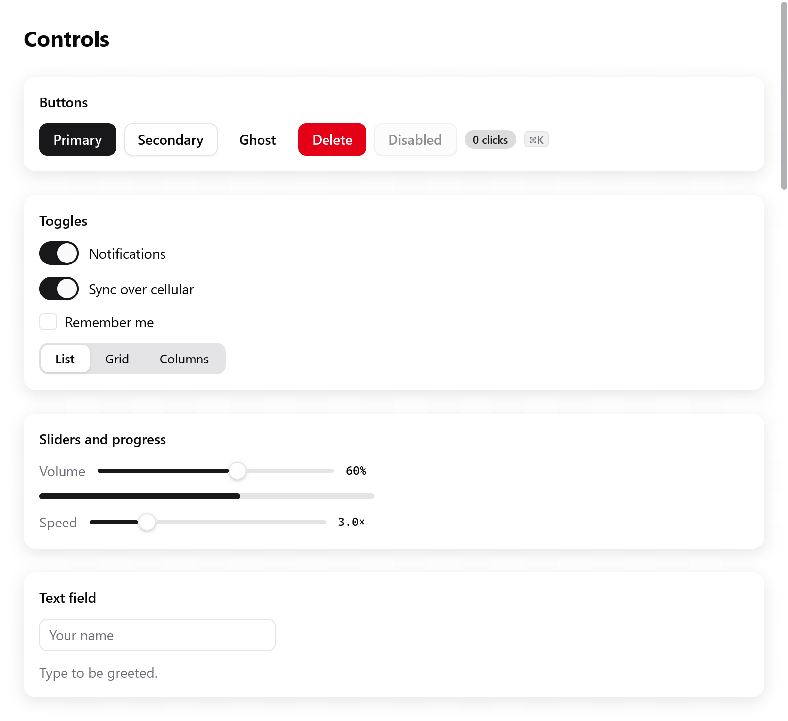

<a id="native-ui"></a>

# Native UI

Cửa sổ có thể hiện một giao diện do chính myzig vẽ, thay vì một trang web. Bạn viết nó hoàn toàn bằng Zig, với `myzig.ui`:

- không HTML, không JavaScript, không bước build frontend;
- cửa sổ không khởi động webview, nên mở ngay và tốn ít bộ nhớ;
- myzig vẽ nó bằng GPU khi có thể: Metal trên macOS, Direct3D 11 trên Windows, OpenGL trên Linux và WebGL 2 trên trình duyệt;
- ở mọi nơi khác, renderer CPU riêng của myzig vẽ ra đúng những pixel đó; xem [rendering](rendering.md).

<!-- demo: controls height=520 -->



*Gallery chạy với theme sáng: nút, switch, slider và một ô nhập chữ.*

Hình ảnh trong các hướng dẫn này được render từ các view Zig đang chạy bằng `ui.Tester`, ở tỷ lệ 2×. Phần lớn dùng lại [ví dụ Gallery](../../../examples/gallery/main.zig). Ảnh về layout, grid, hướng chữ và shader chạy các ví dụ nhỏ riêng. Xem [tạo lại hình ảnh](testing.md#documentation-images).

```zig
const std = @import("std");
const myzig = @import("myzig");
const ui = myzig.ui;

/// State của app.
const Counter = struct {
    n: i64 = 0,

    /// Dựng giao diện cửa sổ từ state, cho mỗi frame.
    fn view(s: *Counter, c: *ui.Context) void {
        ui.column(c, .{ .width = .fill, .height = .fill, .align_items = .center, .justify = .center, .gap = 12 });
        defer ui.end(c);
        ui.textf(c, .{ .size = 40, .weight = .bold }, "{d}", .{s.n});
        if (ui.button(c, "Increment", .{ .variant = .primary }).clicked) s.n += 1;
    }
};

pub fn main(init: std.process.Init) !void {
    const app = try myzig.App.create(init, .{ .name = "Counter" });
    defer app.destroy();
    var state: Counter = .{};
    _ = try app.newWindow(.{
        .title = "Counter",
        .width = 420,
        .height = 300,
        .content = .{ .view = .init(&state, Counter.view) },
    });
    try app.run();
}
```

View theo kiểu immediate mode. Nó là một hàm của state mà myzig chạy trên main thread mỗi khi có chuyện xảy ra: input, đổi kích thước, một bước animation.

- Widget là các lời gọi hàm trả lời ngay. `ui.button` trả về nút có được bấm không; `ui.toggle` đảo giá trị `bool` bạn đưa vào.
- Widget báo về tương tác ngay trong lúc build. Bạn đổi state, và frame sau sẽ hiện ra thay đổi.
- Khi một tương tác làm đổi state, myzig build lại frame trước khi vẽ. Nhờ vậy màn hình không bao giờ chậm hơn state.
- Phần tử nào cần event scroll hay pinch trước lần build sau có thể dùng [callback `handleInput`](gestures.md) tùy chọn.

Không có gì polling. Frame được vẽ khi có input, khi đổi kích thước, khi animation đang chạy, hoặc khi app yêu cầu (`Window.redraw`, `c.frameIn`). Cửa sổ rảnh không tốn CPU.

<a id="what-a-frame-keeps-of-what-you-pass"></a>

## Frame giữ lại gì từ những thứ bạn truyền vào

Một frame được build, rồi layout, rồi paint. Layout và paint chạy sau khi view đã return.

- **Chữ được copy** vào bộ nhớ của frame khi được hiển thị. Gồm `ui.text`, `ui.richText` và các span của nó, label, tooltip, trường nhập, và những gì `c.describe` báo cho công nghệ hỗ trợ. Nên view có thể giải phóng hoặc sửa một chuỗi ngay sau khi hiển thị nó.
- **Các slice và con trỏ khác** mà widget nhận thì được đọc tại chỗ cho đến khi frame được vẽ: byte của ảnh, tên icon, gradient, các điểm của canvas.
- Hãy truyền hằng số, bộ nhớ của chính app, hoặc bộ nhớ của frame. Đừng bao giờ truyền buffer nằm trên stack của hàm view.
- `c.print("{d} left", .{n})` format vào một arena được giải phóng khi frame sau bắt đầu. `c.alloc()` cho bạn arena đó để dùng cho thứ khác.
- Muốn giải phóng dữ liệu như vậy mà view đã hiển thị, hãy giải phóng sau frame (ở event sau, hoặc một frame sau). Hoặc giữ bản cũ thêm một lần cập nhật.

<a id="two-ways-to-write-boxes"></a>

## Hai cách viết box

Các hàm thường nhận một struct `ui.Style`, theo kiểu CSS flexbox:

```zig
ui.row(c, .{ .gap = 8, .padding = .all(12), .background = c.theme.surface, .radius = 8 });
defer ui.end(c);
```

`ui.div` style cùng box đó bằng một chuỗi method nhỏ, như GPUI:

```zig
const card = ui.div(c).row().p(12).gap(8).bg(c.theme.surface).rounded(8).hover(c.theme.surface_hover);
defer card.end();
if (card.clicked()) s.open = !s.open;
```

Cả hai tạo ra cùng các box; trộn thoải mái. Xem [layout](layout.md) và [styling](styling.md).

<a id="run-it-without-a-window"></a>

## Chạy không cần cửa sổ

Mọi view đều có thể được điều khiển trong test bằng `ui.Tester`. Nó build và vẽ frame offscreen, bấm, gõ phím và chụp ảnh, theo một đồng hồ do bạn tự cho chạy:

```zig
var t: ui.Tester = undefined;
try t.init(std.testing.allocator, .init(&state, Counter.view), .{});
defer t.deinit();
try t.clickText("Increment");
try std.testing.expect(t.hasText("1"));
```

Xem [testing](testing.md).

<a id="the-guides"></a>

## Các hướng dẫn

Nền tảng:

- [Views](views.md): hàm view, `ui.View`, context, id và key, state thay đổi từ bên ngoài, frame theo yêu cầu.
- [Layout](layout.md): hàng, cột, kích thước, grow, căn chỉnh, padding, scroll, box absolute, clip.
- [Styling](styling.md): màu, viền, bóng, theme, sáng và tối, theme có tên, màu accent, tùy chọn của desktop, Oklch.
- [Text](text.md): kiểu chữ, xuống dòng, span rich text, heading và label, font, chữ chọn được, zoom.

Widget:

- [Items](items.md): hàng nội dung có media, mô tả và action.
- [Input groups](input-group.md): ô nhập chữ có icon, tiền tố/hậu tố và nút.
- [Pagination](pagination.md): trang đánh số và điều hướng khi chưa biết tổng.
- [Empty, loading and alerts](feedback.md): nội dung trống, placeholder skeleton và thông báo trong trang.
- [Command palette](command-palette.md): các action tìm kiếm được, điều hướng bằng bàn phím.
- [Sheet](sheet.md): panel modal ở các mép cửa sổ.
- [Drawer](drawer.md): panel trồi ra từ một mép, kéo bằng con trỏ, có snap point (vaul).
- [Button and toggle groups](button-groups.md)
- [Multi-select](multi-select.md)
- [Date range picker](date-range.md)
- [Data table composition](data-table.md)
- [File drop zone](file-drop.md)
- [Buttons and small things](buttons.md): nút, link, badge, phím chữ, icon, ảnh, avatar, nút lịch sử.
- [Choices](choices.md): checkbox, nhóm checkbox, switch, nút radio, nhóm radio, segmented control, đánh giá sao.
- [Ranges](ranges.md): slider, range slider, stepper, ô nhập số, meter, thanh tiến trình, spinner.
- [Text input](text-input.md): ô nhập chữ, ô tìm kiếm, token field, combobox, autocomplete, bộ gõ và các thao tác chữ.
- [Dates and colors](dates-and-colors.md): lịch, ô nhập ngày và giờ, bộ chọn màu và ô màu.
- [Forms](forms.md): trường có label, form, fieldset, kiểm tra hợp lệ.
- [Overlays](overlays.md): popover, tooltip, dialog, alert dialog, toast.
- [Menus](menus.md): menu, context menu, menu button, select.
- [Structures](structures.md): tab, collapsible, accordion, split, sidebar, toolbar, breadcrumb.
- [Lists, trees and tables](lists.md): virtual list, tree, outline, table, grid view.
- [Grid layout](grid.md): grid kiểu CSS gồm các track và ô.
- [Navigation](navigation.md): router, action và shortcut, focus group.
- [Drag and drop](drag-and-drop.md): kéo trong cửa sổ và kéo ra ngoài.
- [Custom widgets](custom-widgets.md): box, tương tác, giá trị animate, handle: cách các widget của chính myzig được làm ra.
- [Scrolling and pinching](gestures.md): handler scroll/pinch, đường đi của event và test cử chỉ không cần cửa sổ.
- [Loading indicators](../plugins/loading.md): 29 mẫu của plugin tùy chọn, đồng hồ độc lập và tùy chọn riêng cho từng mẫu.

Vẽ và nội dung phong phú:

- [Motion](motion.md): giá trị animate, spring, keyframe, timeline, transition, giảm chuyển động.
- [Transforms and effects](transforms.md): dịch, co giãn và xoay box, gradient, blur, backdrop effect.
- [Drawing](drawing.md): canvas gồm path, fill và stroke, SVG.
- [Charts](chart.md): đường, cột, vùng và hơn nữa, dữ liệu streaming.
- [Markdown](markdown.md): CommonMark và các mở rộng của GitHub, render dần khi dữ liệu đến.
- [Text area](text-area.md): chữ nhiều dòng, rope, document.
- [Code editor and diff viewer](code-editor.md): tô màu cú pháp, gutter, diff.
- [Rich text](rich-text.md): trình soạn rich text và toolbar của nó.
- [Shaders](shaders.md): shader viết một lần, mọi renderer đều vẽ được.
- [Web views](web-view.md): trang web trong box của native UI, có native UI vẽ đè lên trên.

Chất lượng:

- [Accessibility](accessibility.md): công nghệ hỗ trợ đọc được gì, role và mô tả, trên từng nền tảng.
- [Right to left](right-to-left.md): layout lật ngược.
- [Inspector](inspector.md): cây box của một cửa sổ đang chạy (F12).
- [Testing](testing.md): `ui.Tester`, và các cờ `--myzig-*` của app.
- [Rendering](rendering.md): các renderer và bản sao CPU của chúng.
- [Performance](performance.md): một frame tốn bao nhiêu, và cách giữ nó rẻ.

Native UI cũng chạy trên trình duyệt, build cho `wasm32-wasi`; xem [browsers](../browsers.md).
