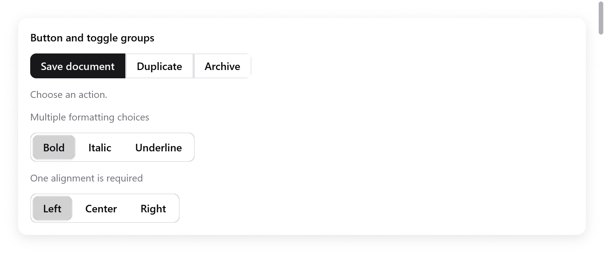

# Nhóm nút và nhóm toggle

Các nút ghép liền nhau cho những thao tác liên quan, và các nút toggle để chọn một hoặc nhiều giá trị.

<!-- demo: button-groups height=360 -->



`buttonGroup` ghép các thao tác liên quan lại với nhau. Thêm các nút, rồi đóng nhóm bằng `end`:

```zig
var group = ui.buttonGroup(c, .{ .label = "Document actions" });
if (group.button("Save", .{ .variant = .primary })) save();
if (group.button("Duplicate", .{})) duplicate();
group.end();
```

- `ButtonGroupOptions`: `vertical`, `label` và `disabled`.
- Mỗi nút nhận `ButtonOptions` như bình thường.
- Thao tác bị disable không kích hoạt được và không nhận focus bàn phím.

`toggleGroup` giữ một boolean cho mỗi mục, trong bộ nhớ do app sở hữu:

```zig
// State, giữ lại giữa các frame:
styles: [3]bool = .{ true, false, false },

// View:
_ = ui.toggleGroup(c, &.{
    .{ .label = "Bold" },
    .{ .label = "Italic" },
    .{ .label = "Underline", .disabled = true },
}, &s.styles, .{ .multiple = true, .label = "Formatting" });
```

- Một `ToggleGroupItem` có label, tên icon (tùy chọn) và cờ disabled.
- Mặc định chỉ chọn một: lúc đầu bật nhiều nhất một cờ.
- `multiple = true` cho phép chọn nhiều.
- `allow_empty = false` giữ lựa chọn cuối cùng luôn được chọn.
- Mảng cờ và danh sách mục phải dài bằng nhau.

**Bàn phím**

- Mỗi nhóm là một điểm dừng Tab.
- Phím mũi tên, Home và End di chuyển focus, bỏ qua các nút bị disable.
- Space và Enter kích hoạt nút đang có focus.
- Nhóm dọc dùng Up và Down. Nhóm ngang theo layout phải sang trái khi có.
- Nút toggle báo cho công nghệ hỗ trợ biết nó có đang được chọn hay không.

Xem trang **Actions & choices** trong Gallery và [nhóm focus](navigation.md).
