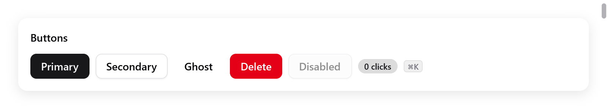

<a id="buttons-and-small-things"></a>

# Nút và các thành phần nhỏ

Nút, liên kết, badge, key cap, icon, ảnh, avatar và cặp nút lùi/tiến của lịch sử: những mảnh nhỏ tạo nên phần lớn các view.

<!-- demo: buttons height=76 -->



*Các nút primary, secondary, ghost, danger và disabled, kèm một badge và một key cap.*

<a id="buttons"></a>

## Nút

```zig
if (ui.button(c, "Save", .{ .variant = .primary }).clicked) s.save();
if (ui.button(c, "Cancel", .{}).clicked) s.editing = false;
if (ui.button(c, "Delete", .{ .variant = .danger }).clicked) s.remove();
_ = ui.button(c, "Disabled", .{ .disabled = true });
```

`ui.button(c, title, options)` vẽ một nút và trả về `ui.Interaction` của nó. `.clicked` là true trong lần build xử lý cú bấm.

| `ui.ButtonOptions` | Mặc định | |
|---|---|---|
| `variant` | `.secondary` | `.primary` (màu accent), `.secondary` (màu surface, có viền), `.ghost` (không có nền cho tới khi hover), `.danger` (màu danger) |
| `width` | `.auto` | một `ui.Length`; `.fill` để nút trải hết chiều ngang phần tử cha |
| `size` | 14 | cỡ chữ, cũng quyết định padding |
| `disabled` | false | bị làm mờ, không bao giờ nhận bấm, hover hay focus |
| `icon` | `""` | một symbol đứng trước tiêu đề, hoặc đứng một mình khi tiêu đề rỗng |

```zig
// Nút chỉ có icon: công nghệ hỗ trợ đọc tên của symbol.
if (ui.button(c, "", .{ .icon = "trash", .variant = .ghost }).clicked) s.remove();
if (ui.button(c, "New", .{ .icon = "plus", .variant = .primary }).clicked) s.add();
```

**Hành vi**

- Màu nền chuyển dần sang trạng thái hover và bấm. Nút đang bị bấm lún xuống nửa điểm.
- Nút nhận focus bàn phím (Tab), và được bấm bằng Enter hoặc Space khi đang có focus.
- Một cú bấm đặt `c.changed`, nên thay đổi nó gây ra hiện ngay trong frame này.

```zig
const it = ui.button(c, "Share", .{ .icon = "globe" });
if (it.clicked) s.share_open = !s.share_open;
```

Interaction còn có `hovered`, `pressed` (đang giữ), `focused`, `double_clicked` và `rect`. `rect` là vị trí layout gần nhất của nút, null ở frame đầu tiên. Dùng nó cho popover neo vào nút hoặc cho tooltip.

- Box tự làm mà hoạt động như nút thì dùng `ui.pressable` hoặc `ui.div(c)...clicked()`. Xem [widget tùy biến](custom-widgets.md).
- Nút mở menu là `ui.menuButton`. Xem [menu](menus.md).

<a id="links"></a>

## Liên kết

```zig
if (ui.link(c, "Privacy policy", .{})) _ = myzig.shell.openUrl("https://example.com/privacy");
```

`ui.link(c, title, .{ .size = 14 })` là chữ màu accent, có gạch chân khi con trỏ nằm trên nó. Nó bấm được như nút, và bằng Enter khi đang có focus bàn phím. Nó trả về true khi được bấm.

<a id="badges"></a>

## Badge

```zig
ui.badge(c, "done", c.theme.success);
ui.badge(c, c.print("{d} new", .{s.unread}), c.theme.accent);
```

`ui.badge(c, str, color)` là một label nhỏ bo tròn: chữ màu `color` trên nền nhạt của chính màu đó.

<a id="key-caps"></a>

## Key cap

```zig
ui.kbd(c, ui.keys.label("⌘K"));
```

`ui.kbd(c, str)` vẽ một tổ hợp phím dưới dạng key cap. Hãy viết tổ hợp phím bằng ký hiệu của Mac. `ui.keys.label`, một hàm chạy lúc biên dịch, viết lại chúng theo cách của nền tảng: `⌘⇧M` trên macOS, `Ctrl+Shift+M` ở nơi khác.

<a id="icons"></a>

## Icon

```zig
ui.icon(c, "star.fill", .{ .color = c.theme.accent });
ui.icon(c, "doc.text", .{ .size = 13, .frame = 18, .color = c.theme.muted });
```

`ui.icon(c, name, options)` vẽ một symbol theo tên SF Symbols của nó.

| `ui.IconOptions` | Mặc định | |
|---|---|---|
| `size` | 16 | |
| `weight` | `.regular` | SF Symbols vẽ nét đậm hơn ở weight đậm hơn |
| `color` | màu chữ | |
| `frame` | | một box vuông mà symbol được canh giữa trong đó, để các symbol rộng hẹp khác nhau thẳng hàng trong một cột |

- Trên macOS, mọi SF Symbol đều có sẵn.
- Trên Linux, Windows và trong trình duyệt, myzig tự vẽ icon dạng nét, theo phong cách Lucide (`src/ui/icons.zig`). Nó có các symbol mà widget và app của nó dùng. Tên nào không có thì ở đó không vẽ gì.
- Dùng các tên này trong app muốn chạy trên mọi nền tảng. Với hình riêng của bạn, hãy dùng ảnh hoặc [SVG](drawing.md).

<details>
<summary>Các tên myzig vẽ được ngoài macOS</summary>

| | |
|---|---|
| mũi tên và thao tác | `checkmark` `xmark` `plus` `chevron.down` `chevron.up` `chevron.right` `chevron.left` `chevron.up.chevron.down` `arrow.right` `arrow.up` `arrow.clockwise` `arrow.right.square` `arrow.up.left.and.arrow.down.right` `arrow.triangle.branch` `magnifyingglass` |
| trạng thái | `circle` `circle.dotted` `checkmark.circle.fill` `stop.circle` `play.fill` `pause.fill` `star.fill` `sparkles` `wand.and.stars` `exclamationmark.triangle` `exclamationmark.triangle.fill` `exclamationmark.circle.fill` `questionmark.circle` `info.circle` `info.circle.fill` `xmark.octagon` `ellipsis.circle` `hand.raised` |
| đồ vật | `person.fill` `photo` `doc` `doc.text` `doc.richtext` `doc.on.doc` `folder` `trash` `pencil` `square.and.pencil` `paperclip` `globe` `network` `terminal` `terminal.fill` `command` `cpu` `memorychip` `brain` `cube` `internaldrive` `desktopcomputer` `wrench.and.screwdriver` |
| bố cục và các icon khác | `list.bullet` `checklist` `sun.max` `moon` `circle.lefthalf.filled` `chart.bar.xaxis` `gauge.with.dots.needle.33percent` `slider.horizontal.3` `equal.square` `plus.square` `xmark.square` `square.grid.2x2` `square.grid.3x3` `rectangle.on.rectangle` `rectangle.split.1x2` `rectangle.split.2x1` `chevron.left.forwardslash.chevron.right` `text.cursor` `textformat` `code` `flame` `waveform.path.ecg` `clear` |

</details>

<a id="images"></a>

## Ảnh

```zig
const logo = @embedFile("logo.png");

_ = ui.image(c, .{ .key = "logo", .bytes = logo, .max_width = 120, .label = "myzig" });
```

`ui.image(c, options)` hiển thị ảnh từ dữ liệu đã mã hóa. Nó trả về false, không vẽ gì, nếu không giải mã được.

| `ui.ImageOptions` | Mặc định | |
|---|---|---|
| `key` | (bắt buộc) | tên của ảnh: cùng một key chỉ giải mã một lần |
| `bytes` | (bắt buộc) | ảnh đã mã hóa, bên gọi phải giữ trong lúc ảnh còn hiển thị |
| `max_width`, `max_height` | 480, 360 | khoảng trống lớn nhất ảnh chiếm, tính bằng điểm |
| `radius` | 8 | góc bo |
| `opacity` | 1 | độ đục |
| `label` | `""` | ảnh thể hiện gì, cho công nghệ hỗ trợ; ảnh không có tên được coi là trang trí |

**Hành vi**

- Ảnh giữ nguyên tỉ lệ. Nó hiển thị bằng nửa kích thước pixel (pixel được coi là pixel 2×), không bao giờ lớn hơn, trong khoảng trống tối đa.
- Ảnh được giải mã một lần cho mỗi key, thu nhỏ để cạnh dài nhất tối đa 1024 pixel, rồi xếp vào một atlas ảnh duy nhất mà các renderer lấy mẫu.
- Ảnh mới dưới một key đã dùng vẫn hiện ảnh cũ. Ảnh thay đổi thì hãy cho nó key mới.
- `ui.imageSize(c, key, bytes)` là kích thước pixel sau khi giải mã, null nếu không giải mã được. Dùng nó để tự đặt `size` cho ảnh, như một trình xem ảnh có zoom và kéo.

<details>
<summary>Định dạng nào giải mã được</summary>

- macOS: ImageIO, đọc được PNG, JPEG, HEIC và nhiều định dạng khác.
- Nơi khác: bộ giải mã PNG của myzig.
- Windows còn dùng Windows Imaging Component cho các định dạng còn lại: JPEG, GIF, BMP, TIFF, ICO, WebP.

</details>

<a id="avatars"></a>

## Avatar

```zig
ui.avatar(c, "Ada Lovelace", .{});
ui.avatar(c, "Linus", .{ .size = 24 });
ui.avatar(c, s.user.name, .{ .image = .{ .key = s.user.id, .bytes = s.user.photo } });
```

`ui.avatar(c, name, options)` hiển thị một người hoặc một vật dưới dạng hình tròn:

- ảnh của nó được cắt tròn;
- hoặc chữ cái đầu của từ đầu và từ cuối trong tên, trên một màu chọn theo tên. Mỗi tên giữ một màu riêng.

| `ui.AvatarOptions` | Mặc định | |
|---|---|---|
| `size` | 32 điểm | |
| `image` | | một `ui.ImageOptions`, hiện thay cho chữ cái đầu khi giải mã được |

<a id="history-buttons"></a>

## Nút lịch sử

```zig
switch (ui.historyButtons(c, .{ .can_back = s.at > 0, .can_forward = s.at + 1 < s.visited.len })) {
    .back => s.at -= 1,
    .forward => s.at += 1,
    .none => {},
}
```

`ui.historyButtons` vẽ cặp nút lùi và tiến của một lịch sử, như trên thanh công cụ của Finder hay của trình duyệt.

- Các nút bị vô hiệu khi đã ở đầu hoặc cuối lịch sử.
- Nó trả về nơi cần đi: `ui.HistoryAction`, `.none`, `.back` hoặc `.forward`.
- Với `shortcuts` (mặc định bật), chúng còn nhận các phím lùi và tiến: Command-[ và Command-] trên macOS, Alt-Left và Alt-Right ở nơi khác.

[Router](navigation.md) giữ sẵn một lịch sử như vậy cho bạn.
