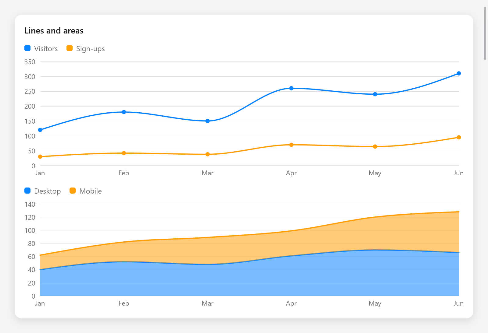
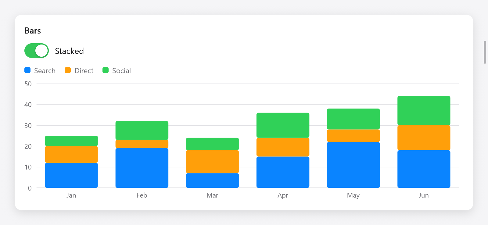

<a id="charts"></a>

# Biểu đồ

`ui.chart` vẽ biểu đồ đường, vùng, thanh, phân tán và hình tròn bằng các trục, đường lưới, chú giải và chú giải công cụ về điểm gần con trỏ nhất. Chúng được vẽ trên canvas ([Bản vẽ](drawing.md)) và theo chủ đề. Các phần của nó (tỷ lệ, đường dẫn của đường, vùng và lát cắt, ngăn xếp, điểm gần nhất) cũng được công khai cho các biểu đồ của riêng bạn.



*Biểu đồ đường và vùng xếp chồng có nhãn và chú giải.*

```zig
const chart = ui.chart;
const months = [_][]const u8{ "Jan", "Feb", "Mar", "Apr", "May", "Jun" };

const r = chart.lineChart(c, &.{
    .{ .name = "Visitors", .values = &.{ 120, 180, 150, 260, 240, 310 } },
    .{ .name = "Sign-ups", .values = &.{ 30, 42, 38, 70, 64, 95 } },
}, .{ .labels = &months, .curve = .monotone, .points = true, .height = 200 });
if (r.hover) |h| ui.text(c, months[h.index], .{ .size = 12 });
```

Trang Biểu đồ của thư viện hiển thị mọi loại (`examples/gallery/drawing.zig`) và `zig build run-chart-streaming` ba dạng sóng, mỗi dạng 15 000 mẫu, 1 000 mẫu mới mỗi giây, được vẽ bằng các phần bên dưới.

<a id="lines-areas-and-bars"></a>

## Đường, vùng và thanh



*Biểu đồ cột xếp chồng thể hiện ba nguồn truy cập.*

`chart.lineChart`, `chart.areaChart` và `chart.barChart` lấy `chart.Series` (một `name`, `values`, một cho mỗi điểm dọc theo x, NaN không có điểm nào ở đó và một `color` tùy chọn, nếu không thì bảng màu sẽ theo vị trí của nó) và `chart.Options`:

| lĩnh vực | mặc định | ý nghĩa |
|---|---|---|
| `width` | 0 | tính bằng điểm; 0 điền vào cha mẹ |
| `height` | 220 | tính bằng điểm |
| `labels` | không có | nhãn dọc theo x, một nhãn cho mỗi điểm hoặc thanh |
| `ticks` | 5 | về số lượng dấu tích mà trục giá trị có |
| `min`, `max` | null | điểm cuối của trục giá trị; null: dữ liệu, được làm tròn đến từng dấu tích |
| `grid` | true | đường lưới ở tích tắc |
| `legend` | true | tên và màu sắc của bộ truyện |
| `curve` | `.linear` | cách các đường nối các điểm (bên dưới) |
| `stacked` | false | khu vực và quán bar xếp chồng lên nhau, không cạnh nhau |
| `line_width` | 2 | của dòng |
| `points` | false | chấm tại các điểm của đường |
| `decimals` | null | các giá trị trong chú giải công cụ; null lên đến hai |
| `key` | null | một id trong số anh chị em của nó |

```zig
_ = chart.areaChart(c, &.{
    .{ .name = "Desktop", .values = &.{ 40, 52, 48, 61, 70, 66 } },
    .{ .name = "Mobile", .values = &.{ 22, 30, 41, 38, 50, 62 } },
}, .{ .labels = &months, .stacked = true, .curve = .monotone, .height = 180 });

_ = chart.barChart(c, &.{
    .{ .name = "Search", .values = &.{ 12, 19, 7, 15, 22, 18 } },
    .{ .name = "Direct", .values = &.{ 8, 4, 11, 9, 6, 12 } },
}, .{ .labels = &months, .stacked = s.stacked, .height = 200 });
```

`chart.Curve`, như các đường cong của d3: `.linear`, `.monotone` (trơn tru, không bao giờ vượt quá giá trị của các điểm mà nó nối: `curveMonotoneX` của d3), `.step`, `.step_after` và `.step_before`.

Mọi biểu đồ đều trả về `chart.Result`: `hover`, điểm gần nhất của con trỏ (`series` và `index`) hoặc null; và `index`, hộp biểu đồ, dành cho `c.interact` (nhấp chuột vào một điểm) và các bài kiểm tra.

<a id="scatter"></a>

## Phân tán

```zig
_ = chart.scatterChart(c, &.{.{ .name = "Samples", .xs = &xs, .ys = &ys }}, .{ .height = 200 });
```

`chart.PointSeries` có `name`, `xs`, `ys` và `color`. `chart.ScatterOptions` có `width`, `height`, `ticks`, `radius` (trong số các dấu chấm, 4), `grid`, `legend`, `decimals`, `reach` (khoảng cách tính theo điểm, con trỏ có thể cách một điểm để chọn nó, 24) và `key`.

<a id="pie-and-donut"></a>

## Bánh và bánh rán

```zig
_ = chart.pieChart(c, &.{
    .{ .label = "Zig", .value = 46 },
    .{ .label = "Go", .value = 28 },
    .{ .label = "Other", .value = 26 },
}, .{ .size = 180, .inner = 0.55 });
```

`chart.PieSlice` có `label`, `value` và `color`. `chart.PieOptions`: `size` (cạnh của nó, 200 điểm), `inner` (lỗ của chiếc bánh rán là một phần của bán kính; 0 một chiếc bánh), `pad` (radian giữa các lát), `legend`, `decimals` và `key`. Lát cắt dưới con trỏ phát triển và cho biết giá trị cũng như phần chia sẻ của nó.

<a id="colors-and-legends"></a>

## Màu sắc và huyền thoại

`chart.palette` giữ chuỗi tám màu theo mặc định. Một huyền thoại của riêng bạn: `chart.legend(c, names, colors)`.

<a id="charts-of-your-own"></a>

## Biểu đồ của riêng bạn

Các phần của biểu đồ hoạt động trên mọi khung vẽ. Các vị trí trên một biểu đồ là các phân số của biểu đồ, từ 0 đến 1: dọc theo x từ cạnh trái của nó, dọc theo y từ dưới lên, cách các giá trị tăng lên. `chart.x(rect, f)` và `chart.y(rect, f)` biến chúng thành các điểm của hình chữ nhật.

<a id="scales"></a>

### Cân

- `chart.Linear.init(lo, hi)` ánh xạ các giá trị thành phân số: `at(v)`, quay lại với `invert(f)`, `span(a, b)` giữa hai giá trị; `nice(count)` làm tròn miền để làm tròn các dấu tích và `ticks(gpa, count)` cho `chart.Tick`s (`at`, `value`, `label`). Đặt `clamp` để giữ các giá trị bên ngoài nó ở phần cuối của nó.
- `chart.Band.init(count)` cung cấp một băng tần cho mỗi nhãn `count`, như `scaleBand` của d3: `padding(inner, outer)`, `band(i)` (a `chart.Span`, `lo` và `hi`), `width()`, `at(i)`, `index(f)` (phân số băng tần nào là trong) và `ticks(gpa, labels)`.
- `chart.extent(values)` là giá trị nhỏ nhất và lớn nhất (bỏ NaN) và `chart.format(gpa, value, decimals)` ghi giá trị giống như các trục thực hiện.

<a id="shapes"></a>

### Hình dạng

- `chart.line(path, rect, xs, ys, curve)` cộng đường thẳng qua các điểm (theo phân số) vào `ui.Path`; `chart.area(path, rect, xs, lo, hi, curve)` khu vực giữa hai dòng (`lo` null cho phần dưới cùng).
- `chart.nearest(xs, f)` là chỉ số của điểm gần nhất với phân số, để di chuột.
- `chart.pie(gpa, values, pad)` tạo `chart.Slice`s (các góc của chúng), `chart.sector(path, cx, cy, inner, outer, slice)` đường đi của một, `chart.sliceAt(slices, dx, dy, inner, outer)` lát cắt tại một điểm và `chart.polar(cx, cy, r, angle)` một điểm trên đường tròn.
- `chart.stack(gpa, series, how)` xếp chồng các chuỗi lên nhau: `series[s][i]` là giá trị thứ i của chuỗi thứ s và kết quả là `[s][i]` a `chart.Segment` (`lo`, `hi`) nơi nó nằm trong ngăn xếp thứ i. `chart.Stacking` là `.standard` (tăng từ 0, giảm giá trị âm), `.normalized` (theo phần của tổng của mỗi ngăn xếp) hoặc `.center` (khoảng 0, biểu đồ luồng).

<a id="a-live-waveform"></a>

### Dạng sóng trực tiếp

`examples/chart-streaming` vẽ ba chuỗi cuộn trên một khung vẽ, giảm từng chuỗi xuống đến mức cực đại của mỗi cột pixel trước khi vuốt, do đó, 15 000 mẫu có giá bằng với độ rộng của ô:

```zig
fn draw(w: *Waveform, p: *ui.Painter) void {
    const r: ui.Rect = .{ .w = p.size.w, .h = p.size.h };
    for (0..6) |t| {
        const yy = chart.y(r, @as(f32, @floatFromInt(t)) / 5);
        p.line(0, yy, r.w, yy, 1, grid_color);
    }
    p.clipRect(r);
    for (0..3) |k| {
        var path = p.path();
        chart.line(&path, r, w.xs_of(k), w.ys_of(k), .linear);
        p.stroke(&path, .color(colors[k]), .{ .width = 2, .join = .round });
    }
}
```

(`xs_of` và `ys_of` là viết tắt của phân số rút gọn của ứng dụng.) Nhãn của các trục của ứng dụng là các hộp được đặt với `absolute` và `offset` tại dấu tích của `chart.Linear.init(0, 1).ticks(c.alloc(), 5)`. Vì dữ liệu thay đổi mọi frame nên view sẽ yêu cầu frame tiếp theo với `c.animationFrame()`.

<a id="testing-charts"></a>

## Biểu đồ kiểm tra

Biểu đồ là các hộp, văn bản và canvas nên Người kiểm tra sẽ nhìn thấy chúng: nhãn của chúng có `t.hasText`, di chuột bằng cách di chuyển con trỏ qua biểu đồ (`t.moveTo`) và đọc `Result.hover` cũng như các pixel của chúng có `t.render`. Xem `src/ui/tests_chart.zig` và [Thử nghiệm](testing.md).
