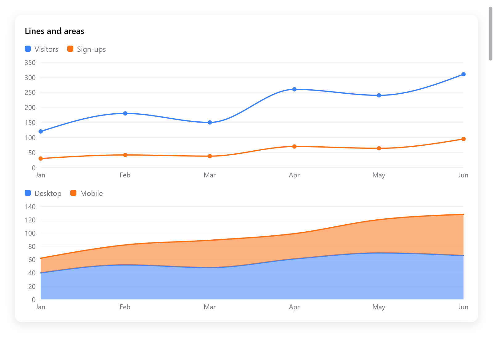
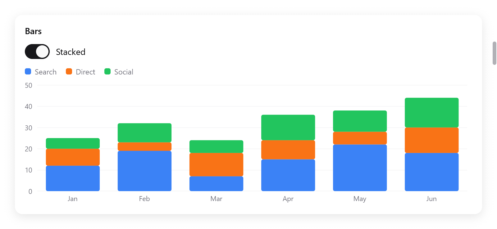

<a id="charts"></a>

# Biểu đồ

`ui.chart` vẽ biểu đồ đường, miền, cột, phân tán và tròn. Chúng có trục, đường lưới, chú thích, và tooltip cho điểm gần con trỏ nhất. Chúng được vẽ trên một canvas ([Vẽ](drawing.md)) và theo theme. Các thành phần bên trong cũng được public để bạn tự làm biểu đồ: thang đo, path của đường, miền và lát cắt, chồng (stack), điểm gần nhất.

<!-- demo: chart height=300 -->



*Biểu đồ đường và biểu đồ miền xếp chồng, có label và chú thích.*

```zig
const chart = ui.chart;
const months = [_][]const u8{ "Jan", "Feb", "Mar", "Apr", "May", "Jun" };

const r = chart.lineChart(c, &.{
    .{ .name = "Visitors", .values = &.{ 120, 180, 150, 260, 240, 310 } },
    .{ .name = "Sign-ups", .values = &.{ 30, 42, 38, 70, 64, 95 } },
}, .{ .labels = &months, .curve = .monotone, .points = true, .height = 200 });
if (r.hover) |h| ui.text(c, months[h.index], .{ .size = 12 });
```

- Trang Charts của gallery có đủ mọi loại (`examples/gallery/drawing.zig`).
- `zig build run-chart-streaming` vẽ ba dạng sóng, mỗi dạng 15 000 mẫu, thêm 1 000 mẫu mới mỗi giây, bằng các thành phần mô tả bên dưới.

<a id="lines-areas-and-bars"></a>

## Đường, miền và cột

<!-- demo: bars height=393 -->



*Biểu đồ cột xếp chồng cho ba nguồn truy cập.*

`chart.lineChart`, `chart.areaChart` và `chart.barChart` nhận `chart.Series` và `chart.Options`. Một `chart.Series` có:

- `name`;
- `values`, mỗi giá trị cho một điểm dọc trục x, NaN nếu chỗ đó không có điểm;
- `color`, tùy chọn; nếu không có thì lấy màu của palette theo thứ tự của series.

| trường | mặc định | ý nghĩa |
|---|---|---|
| `width` | 0 | tính bằng điểm; 0 thì lấp đầy phần tử cha |
| `height` | 220 | tính bằng điểm |
| `labels` | không có | label dọc trục x, mỗi label cho một điểm hoặc một cột |
| `ticks` | 5 | số vạch chia gần đúng trên trục giá trị |
| `min`, `max` | null | hai đầu trục giá trị; null: theo dữ liệu, làm tròn ra tới vạch chia |
| `grid` | true | đường lưới tại các vạch chia |
| `legend` | true | tên và màu của các series |
| `curve` | `.linear` | cách đường nối các điểm (xem bên dưới) |
| `stacked` | false | miền và cột chồng lên nhau, không đứng cạnh nhau |
| `line_width` | 2 | độ dày của đường |
| `points` | false | chấm tại các điểm của đường |
| `decimals` | null | số chữ số thập phân trong tooltip; null là tối đa hai |
| `key` | null | id giữa các phần tử cùng cấp |

```zig
_ = chart.areaChart(c, &.{
    .{ .name = "Desktop", .values = &.{ 40, 52, 48, 61, 70, 66 } },
    .{ .name = "Mobile", .values = &.{ 22, 30, 41, 38, 50, 62 } },
}, .{ .labels = &months, .stacked = true, .curve = .monotone, .height = 180 });

_ = chart.barChart(c, &.{
    .{ .name = "Search", .values = &.{ 12, 19, 7, 15, 22, 18 } },
    .{ .name = "Direct", .values = &.{ 8, 4, 11, 9, 6, 12 } },
}, .{ .labels = &months, .stacked = s.stacked, .height = 200 });
```

`chart.Curve` theo các curve của d3:

- `.linear`;
- `.monotone`: mượt, không bao giờ vượt quá giá trị của các điểm nó nối (`curveMonotoneX` của d3);
- `.step`, `.step_after` và `.step_before`.

Mọi biểu đồ trả về một `chart.Result`:

- `hover`: điểm gần con trỏ nhất (`series` và `index`), hoặc null;
- `index`: box của biểu đồ, dùng cho `c.interact` (bấm vào một điểm) và cho test.

<a id="scatter"></a>

## Phân tán

```zig
_ = chart.scatterChart(c, &.{.{ .name = "Samples", .xs = &xs, .ys = &ys }}, .{ .height = 200 });
```

Một `chart.PointSeries` có `name`, `xs`, `ys` và `color`. `chart.ScatterOptions` có `width`, `height`, `ticks`, `grid`, `legend`, `decimals` và `key` như trên, và thêm:

| trường | mặc định | ý nghĩa |
|---|---|---|
| `radius` | 4 | bán kính các chấm |
| `reach` | 24 | con trỏ cách một điểm tối đa bao nhiêu điểm thì vẫn chọn được điểm đó |

<a id="pie-and-donut"></a>

## Biểu đồ tròn và vành khuyên

```zig
_ = chart.pieChart(c, &.{
    .{ .label = "Zig", .value = 46 },
    .{ .label = "Go", .value = 28 },
    .{ .label = "Other", .value = 26 },
}, .{ .size = 180, .inner = 0.55 });
```

Một `chart.PieSlice` có `label`, `value` và `color`. `chart.PieOptions` cũng có `legend`, `decimals` và `key`, và thêm:

| trường | mặc định | ý nghĩa |
|---|---|---|
| `size` | 200 | cạnh của nó, tính bằng điểm |
| `inner` | 0 | lỗ của vành khuyên, theo tỉ lệ bán kính; 0 là biểu đồ tròn đặc |
| `pad` | 0.02 | khoảng cách giữa các lát, tính bằng radian |

Lát nằm dưới con trỏ phồng to ra và cho biết giá trị cùng tỉ lệ của nó.

<a id="colors-and-legends"></a>

## Màu và chú thích

`chart.palette` giữ tám màu mà các series dùng mặc định. Tự làm chú thích: `chart.legend(c, names, colors)`.

<a id="charts-of-your-own"></a>

## Tự làm biểu đồ

Các thành phần của biểu đồ dùng được trên mọi canvas.

- Vị trí trên vùng vẽ là tỉ lệ của nó, từ 0 đến 1.
- Theo trục x, chúng tính từ mép trái. Theo trục y, chúng tính từ dưới lên, theo chiều giá trị tăng.
- `chart.x(rect, f)` và `chart.y(rect, f)` đổi chúng thành điểm trong một hình chữ nhật.

<a id="scales"></a>

### Thang đo

`chart.Linear.init(lo, hi)` ánh xạ giá trị sang tỉ lệ:

- `at(v)`, và ngược lại bằng `invert(f)`;
- `span(a, b)` giữa hai giá trị;
- `nice(count)` làm tròn miền giá trị ra tới các vạch chia tròn;
- `ticks(gpa, count)` trả về các `chart.Tick` (`at`, `value`, `label`);
- đặt `clamp` để giá trị nằm ngoài miền bị giữ ở hai đầu.

`chart.Band.init(count)` chia cho mỗi label trong `count` label một dải, như `scaleBand` của d3:

- `padding(inner, outer)`;
- `band(i)`: một `chart.Span`, có `lo` và `hi`;
- `width()` và `at(i)`;
- `index(f)`: một tỉ lệ nằm trong dải nào;
- `ticks(gpa, labels)`.

Hai hàm phụ:

- `chart.extent(values)` là giá trị nhỏ nhất và lớn nhất, bỏ qua NaN.
- `chart.format(gpa, value, decimals)` viết một giá trị theo cách các trục viết.

<a id="shapes"></a>

### Hình

- `chart.line(path, rect, xs, ys, curve)` thêm vào một `ui.Path` đường đi qua các điểm, tính bằng tỉ lệ.
- `chart.area(path, rect, xs, lo, hi, curve)` thêm miền giữa hai đường. `lo` là null nghĩa là đáy.
- `chart.nearest(xs, f)` là chỉ số của điểm gần một tỉ lệ nhất, dùng cho hover.
- `chart.pie(gpa, values, pad)` tạo các `chart.Slice`, kèm góc của chúng.
- `chart.sector(path, cx, cy, inner, outer, slice)` là path của một lát.
- `chart.sliceAt(slices, dx, dy, inner, outer)` là lát tại một điểm.
- `chart.polar(cx, cy, r, angle)` là một điểm trên đường tròn.

`chart.stack(gpa, series, how)` chồng các series lên nhau:

- `series[s][i]` là giá trị thứ i của series thứ s.
- `[s][i]` của kết quả là một `chart.Segment` (`lo`, `hi`): chỗ của giá trị đó trong chồng thứ i.

| `chart.Stacking` | |
|---|---|
| `.standard` | từ 0 đi lên, giá trị âm đi xuống |
| `.normalized` | theo tỉ lệ trên tổng của mỗi chồng |
| `.center` | quanh 0, một streamgraph |

<a id="a-live-waveform"></a>

### Dạng sóng trực tiếp

`examples/chart-streaming` vẽ ba series cuộn liên tục trên một canvas. Trước khi vẽ nét, nó rút gọn mỗi series về giá trị cực tiểu và cực đại của từng cột pixel. Nhờ vậy 15 000 mẫu chỉ tốn ngang bề rộng vùng vẽ:

```zig
fn draw(w: *Waveform, p: *ui.Painter) void {
    const r: ui.Rect = .{ .w = p.size.w, .h = p.size.h };
    for (0..6) |t| {
        const yy = chart.y(r, @as(f32, @floatFromInt(t)) / 5);
        p.line(0, yy, r.w, yy, 1, grid_color);
    }
    p.clipRect(r);
    for (0..3) |k| {
        var path = p.path();
        chart.line(&path, r, w.xs_of(k), w.ys_of(k), .linear);
        p.stroke(&path, .color(colors[k]), .{ .width = 2, .join = .round });
    }
}
```

- `xs_of` và `ys_of` đại diện cho các tỉ lệ đã rút gọn của app.
- Label trên các trục là box đặt bằng `absolute` và `offset`, tại các vạch chia của `chart.Linear.init(0, 1).ticks(c.alloc(), 5)`.
- Dữ liệu đổi ở mọi frame, nên view xin frame kế tiếp bằng `c.animationFrame()`.

<a id="testing-charts"></a>

## Test biểu đồ

Biểu đồ là box, chữ và một canvas, nên `ui.Tester` thấy được chúng:

- label của chúng, bằng `t.hasText`;
- hover, bằng cách di con trỏ lên vùng vẽ (`t.moveTo`) rồi đọc `Result.hover`;
- pixel của chúng, bằng `t.render`.

Xem `src/ui/tests_chart.zig` và [Test](testing.md).
