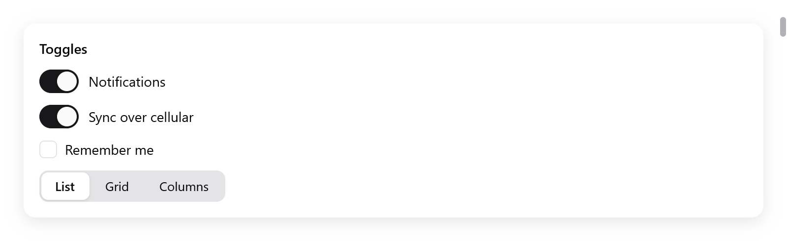
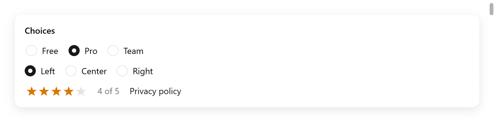

<a id="choices"></a>

# Lựa chọn

Các control dùng để chọn:

- checkbox và switch cho một thiết lập;
- nhóm checkbox cho nhiều thiết lập;
- nút radio và segmented control để chọn một trong vài giá trị;
- đánh giá sao.

Mỗi control sửa một giá trị trong state của bạn qua con trỏ. Nó trả về true khi người dùng đổi giá trị, để bạn xử lý thay đổi đó.

<!-- demo: toggles height=220 -->



*Switch, checkbox và segmented control trong Gallery.*

<a id="checkboxes"></a>

## Checkbox

```zig
_ = ui.checkbox(c, "Remember me", &s.remember);
if (ui.checkbox(c, "Show hidden files", &s.hidden)) s.reload();
```

`ui.checkbox(c, title, &value)` vẽ một ô vuông kèm label. Nó đảo giá trị `bool` khi bấm, hoặc khi nhấn Enter hay Space lúc đang có focus.

- Dấu tick hiện ra và mất đi có easing.
- Label là một phần của control: bấm vào label cũng đảo giá trị.
- Với title rỗng, nó chỉ còn ô vuông, dùng cho cột tick trong bảng.

<a id="checkbox-groups"></a>

## Nhóm checkbox

```zig
const State = struct {
    notify: [3]bool = .{ true, false, true },
};

_ = ui.checkboxGroup(c, "Notifications", &s.notify, &.{ "Mail", "Calendar", "Reminders" });
```

`ui.checkboxGroup(c, title, values, labels)` vẽ một checkbox phía trên cả nhóm, như cho danh sách quyền. Bên dưới, thụt lề vào, là một checkbox cho mỗi phần tử của `values` (một `[]bool`), mang tên lấy từ `labels`.

- Ô của nhóm được tick khi tất cả đều được tick, và ở trạng thái mixed (một dấu gạch) khi chỉ một số được tick.
- Bấm vào nó, hoặc nhấn Space khi nó có focus, sẽ tick tất cả. Khi tất cả đã được tick, nó bỏ tick hết.
- Nó trả về true khi có bất kỳ ô nào thay đổi.
- Công nghệ hỗ trợ đọc ô của nhóm như một checkbox bật, tắt hoặc mixed.

<a id="switches"></a>

## Switch

```zig
_ = ui.toggle(c, "Notifications", &s.notifications);
if (ui.toggle(c, "Dark", &s.dark)) s.theme.switchTo(if (s.dark) ui.Theme.dark_theme else ui.Theme.light);
```

`ui.toggle(c, title, &value)` là một switch, như trên iOS và trong phần cài đặt của macOS. Dùng nó cho thiết lập có hiệu lực ngay.

- Núm trượt sang, và rãnh tô màu success khi bật.
- Trong một [form](forms.md), để title rỗng và để trường của form đặt label cho nó.

<a id="radio-buttons"></a>

## Nút radio

<!-- demo: choices height=223 -->



*Các nhóm radio và một đánh giá bốn sao.*

```zig
ui.row(c, .{ .gap = 16, .align_items = .center });
defer ui.end(c);
_ = ui.radio(c, &s.alignment, 0, "Left");
_ = ui.radio(c, &s.alignment, 1, "Center");
_ = ui.radio(c, &s.alignment, 2, "Right");
```

`ui.radio(c, &selected, value, title)` là một nút radio.

- Nó bật khi `selected.*` bằng `value`.
- Hai giá trị được so bằng `std.meta.eql`, nên kiểu nào cũng dùng được: số nguyên, enum, struct.
- Bấm vào thì nó được chọn và trả về true.
- Bấm vào nút đang được chọn thì không đổi gì và trả về false.

<a id="radio-groups"></a>

## Nhóm radio

```zig
const Plan = enum { free, pro, team };

_ = ui.radioGroup(c, &s.plan, &.{
    .{ .label = "Free", .value = .free },
    .{ .label = "Pro", .value = .pro },
    .{ .label = "Team", .value = .team },
}, .{ .row = true, .gap = 16 });
```

`ui.radioGroup(c, &selected, choices, options)` vẽ một nút radio cho mỗi phần tử của `choices`, gộp thành một control nhận focus bàn phím. `choices` là một `[]const ui.Choice(T)`: gồm `label` và `value`.

- Phím mũi tên chọn giữa các nút; Home và End chọn nút đầu và nút cuối.
- Nó trả về true khi lựa chọn thay đổi.
- Công nghệ hỗ trợ đọc nó như một nhóm radio, kèm vị trí của từng nút trong nhóm.

| `ui.RadioGroupOptions` | Mặc định | |
|---|---|---|
| `row` | `false` | xếp thành hàng thay vì cột |
| `gap` | 8 | khoảng cách giữa các nút |

<a id="segmented-controls"></a>

## Segmented control

```zig
_ = ui.segmented(c, &.{ "List", "Grid", "Columns" }, &s.view_mode);
switch (s.view_mode) {
    0 => s.listView(c),
    1 => s.gridView(c),
    else => s.columnView(c),
}
```

`ui.segmented(c, options, &selected)` chọn một trong vài label, như segmented control của AppKit. `options` là một slice chuỗi, còn `selected` là chỉ số kiểu `usize`.

- Nó trả về true khi lựa chọn thay đổi.
- Đoạn được chọn nổi lên trên màu surface kèm bóng đổ, và chuyển giữa các đoạn có easing.

<a id="ratings"></a>

## Đánh giá sao

```zig
_ = ui.rating(c, &s.stars, .{});
ui.text(c, c.print("{d} of 5", .{s.stars}), .{ .color = c.theme.muted });
```

`ui.rating(c, &value, options)` là một hàng sao, trong đó `value` (một `u8`) sao được tô.

- Bấm vào một sao để đặt điểm. Bấm vào đúng sao đang đặt thì xóa điểm.
- Khi có focus bàn phím, phím mũi tên, Home và End thay đổi điểm.
- Khi con trỏ dừng trên các sao, chúng cho thấy cú bấm sẽ đặt điểm nào.
- Nó trả về true khi điểm thay đổi.

| `ui.RatingOptions` | Mặc định | |
|---|---|---|
| `max` | 5 | số sao |
| `size` | 18 | điểm |

<a id="toggling-from-the-keyboard"></a>

## Đổi lựa chọn bằng bàn phím

- Mọi control ở đây nhận focus bàn phím bằng Tab.
- Nó vẽ vòng focus khi được focus bằng bàn phím.
- Checkbox và switch đảo giá trị khi nhấn Enter và Space.
- Nhóm radio và đánh giá sao di chuyển bằng phím mũi tên.

Test điều khiển chúng theo cùng cách:

```zig
try t.clickText("Large"); // chọn nút radio có label "Large"
t.key(.right);            // lựa chọn kế tiếp của một nhóm radio đang có focus
```

Xem [testing](testing.md).
