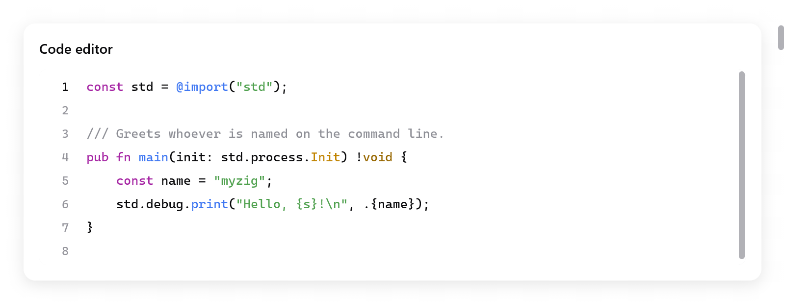
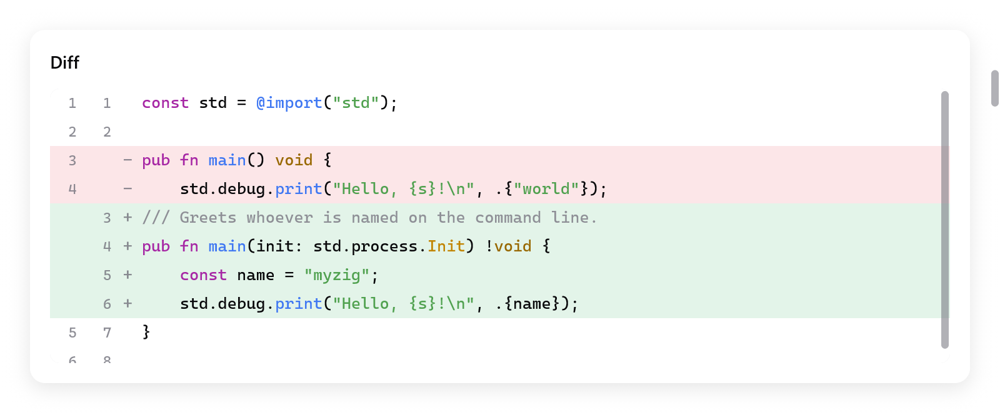

<a id="code-editor-and-diff-viewer"></a>

# Code editor và diff viewer

`ui.codeEditor` sửa mã nguồn, theo editor của Zed và `ui/editor` của mygo. `ui.diffView` hiện thay đổi giữa hai văn bản, dạng gộp (unified) hoặc đặt cạnh nhau.

<!-- demo: code-editor height=335 -->



*Editor Zig có tô màu cú pháp và cột số dòng.*

```zig
const Editor = struct {
    code: ui.CodeEditor,

    fn view(s: *Editor, c: *ui.Context) void {
        _ = ui.codeEditor(c, &s.code, .{});
    }
};

var s: Editor = .{ .code = .init(gpa, source, "main.zig") };
defer s.code.deinit();
```

Editor có:

- cột số dòng (gutter), tô màu cú pháp, và tô nền dòng đang có con trỏ;
- tự thụt lề, ngoặc và dấu nháy tự đóng khi gõ;
- đánh dấu cặp ngoặc tại con trỏ;
- thanh tìm kiếm có cả thay thế: phân biệt hoa thường, nguyên từ, hoặc biểu thức chính quy;
- nhảy tới một dòng;
- tự xuống dòng (soft wrap), hoặc scroll ngang với dòng dài.

Cả hai widget chỉ dựng các dòng đang hiện, nên file 100 000 dòng cũng chỉ tốn bằng một màn hình.

`zig build run-code-editor` sửa file của nhiều ngôn ngữ, kèm thay đổi so với file ban đầu (`examples/code-editor`). Chạy headless: `zig-out/bin/code-editor --myzig-snapshot=diff.png --myzig-script="click:Changes"`.

<a id="the-editor"></a>

## Editor

`ui.CodeEditor.init(gpa, text, name)` tạo editor cho `text`, tô màu theo ngôn ngữ của file `name` (null: không tô). Giải phóng bằng `deinit()`. Các trường và method:

| | |
|---|---|
| `area` | `ui.TextArea` của nó: chữ, vùng chọn, undo ([Text area](text-area.md)) |
| `wrap` | dòng tự xuống theo bề rộng editor, thay vì scroll ngang |
| `wrap_column` | khi có `wrap`, dòng xuống ở cột này, hoặc ở bề rộng editor nếu nó gần hơn (0, mặc định: bề rộng editor) |
| `read_only` | chọn, tìm và copy được, không sửa được |
| `indent` | `unit` (một mức: mặc định `"    "`, hoặc `"\t"`) và `tab_size` (4) |
| `find` | state của thanh tìm kiếm: `open`, `replacing`, `query`, `replacement`, `flags` (`case`, `word`, `regex`), `matches` |
| `setLanguage(name)` | tô màu như file tên `name`, hoặc theo tên ngôn ngữ (`"zig"`, `"go"`); null để bỏ tô màu |
| `goToLine(line)` | đặt con trỏ ở đầu một dòng (đếm từ 1) và cuộn tới đó |
| `openFind(replacing)` | mở thanh tìm kiếm, với chữ đang chọn |
| `closeBars()` | đóng thanh tìm kiếm và thanh nhảy dòng |
| `own_find_bar` | app tự vẽ thanh tìm kiếm từ `find`, `query_id`, `replacement_id` và `focus_next` (editor vẫn tìm, đánh dấu và nhận phím) |
| `extra` | những gì app thêm vào các dòng (bên dưới) |
| `background` | nền của chữ (null: nền sáng hoặc tối mặc định) |
| `guides` | màu cho các đường kẻ ở mỗi mức thụt lề (null: không có) |
| `syntax.colors` | màu của các token, một `ui.SyntaxColors` (null: mặc định) |

App đọc và sửa chữ qua `area`, như với text area:

```zig
const ta = &s.code.area;
const line = ta.caretLine();
const col = ta.sel.caret - ta.doc.lineStart(line);
ui.text(c, c.print("Ln {d}, Col {d}", .{ line + 1, col + 1 }), .{ .size = 12 });
const modified = ta.doc.canUndo();
```

`ui.CodeEditorOptions`:

| Trường | Mặc định | |
|---|---|---|
| `width`, `height` | `.fill` | |
| `size` | 13 | cỡ chữ |
| `line_numbers` | true | cột số dòng |
| `current_line` | true | tô nền dòng có con trỏ |
| `leading` | 1.45 | chiều cao dòng, tính theo bội số của font |
| `weight` | `.regular` | hoặc `weight_value`, 100 tới 900 |
| `family` | `null` | font; null là font monospace của theme |
| `features` | `""` | các feature OpenType, giống `ui.TextStyle` |
| `placeholder` | `""` | |

Nó trả về những gì text area trả về: `changed`, `focused`, `first_line`, `last_line`.

<a id="what-the-app-adds-to-the-lines"></a>

## App thêm gì vào các dòng

```zig
s.code.extra = .{ .ctx = s, .gutter = State.changed, .after = State.blame };
s.code.guides = c.theme.text.alpha(0.08);
```

`extra`, một `ui.CodeEditor.Extra`, cho app trang trí các dòng khi chúng được dựng, chỉ với các dòng đang hiện:

| Callback | Trả về |
|---|---|
| `marks(ctx, c, line, start, str)` | nền cho các đoạn: các `ui.TextMark`, gồm khoảng byte trong dòng và một màu (những chỗ khác có cùng một từ) |
| `gutter(ctx, c, line)` | màu cho một vạch dọc mép trái của gutter (các dòng đã đổi từ commit gần nhất) |
| `after(ctx, c, line)` | một `ui.TextAfter`, chữ mờ sau cuối dòng (blame của dòng có con trỏ, một ghi chú) |

- Mark có `end` là `ui.TextMark.whole` tô kín dòng hết bề ngang view, nằm dưới vùng chọn: dùng cho các khối conflict.
- Bấm vào gutter thì `area.gutter_press` được đặt là dòng đó, để app đọc rồi xóa.

<a id="keys"></a>

## Phím

Ngoài các phím của text area ([Text area](text-area.md#editing)). "Mod" là Command trên macOS và Control ở nơi khác:

| Phím | Tác dụng |
|---|---|
| Mod+F | tìm |
| Mod+Option+F (macOS), Ctrl+H | tìm và thay |
| Mod+G, Mod+Shift+G (macOS), F3, Shift+F3 | kết quả kế tiếp và kết quả trước |
| Ctrl+G | nhảy tới một dòng |
| Escape | đóng các thanh, hoặc thu vùng chọn lại |
| Tab, Shift+Tab | thụt vào và lùi ra các dòng đang chọn (hoặc gõ một mức thụt tại con trỏ) |
| Mod+], Mod+[ | thụt vào và lùi ra các dòng |
| Mod+/ | comment hoặc bỏ comment các dòng, bằng comment dòng của ngôn ngữ (không làm gì nếu ngôn ngữ không có) |
| Alt+Z | bật hoặc tắt tự xuống dòng |
| Mod+C, Mod+X khi không chọn gì | copy hoặc cut dòng có con trỏ |

Khi gõ code:

- Enter giữ mức thụt của dòng, thêm một mức sau ngoặc mở. Khi ở giữa một cặp ngoặc, nó đưa ngoặc đóng xuống một dòng riêng.
- Ngoặc và dấu nháy tự đóng khi gõ, và bao quanh vùng chọn nếu có. Gõ ngoặc đóng thì con trỏ nhảy qua nó. Backspace xóa cả cặp rỗng.
- Ngoặc tại con trỏ và ngoặc đối ứng được đánh dấu. Ngoặc đối ứng được tìm trong phạm vi 2000 dòng và 64 KB (vài dòng dài có thể là cả một file).

<a id="languages"></a>

## Ngôn ngữ

Editor tô màu những gì view [Markdown](markdown.md) tô màu, theo phần mở rộng của file hoặc tên ngôn ngữ: Zig, JavaScript và TypeScript, Go, Python, Rust, C và họ hàng, markup, Markdown, diff và khoảng sáu mươi ngôn ngữ khác. `ui.languageFor(name)` tìm ngôn ngữ từ tên file (null nếu không có).

- Các dòng được tách token từng dòng một, từ state mà dòng đó bắt đầu: trong comment khối, trong chuỗi nhiều dòng. State được lưu theo từng dòng.
- Sau một lần sửa, chỉ các dòng từ chỗ sửa trở đi được tách token lại, cho tới khi gặp dòng bắt đầu ở đúng state như trước. Và chỉ tới hết các dòng đang hiện.
- Dòng dài hơn 20 000 byte thì chỉ 20 000 byte đầu được tô màu, phần còn lại để nguyên, giống VS Code.
- Màu của dòng dài được giữ cho tới khi chữ thay đổi. Dòng dài được layout dần theo ngân sách của mỗi frame, giống [text area](text-area.md).

<a id="find-and-replace"></a>

## Tìm và thay

- Thanh tìm kiếm tìm các kết quả khớp từng dòng một. Nó khớp dạng chữ thường (có hoặc không phân biệt hoa thường, nguyên từ) hoặc dạng biểu thức chính quy.
- Kết quả chỉ được tìm lại khi query, tùy chọn của nó hoặc chữ thay đổi.
- Replace thay kết quả hiện tại hoặc tất cả. Với biểu thức chính quy, `$1` tới `$9` chèn các nhóm của nó vào chuỗi thay.

App muốn thanh tìm kiếm có giao diện riêng thì đặt `own_find_bar`. Khi đó editor không vẽ thanh nào, và thanh của app:

- sửa `find.query` và `find.replacement`;
- gọi `find.step` và `find.replaceOne` / `replaceAll`;
- trao bàn phím cho các field của mình khi `focus_next` yêu cầu (`.query`, `.replacement`);
- lưu id của chúng vào `query_id` và `replacement_id`;
- đóng bằng `closeBars()`. `ui.findBarEscaped(c, id)` cho biết một field đã nhận Escape.

Biểu thức chính quy được khớp bằng một máy backtracking nhỏ (`src/ui/editor/regex.zig`). Nó hiểu:

- ký tự thường và escape: `\d \w \s \b` cùng dạng phủ định của chúng, `\t \n`;
- `.`, lớp ký tự (`[a-z]`, `[^…]`) và neo (`^ $`);
- nhóm, có bắt (capturing) và `(?:…)`, và phép hoặc;
- các lượng từ `* + ? {n} {n,} {n,m}`, tham lam hoặc lười.

Một ngân sách số bước giữ cho mẫu bệnh hoạn không làm treo editor: vượt ngân sách thì dòng đó coi như không khớp.

<a id="the-diff-viewer"></a>

## Diff viewer

<!-- demo: diff height=355 -->



*Một diff với các dòng bị xóa màu đỏ và các dòng được thêm màu xanh lá.*

```zig
var d = try ui.DiffView.init(gpa, before, after, "main.zig");
defer d.deinit();

// Trong view:
const st = d.stats();
ui.text(c, c.print("+{d}  −{d}", .{ st.added, st.deleted }), .{ .size = 13 });
if (ui.segmented(c, &.{ "Unified", "Split" }, &s.split)) d.setMode(if (s.split == 1) .split else .unified);
ui.diffView(c, &d, .{});
```

`ui.DiffView` so sánh hai văn bản theo từng dòng và giữ các hàng nó hiển thị.

- `init(gpa, old, new, name)` copy cả hai văn bản và tô màu theo ngôn ngữ của `name`.
- `set(old, new)` so sánh hai văn bản mới. Ví dụ editor gọi nó khi `area.doc.version` của editor thay đổi.
- `setMode(mode)`: `ui.DiffMode.unified` (dòng bị xóa nằm trên dòng được thêm) hoặc `.split` (đặt cạnh nhau, các dòng thẳng hàng).
- `context`: số dòng không đổi hiện quanh mỗi thay đổi (3). Đoạn dài hơn giữa các thay đổi được thu lại thành một hàng, bấm vào thì mở ra. `expandAll()` và `collapseAll()` làm vậy với mọi đoạn.
- `stats()`: số dòng `added` và `deleted`.
- `scroll_to`, một hàng, đưa hàng đó lên trên cùng ở frame kế tiếp.

Mỗi bên có số dòng và màu cú pháp riêng. Trong một dòng bị đổi, các từ thay đổi được đánh dấu, trừ khi hai dòng giống nhau ít hơn `min_same`.

`ui.DiffViewOptions`:

| Trường | Mặc định | |
|---|---|---|
| `min_same` | 0.3 | phần byte giống nhau tối thiểu của hai dòng để đánh dấu các từ |
| `width`, `height` | `.fill` | |
| `size` | 13 | cỡ chữ |
| `colors` | `null` | màu các token, một `ui.SyntaxColors`; null là màu mặc định sáng hoặc tối |
| `digits` | 0 | số chữ số của cột số dòng; 0 là vừa đủ cho số dòng của văn bản |
| `family`, `features`, `weight_value` | | như ở editor |

**Nhiều diff trong một vùng scroll**, mỗi file dưới một header và xen giữa là các hàng riêng của app, được dựng từ các hàng. Sau `dv.build()`:

- `ui.diffRow(c, &dv, i, opts)` dựng hàng `i` của `dv.rows`, cao `ui.diffRowHeight(c, opts)`, trong một list của app.
- Ở đó dòng dài xuống dòng thành các mảnh hàng. `ui.diffWrapColumns(c, &dv, opts, width, split)` là số ký tự vừa một bên.
- `ui.diffRowParts(&dv, i, cols)` là số mảnh mà hàng `i` chiếm.
- `ui.diffRowPart(c, &dv, i, opts, part, cols)` dựng một mảnh. Số dòng và dấu +/− nằm ở mảnh đầu.

<a id="comparing-texts-yourself"></a>

## Tự so sánh văn bản

`ui.diff` là phần so sánh bên dưới viewer, như `internal/diff` của mygo. Đó là thuật toán O(ND) của Myers trong không gian tuyến tính, kèm giới hạn chi phí của xdiff. Giới hạn này chặn thời gian chạy với các văn bản lớn không liên quan nhau, đổi lại diff có thể không tối thiểu.

```zig
const old_lines = try ui.diff.splitLines(gpa, before);
defer gpa.free(old_lines);
const new_lines = try ui.diff.splitLines(gpa, after);
defer gpa.free(new_lines);
const hunks = try ui.diff.lines(gpa, old_lines, new_lines);
defer gpa.free(hunks);
for (hunks) |h| {
    // Các dòng cũ h.a0..h.a1 được thay bằng các dòng mới h.b0..h.b1.
}
```

- `diff.lines(gpa, a, b)` so sánh dãy dòng, còn `diff.ints(gpa, a, b)` so sánh dãy số nguyên. Cả hai trả về các `diff.Hunk`: `a0`, `a1`, `b0`, `b1`. `a0 == a1` là chèn, `b0 == b1` là xóa.
- `diff.words(gpa, a, b)` so sánh hai dòng theo từng từ. Nó trả về các khoảng byte bị đổi trên mỗi dòng, nối liền qua dấu cách ở giữa, và `same`: mức độ giống nhau, từ 0 tới 1. Giải phóng bằng `deinit(gpa)`.

<a id="testing"></a>

## Test

Editor chạy trong `ui.Tester` giống như trong cửa sổ, với clipboard riêng của `ui.Tester`:

```zig
var s: Editor = .{ .code = .init(gpa, "fn main() {}\n", "main.zig") };
defer s.code.deinit();
var t: ui.Tester = undefined;
try t.init(gpa, .init(&s, Editor.view), .{});
defer t.deinit();
try t.clickText("main");
const mac = @import("builtin").os.tag == .macos;
_ = t.shortcut(if (mac) .{ .key = 'f', .cmd = true } else .{ .key = 'f', .ctrl = true });
try std.testing.expect(s.code.find.open);
```

Xem `src/ui/tests_editor.zig`, `src/ui/tests_diff.zig` và [Test](testing.md).
