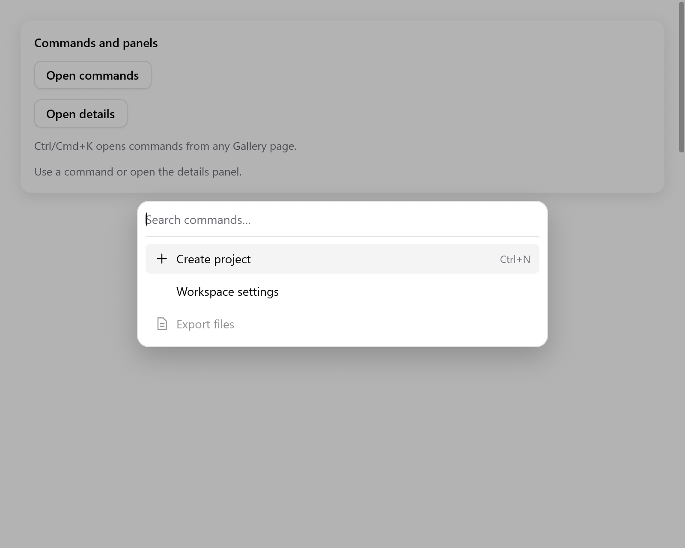

# Command palette

`ui.commandPalette` hiển thị danh sách lệnh có ô tìm kiếm trong một dialog modal. Khi một lệnh được chọn, nó trả về chỉ số của lệnh đó trong danh sách của app.

<!-- demo: panels height=520 -->



```zig
// Trong state của app: commands: ui.CommandState = .{},
if (c.shortcut(.{ .key = 'k', .cmd = true })) s.commands.toggle();
const items: []const ui.CommandItem = &.{
    .{ .title = "New file", .group = "Files", .keywords = "create", .icon = "doc.text" },
    .{ .title = "Settings", .group = "Application", .keywords = "preferences" },
    .{ .title = "Export", .group = "Files", .disabled = !s.has_files },
};
if (ui.commandPalette(c, &s.commands, items, .{})) |index| s.runCommand(index);
```

Giữ `CommandState` trong state của app:

- `show`, `close` và `toggle` mở và đóng palette.
- `query` là buffer của ô tìm kiếm. Mỗi lần mở lại, nó bị xóa trống.
- `selected` là chỉ số của mục đang chọn trong danh sách của app.

Dựng palette sau phần còn lại của view, để các control của nó xử lý input sau cùng.

<a id="items-and-options"></a>

## Lệnh và tùy chọn

Mỗi lệnh có `title` và các trường không bắt buộc `group`, `keywords`, `icon`, `shortcut` (chữ để hiển thị) và `disabled`. Đặt các lệnh cùng nhóm cạnh nhau.

| `CommandOptions` | Mặc định | Ý nghĩa |
|---|---|---|
| `width` | `.{ .px = 480 }` | Chiều rộng dialog, không vượt quá cửa sổ |
| `max_height` | `320` | Chiều cao tối đa của danh sách kết quả trước khi scroll |
| `label` | `"Commands"` | Tên của dialog/danh sách cho trình đọc màn hình |
| `placeholder` | `"Search commands…"` | Gợi ý trong ô tìm kiếm |
| `search_label` | `"Search commands"` | Tên ô tìm kiếm cho trình đọc màn hình |
| `empty_label` | `"No commands found."` | Chữ hiện khi không có kết quả |

**Tìm kiếm và phím**

- Tìm theo tiêu đề và `keywords`, không phân biệt hoa thường ASCII. Kết quả khớp phần đầu đứng trước.
- Lệnh bị tắt vẫn hiện, nhưng điều hướng bằng phím bỏ qua chúng.
- Khi gõ, focus vẫn ở ô tìm kiếm. Space chỉ là một ký tự tìm kiếm.
- Lên/Xuống đi vòng qua các kết quả đang bật. Home/End tới kết quả đầu/cuối.
- Enter hoặc bấm vào một kết quả sẽ chạy nó và đóng palette.
- Kết quả đang chọn tự scroll vào tầm nhìn. Trình đọc màn hình nhận nó là active descendant của ô tìm kiếm.
- Tab chỉ đi trong dialog. Escape hoặc bấm vào nền mờ sẽ đóng nó.
- Khi đóng, focus trở về control đã mở nó.
- Palette mở ra không có animation, vì nó được dùng thường xuyên.

<a id="shared-actions"></a>

## Dùng chung actions

Nếu app đã dùng [`ui.Actions`](navigation.md#actions), dùng adapter để dùng chung tiêu đề, icon, trạng thái bật/tắt và nhãn phím tắt:

```zig
if (s.actions.commandPalette(c, &s.commands, .{})) |cmd| s.run(cmd);
```

Nó trả về enum tag của action và cập nhật `actions.last`, giống `menuItem` và `button`. Nhãn phím tắt chỉ để hiển thị. Vẫn gọi `actions.shortcuts(c)` để xử lý các tổ hợp phím đó.

Xem [Gallery](../../../examples/gallery/feedback.zig): các lệnh mở một [Sheet](sheet.md) hoặc cập nhật workspace.
