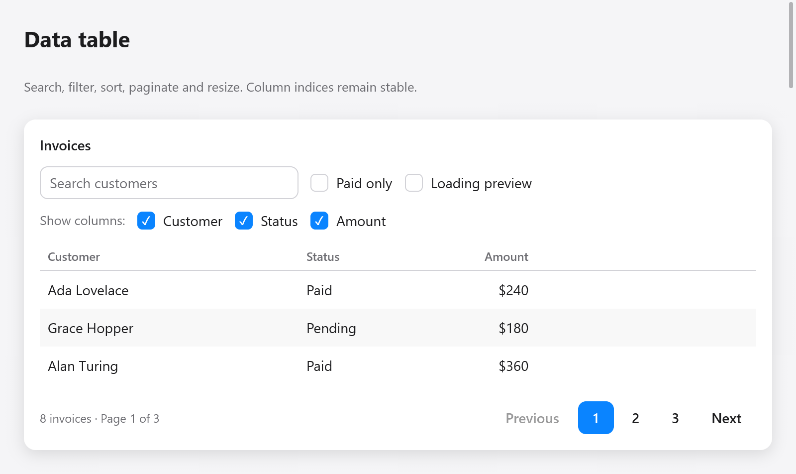

# Ghép bảng dữ liệu



Trang **Data table** trong Gallery ghép `textField`, checkbox, `table`,
`pagination`, `skeleton` và `empty`. Tìm kiếm và lọc trạng thái chạy trước
sắp xếp, sau đó phân trang cắt danh sách kết quả. Đổi lọc hoặc sắp xếp xóa
con trỏ hàng; đổi lọc còn đưa về trang đầu. Ví dụ có trạng thái đang tải
và không tìm thấy kết quả.

Cột hỗ trợ `hidden`, `min_width` và `max_width`. Header và ô của cột bị ẩn
không được dựng, nhưng `table.cell()` và `state.sort.column` vẫn trả chỉ số
cột gốc. Phím chuyển ô bỏ qua cột ẩn.

```zig
// State:
widths: [3]f32 = .{ 260, 130, 110 },

// Trong view:
const columns = [_]ui.TableColumn{
    .{ .title = "Khách hàng", .sortable = true, .min_width = 120 },
    .{ .title = "Trạng thái", .hidden = !s.show_status },
    .{ .title = "Số tiền", .alignment = .end },
};
var table = ui.table(c, &s.table, &columns, rows.len, .{
    .column_widths = &s.widths,
    .height = .{ .px = 240 },
});
// Dựng hàng bằng next()/cell(), sau đó:
const result = table.end();
if (result.resized) saveColumnPreferences();
```

`column_widths` là mảng độ rộng có thể sửa do ứng dụng giữ, ứng với toàn bộ
cột kể cả cột ẩn. Truyền mảng để bật tay nắm resize. Độ rộng dương được kẹp
theo giới hạn cột; 0 chia phần chỗ còn lại cho tới khi resize. Thu nhỏ cửa
sổ không ghi đè độ rộng đã chọn.

Kéo tay nắm, hoặc focus rồi dùng Left/Right (10 điểm), Home (nhỏ nhất), End
(lớn nhất). Bố cục phải sang trái đảo hướng phím. Tay nắm có vai trò splitter
cho công cụ hỗ trợ tiếp cận và không kích hoạt sắp xếp.

Ứng dụng tự sắp xếp dữ liệu khi `result.sorted` báo thay đổi. Nếu cần giữ
lựa chọn qua lọc/sắp xếp, dùng khóa hàng ổn định theo
[danh sách, cây và bảng](lists.md). Xem
[ví dụ đầy đủ trong Gallery](../../../examples/gallery/data_table.zig).
