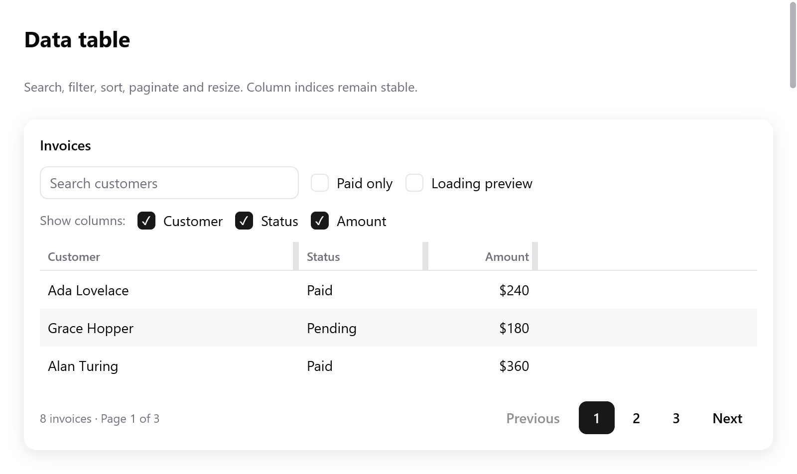

# Ghép bảng dữ liệu

<!-- demo: data-table height=350 -->



Trang **Data table** trong Gallery ghép `textField`, checkbox, `table`, `pagination`, `skeleton` và `empty`.

- Tìm kiếm và lọc theo trạng thái chạy trước khi sắp xếp. Sau đó phân trang cắt lấy các hàng khớp.
- Đổi bộ lọc hoặc cách sắp xếp sẽ xóa con trỏ hàng. Đổi bộ lọc còn đưa về trang đầu.
- Trạng thái đang tải và không có kết quả được minh họa riêng.

Cột hỗ trợ `hidden`, `min_width` và `max_width`.

- Header và ô của cột ẩn không được dựng.
- `table.cell()` và `state.sort.column` vẫn trả về chỉ số cột gốc.
- Phím mũi tên giữa các ô bỏ qua cột ẩn.

```zig
// State:
widths: [3]f32 = .{ 260, 130, 110 },

// Trong view:
const columns = [_]ui.TableColumn{
    .{ .title = "Customer", .sortable = true, .min_width = 120 },
    .{ .title = "Status", .hidden = !s.show_status },
    .{ .title = "Amount", .alignment = .end },
};
var table = ui.table(c, &s.table, &columns, rows.len, .{
    .column_widths = &s.widths,
    .height = .{ .px = 240 },
});
// Dựng hàng bằng next()/cell(), sau đó:
const result = table.end();
if (result.resized) saveColumnPreferences();
```

**Đổi độ rộng cột.** `column_widths` là một slice có thể sửa, tùy chọn, do app sở hữu. Nó có một độ rộng cho mỗi cột, kể cả cột ẩn. Truyền nó vào sẽ bật các tay nắm resize.

- Độ rộng dương được kẹp theo giới hạn của từng cột.
- Độ rộng 0 chia phần chỗ còn lại, cho đến khi được resize.
- Độ rộng không đổi chỉ vì cửa sổ thu nhỏ.
- Kéo một tay nắm, hoặc focus nó rồi dùng Left/Right (mười điểm), Home (nhỏ nhất) hoặc End (lớn nhất).
- Layout phải sang trái đảo chiều phím mũi tên.
- Tay nắm là splitter cho công nghệ hỗ trợ. Chúng không kích hoạt sắp xếp.

Bảng rộng hơn box của nó sẽ scroll ngang với `.sideways = true`. Nó giữ các cột đầu luôn hiện với `.frozen = n`. Xem [lists, trees and tables](lists.md).

Việc sắp xếp vẫn do app làm; `result.sorted` báo khi có thay đổi. Nếu lựa chọn phải giữ được qua sắp xếp lại hay lọc, hãy cung cấp key ổn định cho hàng, như [lists, trees and tables](lists.md) mô tả. Xem [ví dụ đầy đủ trong Gallery](../../../examples/gallery/data_table.zig).
