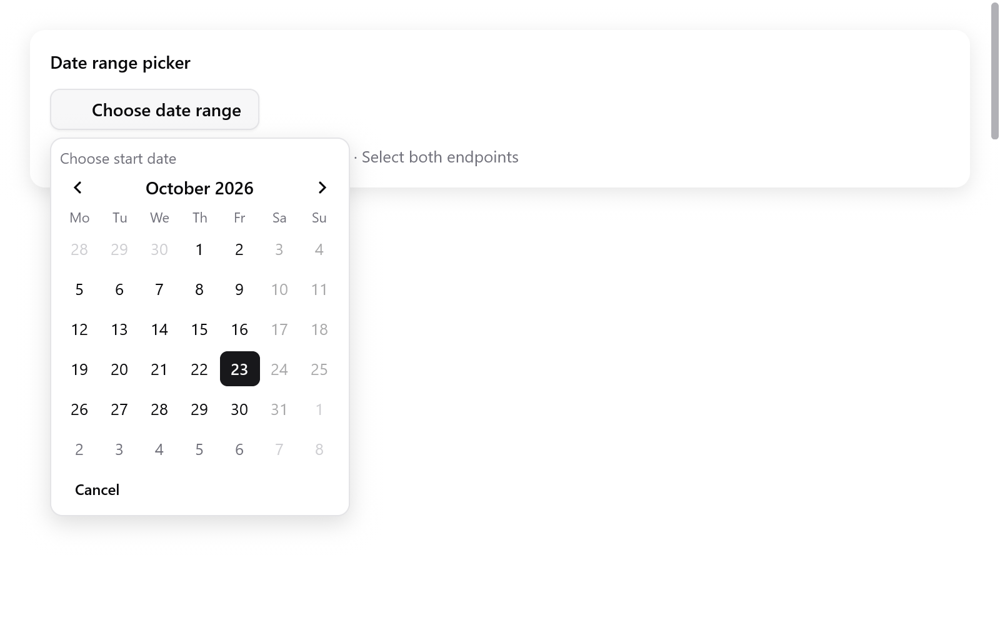

# Chọn khoảng ngày

<!-- demo: date-range height=520 -->



`dateRangeInput` ghi nhận một `DateRange` tính cả hai đầu, sau khi người dùng chọn đủ hai ngày. Người dùng có thể chọn ngày muộn hơn trước; `start` luôn trùng hoặc trước `end`.

```zig
// State của app:
period: ?ui.DateRange = null,
period_picker: ui.DateRangeState = .{},

// Trong view:
_ = ui.dateRangeInput(c, &s.period, &s.period_picker, .{
    .label = "Reporting period",
    .format = .day_month_year,
    .calendar = .{
        .min = .{ .year = 2026, .month = 10, .day = 1 },
        .max = .{ .year = 2026, .month = 12, .day = 31 },
        .first_weekday = 1,
    },
});
```

`CalendarOptions` hỗ trợ `min`/`max` tính cả hai đầu và `disabled: ?*const fn (ui.Date) bool`. Chúng cũng dùng được với `calendar` và `dateInput`.

- Khoảng ngày không được chứa ngày bị khóa nào, kể cả ngày nằm giữa hai đầu.
- Khi có callback, bước kiểm tra sẽ duyệt từng ngày trong khoảng đã chọn. Hãy giữ callback nhẹ.

**Hành vi**

- Popup tô màu khoảng đang chọn dở.
- Lần bấm đầu chưa đổi giá trị đã ghi nhận.
- Cancel, Escape hoặc bấm bên ngoài giữ nguyên giá trị đó. Mở lại thì bắt đầu một lượt chọn mới.
- `disabled = true` khóa ô chọn.
- Không cần allocator.
- Phím mũi tên đi theo ngày và tuần, Page Up/Down theo tháng, Home/End tới đầu và cuối tháng.
- Enter hoặc Space chọn ngày đang đứng.
- Con trỏ có thể đi qua ngày bị khóa, nhưng không chọn được.
- Hàm chỉ trả về true sau khi ghi nhận một khoảng hoàn chỉnh khác giá trị cũ.

Xem [dates, times and colors](dates-and-colors.md) và trang **Actions & choices** trong Gallery.
