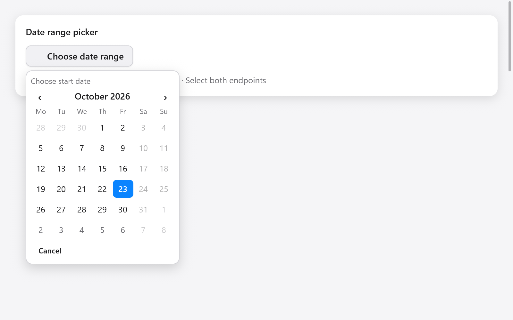

# Chọn khoảng ngày



`dateRangeInput` ghi nhận `DateRange` gồm cả hai đầu sau khi người dùng chọn
đủ ngày bắt đầu và kết thúc. Có thể chọn ngày muộn trước; kết quả luôn có
`start` không sau `end`.

```zig
// State:
period: ?ui.DateRange = null,
period_picker: ui.DateRangeState = .{},

// Trong view:
_ = ui.dateRangeInput(c, &s.period, &s.period_picker, .{
    .label = "Kỳ báo cáo",
    .format = .day_month_year,
    .calendar = .{
        .min = .{ .year = 2026, .month = 10, .day = 1 },
        .max = .{ .year = 2026, .month = 12, .day = 31 },
        .first_weekday = 1,
    },
});
```

`CalendarOptions` hỗ trợ `min`/`max` bao gồm hai đầu và callback
`disabled: ?*const fn (ui.Date) bool`. Các tùy chọn này cũng dùng cho
`calendar` và `dateInput`. Khoảng không được chứa ngày bị khóa, kể cả ngày
ở giữa. Nếu có callback, việc kiểm tra duyệt từng ngày trong khoảng; giữ
callback nhẹ.

Popup tô khoảng đang chọn. Lần chọn đầu chưa đổi giá trị đã ghi nhận.
Cancel, Escape hoặc bấm ngoài giữ giá trị cũ; mở lại bắt đầu lượt chọn mới.
`disabled = true` khóa toàn bộ ô chọn. Không cần allocator.

Phím mũi tên di chuyển theo ngày/tuần, Page Up/Down theo tháng, Home/End tới
hai đầu tháng; Enter hoặc Space chọn ngày hiện tại. Con trỏ có thể đi qua
ngày bị khóa nhưng không chọn được. Hàm chỉ trả `true` sau khi ghi nhận
một khoảng hoàn chỉnh khác giá trị cũ.

Xem [ngày, giờ và màu sắc](dates-and-colors.md) và trang
**Actions & choices** trong Gallery.
