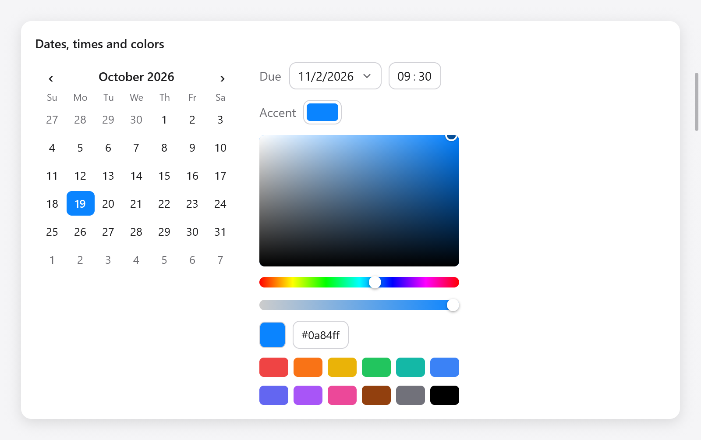

<a id="dates-times-and-colors"></a>

# Ngày, giờ và màu sắc

Lịch, trường ngày và giờ trong ngày cũng như bộ chọn màu. Mỗi chỉnh sửa một giá trị trạng thái của bạn thông qua một con trỏ và trả về true khi người dùng thay đổi nó.

<a id="dates"></a>



*Lịch, ô nhập ngày giờ, ô màu và bộ chọn màu.*

## Ngày

`ui.Date` là một ngày trong lịch Gregorian tiên sinh: `year` (một `i32`), `month` (1 đến 12) và `day` (1 đến tháng cuối cùng). Nó không có múi giờ và không có thời gian trong ngày.

| phương pháp | nó làm gì |
|---|---|
| `toDays()`, `fromDays(n)` | ngày kể từ ngày 01-01-1970 và trở lại |
| `addDays(n)` | `n` ngày sau (sớm hơn nếu âm tính) |
| `addMonths(n)` | `n` tháng sau, cùng ngày hoặc ngày cuối cùng của tháng: ngày 31 tháng 1 và một tháng là ngày cuối cùng của tháng 2 |
| `weekday()` | 0 cho Chủ Nhật đến 6 cho Thứ Bảy |
| `eql(b)` | cùng ngày |
| `valid()` | tháng và ngày trong giới hạn của họ |

```zig
const due: ui.Date = .{ .year = 2026, .month = 11, .day = 2 };
const week_later = due.addDays(7);
const days_left = due.toDays() - today.toDays();
```

Các vật dụng không đọc đồng hồ: hôm nay ứng dụng sẽ đi đến nơi nó cần. Để hiển thị ngày theo ngôn ngữ của người dùng viết chúng, hãy xem [i18n](../i18n.md).

<a id="calendars"></a>

## Lịch

`ui.calendar(c, &date, options)` hiển thị một tháng và chọn một ngày làm công cụ chọn ngày theo đồ họa của SwiftUI. Một cú nhấp chuột sẽ chọn một ngày, giống như các mũi tên thực hiện khi nó tập trung vào bàn phím; Page Up và Page Down, hoặc các nút của nó, di chuyển theo tháng; Home và End đi đến ngày đầu tiên và ngày cuối cùng của tháng. Nó trả về true khi ngày thay đổi:

```zig
_ = ui.calendar(c, &s.day, .{ .today = s.today, .first_weekday = 1 });
```

`ui.CalendarOptions`:

| lĩnh vực | mặc định | nó làm gì |
|---|---|---|
| `first_weekday` | 0 | ngày đầu tuần: 0 cho Chủ nhật (Hoa Kỳ), 1 cho Thứ Hai (hầu hết Châu Âu) |
| `today` | null | hôm nay, được đánh dấu bằng một chiếc nhẫn; không có khi null |

<a id="date-inputs"></a>

## Đầu vào ngày

`ui.dateInput(c, &date, options)` là một trường hiển thị ngày ở dạng số và lịch bên dưới nó sẽ thay đổi. Một cú nhấp chuột, Enter hoặc Space sẽ mở ra lịch, trong đó một cú nhấp chuột sẽ chọn một ngày, giống như các mũi tên và Enter; Page Up và Page Down, hoặc các nút của nó, di chuyển theo tháng; Thoát hoặc một cú nhấp chuột bên ngoài sẽ đóng nó lại. Nó trả về true khi ngày thay đổi:

```zig
ui.row(c, .{ .gap = 8, .align_items = .center });
defer ui.end(c);
ui.text(c, "Due", .{ .color = c.theme.muted });
_ = ui.dateInput(c, &s.due, .{ .format = .day_month_year, .calendar = .{ .first_weekday = 1 } });
```

`ui.DateInputOptions`: `format`, `ui.DateFormat`, và `calendar`, các tùy chọn lịch của nó.

| `ui.DateFormat` | hiển thị ngày 5 tháng 1 năm 2026 là |
|---|---|
| `.month_day_year` (mặc định) | 5/1/2026, như ở Hoa Kỳ |
| `.day_month_year` | 01/05/2026, như ở Vương quốc Anh |
| `.year_month_day` | 5/1/2026, như ở Trung Quốc |

<a id="times-of-day"></a>

## Thời gian trong ngày

`ui.Time` là thời gian trong ngày: `hour` (0 đến 23) và `minute` (0 đến 59).

`ui.timeInput(c, &time, options)` chỉnh sửa một phần trong các phân đoạn. Up và Down bước phân đoạn với trọng tâm suốt ngày đêm; các chữ số đã gõ sẽ thiết lập nó, chuyển sang số phút sau khi số giờ được gõ; A hoặc P chọn nửa ngày; Di chuyển trái và phải giữa các phân đoạn; một cú nhấp chuột tập trung một. Nó trả về true khi thời gian thay đổi:

```zig
_ = ui.timeInput(c, &s.alarm, .{});
_ = ui.timeInput(c, &s.meeting, .{ .twelve_hour = true });
```

`ui.TimeInputOptions`: `twelve_hour` (3:04 chiều thay vì 15:04), và `am` và `pm`, các từ của hai nửa trong ngày (`"AM"` và `"PM"`), đối với các ngôn ngữ khác.

<a id="color-pickers"></a>

## Bộ chọn màu

`ui.colorPicker(c, &color, &picker)` chỉnh sửa `ui.Color`, dưới dạng bảng màu của AppKit: một hình vuông chọn độ bão hòa (ngang) và độ sáng (lên) của màu sắc mà thanh trượt bên dưới nó chọn; một thanh trượt độ mờ; màu ở dạng hex mà người dùng chỉnh sửa; và các mẫu màu. Các mũi tên di chuyển qua hình vuông trong khi tiêu điểm là bàn phím. Nó trả về true khi màu thay đổi:

```zig
const State = struct {
    tint: ui.Color = .hex(0x0a84ff),
    picker: ui.ColorPicker = .{},
};

if (ui.colorPicker(c, &s.tint, &s.picker)) s.recolor();
```

`ui.ColorPicker` là những gì bộ chọn giữ trên các khung, ở trạng thái của bạn: màu xám giữ nguyên (do đó, kéo sang màu trắng và quay lại sẽ giữ màu sắc), hex được nhập và liệu bộ chọn giếng có mở hay không. Khi ứng dụng tự thay đổi màu, bộ chọn sẽ bắt đầu từ màu đó.

`ui.parseHex(s)` đọc `#rgb`, `#rrggbb` hoặc `#rrggbbaa` (`#` tùy chọn) thành một màu hoặc null, đối với các màu được lưu trong cài đặt dưới dạng văn bản.

<a id="color-wells"></a>

## Giếng màu

`ui.colorWell(c, &color, &picker)` là một mẫu màu mở ra một bộ chọn bên dưới nó, giống như ô màu của AppKit: một cú nhấp chuột, Enter hoặc Space sẽ mở nó và Escape hoặc một cú nhấp chuột bên ngoài sẽ đóng nó lại. Nó trả về true khi màu thay đổi:

```zig
ui.row(c, .{ .gap = 8, .align_items = .center });
defer ui.end(c);
ui.text(c, "Accent", .{ .color = c.theme.muted });
_ = ui.colorWell(c, &s.tint, &s.well);
```

Cung cấp cho mỗi giếng một `ui.ColorPicker` riêng.

Để làm cho màu đã chọn làm điểm nhấn của ứng dụng, hãy xem [`ui.preferences.setAccent`](styling.md#the-desktops-preferences) hoặc [`ui.themes.withAccent`](styling.md#named-themes).
