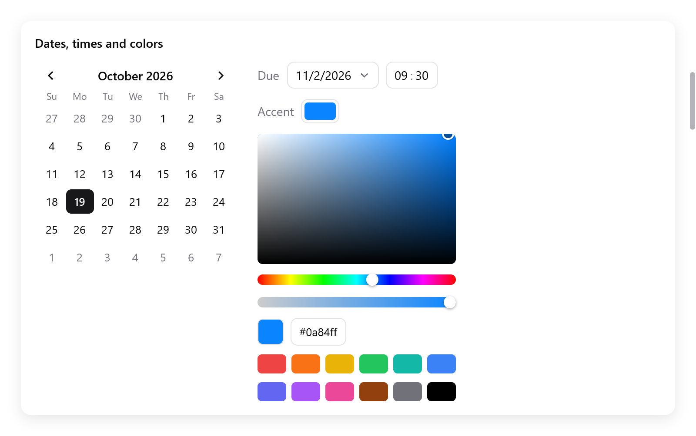

<a id="dates-times-and-colors"></a>

# Ngày, giờ và màu

Lịch, ô nhập ngày và giờ trong ngày, và bộ chọn màu. Mỗi control sửa một giá trị trong state của bạn qua con trỏ. Nó trả về true khi người dùng đổi giá trị.

<!-- demo: dates-and-colors height=520 -->



*Lịch, ô nhập ngày và giờ, color well và bộ chọn màu.*

<a id="dates"></a>

## Ngày

`ui.Date` là một ngày theo lịch Gregory mở rộng về quá khứ (proleptic):

- `year`, một `i32`;
- `month`, từ 1 đến 12;
- `day`, từ 1 đến ngày cuối của tháng.

Nó không có múi giờ và không có giờ trong ngày.

| Phương thức | Tác dụng |
|---|---|
| `toDays()`, `fromDays(n)` | số ngày kể từ 1970-01-01, và chiều ngược lại |
| `addDays(n)` | `n` ngày sau (trước, nếu âm) |
| `addMonths(n)` | `n` tháng sau, vào cùng ngày hoặc ngày cuối tháng: 31 tháng 1 cộng một tháng là ngày cuối của tháng 2 |
| `weekday()` | 0 là Chủ nhật đến 6 là thứ Bảy |
| `eql(b)` | cùng một ngày |
| `valid()` | tháng và ngày nằm trong giới hạn |

```zig
const due: ui.Date = .{ .year = 2026, .month = 11, .day = 2 };
const week_later = due.addDays(7);
const days_left = due.toDays() - today.toDays();
```

Các widget không đọc đồng hồ: app tự truyền ngày hôm nay vào chỗ cần. Để hiện ngày theo cách viết của ngôn ngữ người dùng, xem [i18n](../i18n.md).

<a id="calendars"></a>

## Lịch

```zig
_ = ui.calendar(c, &s.day, .{ .today = s.today, .first_weekday = 1 });
```

`ui.calendar(c, &date, options)` hiện một tháng và cho chọn một ngày, như date picker dạng đồ họa của SwiftUI. Nó trả về true khi ngày thay đổi.

- Bấm để chọn một ngày. Phím mũi tên cũng vậy khi lịch có focus bàn phím.
- Page Up và Page Down, hoặc các nút của lịch, chuyển theo tháng.
- Home và End tới ngày đầu và ngày cuối của tháng.

| `ui.CalendarOptions` | Mặc định | |
|---|---|---|
| `first_weekday` | 0 | ngày đầu tuần: 0 là Chủ nhật (Mỹ), 1 là thứ Hai (phần lớn châu Âu) |
| `today` | null | ngày hôm nay, đánh dấu bằng một vòng tròn; null thì không có |
| `min`, `max`, `disabled` | null | không chọn được ngày nằm ngoài chúng, hoặc ngày mà `disabled(day)` là true |
| `browse` | `false` | di chuyển chỉ xem ngày khác mà không chọn; chỉ bấm, Enter hoặc Space mới chọn |

<a id="date-inputs"></a>

## Ô nhập ngày

```zig
ui.row(c, .{ .gap = 8, .align_items = .center });
defer ui.end(c);
ui.text(c, "Due", .{ .color = c.theme.muted });
_ = ui.dateInput(c, &s.due, .{ .format = .day_month_year, .calendar = .{ .first_weekday = 1 } });
```

`ui.dateInput(c, &date, options)` là một ô hiện ngày bằng số. Một cuốn lịch bên dưới dùng để đổi ngày. Nó trả về true khi ngày thay đổi.

- Bấm, Enter hoặc Space mở lịch.
- Trong lịch, bấm để chọn một ngày, phím mũi tên và Enter cũng vậy.
- Page Up và Page Down, hoặc các nút của lịch, chuyển theo tháng.
- Escape hoặc bấm ra ngoài thì đóng lịch.

`ui.DateInputOptions`: `format`, một `ui.DateFormat`, và `calendar`, các tùy chọn của lịch.

| `ui.DateFormat` | hiện ngày 5 tháng 1 năm 2026 là |
|---|---|
| `.month_day_year` (mặc định) | 1/5/2026, như ở Mỹ |
| `.day_month_year` | 05/01/2026, như ở Anh |
| `.year_month_day` | 2026/1/5, như ở Trung Quốc |

<a id="times-of-day"></a>

## Giờ trong ngày

```zig
_ = ui.timeInput(c, &s.alarm, .{});
_ = ui.timeInput(c, &s.meeting, .{ .twelve_hour = true });
```

`ui.Time` là một giờ trong ngày: `hour` (0 đến 23) và `minute` (0 đến 59). `ui.timeInput(c, &time, options)` sửa nó theo từng phần. Nó trả về true khi giờ thay đổi.

- Up và Down tăng giảm phần đang có focus, vòng quanh đồng hồ.
- Gõ số để đặt phần đó. Gõ xong giờ thì nó chuyển sang phút.
- A hoặc P chọn buổi sáng hay chiều.
- Left và Right chuyển giữa các phần; bấm vào một phần để focus nó.

| `ui.TimeInputOptions` | Mặc định | |
|---|---|---|
| `twelve_hour` | `false` | 3:04 PM thay vì 15:04 |
| `am`, `pm` | `"AM"`, `"PM"` | chữ cho hai buổi trong ngày, dùng cho ngôn ngữ khác |

<a id="color-pickers"></a>

## Bộ chọn màu

```zig
const State = struct {
    tint: ui.Color = .hex(0x0a84ff),
    picker: ui.ColorPicker = .{},
};

if (ui.colorPicker(c, &s.tint, &s.picker)) s.recolor();
```

`ui.colorPicker(c, &color, &picker)` sửa một `ui.Color`, như color panel của AppKit. Nó trả về true khi màu thay đổi. Nó gồm:

- một hình vuông chọn độ bão hòa (theo chiều ngang) và độ sáng (theo chiều dọc);
- bên dưới, một slider chọn hue;
- một slider độ mờ đục;
- màu dạng hex, người dùng sửa được;
- các ô màu mẫu.

Khi hình vuông có focus bàn phím, phím mũi tên di chuyển trong nó.

`ui.ColorPicker` là những gì bộ chọn giữ qua các frame, trong state của bạn:

- hue mà một màu xám giữ lại, nên kéo về trắng rồi kéo ra vẫn giữ hue;
- chuỗi hex đang gõ;
- picker của một color well có đang mở hay không.

Khi app tự đổi màu, bộ chọn bắt đầu lại từ màu đó.

`ui.parseHex(s)` đọc `#rgb`, `#rrggbb` hoặc `#rrggbbaa` thành một màu, hoặc null. Dấu `#` có thể bỏ. Dùng nó cho màu lưu trong cài đặt dưới dạng chữ.

<a id="color-wells"></a>

## Color well

```zig
ui.row(c, .{ .gap = 8, .align_items = .center });
defer ui.end(c);
ui.text(c, "Accent", .{ .color = c.theme.muted });
_ = ui.colorWell(c, &s.tint, &s.well);
```

`ui.colorWell(c, &color, &picker)` là một ô màu, bấm vào thì mở bộ chọn màu bên dưới, như color well của AppKit. Nó trả về true khi màu thay đổi.

- Bấm, Enter hoặc Space mở bộ chọn.
- Escape hoặc bấm ra ngoài thì đóng.
- Mỗi well cần một `ui.ColorPicker` riêng.

Để dùng màu đã chọn làm màu accent của app, xem [`ui.preferences.setAccent`](styling.md#the-desktops-preferences) hoặc [`ui.themes.withAccent`](styling.md#named-themes).
