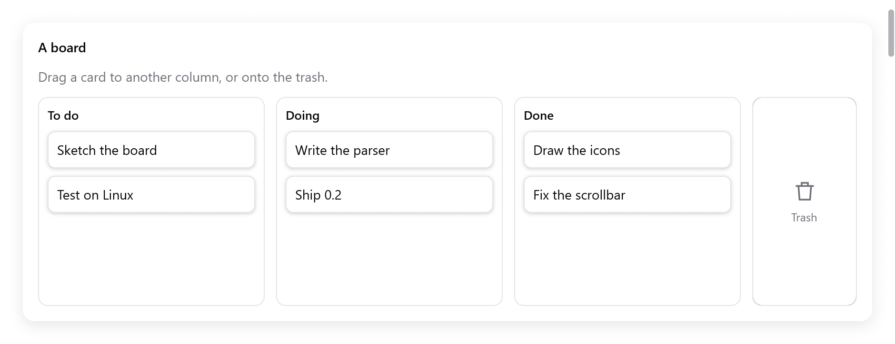

<a id="drag-and-drop"></a>

# Kéo và thả

`ui.DragDrop` kéo dữ liệu bên trong một cửa sổ giao diện native: từ các box kéo được dữ liệu (`draggable`) tới các box nhận dữ liệu (`target`).

<!-- demo: drag-and-drop height=386 -->



*Các thẻ công việc kéo được trong các cột To do, Doing và Done, cạnh một target thùng rác.*

- Cú kéo bắt đầu khi con trỏ đang bấm một draggable di chuyển được 4 điểm. Một bản sao trong mờ của box đi theo con trỏ, và cú bấm không còn là click nữa.
- Khi thả, target trong cùng dưới con trỏ nhận được một trong các định dạng của dữ liệu sẽ lấy nó. Hiệu ứng là thứ cả hai đầu cùng cho phép: copy, move hoặc link.
- Escape hủy cú kéo.
- Dữ liệu là một `myzig.transfer.Data`: các mục theo định dạng có kiểu, giống dữ liệu mà clipboard và kéo thả của hệ thống mang theo (xem [Truyền dữ liệu](../data-transfer.md)).
- Cú kéo ra khỏi cửa sổ sẽ tiếp tục bằng kéo thả của hệ thống, tới cửa sổ khác và app khác, ở nơi myzig hỗ trợ (Windows, OLE).

<a id="a-board-of-cards"></a>

## Một bảng thẻ

```zig
const std = @import("std");
const myzig = @import("myzig");
const ui = myzig.ui;
const transfer = myzig.transfer;

const Task = struct { id: u32, title: []const u8, column: u8 };
const columns = [_][]const u8{ "To do", "Doing", "Done" };

const Board = struct {
    gpa: std.mem.Allocator,
    tasks: [32]Task = undefined,
    count: usize = 0,
    dnd: ui.DragDrop = .{},

    fn deinit(b: *Board) void {
        b.dnd.deinit();
    }

    fn view(b: *Board, c: *ui.Context) void {
        const th = c.theme;
        const fmt = transfer.value_format(Task);
        ui.row(c, .{ .width = .fill, .height = .fill, .gap = 12, .padding = .all(16), .align_items = .stretch });
        defer ui.end(c);
        for (columns, 0..) |name, col| {
            // Một target: box được mở trước các phần tử con của nó.
            const zone = c.open(.{ .grow = 1, .padding = .all(10), .gap = 8, .radius = 10, .border = th.border }, name);
            const t = b.dnd.target(c, zone, .{ .formats = &.{fmt}, .effects = .copy_move });
            if (t.over) c.node(zone).style.border = th.accent;
            ui.text(c, name, .{ .weight = .semibold });
            for (b.tasks[0..b.count]) |*task| {
                if (task.column != col) continue;
                ui.key(c, c.print("task-{d}", .{task.id}));
                var d = b.dnd.draggable(c, .{ .width = .fill, .padding = .all(10), .radius = 8, .background = th.surface }, .{ .effects = .copy_move });
                if (d.starting) if (transfer.valueData(b.gpa, Task, task)) |data| d.offer(data) else |_| {};
                ui.text(c, task.title, .{});
                _ = d.end();
            }
            c.end();
            if (t.dropped) |drop| if (drop.data.value(Task)) |task| {
                task.column = @intCast(col);
            };
        }
        b.dnd.preview(c); // cuối cùng: bản sao đi theo con trỏ
    }
};
```

App giữ một `ui.DragDrop` cho mỗi cửa sổ, và giải phóng nó bằng `deinit()`.

<a id="sources"></a>

## Nguồn kéo

`dnd.draggable(c, style, opts)` mở một box có style `style`. Các phần tử con của nó theo sau, rồi đến `end()`.

- `starting` là true trong frame mà con trỏ đang bấm nó đã đi đủ xa. Lúc đó `offer(data)` bắt đầu cú kéo với dữ liệu, và từ đó cú kéo sở hữu dữ liệu này.
- Draggable không offer gì thì vẫn chỉ là một cú bấm, nên một dòng có thể lúc kéo được, lúc không.

`ui.DraggableOptions`:

| Trường | Mặc định | |
|---|---|---|
| `effects` | copy | cú thả được làm gì với dữ liệu: `transfer.Effects` (`.copy`, `.move`, `.link`, hoặc `.copy_move`) |
| `count` | 1 | cú kéo chứa bao nhiêu giá trị, hiện cạnh con trỏ khi nhiều hơn một (các dòng đã chọn trong list, kéo cùng nhau) |
| `dim` | true | làm mờ box khi dữ liệu của nó đang được kéo |

`end()` trả về:

| Trường | |
|---|---|
| `dragging` | dữ liệu của nó có đang được kéo không |
| `finished` | một `ui.DragFinished`, trong frame mà cú kéo kết thúc |

`ui.DragFinished` có:

- `effect`: target đã làm gì. `.move` nghĩa là nguồn phải xóa giá trị của mình.
- `canceled`: Escape, hoặc thả trên chỗ không nhận dữ liệu.
- `escaped`: phân biệt cú kéo bị hủy (Escape, `cancel()`) với cú kéo thả ở chỗ không có target.
- `screen`: nơi kết thúc của cú kéo đã chuyển sang kéo thả của hệ thống, tính bằng điểm màn hình ([Truyền dữ liệu](../data-transfer.md#drags-that-leave-the-window)).

```zig
if (d.end().finished) |f| {
    if (f.effect == .move) s.remove(task.id);
}
```

Gắn key cho các draggable trong vòng lặp bằng `ui.key`, để cú kéo giữ đúng nguồn khi các mục phía trên xuất hiện hay biến mất.

<a id="targets"></a>

## Target

`dnd.target(c, index, opts)` biến box `index` (lấy từ `c.open`) thành target, trước khi dựng các phần tử con của nó. Nó trả về một `ui.DropTargetResult`:

- `over`: khi dữ liệu mà nó nhận đang được kéo qua nó. Lúc đó hãy làm nổi bật nó.
- `dropped`: một `ui.Drop`, trong frame mà dữ liệu được thả lên nó.

`ui.DropTargetOptions` có `formats` (các định dạng nó nhận; để trống thì nhận mọi thứ), `effects` (copy) và `disabled`.

Một `ui.Drop` có:

- `data`, dùng được tới frame kế tiếp. Đọc nó, hoặc `clone` để giữ lại.
- `effect`, hiệu ứng đã thống nhất. Khi cả hai đầu cho phép nhiều hiệu ứng, copy được ưu tiên, và giữ Shift để yêu cầu move. Target cũng có thể đọc phím bổ trợ (`c.input.ctrl`, `c.input.shift`) để tự quyết định.
- `at`, nơi con trỏ thả ra, tính bằng điểm của cửa sổ.

Dữ liệu đọc được theo bất kỳ định dạng nào nó có:

- `data.value(T)` trả về `*T` mà cú kéo `transfer.valueData` mang theo, cho các cú kéo bên trong app, khớp theo `transfer.value_format(T)`.
- `data.read(allocator, format)` trả về các byte của một định dạng, được tạo ra khi được hỏi với những định dạng offer kiểu lazy.
- `data.files(allocator)` trả về các đường dẫn của dữ liệu `transfer.file_list` và `transfer.uri_list`.
- `data.preferred(&wanted)` chọn định dạng đầu tiên trong `wanted` mà nó có.

<a id="the-preview"></a>

## Bản xem trước

- `dnd.preview(c)` vẽ bản sao của nguồn đi theo con trỏ, đè lên mọi thứ. Gọi một lần, cuối cùng trong view.
- `dnd.dragging()` là true khi đang có dữ liệu được kéo.
- `dnd.cancel()` hủy cú kéo từ code.

<a id="out-of-the-window-and-into-it"></a>

## Kéo ra khỏi cửa sổ, và kéo vào

Cú kéo rời cửa sổ bằng kéo thả của hệ thống khi `DragDrop` có `external`. `myzig.systemDrag(window)` trả về một `external` ở nơi myzig hỗ trợ kéo thả của hệ thống (Windows, qua OLE). Ở nơi khác nó trả về null, và cú kéo nằm trong cửa sổ.

```zig
const win = try app.newWindow(.{
    .title = "Board",
    .on_drop = .of(&board, Board.droppedFiles),
    .content = .{ .view = .init(&board, Board.view) },
});
board.dnd.external = myzig.systemDrag(win);
```

- Dữ liệu kéo ra có thể offer nhiều định dạng, một số chỉ được tạo khi target hỏi tới (`transfer.lazy`). Ví dụ một ghi chú ở dạng văn bản cho trình soạn thảo, và ở dạng JSON cho một cửa sổ khác của app.
- `transfer.fileData(gpa, paths)` kéo file sang trình quản lý file.
- File thả lên cửa sổ từ trình quản lý file hoặc app khác sẽ tới callback `on_drop` của cửa sổ, `fn (ctx, *myzig.Window, paths: []const []const u8) void`. Bọc chúng trong `transfer.fileData` để đưa cho cùng đoạn code xử lý cú thả bên trong cửa sổ.

Xem `examples/drag-drop`: hai cửa sổ kéo ghi chú, văn bản, URL và file qua lại với nhau và với app khác. Xem [Truyền dữ liệu](../data-transfer.md) cho các định dạng.

<a id="testing"></a>

## Test

- `ui.Tester.drag(x1, y1, x2, y2)` bấm ở một điểm, di chuyển qua ngưỡng tới điểm kia rồi thả.
- `moveTo` di chuyển con trỏ từng bước, để kiểm tra target có nổi bật trên đường đi không (xem [Test](testing.md)).
- Cú kéo trong test không bao giờ chạm tới kéo thả của hệ thống.
