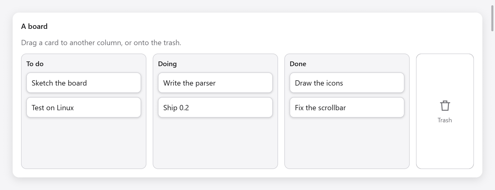

<a id="drag-and-drop"></a>

# Kéo và thả

`ui.DragDrop` kéo dữ liệu trong cửa sổ giao diện native: các hộp kéo dữ liệu (`draggable`) và các hộp lấy dữ liệu (`target`). Sau khi con trỏ nhấn vào vật có thể kéo được sẽ di chuyển 4 điểm, bản sao mờ của hộp sẽ đi theo con trỏ và thao tác nhấn không còn là nhấp chuột nữa; mục tiêu trong cùng bên dưới con trỏ lấy một trong các định dạng của dữ liệu sẽ nhận được nó khi con trỏ thả ra, với hiệu ứng mà cả hai đầu đều cho phép (sao chép, di chuyển, liên kết). Escape từ bỏ một lực cản.

Dữ liệu là `myzig.transfer.Data`: các mục ở định dạng đã nhập, cùng dữ liệu trong bảng tạm và thao tác kéo và thả của hệ thống (xem [Truyền dữ liệu](../data-transfer.md)). Thao tác kéo rời khỏi cửa sổ sẽ tiếp tục trong quá trình kéo và thả của hệ thống trong đó myzig có một (Windows, OLE), tới các cửa sổ khác và ứng dụng khác.

<a id="a-board-of-cards"></a>



*Các thẻ công việc có thể kéo giữa To do, Doing và Done, cạnh vùng thả vào thùng rác.*

## Một bảng thẻ

```zig
const std = @import("std");
const myzig = @import("myzig");
const ui = myzig.ui;
const transfer = myzig.transfer;

const Task = struct { id: u32, title: []const u8, column: u8 };
const columns = [_][]const u8{ "To do", "Doing", "Done" };

const Board = struct {
    gpa: std.mem.Allocator,
    tasks: [32]Task = undefined,
    count: usize = 0,
    dnd: ui.DragDrop = .{},

    fn deinit(b: *Board) void {
        b.dnd.deinit();
    }

    fn view(b: *Board, c: *ui.Context) void {
        const th = c.theme;
        const fmt = transfer.value_format(Task);
        ui.row(c, .{ .width = .fill, .height = .fill, .gap = 12, .padding = .all(16), .align_items = .stretch });
        defer ui.end(c);
        for (columns, 0..) |name, col| {
            // A target: a box opened before its children.
            const zone = c.open(.{ .grow = 1, .padding = .all(10), .gap = 8, .radius = 10, .border = th.border }, name);
            const t = b.dnd.target(c, zone, .{ .formats = &.{fmt}, .effects = .copy_move });
            if (t.over) c.node(zone).style.border = th.accent;
            ui.text(c, name, .{ .weight = .semibold });
            for (b.tasks[0..b.count]) |*task| {
                if (task.column != col) continue;
                ui.key(c, c.print("task-{d}", .{task.id}));
                var d = b.dnd.draggable(c, .{ .width = .fill, .padding = .all(10), .radius = 8, .background = th.surface }, .{ .effects = .copy_move });
                if (d.starting) if (transfer.valueData(b.gpa, Task, task)) |data| d.offer(data) else |_| {};
                ui.text(c, task.title, .{});
                _ = d.end();
            }
            c.end();
            if (t.dropped) |drop| if (drop.data.value(Task)) |task| {
                task.column = @intCast(col);
            };
        }
        b.dnd.preview(c); // last: the copy that follows the pointer
    }
};
```

Ứng dụng giữ một `ui.DragDrop` trên mỗi cửa sổ và giải phóng nó bằng `deinit()`.

<a id="sources"></a>

## Nguồn

`dnd.draggable(c, style, opts)` mở một hộp có kiểu dáng `style` có con theo sau, sau đó là `end()`. Trong khung, con trỏ nhấn nó đã di chuyển đủ xa, `starting` là true: `offer(data)` bắt đầu kéo bằng dữ liệu mà thao tác kéo sở hữu. Một đối tượng có thể kéo không cung cấp bất cứ thứ gì vẫn là một nút nhấn, do đó, một hàng chỉ có thể kéo trong một khoảng thời gian.

`ui.DraggableOptions`:

| trường | Mặc định | |
|---|---|---|
| `effects` | sao chép | tác dụng của việc giảm dữ liệu: `transfer.Effects` (`.copy`, `.move`, `.link` hoặc `.copy_move`) |
| `count` | 1 | thao tác kéo giữ bao nhiêu giá trị, được hiển thị bên cạnh con trỏ khi một số (các hàng được chọn trong danh sách được kéo cùng nhau) |
| `dim` | true | làm mờ hộp trong khi dữ liệu của nó kéo |

`end()` trả về xem đó là `dragging` và `finished`, `ui.DragFinished`, trong khung quá trình kéo của nó đã kết thúc: `effect` mục tiêu đã thực hiện (`.move` có nghĩa là nguồn xóa giá trị của nó) và `canceled` (Thoát hoặc bỏ qua không có gì chiếm lấy nó); `escaped` cho biết một lần kéo đã bỏ cuộc (Escape, `cancel()`) từ một lần không vượt qua mục tiêu và `screen` là nơi một lần kéo tiếp tục diễn ra trong hệ thống đã kết thúc, tại các điểm trên màn hình ([Truyền dữ liệu](../data-transfer.md#drags-that-leave-the-window)).

```zig
if (d.end().finished) |f| {
    if (f.effect == .move) s.remove(task.id);
}
```

Các phím có thể kéo trong một vòng lặp với `ui.key`, sao cho lực kéo giữ nguyên nguồn của nó khi các mục phía trên nó đến và đi.

<a id="targets"></a>

## Mục tiêu

`dnd.target(c, index, opts)` đặt hộp `index` (từ `c.open`) làm mục tiêu, trước khi các hộp con của nó được xây dựng. Nó trả về `ui.DropTargetResult`: `over`, trong khi dữ liệu nó sẽ kéo qua nó (đánh dấu nó sau đó) và `dropped`, `ui.Drop`, trong khung, dữ liệu được thả vào đó.

`ui.DropTargetOptions` có `formats` (các định dạng cần có; trống có bất kỳ định dạng nào), `effects` (bản sao) và `disabled`.

`ui.Drop` có `data`, hợp lệ cho đến khung tiếp theo (đọc nó hoặc `clone` để giữ khung), `effect` đã đồng ý và `at`, nơi con trỏ buông ra, trong các điểm cửa sổ. Khi cả hai đầu cho phép một số hiệu ứng, việc sao chép sẽ được ưu tiên và giữ Shift sẽ yêu cầu di chuyển; mục tiêu cũng có thể đọc các từ bổ nghĩa (`c.input.ctrl`, `c.input.shift`) để tự quyết định.

Dữ liệu có thể được đọc ở bất kỳ định dạng nào của nó:

- `data.value(T)` trả về `*T` một `transfer.valueData` mang kéo, cho các lần kéo trong ứng dụng, khớp với `transfer.value_format(T)`.
- `data.read(allocator, format)` trả về các byte có định dạng, được tạo khi được yêu cầu tạo dữ liệu khi được yêu cầu.
- `data.files(allocator)` trả về đường dẫn của dữ liệu `transfer.file_list` và `transfer.uri_list`.
- `data.preferred(&wanted)` chọn định dạng đầu tiên của `wanted` mà nó có.

<a id="the-preview"></a>

## Bản xem trước

`dnd.preview(c)` vẽ bản sao của nguồn theo sau con trỏ, trên mọi thứ: gọi nó một lần, cuối cùng trong view. `dnd.dragging()` là true trong khi kéo dữ liệu và `dnd.cancel()` cho phép kéo lên từ mã.

<a id="out-of-the-window-and-into-it"></a>

## Ra khỏi cửa sổ và vào trong đó

Thao tác kéo sẽ rời khỏi cửa sổ trong quá trình kéo và thả của hệ thống khi `DragDrop` có `external`: `myzig.systemDrag(window)` trả về một cửa sổ trong đó myzig có thao tác kéo của hệ thống (Windows, thông qua OLE) và null ở nơi khác, nơi các thao tác kéo vẫn nằm trong cửa sổ.

```zig
const win = try app.newWindow(.{
    .title = "Board",
    .on_drop = .of(&board, Board.droppedFiles),
    .content = .{ .view = .init(&board, Board.view) },
});
board.dnd.external = myzig.systemDrag(win);
```

Dữ liệu được kéo ra có thể cung cấp một số định dạng, một số chỉ được tạo khi mục tiêu yêu cầu (`transfer.lazy`): ghi chú dưới dạng văn bản cho trình soạn thảo văn bản và dưới dạng JSON cho một cửa sổ khác của ứng dụng. `transfer.fileData(gpa, paths)` kéo tệp vào trình quản lý tệp.

Các tệp được thả trên cửa sổ từ trình quản lý tệp hoặc ứng dụng khác sẽ chuyển đến lệnh gọi lại `on_drop` của cửa sổ, `fn (ctx, *myzig.Window, paths: []const []const u8) void`; bọc chúng trong `transfer.fileData` để đưa chúng vào cùng mã với các giọt trong cửa sổ. Xem `examples/drag-drop` để biết hai cửa sổ kéo ghi chú, văn bản, URL và tệp giữa nhau và các ứng dụng khác và [Truyền dữ liệu](../data-transfer.md) để biết các định dạng.

<a id="testing"></a>

## Kiểm tra

`ui.Tester.drag(x1, y1, x2, y2)` nhấn vào một điểm, di chuyển qua ngưỡng này đến điểm khác và thả ra, đồng thời `moveTo` di chuyển con trỏ từng bước để kiểm tra điểm nổi bật của mục tiêu trên đường đi (xem [Kiểm thử](testing.md)). Thao tác kéo trong kiểm thử không bao giờ chạm vào thao tác kéo và thả của hệ thống.
