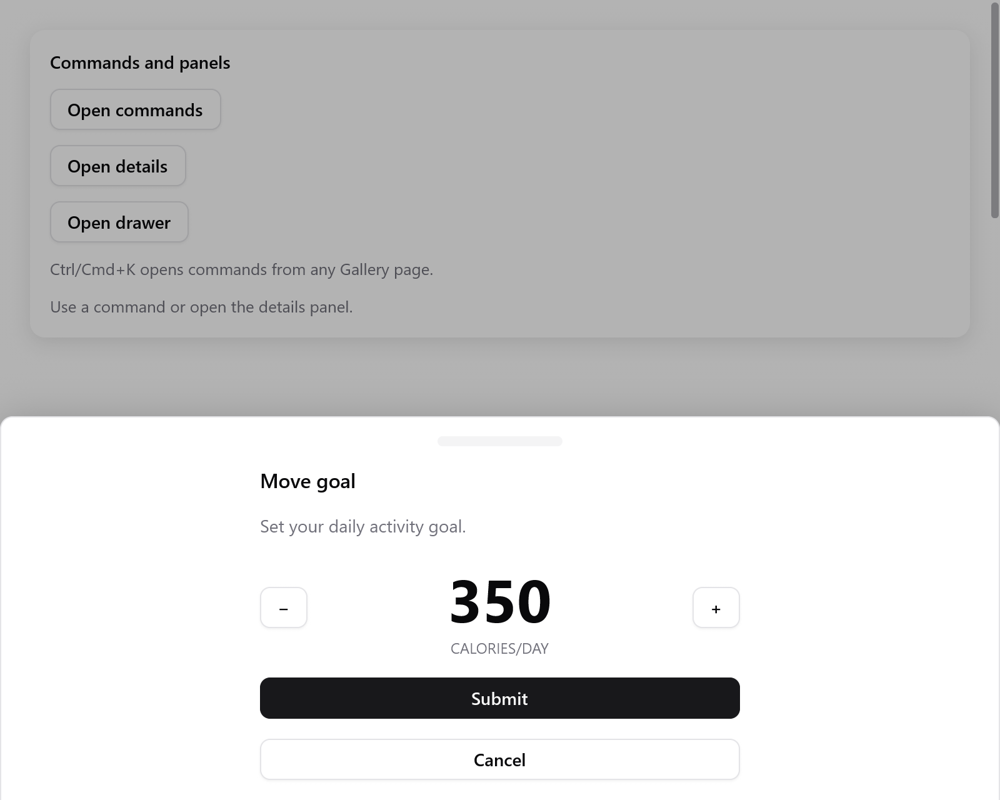

# Drawer

Panel trồi ra từ một mép cửa sổ, kéo để đóng: bản port của [vaul](https://vaul.emilkowal.ski), drawer mà shadcn/ui dùng.

<!-- demo: drawer height=420 -->



*Drawer Move goal trồi lên từ dưới, phía trên cửa sổ đã bị làm mờ.*

```zig
// Trong state của app: goal: ui.DrawerState = .{},
if (ui.button(c, "Move goal", .{}).clicked) s.goal.show();
if (ui.drawer(c, &s.goal, .{ .label = "Move goal" })) |d| {
    defer d.end();
    ui.text(c, "Set your daily activity goal.", .{});
    if (ui.button(c, "Submit", .{ .variant = .primary }).clicked) s.goal.close();
}
```

`show`, `close` và `toggle` mở và đóng nó; drawer tự trượt vào ra. `visible()` là true cho đến khi nó trượt đi hẳn.

| `DrawerOptions` | Mặc định | |
|---|---|---|
| `side` | `.bottom` | `.bottom`, `.top`, `.left` hoặc `.right` |
| `snap_points` | không có | các vị trí dừng, từ ít mở nhất: `.{ .fraction = 0.5 }` hoặc `.{ .px = 148 }` |
| `fade_from` | cái cuối | snap point mà từ đó cửa sổ bị làm mờ |
| `snap_to_sequential` | `false` | vuốt chỉ đi một snap point, không nhảy thẳng tới cuối |
| `dismissible` | `true` | Escape, bấm bên ngoài và kéo sẽ đóng nó |
| `close_threshold` | 0.25 | phần kích thước phải kéo qua để đóng |
| `handle`, `handle_only` | `true`, `false` | thanh để nắm kéo; chỉ thanh này mới kéo được |
| `size`, `max` | theo nội dung, 0.8 | chiều cao (hoặc chiều rộng: 384); chiếm tối đa phần này của cửa sổ |
| `modal` | `true` | làm mờ cửa sổ và giữ bàn phím; `false` để phía sau vẫn dùng được |
| `parent` | `null` | drawer mà nó mở ra từ đó, và bị đẩy lùi lại |
| `padding`, `gap`, `label` | 16, 12, `"Drawer"` | của panel; tên cho trình đọc màn hình |

**Kéo**

- Kéo panel hoặc thanh nắm, không phải các control bên trong.
- Thả tay khi đang kéo nhanh (0,4 điểm mỗi mili giây) hoặc đã quá `close_threshold` thì nó đóng; nếu không thì nó trở về. Kéo quá vị trí mở thì bị ghìm lại.
- Khi có snap point, nó dừng ở snap point gần nhất, và vuốt nhanh thì sang snap point kế tiếp. Chỉ vị trí thôi thì không bao giờ đóng. `DrawerState.snap` cho biết nó đang dừng ở đâu.
- Bấm vào thanh nắm thì sang snap point kế tiếp, hoặc đóng nếu đang ở cái cuối. Nhấn giữ thì không làm gì.

**Cửa sổ phía sau.** Mở `ui.drawerBackground` bao quanh phần còn lại của view thì nó thu nhỏ lùi lại khi drawer mở, như trên iOS:

```zig
const back = ui.drawerBackground(c, &s.goal);
// ... nội dung cửa sổ ...
back.end();
if (ui.drawer(c, &s.goal, .{})) |d| { ... }
```

**Drawer lồng nhau.** Dựng drawer thứ hai trong nội dung của drawer thứ nhất, kèm `.parent`. Drawer thứ nhất thu nhỏ lùi lại 16 điểm khi drawer thứ hai mở, và đi theo cú kéo của nó. Escape đóng drawer trên cùng trước.

```zig
if (ui.drawer(c, &s.outer, .{})) |d| {
    defer d.end();
    if (ui.button(c, "Open another", .{}).clicked) s.inner.show();
    if (ui.drawer(c, &s.inner, .{ .parent = &s.outer })) |n| {
        defer n.end();
    }
}
```

Drawer modal hoạt động như [dialog](overlays.md#dialogs): Tab chỉ đi trong nó, và tiêu điểm trở lại chỗ cũ khi nó đóng. Khi hệ thống yêu cầu giảm chuyển động, nó hiện ra ngay.

Xem trang `Feedback` trong [Gallery](../../../examples/gallery/feedback.zig).
