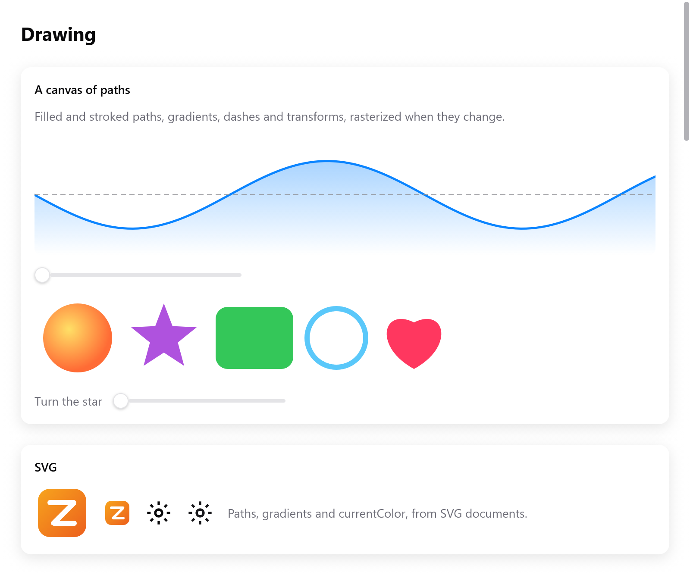

<a id="drawing"></a>

# Vẽ

Khi box, chữ và icon không đủ, hãy tự vẽ.

- `ui.canvas` đưa cho một hàm vẽ một `ui.Painter`. Painter tô (fill) và vẽ viền (stroke) các path bằng màu và gradient, qua các phép biến đổi và clip.
- `ui.svg` vẽ tài liệu SVG theo cùng cách.
- Biểu đồ cũng được vẽ trên canvas ([Charts](chart.md)).
- Với hiệu ứng tính trên từng pixel, xem [Shaders](shaders.md).

Trang Drawing của gallery có các ví dụ dưới đây (`examples/gallery/drawing.zig`, `zig build run-gallery`).

<!-- demo: drawing height=520 -->



*Path trên canvas, gradient, nét đứt, các hình cơ bản và ảnh SVG.*

<a id="a-canvas"></a>

## Canvas

```zig
const Wave = struct {
    phase: f32 = 0,

    fn draw(s: *Wave, p: *ui.Painter) void {
        var line = p.path();
        for (0..101) |i| {
            const x = p.size.w * @as(f32, @floatFromInt(i)) / 100;
            const y = p.size.h / 2 + 30 * @sin(@as(f32, @floatFromInt(i)) / 8 + s.phase);
            if (i == 0) line.moveTo(x, y) else line.lineTo(x, y);
        }
        p.stroke(&line, .color(.hex(0x0a84ff)), .{ .width = 2, .join = .round });
    }

    fn view(s: *Wave, c: *ui.Context) void {
        _ = ui.canvas(c, .{ .w = 300, .h = 120 }, .{ .radius = 8 }, s, draw);
        _ = ui.slider(c, &s.phase, .{ .min = 0, .max = 6.28, .label = "Phase" });
    }
};
```

`ui.canvas(c, size, options, ctx, draw)` tạo một box rộng `size` điểm. Nó gọi `draw(ctx, painter)` để ghi lại những gì cần hiện.

- Cạnh nào bằng 0 thì canvas lấp đầy phần tử cha theo chiều đó.
- Canvas được vẽ theo kích thước nó có ở lần layout trước. `p.size` cho biết kích thước đó.

| `ui.CanvasOptions` | |
|---|---|
| `key` | một id giữ nguyên khi đổi thứ tự |
| `opacity` | |
| `radius` | bo góc hình và cắt bỏ phần vẽ ở các góc đó |

**Phần đang hiện.** `p.visible()` là phần canvas đang nằm trong vùng nhìn thấy, theo hệ tọa độ mà canvas vẽ. Một hình vẽ cao hơn cửa sổ, như một tài liệu dài hay biểu đồ nhiều điểm, bỏ qua phần nằm ngoài:

```zig
const v = p.visible();
for (s.lines, 0..) |l, i| {
    const y = @as(f32, @floatFromInt(i)) * 20;
    if (y + 20 < v.y or y > v.y + v.h) continue;
    p.fillRect(.{ .x = 4, .y = y, .w = l.width, .h = 14 }, th.text);
}
```

- Một frame có scroll canvas thì vẽ lại thêm một lần, với phần đang hiện mới.
- Cho đến khi có frame vẽ nó, đây là toàn bộ canvas.
- Bên ngoài painter, `ui.canvasVisibility(c, id, whole)` trả lời cùng câu hỏi cho canvas sẽ nhận box id `id` (`c.peekId`). Một animation có thể tạm dừng khi canvas của nó bị scroll ra khỏi vùng nhìn thấy, như [plugin loading](../plugins/loading.md) làm.

<details>
<summary>Cách tìm phần đang hiện</summary>

Đó là box của canvas, giới hạn trong các box có scroll, các clip bao quanh và cửa sổ, theo frame vẽ gần nhất. Nó được tính ngược lại qua các phép biến đổi của box và của chính painter. Vì vậy canvas khi phóng to sẽ thấy ít phần của mình hơn, đúng bằng phần đang hiện.

</details>

**Con trỏ.** Canvas trả về chỉ số box của nó, nên nó nhận con trỏ như mọi box khác:

```zig
const box = ui.canvas(c, .{ .w = 0, .h = 200 }, .{}, s, draw);
const it = c.interact(box, .{});
if (it.clicked) if (it.rect) |r| s.addPoint(c.input.mouse.x - r.x, c.input.mouse.y - r.y);
```

<a id="how-it-is-drawn"></a>

### Cách canvas được vẽ

Painter chỉ ghi lại lệnh; bản thân nó không vẽ gì.

- Bản ghi được rasterize trên CPU (`src/ui/canvas_render.zig`), có khử răng cưa, theo tỉ lệ của cửa sổ.
- Kết quả là một hình trong image atlas. Mọi renderer vẽ hình đó giống như vẽ `ui.image`.
- Hình được đánh khóa bằng hash của bản ghi. Canvas chỉ rasterize lại khi nội dung ghi lại thay đổi.
- Một frame vẽ y hệt lần trước chỉ tốn chi phí ghi lệnh và tính hash.
- Canvas thay đổi mỗi frame, như một animation, sẽ bị rasterize mỗi frame. Hãy giữ chúng nhỏ, hoặc chuyển phần chuyển động sang transform của box ([Transforms](transforms.md)).
- Path, gradient stop và nét đứt đưa cho Painter đều được sao chép. Bộ nhớ nào cũng truyền được, kể cả stack.

<a id="paths"></a>

## Path

`p.path()` tạo một `ui.Path` trong bộ nhớ của frame. Tọa độ tính bằng điểm, từ góc trên bên trái canvas, trục y hướng xuống.

| Phương thức | Vẽ |
|---|---|
| `moveTo(x, y)` | bắt đầu một subpath mới |
| `lineTo(x, y)` | một đoạn thẳng |
| `quadTo(cx, cy, x, y)` | một đường Bézier bậc hai |
| `cubicTo(c1x, c1y, c2x, c2y, x, y)` | một đường Bézier bậc ba |
| `close()` | đóng subpath |
| `arc(cx, cy, r, a0, a1, ccw)` | một cung tròn, góc tính bằng radian |
| `svgArc(rx, ry, rotation, large, sweep, x, y)` | cung elip kiểu SVG tới một điểm |
| `rect(x, y, w, h)` | một hình chữ nhật |
| `roundRect(x, y, w, h, rx, ry)` | một hình chữ nhật bo góc |
| `ellipse(cx, cy, rx, ry)`, `circle(cx, cy, r)` | hình elip |
| `polyline(points, closed)` | các điểm `[2]f32` nối với nhau |
| `append(data, transform)` | `ui.PathData` của một path khác, đã biến đổi |

Path tạo bằng allocator riêng (`ui.Path.init(gpa)`) có thể giữ qua nhiều frame và dùng lại:

- `reset()` làm rỗng nó;
- `deinit()` giải phóng nó;
- `data()` trả về `ui.PathData` của nó (verb và điểm) để dùng với `p.fillData`.

<a id="filling-and-stroking"></a>

## Tô và vẽ viền

```zig
p.fill(&path, .color(.hex(0xaf52de)));
p.fillRule(&path, .color(c.theme.text), .evenodd); // thủng ở chỗ các subpath chồng nhau
p.stroke(&path, .color(accent), .{ .width = 2.5, .join = .round, .cap = .round });
```

`ui.FillRule` là `.nonzero` (mặc định của `fill`) hoặc `.evenodd`.

| `ui.Stroke` | Mặc định | |
|---|---|---|
| `width` | 1 | tính bằng điểm |
| `join` | `.miter` | `ui.LineJoin`: `.miter`, `.round`, `.bevel` |
| `cap` | `.butt` | `ui.LineCap`: `.butt`, `.round`, `.square` |
| `miter_limit` | 4 | độ dài tối đa của góc nhọn, tính theo bề rộng nét, trước khi bị vát |
| `dash` | không có | độ dài đoạn vẽ và đoạn trống, lặp lại (số lẻ thì được lấy hai lần) |
| `dash_offset` | 0 | vị trí bắt đầu nét đứt |

Viết tắt: `fillRect(rect, color)`, `fillRoundRect(rect, radius, paint)`, `fillCircle(cx, cy, r, paint)`, `strokeCircle(cx, cy, r, width, color)` và `line(x0, y0, x1, y1, width, color)`.

<a id="paints-and-gradients"></a>

## Paint và gradient

Một `ui.Paint` là `.color(c)` (`.solid`), `.linear` hoặc `.radial`, như gradient của SVG và Canvas 2D:

```zig
p.fill(&area, .{ .linear = .{
    .from = .{ 0, 0 }, .to = .{ 0, h },
    .stops = &.{ .{ .offset = 0, .color = accent.alpha(0.45) }, .{ .offset = 1, .color = accent.alpha(0) } },
} });
p.fillCircle(50, 50, 40, .{ .radial = .{
    .center = .{ 40, 40 }, .radius = 48,
    .stops = &.{ .{ .offset = 0, .color = .hex(0xffe066) }, .{ .offset = 1, .color = .hex(0xff6b35) } },
} });
```

- `ui.LinearGradient` đi `from` một điểm `to` một điểm khác.
- `ui.RadialGradient` đi từ `focal` ra tới đường tròn bán kính `radius` quanh `center`. Không đặt `focal` thì nó là tâm.

Cả hai nhận:

- `stops`, gồm các `ui.GradientStop`: `offset` từ 0 đến 1 và `color`;
- `spread`, chuyện gì xảy ra ngoài hai đầu: `.pad`, `.reflect` hoặc `.repeat`;
- `transform`, từ không gian của gradient sang không gian của hình vẽ (`gradientTransform` của SVG).

<a id="transforms-clips-and-layers"></a>

## Biến đổi, clip và layer

Painter giữ một transform, clip và độ mờ đục hiện tại:

```zig
p.save();
p.rotate(s.turn * std.math.pi / 180, 150, 50); // radian, quanh điểm (150, 50)
p.fill(&star, .color(.hex(0xaf52de)));
p.restore();
```

- `save()` và `restore()` lưu và khôi phục transform, clip và độ mờ đục.
- `transform(t)` vẽ những gì theo sau qua một `ui.Transform`, sau các transform đã đặt.
- `translate(x, y)`, `scaleBy(sx, sy)` và `rotate(radians, cx, cy)` là cách viết tắt.
- `ui.Transform` có `translation`, `scaling`, `rotation` (radian), `skewX`, `skewY`, `then`, `apply` và `invert`.
- `clip(path, rule)` và `clipRect(rect)` giữ những gì vẽ sau nằm bên trong, trong phạm vi các clip đã đặt.
- `setAlpha(a)` làm mờ những gì vẽ sau, cho tới `restore`.
- `beginLayer(opacity)` và `endLayer()` vẽ riêng một nhóm, rồi trộn nó với `opacity`. Kết quả là một nhóm trong mờ mà chỗ chồng nhau không lộ ra.

Box được biến đổi bằng `ui.Affine`, tính bằng độ. Canvas dùng `ui.Transform`, tính bằng radian, như Canvas 2D.

<a id="svg"></a>

## SVG

```zig
const logo = @embedFile("logo.svg");

_ = ui.svg(c, logo, .{ .height = 32 });
_ = ui.svg(c, gear, .{ .width = 16, .color = c.theme.accent }); // currentColor của nó
```

`ui.svg(c, bytes, options)` vẽ một tài liệu SVG giống như canvas, theo tỉ lệ của cửa sổ. Nếu các byte không phải SVG, nó trả về false và không vẽ gì.

| `ui.SvgOptions` | |
|---|---|
| `width`, `height` | kích thước tính bằng điểm; một cạnh bằng 0 thì giữ tỉ lệ của tài liệu, cả hai bằng 0 thì dùng kích thước gốc |
| `color` | giá trị của `currentColor`; null là màu chữ của theme, nên icon theo chế độ sáng và tối |
| `opacity` | độ mờ đục |
| `key` | một id giữa các phần tử cùng cấp |

Hình được giữ lại. Frame hiện cùng các byte với cùng kích thước và màu thì vẽ mà không phải parse lại.

`ui.rasterizeSvg(gpa, bytes, w, h, current_color)` vẽ một tài liệu thành pixel BGRA premultiplied, `w` × `h`, không cần cửa sổ. Nó dùng cho icon tạo sẵn và cho test. Giải phóng kết quả bằng `gpa`.

<details>
<summary>Phần nào của SVG được vẽ</summary>

Theo `src/ui/svg_draw.zig`:

- `viewBox` của gốc, căn theo `preserveAspectRatio`;
- group và `svg` lồng nhau;
- path và các hình cơ bản;
- `use` cho phần tử và symbol;
- transform;
- fill và stroke bằng màu và gradient: linear và radial, qua tham chiếu, ở cả hai hệ đơn vị;
- độ mờ đục của chúng, độ mờ đục của group, và clip path.

Màu có thể là hex, `rgb()`, `hsl()`, tên màu hoặc `currentColor`. Style có thể đến từ thuộc tính, `style`, hoặc các quy tắc CSS đơn giản trong `<style>`, với selector theo phần tử, class và id.

Chữ, mask, filter, marker và pattern bị bỏ qua. Hãy chuyển chữ thành path khi xuất file.

</details>

<a id="images"></a>

## Hình ảnh

Ảnh từ file không vẽ trên canvas mà hiện bằng `ui.image`. Đó là PNG, và trên macOS là mọi định dạng ImageIO đọc được. Xem [Text](text.md) và [Buttons and media](buttons.md).

<a id="testing-drawings"></a>

## Test hình vẽ

Canvas vẽ trong `ui.Tester` giống như trong cửa sổ, qua cùng một bộ rasterize. Test có thể render view và xem từng pixel:

```zig
var t: ui.Tester = undefined;
try t.init(gpa, .init(&s, Wave.view), .{ .width = 320, .height = 160, .scale = 1 });
defer t.deinit();
const px = try t.render(gpa);
defer px.deinit(gpa);
```

Xem [Testing](testing.md).
