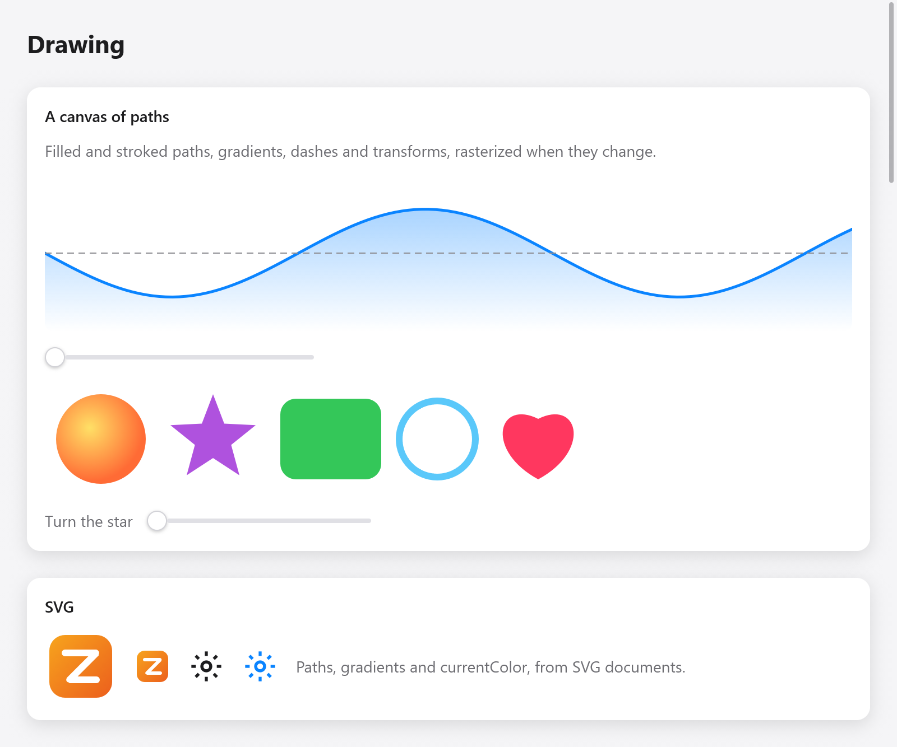

<a id="drawing"></a>

# Vẽ

Khi các hộp, văn bản và biểu tượng không đủ, hãy vẽ: `ui.canvas` cung cấp chức năng vẽ `ui.Painter`, chức năng này sẽ lấp đầy và vẽ các đường dẫn bằng màu sắc và chuyển màu, thông qua các phép biến đổi và clip. `ui.svg` vẽ tài liệu SVG theo cách tương tự. Biểu đồ cũng được vẽ trên canvas ([Charts](chart.md)); để biết hiệu ứng trên mỗi pixel, hãy xem [Shaders](shaders.md).

Trang Vẽ của thư viện có các ví dụ bên dưới (`examples/gallery/drawing.zig`, `zig build run-gallery`).

<a id="a-canvas"></a>



*Đường vẽ canvas, gradient, nét đứt, hình khối và ảnh SVG.*

## Một bức vẽ

```zig
const Wave = struct {
    phase: f32 = 0,

    fn draw(s: *Wave, p: *ui.Painter) void {
        var line = p.path();
        for (0..101) |i| {
            const x = p.size.w * @as(f32, @floatFromInt(i)) / 100;
            const y = p.size.h / 2 + 30 * @sin(@as(f32, @floatFromInt(i)) / 8 + s.phase);
            if (i == 0) line.moveTo(x, y) else line.lineTo(x, y);
        }
        p.stroke(&line, .color(.hex(0x0a84ff)), .{ .width = 2, .join = .round });
    }

    fn view(s: *Wave, c: *ui.Context) void {
        _ = ui.canvas(c, .{ .w = 300, .h = 120 }, .{ .radius = 8 }, s, draw);
        _ = ui.slider(c, &s.phase, .{ .min = 0, .max = 6.28, .label = "Phase" });
    }
};
```

`ui.canvas(c, size, options, ctx, draw)` tạo một hộp `size` có điểm lớn và gọi `draw(ctx, painter)` để ghi lại những gì nó hiển thị. Cạnh 0 lấp đầy phần gốc dọc theo nó: khung vẽ được vẽ ở kích thước có trong bố cục cuối cùng, điều mà `p.size` cho biết. `ui.CanvasOptions` có `key` (id vẫn tồn tại sau khi sắp xếp lại), `opacity` và `radius`, làm tròn các góc của bức tranh và cắt những gì được vẽ ở đó.

`p.visible()` là một phần của khung vẽ được hiển thị, theo tọa độ mà nó vẽ: hộp của nó nằm trong các hộp cuộn và các kẹp xung quanh nó và cửa sổ, khi khung cuối cùng vẽ nó, được đưa trở lại thông qua các biến đổi của các hộp của nó và của chính họa sĩ, do đó, một khung vẽ được phóng to sẽ thấy ít bản thân nó hơn nhiều như hiển thị. Một bản vẽ cao hơn cửa sổ (một tài liệu dài, nhiều điểm trên biểu đồ) bỏ qua những gì nằm bên ngoài nó; một khung cuộn nó vẽ lại một lần nữa với phần như hiện tại. Cho đến khi một khung vẽ nó, nó là toàn bộ bức tranh. Bên ngoài painter, `ui.canvasVisibility(c, id, whole)` trả lời điều tương tự cho khung vẽ sẽ nhận id hộp `id` (`c.peekId`), để một hoạt ảnh có thể tạm dừng khi khung vẽ của nó bị cuộn ra khỏi tầm nhìn ([plugin loading](../plugins/loading.md) làm vậy).

```zig
const v = p.visible();
for (s.lines, 0..) |l, i| {
    const y = @as(f32, @floatFromInt(i)) * 20;
    if (y + 20 < v.y or y > v.y + v.h) continue;
    p.fillRect(.{ .x = 4, .y = y, .w = l.width, .h = 14 }, th.text);
}
```

Canvas trả về chỉ mục của hộp, vì vậy nó có thể lấy con trỏ giống như bất kỳ hộp nào:

```zig
const box = ui.canvas(c, .{ .w = 0, .h = 200 }, .{}, s, draw);
const it = c.interact(box, .{});
if (it.clicked) if (it.rect) |r| s.addPoint(c.input.mouse.x - r.x, c.input.mouse.y - r.y);
```

<a id="how-it-is-drawn"></a>

### Nó được vẽ như thế nào

Painter ghi lại các lệnh; bản thân nó không vẽ gì cả. Bản ghi được rasterized trên CPU (`src/ui/canvas_render.zig`), với tính năng khử răng cưa, ở tỷ lệ của cửa sổ, thành một hình ảnh trong atlas hình ảnh mà mọi bộ kết xuất sẽ vẽ khi nó vẽ `ui.image`. Một khung vẽ chỉ được phân loại lại khi nội dung nó ghi thay đổi: hình ảnh được khóa bằng hàm băm của bản ghi, do đó, một khung vẽ cùng một thứ chỉ tốn phí ghi và hàm băm. Một khung vẽ thay đổi mọi frame (hình động) sẽ được raster hóa mọi frame, vì vậy hãy giữ những frame đó ở kích thước nhỏ hoặc di chuyển phần hoạt hình sang phần biến đổi của hộp ([Transforms](transforms.md)).

Các đường dẫn, điểm dừng chuyển màu và dấu gạch ngang được cung cấp cho Họa sĩ sẽ được sao chép: chuyển bất kỳ bộ nhớ nào, thậm chí cả ngăn xếp.

<a id="paths"></a>

## Đường dẫn

`p.path()` tạo `ui.Path` trong bộ nhớ của khung. Tọa độ là các điểm từ trên cùng bên trái của khung vẽ, y đi xuống.

| phương pháp | hòa |
|---|---|
| `moveTo(x, y)` | bắt đầu một đường dẫn phụ mới |
| `lineTo(x, y)` | một đoạn thẳng |
| `quadTo(cx, cy, x, y)` | Bézier bậc hai |
| `cubicTo(c1x, c1y, c2x, c2y, x, y)` | một khối Bézier |
| `close()` | đóng đường dẫn phụ |
| `arc(cx, cy, r, a0, a1, ccw)` | cung tròn, góc tính bằng radian |
| `svgArc(rx, ry, rotation, large, sweep, x, y)` | Vòng cung hình elip của SVG tới một điểm |
| `rect(x, y, w, h)` | một hình chữ nhật |
| `roundRect(x, y, w, h, rx, ry)` | một hình chữ nhật tròn |
| `ellipse(cx, cy, rx, ry)`, `circle(cx, cy, r)` | hình elip |
| `polyline(points, closed)` | `[2]f32` điểm đã tham gia |
| `append(data, transform)` | `ui.PathData` của đường dẫn khác, đã được chuyển đổi |

Một đường dẫn được tạo bằng bộ cấp phát riêng (`ui.Path.init(gpa)`) có thể được giữ trên các khung và được sử dụng lại: `reset()` làm trống nó, `deinit()` giải phóng nó và `data()` cung cấp `ui.PathData` (động từ và điểm) cho `p.fillData`.

<a id="filling-and-stroking"></a>

## Làm đầy và vuốt ve

```zig
p.fill(&path, .color(.hex(0xaf52de)));
p.fillRule(&path, .color(c.theme.text), .evenodd); // holes where subpaths overlap
p.stroke(&path, .color(accent), .{ .width = 2.5, .join = .round, .cap = .round });
```

`ui.FillRule` là `.nonzero` (mặc định là `fill`) hoặc `.evenodd`. `ui.Stroke`:

| lĩnh vực | mặc định | ý nghĩa |
|---|---|---|
| `width` | 1 | tính bằng điểm |
| `join` | `.miter` | `ui.LineJoin`: `.miter`, `.round`, `.bevel` |
| `cap` | `.butt` | `ui.LineCap`: `.butt`, `.round`, `.square` |
| `miter_limit` | 4 | một miter có thể dài nhất tính theo chiều rộng trước khi nó được vát góc |
| `dash` | không có | bật và tắt độ dài, lặp đi lặp lại (số lẻ được tính hai lần) |
| `dash_offset` | 0 | nơi dấu gạch ngang bắt đầu |

Viết tắt: `fillRect(rect, color)`, `fillRoundRect(rect, radius, paint)`, `fillCircle(cx, cy, r, paint)`, `strokeCircle(cx, cy, r, width, color)` và `line(x0, y0, x1, y1, width, color)`.

<a id="paints-and-gradients"></a>

## Sơn và độ dốc

`ui.Paint` là `.color(c)` (`.solid`), `.linear` hoặc `.radial`, dưới dạng chuyển màu của SVG và Canvas 2D:

```zig
p.fill(&area, .{ .linear = .{
    .from = .{ 0, 0 }, .to = .{ 0, h },
    .stops = &.{ .{ .offset = 0, .color = accent.alpha(0.45) }, .{ .offset = 1, .color = accent.alpha(0) } },
} });
p.fillCircle(50, 50, 40, .{ .radial = .{
    .center = .{ 40, 40 }, .radius = 48,
    .stops = &.{ .{ .offset = 0, .color = .hex(0xffe066) }, .{ .offset = 1, .color = .hex(0xff6b35) } },
} });
```

`ui.LinearGradient` đi `from` một điểm `to` điểm khác; `ui.RadialGradient` đi ra từ `focal` (trung tâm trừ khi được chỉ định) đến vòng tròn `radius` xung quanh `center`. Cả hai đều lấy `stops` (`ui.GradientStop`: `offset` 0 đến 1 và `color`), `spread` (`.pad`, `.reflect` hoặc `.repeat`: những gì xảy ra ở phần cuối) và `transform` từ không gian của gradient đến bản vẽ (SVG's `gradientTransform`).

<a id="transforms-clips-and-layers"></a>

## Chuyển đổi, clip và lớp

Painter giữ lại biến đổi, clip và độ mờ hiện tại:

```zig
p.save();
p.rotate(s.turn * std.math.pi / 180, 150, 50); // radians, about (150, 50)
p.fill(&star, .color(.hex(0xaf52de)));
p.restore();
```

- `save()` và `restore()` giữ và mang lại các biến đổi, clip và độ mờ.
- `transform(t)` rút ra những gì tiếp theo thông qua `ui.Transform` (sau khi các phép biến đổi đã được đặt); `translate(x, y)`, `scaleBy(sx, sy)` và `rotate(radians, cx, cy)` là viết tắt. `ui.Transform` có `translation`, `scaling`, `rotation` (radian), `skewX`, `skewY`, `then`, `apply` và `invert`. (Các hộp được chuyển đổi bằng `ui.Affine`, tính bằng độ; canvas có `ui.Transform`, tính bằng radian, giống như Canvas 2D.)
- `clip(path, rule)` và `clipRect(rect)` giữ những gì tiếp theo bên trong, trong các clip đã được đặt.
- `setAlpha(a)` mờ dần những gì tiếp theo cho đến `restore`.
- `beginLayer(opacity)` và `endLayer()` tách một nhóm ra, sau đó trộn nó với `opacity`: một nhóm mờ có phần chồng lên nhau không hiển thị.

## SVG

```zig
const logo = @embedFile("logo.svg");

_ = ui.svg(c, logo, .{ .height = 32 });
_ = ui.svg(c, gear, .{ .width = 16, .color = c.theme.accent }); // its currentColor
```

`ui.svg(c, bytes, options)` vẽ tài liệu SVG dưới dạng canvas, theo tỷ lệ của cửa sổ và trả về false (không vẽ gì) nếu các byte không phải là một. `ui.SvgOptions`:

| lĩnh vực | ý nghĩa |
|---|---|
| `width`, `height` | kích thước của nó tính bằng điểm; một bên bằng 0 giữ tỷ lệ của tài liệu, cả hai bên bằng 0 đều có kích thước riêng |
| `color` | `currentColor` là gì; null là màu văn bản của chủ đề nên các biểu tượng sẽ có màu sáng và tối |
| `opacity` | độ mờ của nó |
| `key` | một id trong số anh chị em của nó |

Hình ảnh được giữ lại: một khung hiển thị các byte giống nhau ở cùng kích thước và màu sắc sẽ vẽ nó mà không cần phân tích cú pháp lại.

Những gì SVG được vẽ (`src/ui/svg_draw.zig`): `viewBox` của gốc được trang bị `preserveAspectRatio`, các nhóm và `svg` lồng nhau, các đường dẫn và hình dạng cơ bản, `use` của các phần tử và ký hiệu, biến đổi, tô màu và nét theo màu sắc và chuyển màu (tuyến tính và xuyên tâm, theo tham chiếu, trong cả hai hệ thống đơn vị), độ mờ của chúng, độ mờ nhóm và đường cắt. Màu sắc có thể là hex, `rgb()`, `hsl()`, tên hoặc `currentColor` và kiểu có thể đến từ các thuộc tính, `style` hoặc các quy tắc CSS đơn giản trong `<style>` (bộ chọn theo thành phần, lớp và id). Văn bản, mặt nạ, bộ lọc, điểm đánh dấu và mẫu bị loại bỏ: chuyển đổi văn bản thành đường dẫn khi bạn xuất tệp.

`ui.rasterizeSvg(gpa, bytes, w, h, current_color)` vẽ tài liệu thành các pixel BGRA được nhân sẵn, `w` × `h`, không có cửa sổ: dành cho các biểu tượng được tạo trước thời hạn và các bài kiểm tra. Giải phóng kết quả bằng `gpa`.

<a id="images"></a>

## Hình ảnh

Hình ảnh từ các tệp (PNG và trên macOS bất kể ImageIO đọc gì) không được vẽ trên canvas mà được hiển thị bằng `ui.image`; xem [Văn bản](text.md) và [Nút và phương tiện](buttons.md).

<a id="testing-drawings"></a>

## Bản vẽ thử nghiệm

Một canvas vẽ trong Trình kiểm tra như trong một cửa sổ, thông qua cùng một trình rasterizer, do đó, một kiểm thử có thể hiển thị view và xem các pixel:

```zig
var t: ui.Tester = undefined;
try t.init(gpa, .init(&s, Wave.view), .{ .width = 320, .height = 160, .scale = 1 });
defer t.deinit();
const px = try t.render(gpa);
defer px.deinit(gpa);
```

Xem [Thử nghiệm](testing.md).
