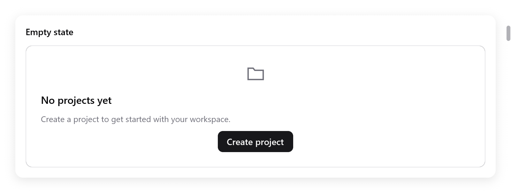
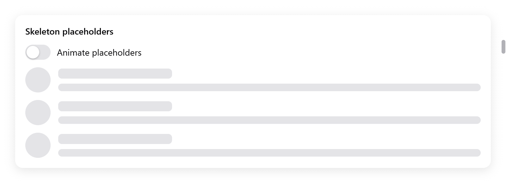
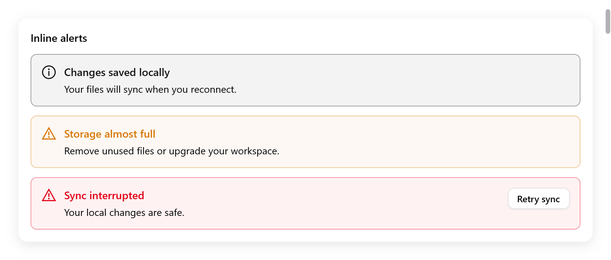

# Trạng thái trống, đang tải và alert

Các widget cho những trạng thái quanh nội dung: chưa có gì để hiện, đang tải, hoặc có thông báo cho người dùng. Chúng dùng chung theme và renderer trên mọi backend.

<a id="empty-content"></a>

## Nội dung trống

<!-- demo: empty-state height=326 -->



```zig
const state = ui.empty(c, "No projects yet", "Create your first project.", .{
    .icon = "folder",
    .outline = true,
});
defer state.end();
if (ui.button(c, "Create project", .{ .variant = .primary }).clicked) s.createProject();
```

`ui.empty` mở một cột: thêm nút hoặc nội dung của bạn, rồi gọi `end`.

| `EmptyOptions` | Mặc định |
|---|---|
| `width` | `.fill` |
| `icon` | `""` |
| `outline` | `false` |

- Tiêu đề và mô tả tự xuống dòng.
- Nhóm được đặt tên cho accessibility.
- Các nút bên trong giữ focus và hành động riêng của chúng.
- App tự quyết định khi nào không có dữ liệu, và khi nào thay trạng thái này bằng nội dung.

<a id="skeleton-placeholders"></a>

## Skeleton giữ chỗ

<!-- demo: skeleton height=315 -->



```zig
ui.skeleton(c, .{ .width = .{ .px = 40 }, .height = 40, .radius = 20 });
ui.skeleton(c, .{ .width = .{ .px = 180 } });
ui.skeleton(c, .{ .width = .fill, .height = 12 });
```

| `SkeletonOptions` | Mặc định | Ý nghĩa |
|---|---|---|
| `width` | `.fill` | Chiều rộng của khối giữ chỗ |
| `height` | `16` | Chiều cao, tính bằng điểm |
| `radius` | `6` | Bán kính góc; bằng nửa kích thước thì thành hình tròn |
| `animated` | `true` | Nhấp nháy nhẹ trong lúc chờ |

- Hiệu ứng nhấp nháy dùng đồng hồ của UI và xin frame ở 30 Hz.
- Nó dừng khi `animated` là false hoặc hệ thống yêu cầu [giảm chuyển động](motion.md).
- Thay các khối giữ chỗ bằng nội dung khi dữ liệu về.
- Chúng không nhận focus và không đưa chữ giả nào cho công nghệ hỗ trợ. Hãy đặt tên cho nhóm bao quanh nếu cần báo trạng thái đang tải cho trình đọc màn hình.

<a id="inline-alerts"></a>

## Alert trong trang

<!-- demo: alerts height=366 -->



```zig
const notice = ui.alert(c, "Sync interrupted", "Your local changes are safe.", .{
    .kind = .danger,
});
defer notice.end();
if (ui.button(c, "Retry", .{}).clicked) s.retry();
```

`ui.alert` mở một hàng gồm icon cùng tiêu đề và mô tả tự xuống dòng. Thêm các nút ở cuối, rồi gọi `end`.

| `AlertOptions` | Mặc định | |
|---|---|---|
| `width` | `.fill` | |
| `kind` | `.info` | `.info`, `.success`, `.warning` hoặc `.danger` |

- Màu theo theme.
- Alert là một nhóm status cho accessibility.
- Nó để focus nguyên ở chỗ người dùng đặt.
- Muốn trình đọc màn hình đọc một lần, gọi `c.announce` khi state của app thay đổi.

Dùng [dialog](overlays.md) khi người dùng phải quyết định mới làm tiếp được, và [toast](overlays.md#toasts) cho thông báo thoáng qua. Trang **Feedback** trong [Gallery](../../../examples/gallery/feedback.zig) có cả ba widget.
