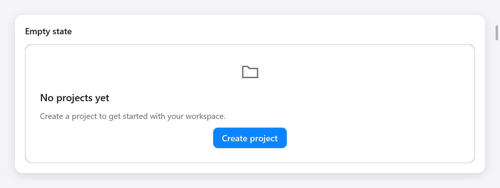
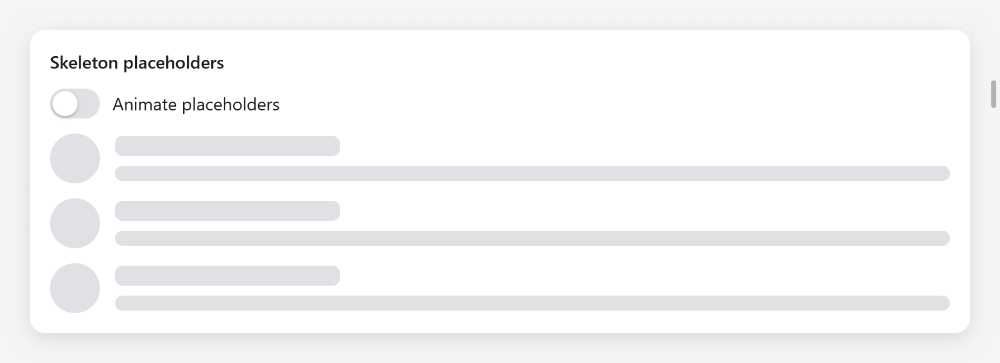
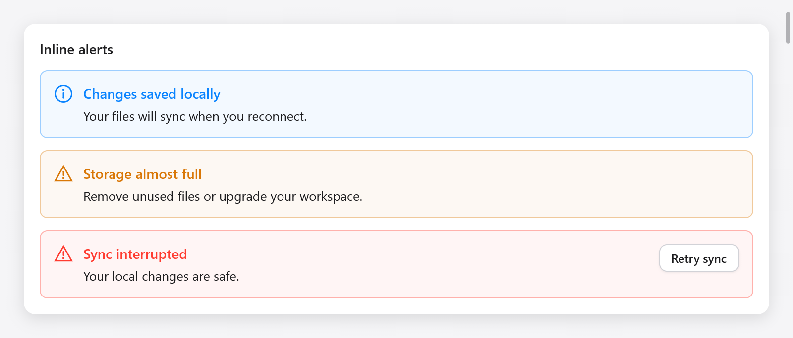

# Empty, Skeleton và Alert

Ba widget chuẩn hóa giao diện khi chưa có dữ liệu, đang tải hoặc cần hiển
thị thông báo. Chúng dùng chung theme và renderer trên mọi backend.

## Nội dung trống



```zig
const state = ui.empty(c, "Chưa có dự án", "Tạo dự án đầu tiên.", .{
    .icon = "folder",
    .outline = true,
});
defer state.end();
if (ui.button(c, "Tạo dự án", .{ .variant = .primary }).clicked) s.createProject();
```

`ui.empty` mở một cột. Thêm nút hoặc nội dung tùy chỉnh rồi gọi `end`.
`EmptyOptions` gồm `width` (`.fill`), `icon` (`""`) và `outline` (`false`).
Tiêu đề/mô tả tự xuống dòng; nhóm có tên cho accessibility. Các nút giữ
focus và hành động riêng. App quyết định khi nào hiển thị trạng thái trống
và khi nào thay bằng dữ liệu thật.

## Skeleton khi tải



```zig
ui.skeleton(c, .{ .width = .{ .px = 40 }, .height = 40, .radius = 20 });
ui.skeleton(c, .{ .width = .{ .px = 180 } });
ui.skeleton(c, .{ .width = .fill, .height = 12 });
```

| `SkeletonOptions` | Mặc định | Ý nghĩa |
|---|---|---|
| `width` | `.fill` | Chiều rộng |
| `height` | `16` | Chiều cao theo point |
| `radius` | `6` | Bán kính góc; dùng nửa kích thước để tạo hình tròn |
| `animated` | `true` | Nhịp sáng nhẹ trong lúc chờ |

Hiệu ứng dùng đồng hồ UI và yêu cầu frame ở 30 Hz. Nó dừng khi `animated`
là false hoặc bật [Reduce Motion](motion.md). Thay Skeleton bằng nội dung
thật khi dữ liệu đến. Widget không nhận focus hay cung cấp văn bản giả
cho công nghệ hỗ trợ; đặt tên nhóm bao quanh nếu cần thông báo đang tải.

## Alert trong trang



```zig
const notice = ui.alert(c, "Đồng bộ gián đoạn", "Thay đổi cục bộ vẫn an toàn.", .{
    .kind = .danger,
});
defer notice.end();
if (ui.button(c, "Thử lại", .{}).clicked) s.retry();
```

`ui.alert` mở một hàng có icon và tiêu đề/mô tả tự xuống dòng. Thêm nút ở
cuối rồi gọi `end`. `AlertOptions` có `width` (`.fill`) và `kind` (`.info`):
`.info`, `.success`, `.warning`, `.danger`. Màu theo theme. Alert có vai trò
accessibility `status` và giữ nguyên focus. Gọi `c.announce` khi state của
app thay đổi nếu cần trình đọc màn hình thông báo một lần.

Dùng [dialog](overlays.md) khi cần quyết định trước khi tiếp tục và
[toast](overlays.md) cho thông báo tạm thời. Trang **Feedback** trong
[Gallery](../../../examples/gallery/feedback.zig) minh họa cả ba widget.
