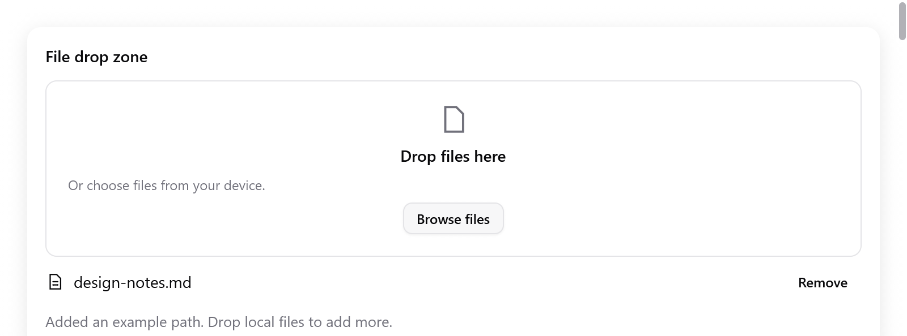

# Vùng thả file

<!-- demo: file-drop height=321 -->



Vùng nhận file và danh sách URI được thả vào, kèm danh sách các đường dẫn. Nó không bao giờ đọc hay tải các file lên.

```zig
// Khởi tạo state một lần:
files: ui.FileList, // khởi tạo bằng .init(gpa)
drag: ui.DragDrop = .{},

// Trong view:
const result = ui.fileDropZone(c, &s.drag, &s.files, .{ .max_files = 8 });
if (result.browse) requestFileDialog();
if (result.err) |err| reportError(err);
// Cuối view, nếu controller này còn có nguồn kéo:
s.drag.preview(c);
```

Khi dọn dẹp, gọi `files.deinit()` và `drag.deinit()`.

| `FileDropOptions` | Mặc định | |
|---|---|---|
| `title` | `"Drop files here"` | tiêu đề |
| `description` | `"Or choose files from your device."` | dòng chữ bên dưới |
| `browse_label` | `"Browse files"` | nút chọn file |
| `width` | `.fill` | |
| `disabled` | `false` | chặn chọn file, xóa và thả |
| `max_files` | không giới hạn | các file thả vào vượt quá số này bị từ chối |

| `FileDropResult` | |
|---|---|
| `changed` | danh sách đã thay đổi |
| `browse` | người dùng đã bấm nút Browse |
| `over` | có thứ đang được kéo bên trên vùng |
| `rejected` | số đường dẫn bị `max_files` từ chối |
| `err` | lỗi cấp phát hoặc giải mã, hoặc `null` |

**Hoạt động**

- `FileList` giữ bản sao của các đường dẫn, nên chúng vẫn còn sau khi dữ liệu thả hết hiệu lực.
- Các đường dẫn đã nhận trước một lỗi vẫn ở lại trong danh sách.
- Đường dẫn trùng không chiếm chỗ trong `max_files`.
- Mỗi đường dẫn có nút Remove.
- Nó dùng cơ chế target của `DragDrop`. Kéo từ bên ngoài vào được đến đâu là tùy backend; xem [kéo và thả](drag-and-drop.md).

**Hộp thoại chọn file của riêng bạn.** Thêm các đường dẫn nó trả về bằng `try files.add(path)`, rồi yêu cầu vẽ lại khi kết quả bất đồng bộ về tới.

- `add` sao chép chuỗi.
- Nó trả về false khi đường dẫn rỗng hoặc trùng.
- `max_files` không giới hạn `add`.

Nút Browse trong Gallery thêm một đường dẫn mẫu để ví dụ luôn cho cùng kết quả. App thật tự xử lý `browse`.
