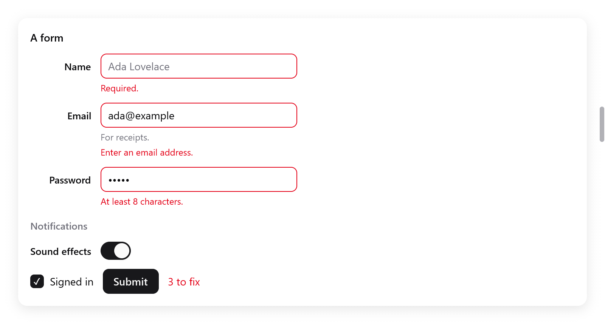

<a id="forms"></a>

# Form

Label, mô tả, lỗi và kiểm tra giá trị cho các control của một form.

- Một **field** gắn label cho một control, hiện mô tả hoặc lỗi bên dưới nó, và đặt tên cho nó để trình đọc màn hình đọc được.
- Một **form** xếp label của các field thành một cột riêng.
- Một **fieldset** gom các field dưới một tiêu đề (legend) và có thể vô hiệu hóa chúng cùng lúc.
- `ui.validate` kiểm tra giá trị.

<!-- demo: forms height=453 -->



*Một form đã gửi, hiện lỗi trường bắt buộc, lỗi email và lỗi mật khẩu.*

<a id="fields"></a>

## Field

```zig
const f = ui.field(c, "Email", .{ .description = "For receipts.", .err = ui.validate.email(s.email.text()) });
_ = ui.textField(c, &s.email, .{ .width = .{ .px = 260 } });
f.end();
```

`ui.field(c, title, options)` gắn label cho control được dựng ngay sau nó, label nằm phía trên như trên web. Hàm trả về một `ui.Field`: gọi `end` sau khi dựng xong control.

`ui.FieldOptions`:

| Trường | Hiện gì |
|---|---|
| `description` | một dòng chữ dưới control, màu mờ |
| `err` | giá trị sai ở đâu, hiện dưới control bằng màu danger, viền control cũng đổi sang màu này; rỗng là hợp lệ |

- Bấm vào label thì control nhận focus.
- Tên của control cho trình đọc màn hình là label. Phần mô tả của nó là lỗi, nếu không có lỗi thì là description.
- Control bị đánh dấu không hợp lệ khi còn lỗi.
- Control nào cũng được: text field, select, switch, ô nhập ngày. Field tìm control đầu tiên được dựng sau label của nó.

<a id="forms-1"></a>

## Form

```zig
var fm = ui.form(c, .{});
{
    defer fm.end();
    const n = fm.field("Name", .{});
    _ = ui.textField(c, &s.name, .{ .placeholder = "Ada Lovelace", .width = .{ .px = 260 } });
    n.end();
    const p = fm.field("Password", .{ .err = ui.validate.minLength(c, s.password.text(), 8) });
    _ = ui.textField(c, &s.password, .{ .password = true, .width = .{ .px = 260 } });
    p.end();
    const snd = fm.field("Sound effects", .{});
    _ = ui.toggle(c, "", &s.sounds);
    snd.end();
}
```

`ui.form(c, options)` đặt label của các field thành một cột bên cạnh các control, giống phần cài đặt của macOS. Giữ form trong một biến, vì các field của nó thay đổi nó. Tạo field bằng chính hàm `field` của form.

Các label:

- căn phải, trong một cột rộng bằng label dài nhất;
- ngang hàng với dòng chữ đầu tiên của control;
- ngang hàng với giữa control nếu control không có chữ, như switch, dù bên dưới có description hay không;
- ngang hàng với chữ của một hàng có chấm hoặc icon cạnh chữ (`Style.baselines`).

`ui.FormOptions`:

| Trường | Mặc định | |
|---|---|---|
| `gap` | 12 | giữa các field |
| `label_gap` | 12 | giữa cột label và cột control |

Chiều rộng của label được đo khi dựng form. Khi nó thay đổi, frame được dựng lại ngay, nên không frame nào hiện label bị lệch.

<a id="fieldsets"></a>

## Fieldset

```zig
const set = ui.fieldset(c, "Notifications", .{ .disabled = !s.signed_in });
const snd = fm.field("Sound effects", .{});
_ = ui.toggle(c, "", &s.sounds);
snd.end();
set.end();
```

`ui.fieldset(c, legend, options)` gom các field dưới một legend. Kết thúc bằng `end`.

- Với `disabled`, các field bị làm mờ và không nhận input. Một box phủ lên trên nhận mọi cú bấm, và focus bàn phím rời khỏi chúng.
- `ui.FieldsetOptions`: `disabled` và `gap` (12).
- Fieldset có thể chứa field của một form, đặt giữa các lần gọi `field` của form như ở trên, hoặc các `ui.field` thường.

<a id="validation"></a>

## Kiểm tra giá trị

`ui.validate` có các hàm kiểm tra trả về lỗi cần hiện, dùng được ngay cho `err` của field. Lỗi rỗng nghĩa là giá trị hợp lệ.

| Kiểm tra | Lỗi |
|---|---|
| `required(s)` | "Required." khi giá trị rỗng hoặc chỉ có khoảng trắng |
| `email(s)` | "Enter an email address." trừ khi trông giống một địa chỉ email (rỗng là hợp lệ) |
| `minLength(c, s, n)` | "At least n characters." khi ít hơn `n` ký tự (rỗng là hợp lệ) |
| `number(c, s, lo, hi)` | "Enter a number." hoặc "Between lo and hi." (rỗng là hợp lệ) |
| `first(errors)` | lỗi không rỗng đầu tiên trong nhiều phép kiểm tra |

Kết hợp `required` với một phép kiểm tra khác cho giá trị bắt buộc phải nhập:

```zig
.err = ui.validate.first(&.{ ui.validate.required(s.email.text()), ui.validate.email(s.email.text()) }),
```

`ui.Validation` đếm số lỗi của form, để bật nút submit hoặc cho biết còn bao nhiêu lỗi. `check(err)` trả lại lỗi và đếm nó. `ok()` cho biết có lỗi nào không.

```zig
fn form(s: *State, c: *ui.Context) void {
    var v: ui.Validation = .{};
    var fm = ui.form(c, .{});
    {
        defer fm.end();
        const n = fm.field("Name", .{ .err = if (s.submitted) v.check(ui.validate.required(s.name.text())) else "" });
        _ = ui.textField(c, &s.name, .{ .width = .{ .px = 260 } });
        n.end();
        const e = fm.field("Email", .{ .err = v.check(ui.validate.email(s.email.text())) });
        _ = ui.textField(c, &s.email, .{ .width = .{ .px = 260 } });
        e.end();
    }
    ui.row(c, .{ .gap = 12, .align_items = .center });
    defer ui.end(c);
    if (ui.button(c, "Submit", .{ .variant = .primary }).clicked) s.submitted = true;
    if (s.submitted) ui.text(c, if (v.ok()) "All good." else c.print("{d} to fix", .{v.errors}), .{
        .color = if (v.ok()) c.theme.success else c.theme.danger,
    });
}
```

- Chỉ hiện lỗi của field bắt buộc còn rỗng sau khi người dùng đã thử submit, như ở trên. Lỗi của những gì đã gõ thì hiện ngay.
- Lỗi là chuỗi tiếng Anh. Với ngôn ngữ khác, tự viết hàm kiểm tra với thông báo lấy từ [i18n](../i18n.md): hàm nào trả về chuỗi cũng được.
