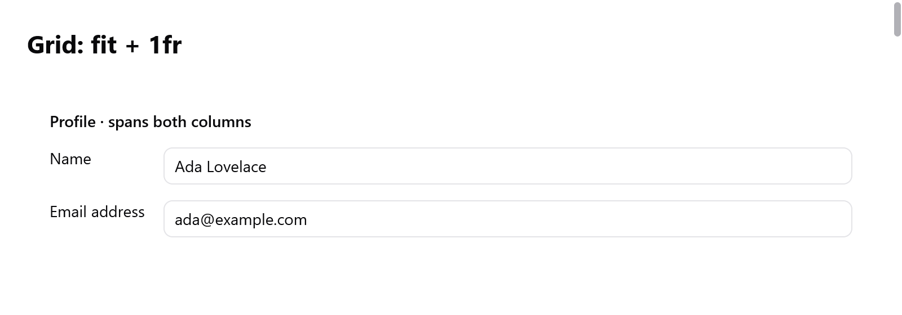

<a id="grid"></a>

# Grid

`ui.grid` xếp các phần tử con theo hàng và cột, theo kiểu CSS grid và `ui.Grid` của mygo. Các phần tử con lấp các ô lần lượt theo từng hàng, hoặc nằm ở chỗ được chỉ định, có thể trải qua nhiều cột và hàng. Dùng nó cho form (label ở một cột, ô nhập ở cột kia), dashboard và trang cài đặt.

Grid dựng tất cả phần tử con của nó. Với nhiều mục chỉ được dựng khi hiện ra, dùng [`ui.gridView`](lists.md#grid-views).

<!-- demo: grid height=304 -->



*Một form hồ sơ dùng track fit và track phân số; tiêu đề trải qua cả hai cột.*

```zig
var g = ui.grid(c, .{ .columns = &.{ .fit, .{ .fr = 1 } }, .gap_x = 16, .gap_y = 8 });
g.cell(.{ .col_span = -1 }); // trải qua mọi cột
ui.text(c, "Profile", .{ .weight = .bold });
ui.end(c);
ui.text(c, "Name", .{}); // phần tử con nằm ngoài cell thì lấy ô kế tiếp
_ = ui.textField(c, &s.name, .{});
ui.text(c, "Email", .{});
_ = ui.textField(c, &s.email, .{});
g.end();
```

`ui.grid(c, opts)` mở grid; tiếp theo là các phần tử con, rồi `end()`.

<a id="tracks"></a>

## Track

Cột và hàng là các `ui.GridTrack`:

| Track | Kích thước |
|---|---|
| `.fit` | vừa đúng nội dung |
| `.{ .px = 220 }` | đúng bấy nhiêu điểm |
| `.{ .fr = 1 }` | một phần của khoảng trống mà các track khác để lại (`minmax(0, 1fr)` của CSS); khi kích thước grid chưa được đặt thì vừa đúng nội dung |

- `.{ .fr = 2 }` chiếm gấp đôi chỗ so với `.{ .fr = 1 }`.
- `rows` đặt cho các hàng đầu tiên. Các hàng sau đó vừa với nội dung, nên phần lớn grid chỉ cần `columns`.
- Một grid có tối đa 32 cột và 32 hàng được đặt sẵn.

`ui.GridOptions`:

| Trường | Mặc định | |
|---|---|---|
| `columns` | `&.{.{ .fr = 1 }}` | các track cột |
| `rows` | `&.{}` | track của các hàng đầu tiên |
| `gap_x`, `gap_y` | 0 | khoảng cách giữa các cột, giữa các hàng |
| `justify_items` | `.stretch` | vị trí phần tử con theo chiều ngang của ô: `.stretch`, `.start`, `.center` hoặc `.end` |
| `align_items` | `.stretch` | vị trí phần tử con theo chiều dọc của ô, hoặc `.baseline`: dòng chữ đầu tiên của các mục trong mỗi hàng thẳng hàng nhau, như trong một [row](layout.md#alignment), và hàng cao đủ để làm vậy |
| `style` | `.{ .width = .fill }` | box của chính grid: padding, nền, kích thước |

<a id="cells"></a>

## Cell

Phần tử con dựng thẳng trong grid sẽ lấy ô trống kế tiếp. Muốn đặt một phần tử con vào chỗ cụ thể, cho nó trải qua nhiều track hoặc căn riêng, hãy mở một cell bằng `Grid.cell(opts)`. Tiếp theo là các phần tử con, rồi `ui.end(c)`. Cell là một box cột, lấp đầy chỗ của nó theo cách grid căn.

`ui.GridCell`:

| Trường | Mặc định | |
|---|---|---|
| `col`, `row` | 0 | cột và hàng mà nó bắt đầu, đếm từ 1; 0 thì đặt vào ô trống kế tiếp |
| `col_span`, `row_span` | 1 | số cột và hàng nó trải qua; số âm thì trải tới cột cuối (hoặc hàng cuối mà grid đặt sẵn) |
| `justify`, `align` | null | cách căn riêng của nó, thay cho `justify_items` và `align_items` của grid |
| `style` | không có | box của cell |

```zig
var g = ui.grid(c, .{ .columns = &.{ .fit, .{ .px = 50 }, .{ .fr = 1 } }, .gap_x = 4 });
g.cell(.{ .col_span = -1 }); // tiêu đề trải qua cả ba cột
ui.text(c, "Totals", .{ .weight = .bold });
ui.end(c);
ui.text(c, "Apples", .{});
ui.text(c, "12", .{});
g.cell(.{ .justify = .end, .@"align" = .center }); // đẩy về cuối ô
ui.text(c, "$4.80", .{ .mono = true });
ui.end(c);
g.cell(.{ .col = 3, .row = 3, .row_span = 2 }); // đặt chỗ sẵn, cao hai hàng
ui.text(c, "Notes", .{});
ui.end(c);
g.end();
```

Cell được đặt bằng `col` và `row` giữ nguyên chỗ của nó, và các phần tử con phía sau chảy vòng qua những ô nó chiếm.

<a id="sizing"></a>

## Kích thước

- Grid rộng theo `style` của nó (mặc định `.fill`) và cao bằng tổng các hàng. Những gì đứng sau nó trong cột sẽ nằm bên dưới.
- Cột `.fit` rộng bằng phần tử con rộng nhất của nó. Cột `px` cố định. Các cột `fr` chia nhau phần còn lại.
- Phần tử con trải qua nhiều track sẽ chia phần còn thiếu cho các track vừa-nội-dung mà nó trải qua. Nếu nó trải qua các track `fr`, phần thiếu được chia theo tỉ lệ của chúng.
- Khi chưa biết kích thước grid, các track `fr` vừa với nội dung, theo tỉ lệ của chúng.
- Chỉ những phần tử con mà các cột cần đọc mới được đo theo chiều rộng của grid. Phần tử nằm trong cột cố định, hoặc trong cột `fr` đã biết chiều rộng (như `minmax(0, 1fr)` của CSS), chỉ được đo một lần, theo chiều rộng của ô.

Ở chế độ phải sang trái, các cột của grid bắt đầu từ bên phải (xem [Phải sang trái](right-to-left.md)).

<a id="flexbox-or-grid"></a>

## Flexbox hay grid

Hàng và cột của [layout](layout.md) chỉ có một chiều. Mỗi hàng tự tính kích thước phần tử con của nó, nên label ở các hàng khác nhau chỉ thẳng hàng khi mỗi label có chiều rộng cố định. Grid tính kích thước ô của mọi hàng theo cùng các track: một cột `.fit` chứa label sẽ rộng bằng label dài nhất, ở mọi hàng.
