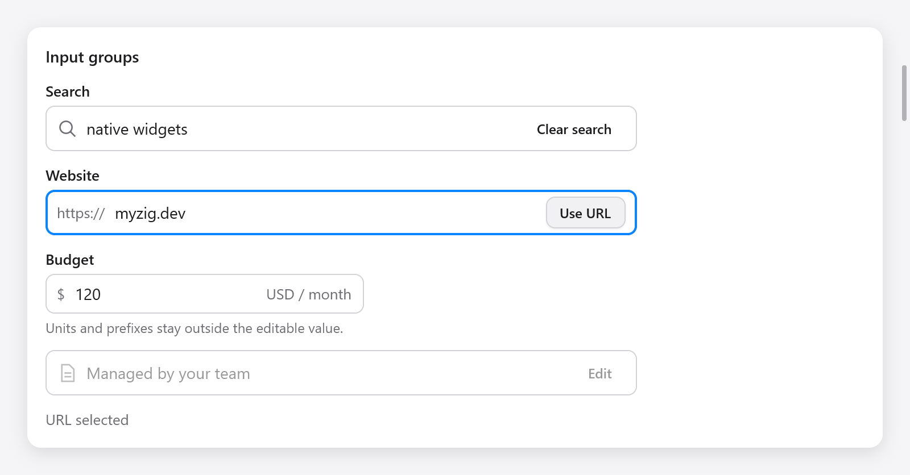

# Input Group

`ui.inputGroup` đặt một ô nhập, icon, tiền tố, hậu tố và nút thao tác trong
cùng một khung. Ô nhập giữ nguyên cách chỉnh sửa, chọn chữ, bộ gõ và xử lý
mật khẩu của [text field](text-input.md).



```zig
var group = ui.inputGroup(c, .{ .width = .{ .px = 420 } });
defer group.end();
group.text("https://");
const result = group.input(&s.url, .{ .placeholder = "example.com", .label = "Website" });
if (result.submitted) s.openUrl();
if (group.button("Mở", .{ .variant = .primary })) s.openUrl();
```

Giữ `ui.TextBuffer` trong state của app. Gọi `input` đúng một lần giữa
`inputGroup` và `end`. Ô nhập chiếm phần chiều rộng còn lại sau các phần
bổ sung; group quản lý hai tùy chọn `width` và `bare` của ô nhập.

## Các phần và trạng thái

| Phương thức | Ý nghĩa |
|---|---|
| `text(value)` | Tiền tố/hậu tố màu dịu, nằm ngoài giá trị chỉnh sửa |
| `icon(name)` | Icon trang trí |
| `input(buffer, options)` | Ô nhập, trả về `ui.TextFieldResult` |
| `button(title, options)` | Nút thao tác, trả về true khi kích hoạt |
| `end()` | Đóng group và cập nhật viền focus/lỗi |

`InputGroupOptions` gồm `width` (mặc định 320 point), `disabled` (false)
và `invalid` (false). Group bị disabled không cho sửa nội dung hoặc kích
hoạt nút, đồng thời bỏ các điều khiển khỏi thứ tự Tab. `invalid` đổi màu
viền và đánh dấu ô nhập cho công nghệ hỗ trợ; dùng [field](forms.md) để
hiển thị thông báo lỗi.

```zig
const field = ui.field(c, "Ngân sách", .{ .err = s.budget_error });
defer field.end();
var group = ui.inputGroup(c, .{ .invalid = s.budget_error.len > 0 });
defer group.end();
group.text("$");
_ = group.input(&s.amount, .{});
group.text("USD / tháng");
```

Bấm khung hoặc phần trang trí sẽ focus ô nhập. Tab di chuyển giữa ô nhập
và các nút đang bật. Enter trong ô nhập trả về `submitted`; Enter hoặc
Space trên nút chỉ kích hoạt nút đó. Viền biểu thị focus khi một điều
khiển bất kỳ trong group có focus.

Label của form đặt tên và focus ô nhập, kể cả khi có tiền tố phía trước.
Nếu không dùng form, truyền `label` vào tùy chọn của `input`. Đặt tiêu đề
nút rõ nghĩa. Tiền tố và hậu tố tuân theo [hướng giao diện](right-to-left.md);
phần văn bản chỉnh sửa giữ hành vi text field thông thường.

Xem trang **Composition** trong [Gallery](../../../examples/gallery/composites.zig)
để thử tìm kiếm, URL, đơn vị và trạng thái disabled.
