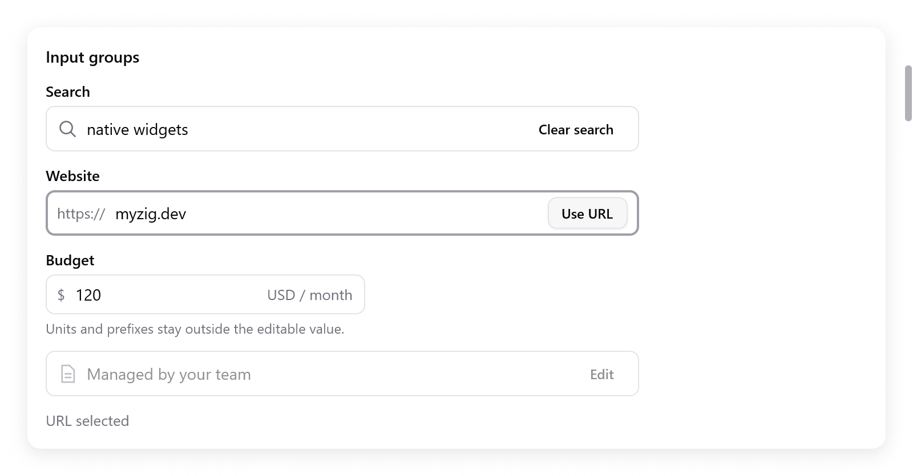

# Input group

`ui.inputGroup` đặt một ô nhập chữ, icon, tiền tố, hậu tố và nút thao tác vào chung một khung. Ô nhập của nó sửa chữ, chọn chữ, nhận bộ gõ và xử lý mật khẩu giống như [text field](text-input.md).

<!-- demo: input-groups height=442 -->



```zig
var group = ui.inputGroup(c, .{ .width = .{ .px = 420 } });
defer group.end();
group.text("https://");
const result = group.input(&s.url, .{ .placeholder = "example.com", .label = "Website" });
if (result.submitted) s.openUrl();
if (group.button("Open", .{ .variant = .primary })) s.openUrl();
```

- Giữ `ui.TextBuffer` trong state của app.
- Gọi `input` đúng một lần giữa `inputGroup` và `end`.
- Ô nhập chiếm phần chỗ còn lại sau các tiền tố, hậu tố và nút. Group quản lý các tùy chọn `width` và `bare` của nó.

<a id="parts-and-state"></a>

## Các phần và state

| Method | Ý nghĩa |
|---|---|
| `text(value)` | Tiền tố hoặc hậu tố màu nhạt, nằm ngoài giá trị sửa được |
| `icon(name)` | Icon trang trí |
| `input(buffer, options)` | Ô nhập chữ; trả về `ui.TextFieldResult` |
| `button(title, options)` | Nút thao tác; trả về true khi được kích hoạt |
| `end()` | Đóng group và cập nhật viền focus/lỗi dùng chung |

| `InputGroupOptions` | Mặc định | |
|---|---|---|
| `width` | 320 điểm | |
| `disabled` | false | bỏ ô nhập và các nút khỏi điều hướng bàn phím, không cho sửa và kích hoạt |
| `invalid` | false | tô màu viền và đánh dấu ô nhập cho công nghệ hỗ trợ |

Để hiện thông báo lỗi, hãy dùng [field](forms.md):

```zig
const field = ui.field(c, "Budget", .{ .err = s.budget_error });
defer field.end();
var group = ui.inputGroup(c, .{ .invalid = s.budget_error.len > 0 });
defer group.end();
group.text("$");
_ = group.input(&s.amount, .{});
group.text("USD / month");
```

**Hành vi**

- Bấm vào khung hoặc phần trang trí sẽ focus ô nhập.
- Tab di chuyển giữa ô nhập và các nút thao tác đang bật.
- Enter trong ô nhập báo về `submitted`. Enter hoặc Space trên một nút chỉ kích hoạt nút đó.
- Viền hiện focus khi bất kỳ control nào bên trong có focus.
- Label của form đặt tên và focus ô nhập, kể cả khi có tiền tố đứng trước. Không có label của form thì đặt `label` trong tùy chọn của `input`.
- Đặt tiêu đề nút rõ nghĩa.
- Tiền tố và hậu tố theo [hướng](right-to-left.md) của giao diện. Phần chữ sửa được vẫn hoạt động như text field bình thường.

Xem trang **Composition** trong [Gallery](../../../examples/gallery/composites.zig) để thấy các ví dụ tìm kiếm, URL, đơn vị và disabled.
