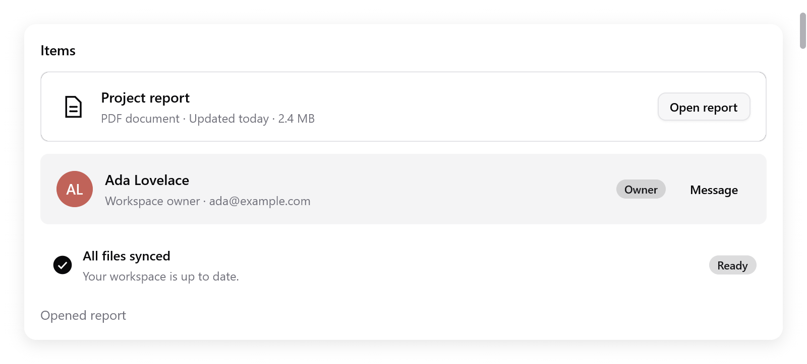

# Items

`ui.item` là một hàng nội dung: media, tiêu đề, mô tả và các nút thao tác ở cuối. Dùng cho file, người, thông báo và cài đặt.

<!-- demo: items height=386 -->



```zig
const row = ui.item(c, .{ .label = "Project report" });
defer row.end();
row.icon("doc.text");
row.content("Project report", "PDF document · Updated today");
if (ui.button(c, "Open", .{}).clicked) s.openReport();
```

- Phần nội dung chiếm chiều rộng còn lại và tự xuống dòng. Các nút thao tác giữ chiều rộng của mình.
- Thêm widget bình thường trước hoặc sau `content` để có media riêng, badge hoặc nhiều nút.
- Một hàng là một nhóm accessibility. Các control trong nó là những điểm dừng bàn phím riêng, nên bấm một nút thao tác không kích hoạt cả hàng.

<a id="options-and-methods"></a>

## Tùy chọn và phương thức

| `ItemOptions` | Mặc định | Ý nghĩa |
|---|---|---|
| `width` | `.fill` | Chiều rộng của hàng |
| `variant` | `.outline` | `.plain`, `.outline` hoặc `.muted` |
| `size` | `.normal` | `.normal` hoặc `.small`, quyết định khoảng cách và cỡ tiêu đề |
| `label` | `""` | Tên của nhóm cho trình đọc màn hình |

| Phương thức | Ý nghĩa |
|---|---|
| `icon(name)` | Icon theo màu theme, trong một ô media cố định |
| `avatar(name, options)` | Một `ui.avatar` có sẵn, kể cả ảnh và chữ viết tắt dự phòng |
| `content(title, description)` | Tiêu đề và mô tả mờ tùy chọn; cả hai tự xuống dòng |
| `end()` | Đóng hàng sau các widget ở cuối |

```zig
const member = ui.item(c, .{ .variant = .muted, .size = .small });
defer member.end();
member.avatar("Ada Lovelace", .{ .size = 32 });
member.content("Ada Lovelace", "Workspace owner");
ui.badge(c, "Owner", c.theme.accent);
```

- Với các item lặp lại, gọi `ui.keyed(c, record.id)` trước `ui.item` để có key ổn định, như các [nội dung danh sách](lists.md) khác.
- Thứ tự trong hàng theo [hướng chữ](right-to-left.md) của giao diện.
- Widget dùng chung layout và theme trên macOS, Linux, Windows và trình duyệt.

Trang **Composition** trong [Gallery](../../../examples/gallery/composites.zig) có ví dụ tương tác. Kết hợp item với [pagination](pagination.md) khi app tải dữ liệu theo trang.
