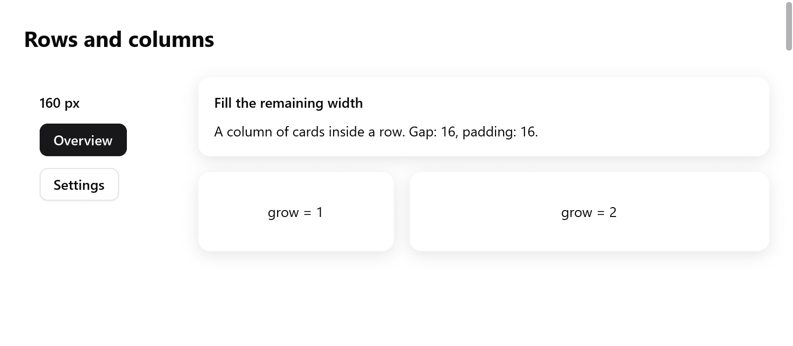

<a id="layout"></a>

# Layout

Layout là flexbox, như trong CSS. Một box xếp các phần tử con theo hàng hoặc cột. Nó tính kích thước phần tử con theo nội dung, chia khoảng trống thừa cho những phần tử grow, và căn chúng theo cả hai trục. Mỗi box được mô tả bằng một `ui.Style`. Truyền nó cho `ui.row`, `ui.column` và các container khác, hoặc đặt bằng các method của `ui.div`.

Layout chạy mỗi frame, qua hai lượt:

- `measure` đo box theo nội dung, từ dưới lên;
- `arrange` đặt chúng vào chỗ, từ trên xuống.

Layout của chữ được cache qua các frame. Frame nào không đổi gì trong một box thì layout lại box đó rất rẻ.

<!-- demo: layout height=374 -->



*Sidebar rộng cố định bên cạnh một cột thẻ co giãn, có gap và padding.*

<a id="containers"></a>

## Container

| hàm | mở ra |
|---|---|
| `ui.column(c, style)` | phần tử con từ trên xuống |
| `ui.row(c, style)` | phần tử con từ trái sang phải (phải sang trái khi [RTL](right-to-left.md)) |
| `ui.card(c, style)` | một cột trên màu surface, bo góc 12, padding 16, bóng nhẹ, trừ khi style nói khác |
| `ui.scroll(c, style)` | một cột có phần tử con scroll theo chiều dọc |
| `ui.pressable(c, style, hover)` | một box báo về con trỏ (xem [custom widgets](custom-widgets.md)) |
| `ui.div(c)` | một cột được style bằng chuỗi method, xem bên dưới |

```zig
ui.row(c, .{ .width = .fill, .padding = .xy(16, 10), .gap = 8, .align_items = .center });
defer ui.end(c);
ui.text(c, "Inbox", .{ .weight = .semibold });
ui.spacer(c);
_ = ui.button(c, "Compose", .{ .variant = .primary });
```

- `ui.end(c)` đóng từng container. `ui.Div` đóng bằng `end` của chính nó.
- `ui.spacer(c)` chiếm khoảng trống thừa dọc trục chính của phần tử cha. Nó đẩy những gì theo sau về cuối.
- `ui.divider(c)` vẽ một đường dày một điểm ngang qua phần tử cha, bằng màu viền.

<a id="sizes"></a>

## Kích thước

`width` và `height` là một `ui.Length`:

- `.auto`, mặc định: lớn bằng nội dung, cộng padding.
- `.{ .px = 120 }`: đúng bấy nhiêu điểm.
- `.fill`: toàn bộ chỗ mà phần tử cha cho. Dọc trục chính của phần tử cha, nó lớn lên từ padding như `grow = 1`. Theo trục ngang, nó giãn ra.

`min_width`, `min_height`, `max_width` và `max_height` giới hạn kích thước.

- `max_width` giữ đoạn văn dễ đọc trong cửa sổ rộng.
- `max_height` trên một box scroll khiến nó cao bằng nội dung, tối đa đến chiều cao đó. Quá thì nó scroll, như câu trả lời trong chat hay danh sách trong popover.

`grow` là phần khoảng trống thừa mà box nhận được dọc trục chính của phần tử cha. Hai phần tử cùng cấp có `grow = 1` và `grow = 2` nhận một phần ba và hai phần ba.

- Khoảng trống được chia như CSS flexbox, và như Chrome layout.
- Mỗi box lớn lên từ kích thước của nó: flex base size, trước khi áp min và max.
- Box bị `max_width` hoặc `min_width` chặn lại thì giữ kích thước đó. Các box khác chia phần còn lại.
- Box không bao giờ nhỏ hơn padding của nó, dù kích thước ghi gì.

Khi một hàng thiếu chỗ, các box chứa chữ xuống dòng sẽ nhả bớt chỗ. Chúng nhả theo tỷ lệ chiều rộng trừ padding, cho đến `min_width`. Chữ của chúng xuống thành nhiều dòng hơn. Các box khác giữ nguyên kích thước.

Box nào có chiều rộng cuối cùng khác với chiều rộng lúc đo thì được đo lại. Nhờ đó chữ xuống dòng luôn có đúng số dòng.

<a id="spacing"></a>

## Khoảng cách

- `padding` là một `ui.Edges` (`top`, `right`, `bottom`, `left`). `ui.Edges.all(12)` và `ui.Edges.xy(16, 8)` (ngang, dọc) dùng cho các trường hợp thường gặp. Trong struct literal, viết `.padding = .all(12)`.
- `gap` là khoảng trống giữa các phần tử con dọc trục chính.
- Không có margin. Giãn cách các box bằng gap và padding của phần tử cha, hoặc bằng `ui.spacer`.

<a id="alignment"></a>

## Căn chỉnh

`align_items` đặt phần tử con theo trục vuông góc với trục chính:

| `align_items` | |
|---|---|
| `.start` | mặc định |
| `.center`, `.end` | |
| `.stretch` | phần tử con có kích thước theo trục ngang là `.auto` sẽ rộng (trong cột) hoặc cao (trong hàng) bằng box |
| `.baseline` | căn dòng chữ đầu tiên của các phần tử con trong một hàng, như giá tiền chữ lớn bên cạnh đơn vị chữ nhỏ |

```zig
ui.row(c, .{ .align_items = .baseline, .gap = 4 });
defer ui.end(c);
ui.text(c, "$42", .{ .size = 40, .weight = .bold });
ui.text(c, "/month", .{ .color = c.theme.muted });
```

Với `.baseline`:

- Hàng cao bằng mức cần để căn.
- Baseline của một box là baseline của phần tử con đầu tiên mở đầu box đó. Với một hàng đang căn phần tử con, đó là baseline của dòng chúng.
- Phần tử con không có chữ thì căn theo cạnh dưới, như trong CSS.
- Trong một cột, `.baseline` chính là `.start`.

Các hàng của form căn label với chữ của control bằng `baselines = true` (xem [forms](forms.md)).

`justify` đặt phần tử con dọc trục chính khi không phần tử nào grow: `.start`, `.center`, `.end`, hoặc `.space_between`, chia đều khoảng trống thừa vào giữa chúng.

```zig
// Căn giữa cả hai chiều trong cửa sổ.
ui.column(c, .{ .width = .fill, .height = .fill, .align_items = .center, .justify = .center, .gap = 12 });
defer ui.end(c);
```

<a id="scrolling"></a>

## Scroll

`scroll = true` làm box scroll được. `ui.scroll` đặt sẵn trường này.

```zig
ui.scroll(c, .{ .grow = 1, .width = .fill, .padding = .all(16), .gap = 8 });
defer ui.end(c);
for (s.messages) |m| messageRow(c, m);
```

- Nó clip các phần tử con và scroll chúng theo chiều dọc bằng con lăn chuột và trackpad.
- Một thanh scroll mảnh hiện ở bên phải khi nội dung tràn. Kéo thumb để scroll. `scrollbar = false` scroll mà không có thanh.
- Một nấc con lăn chuột lướt tới đích theo một ease out ngắn, như trình duyệt. Nhiều nấc liên tiếp được cộng dồn.
- Box đã ở cuối thì nhường các nấc cho box bao quanh.
- Touchpad đi theo ngón tay. Khi bật giảm chuyển động, một nấc scroll ngay lập tức.
- Nó nhận chỗ được cho, không phải chiều cao nội dung, như `min-height: 0` của CSS. Hãy cho nó kích thước hoặc để nó grow.

**Scroll ngang.** Một hàng có `scroll = true` thì scroll ngang, như một dải tab. Nó nhận chiều rộng được cho thay vì chiều rộng nội dung. Con lăn chuột đẩy nó đi. Một thanh mảnh hiện dọc cạnh dưới khi nội dung tràn.

**Từ app:**

- Đặt `c.scroll` theo id của nó để đưa một phần tử con vào tầm nhìn.
- `c.scroll_limit.get(id)` là khoảng có thể scroll của mỗi box scroll đã layout ở frame trước. Nó bằng 0 khi nội dung vừa hoặc box rỗng. Giá trị đúng dù layout đo lại chữ hay giữ kết quả cũ.
- `c.scroll_max` chỉ được giữ cho các box bám theo cuối (bên dưới). Với các box khác, đọc `scroll_limit`.
- `c.glideBy(id, dy)` lướt box `id` đi `dy` điểm (dương là lên), như một nấc con lăn trên nó. Dùng cho thứ scroll một box từ chỗ khác: minimap, overview.

**Bám theo cuối.** Với `follow_end = true`, box scroll đứng ở cuối khi nội dung lớn lên, miễn người đọc để nó ở đó. Dùng cho log, chat và terminal.

- Scroll lên thì nó đứng yên. Scroll xuống lại thì nó bám theo tiếp.
- `c.capScroll(id, offset)` cho nó bám theo không quá một offset, trong một frame.
- `c.scrollMoved(id)` cho biết người đọc hoặc app đã di chuyển nó, chứ không phải nó tự bám theo.

`follow_glide` làm nó lướt về cuối khi nội dung lớn lên, theo một animation, thay vì hiện cuối ngay. Phần mới thêm trồi lên từ dưới, như các app chat scroll.

```zig
const glide: ui.FollowGlide = .of(.smooth);
ui.column(c, .{ .scroll = true, .follow_end = true, .follow_glide = &glide, .grow = 1, .gap = 8 });
```

- Ở frame nội dung thay đổi, các phần tử con còn lại vẫn hiện ở chỗ cũ. Rồi chúng đi tới chỗ mới.
- Một lần lướt đang chạy sẽ tiếp tục từ vị trí hiện tại khi có thêm nội dung.
- Người đọc scroll thì nó dừng. Khi bật giảm chuyển động, phần cuối hiện ngay.
- Không gì di chuyển khi nội dung vừa box với `justify = .start`, hoặc khi box cao bằng nội dung (`max_height`).
- Box tự đổi chiều cao thì di chuyển phần tử con ngay. Ví dụ cửa sổ bị đổi kích thước, hoặc ô soạn tin bên dưới cao lên.

Với hàng nghìn dòng, dùng virtual list `ui.list`, chỉ build các dòng đang thấy; xem [lists](lists.md).

<a id="positioning"></a>

## Định vị

`offset` dịch một box sau layout, không dịch các phần tử cùng cấp: một cú xê dịch nhỏ, một cú bấm làm nút lún nửa điểm, một thao tác kéo.

`absolute = true` đưa box ra khỏi luồng:

- Nó được đặt tại gốc vùng nội dung của phần tử cha, cộng `offset`.
- Nó có kích thước riêng. `.fill` lấp đầy vùng nội dung của phần tử cha.
- Nó nằm trên hoặc dưới các phần tử cùng cấp theo thứ tự build.

Badge trên icon và tay nắm trên ảnh là các box absolute:

```zig
ui.column(c, .{ .width = .{ .px = 48 }, .height = .{ .px = 48 } });
defer ui.end(c);
ui.icon(c, "folder", .{ .size = 40 });
{
    ui.row(c, .{ .absolute = true, .offset = .{ .x = 30, .y = -4 } });
    defer ui.end(c);
    ui.badge(c, "3", c.theme.danger);
}
```

Những thứ nổi trên mọi thứ (popover, menu, toast) là overlay, được layout phía trên view; xem [overlays](overlays.md).

`transform` dịch, co giãn và xoay box khi vẽ, quanh `transform_origin`, sau layout. Chỗ của nó trong luồng không đổi. Xem [transforms](transforms.md).

<a id="clipping-and-opacity"></a>

## Clip và độ mờ

- `clip = true` clip các phần tử con theo box, theo cả góc bo.
- `opacity` làm mờ box cùng mọi thứ bên trong.

<a id="the-chain-of-ui-div"></a>

## Chuỗi method của `ui.div`

`ui.div(c)` mở một cột và trả về một `ui.Div`. Mỗi method của nó đặt một trường của style rồi trả về chính nó, nên có thể nối chuỗi, như element của GPUI. Method style đi trước, rồi đến phần tử con, rồi `end`:

```zig
const item = ui.div(c).row().wFull().px(10).py(6).gap(8).itemsCenter().rounded(7).hover(c.theme.surface_hover);
defer item.end();
if (item.clicked()) s.page = .settings;
ui.icon(c, "wrench.and.screwdriver", .{ .size = 14 });
ui.text(c, "Settings", .{ .weight = .medium });
```

| method | style |
|---|---|
| `row()`, `column()` | `direction` |
| `gap(v)` | `gap` |
| `p(v)`, `px(v)`, `py(v)`, `pt(v)`, `pr(v)`, `pb(v)`, `pl(v)` | `padding`: tất cả, ngang, dọc, một cạnh |
| `w(v)`, `h(v)`, `size(w, h)` | `width`, `height` tính bằng điểm |
| `wFull()`, `hFull()`, `sizeFull()` | `.fill` |
| `grow()` | `grow = 1` |
| `minW(v)`, `maxW(v)`, `maxH(v)` | giới hạn |
| `itemsStart()`, `itemsCenter()`, `itemsEnd()`, `itemsStretch()` | `align_items` |
| `justifyCenter()`, `justifyEnd()`, `justifyBetween()` | `justify` |
| `center()` | căn giữa cả hai |
| `bg(color)`, `border(color)`, `borderW(v)` | nền, viền |
| `rounded(v)`, `roundedFull()` | `radius` |
| `shadow(s)`, `shadowSm()`, `shadowMd()`, `shadowLg()` | `shadow` |
| `opacity(v)` | `opacity` |
| `clip()`, `scrollY()`, `absolute()`, `offset(x, y)` | tràn và vị trí |
| `control()` | `control`: chữ bên trong không chọn được |
| `hover(color)` | nền chuyển dần sang `color` khi con trỏ ở trên |

`interaction()`, `clicked()` và `hovered()` đọc quan hệ giữa con trỏ và box, theo layout trước. `clicked()` còn đặt `c.changed`, nên thay đổi do cú bấm hiện ra ngay trong frame này.

<a id="grids"></a>

## Grid

Hàng và cột thẳng hàng với nhau (form gồm label và trường, dashboard gồm các thẻ) là một grid của các track; xem [grid layout](grid.md).
