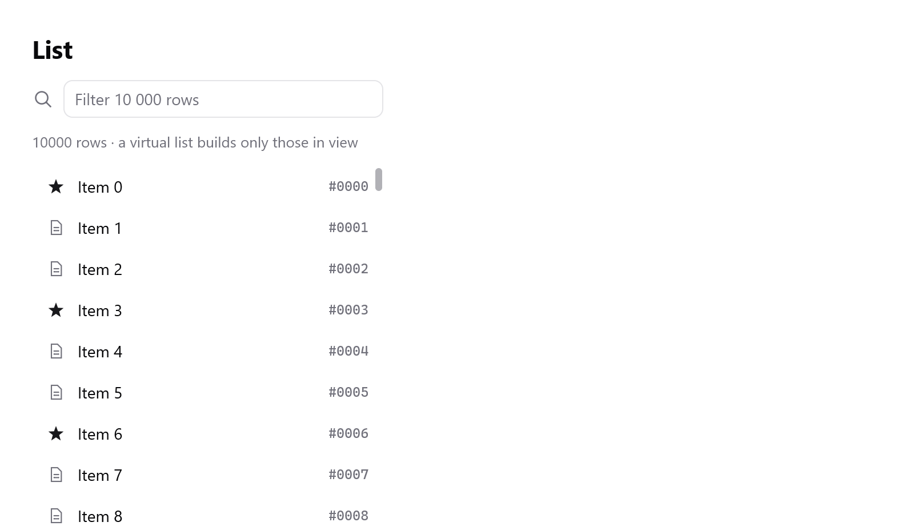
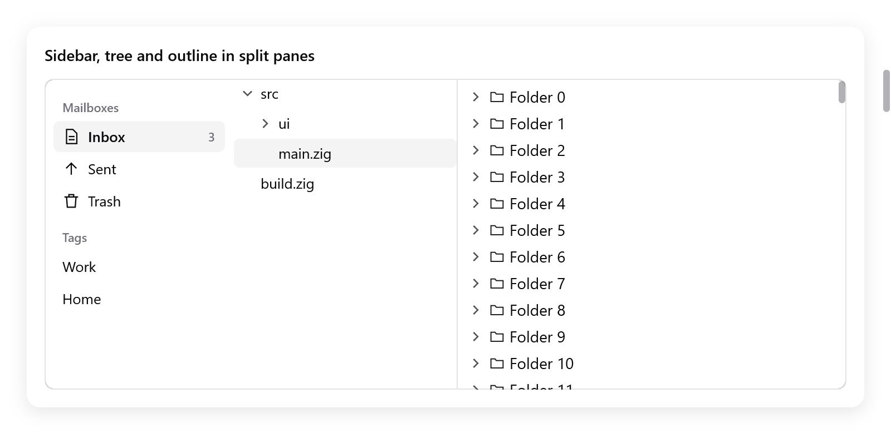
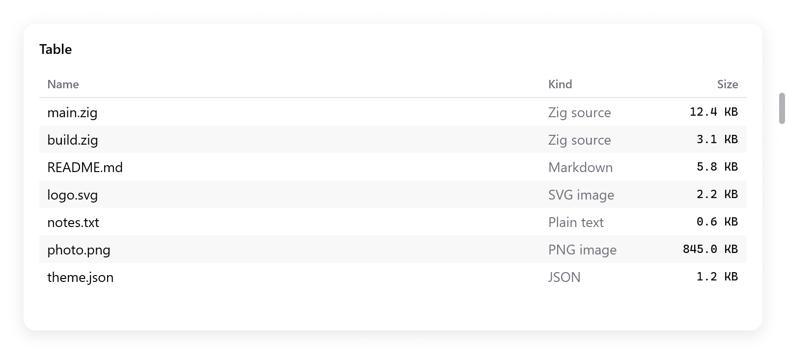
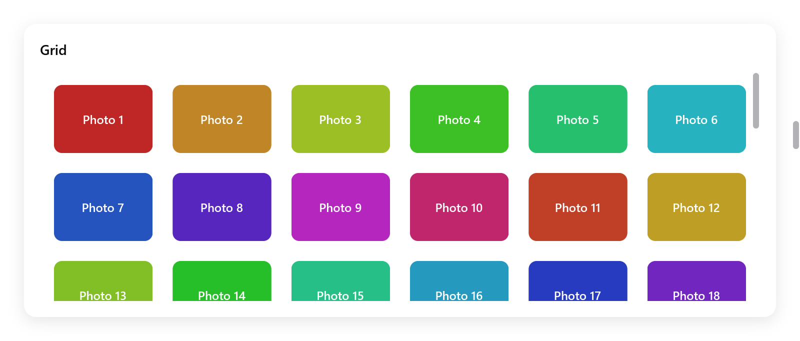

<a id="lists-trees-tables-and-grid-views"></a>

# Danh sách, cây, bảng và grid view

Các widget cho tập hợp nhiều mục: danh sách ảo hóa, cây, outline, bảng và grid view.

- Tất cả, trừ cây, chỉ dựng các hàng đang hiện, cộng thêm vài hàng xung quanh. Danh sách một trăm nghìn hàng chỉ tốn bằng một màn hình.
- Lựa chọn của chúng thuộc về app, giữ trong state của app.
- `end` của chúng trả về những gì đã xảy ra trong frame này.

| Widget | Dùng cho | Dựng |
|---|---|---|
| `ui.list` | các hàng cao bằng nhau | các hàng đang hiện |
| `ui.measuredList` | các hàng cao bất kỳ: khung chat, một feed | các hàng đang hiện |
| `ui.tree` | cây nhỏ, mỗi mục nằm trong phần tử cha của nó | mọi mục đang hiện |
| `ui.outline` | cây kích thước bất kỳ, như list view của Finder | các hàng đang hiện |
| `ui.table` | các hàng trong các cột sắp xếp được, dưới một header | các hàng đang hiện |
| `ui.gridView` | các mục trong lưới tự xuống hàng, như thư viện của Photos | các hàng đang hiện |

Để xếp các ô theo hàng và cột mà chứa mọi phần tử con, như một form hay dashboard, hãy dùng [`ui.grid`](grid.md).

<!-- demo: virtual-list height=360 -->



*Danh sách ảo 10.000 hàng; chỉ những hàng đang hiện mới được dựng.*

<a id="lists"></a>

## Danh sách

```zig
var rows = ui.list(c, .{ .count = s.items.len, .row_height = 36 });
while (rows.next()) |i| {
    const row = ui.div(c).row().wFull().h(36).px(12).gap(10).itemsCenter().rounded(6).hover(c.theme.surface_hover);
    defer row.end();
    ui.icon(c, "doc.text", .{ .size = 13, .color = c.theme.muted });
    ui.text(c, s.items[i].name, .{});
}
rows.end();
```

`ui.list(c, opts)` là một danh sách ảo hóa, theo kiểu `uniform_list` của GPUI: các hàng cao bằng nhau, và chỉ những hàng đang hiện mới được dựng. Nó có scroll. `next()` cho chỉ số của từng hàng cần dựng, rồi `end()` đóng danh sách.

- Mỗi hàng phải cao đúng `row_height`: hãy dựng nó với chiều cao đó.
- Danh sách cấp cho mỗi hàng một id theo chỉ số. Hàng giữ được hover và animation khi danh sách scroll.
- Khi hàng bị lọc hoặc đổi thứ tự mà state của nó phải đi theo mục, hãy gắn key cho nội dung hàng bằng `ui.key` (xem [Views](views.md)).

| `ui.ListOptions` | Mặc định | |
|---|---|---|
| `count` | | số hàng |
| `row_height` | | chiều cao mỗi hàng, tính bằng điểm |
| `width`, `height` | `.fill` | box của danh sách |
| `gap` | 0 | giữa các hàng |
| `padding` | không có | |
| `overscan` | 4 | số hàng dựng thêm ngoài mỗi mép của vùng hiện, để scroll mượt |
| `scroll_to` | null | scroll danh sách tới offset này, tính bằng điểm, trong frame này |
| `follow_end`, `follow_glide` | false, null | bắt đầu ở cuối và giữ cuối danh sách trong tầm nhìn khi có hàng mới, trượt tới đó ([layout](layout.md)) |
| `choice` | null | các hàng được chọn (xem dưới) |

- Để hiện hàng `i`, scroll tới `i * (row_height + gap)`.
- Các box rỗng giữ chỗ cho những hàng ở trên và dưới vùng hiện. Thanh scroll là của toàn bộ danh sách.

<a id="choosing-rows"></a>

### Chọn hàng

Với `choice`, một `*ui.ListChoice` do app giữ, các hàng có thể được chọn. Danh sách tự mở box cho từng hàng, cao `row_height`: hãy dựng nội dung hàng bên trong.

- Bấm để chọn một hàng.
- Khi danh sách có focus, phím mũi tên, Home, End, Page Up và Page Down di chuyển `choice.selected`.
- Enter hoặc double click thì submit hàng đó.
- `rows.result`, đọc sau `end()`, có `changed`, `submitted`, `focused` và `menu_row`, hàng vừa bị bấm chuột phải trong frame.
- `rows.textColor()` là màu chữ trên hàng đang dựng.

**Chọn nhiều hàng.** Với `choice.selection`, một `*ui.Selection` (tập key của các hàng), người dùng chọn được nhiều hàng, như trong Finder:

- Shift-click, và Shift với phím mũi tên, mở rộng lựa chọn từ hàng bắt đầu.
- Cmd-click (Ctrl-click ngoài Mac) thêm hoặc bỏ một hàng.
- Cmd+A chọn mọi hàng.
- Nhấn vào hàng chưa chọn thì chọn nó ngay khi nhấn xuống. Nhấn vào hàng đã chọn thì đợi tới lúc nhả.

**Bấm chuột phải.**

- Bấm chuột phải vào hàng chưa chọn thì chọn nó trước khi context menu mở. Nhờ vậy menu thao tác đúng trên hàng nó được mở.
- Trên hàng đã chọn, lựa chọn giữ nguyên.
- `choice.menu_keeps_selection` để nguyên lựa chọn. Khi đó menu chỉ thao tác trên `menu_row`.
- Danh sách không có selection thì không bao giờ chọn khi bấm chuột phải.

**Key.** `choice.key` (`ui.SelectionKey.of(ctx, keyOf)`) cho mục của mỗi hàng một danh tính.

- Selection giữ key của các mục.
- Con trỏ chọn đi theo mục của nó khi các hàng xuất hiện, biến mất hay di chuyển, miễn selection vẫn còn giữ mục đó.
- Vì vậy app có thể chọn một hàng khác tại chỉ số của con trỏ chọn, như một file vừa paste hay sắp xếp vào đó, hoặc một mục vừa đổi tên tại chỗ. Lựa chọn của app được giữ lại.

```zig
s.choice = .{ .selection = &s.chosen, .key = .of(s, State.keyOf) };
var rows = ui.list(c, .{ .count = s.files.len, .row_height = 28, .choice = &s.choice });
while (rows.next()) |i| {
    const name = c.leaf(.{ .padding = .xy(8, 0) }, .{ .text = .{ .str = s.files[i].name, .style = .{}, .color = rows.textColor() } }, null);
    if (ui.rowDoubleClicked(c, name)) s.rename(i);
}
rows.end();
```

`ui.rowDoubleClicked(c, index)` cho biết double click của một hàng rơi vào phần tử `index`. Nó không lấy mất cú bấm của hàng, hàng vẫn chọn như thường. Các ô của bảng cũng đọc được nó.

<a id="rows-of-any-height"></a>

## Hàng cao bất kỳ

```zig
var rows = ui.measuredList(c, &s.messages, .{ .count = s.items.len, .estimate = 60, .gap = 8, .follow_end = true });
while (rows.next()) |i| ui.text(c, s.items[i].text, .{ .wrap = true });
rows.end();
```

`ui.measuredList(c, &state, opts)` là một danh sách ảo hóa mà mỗi hàng cao theo nội dung, theo kiểu `list` của GPUI: tin nhắn tự xuống dòng, một feed. `next()` mở box cho từng hàng, rộng bằng danh sách, để chứa nội dung. Nó dừng khi vùng hiện đã đầy.

- App giữ một `ui.MeasuredListState` và giải phóng nó bằng `deinit(gpa)`.
- Mỗi hàng được đo trong frame dựng nó, nên những gì hiện ra không bao giờ là ước đoán.
- Hàng chưa dựng được tính bằng `estimate`. Chỉ thanh scroll và độ xa của một cú nhảy đọc giá trị này: càng gần chiều cao hàng thông thường, thanh scroll càng ổn định.
- Vị trí của người đọc là một hàng, không phải một offset. Khi các hàng phía trên được đo và hóa ra cao hơn hay thấp hơn, không có gì trên màn hình bị xê dịch.

| `ui.MeasuredListOptions` | Mặc định | |
|---|---|---|
| `count` | | số hàng |
| `estimate` | 44 | chiều cao ước chừng của một hàng, tính bằng điểm |
| `width`, `height` | `.fill` | box của danh sách |
| `gap` | 0 | giữa các hàng |
| `padding` | không có | |
| `overscan` | 2 | số hàng dựng thêm ngoài mỗi mép của vùng hiện |
| `follow_end` | false | bắt đầu ở cuối và giữ cuối danh sách trong tầm nhìn khi hàng mới tới hoặc hàng cao lên, cho tới khi người đọc scroll đi chỗ khác |

- `state.reveal = i` đưa hàng `i` lên đầu vùng hiện ở frame tiếp theo, trừ khi hàng đó đã hiện trọn.
- Một hàng giữ chiều cao cho tới khi được dựng lại hoặc bề rộng danh sách thay đổi. Hàng thay đổi lúc nằm ngoài vùng hiện sẽ tự sửa lại khi quay vào.
- Khi hàng bị lọc, sắp xếp, hoặc chèn lên trên các hàng khác, hãy gọi `state.reset()`. Nó quên các chiều cao đã đo; vị trí vẫn tính theo chỉ số.
- Mỗi hàng tốn hơn một hàng của `ui.list`, vốn không bao giờ đo. Hãy dùng `ui.list` khi các hàng cao bằng nhau.
- Ở đây không chọn hàng được; nội dung của hàng có thể bấm được.

<a id="trees"></a>

## Cây

<!-- demo: tree height=415 -->



*Cây thư mục bên cạnh một outline các thư mục.*

```zig
var tr = ui.tree(c, &s.chosen, .{});
if (tr.item("src", "src", &s.src_open)) {
    defer tr.endChildren();
    if (tr.item("src/ui", "ui", &s.ui_open)) {
        defer tr.endChildren();
        _ = tr.item("src/ui/list.zig", "list.zig", null);
        _ = tr.item("src/ui/tree.zig", "tree.zig", null);
    }
    _ = tr.item("src/main.zig", "main.zig", null);
}
_ = tr.item("build.zig", "build.zig", null);
if (tr.end().submitted) s.open(s.chosen);
```

`ui.tree(c, &chosen, opts)` là một cây mà mỗi mục được dựng bên trong mục cha. Các phần tử con hiện ra khi mục cha đang mở. Mục được đặt tên bằng key do app giữ, như đường dẫn hay id. `chosen.*` là key của mục đang chọn.

`item(key, label, open)` thêm một mục; `open` là null thì mục là lá. Nó trả về true khi các phần tử con của mục đang hiện: hãy dựng chúng, rồi gọi `endChildren()`.

- Bấm vào mũi tên của mục thì mở hoặc đóng nó. Bấm vào chỗ khác trên mục thì chọn nó.
- Khi có focus bàn phím, Up và Down chọn các mục lân cận.
- Right mở mục hoặc đi tới phần tử con đầu tiên. Left đóng mục hoặc đi về phần tử cha.
- Enter, hoặc double click, submit lựa chọn.
- Kết quả có `changed`, `submitted` và `focused`.

| `ui.TreeOptions` | Mặc định | |
|---|---|---|
| `width` | `.fill` | |
| `height` | `.auto` | |
| `row_height` | 26 | |
| `indent` | 16 | mỗi cấp thụt thêm chừng này trước mũi tên của mục |

Cây dựng mọi mục nó hiển thị. Với hàng nghìn mục, hãy dùng outline.

<a id="outlines"></a>

## Outline

`ui.outline(T, c, &state, roots, provider, opts)` hiển thị một cây các mục kiểu `T`, như outline view của AppKit và list view của Finder. Bên dưới mỗi mục đang mở là các phần tử con, thụt lề, với một mũi tên để mở và đóng. Nó chỉ dựng các hàng đang hiện.

- App giữ một `ui.OutlineState(T)`: các mục đang mở và mục đang chọn (`selected`).
- `provider.children(item)` trả về các phần tử con của một mục, rỗng nếu mục không có con.
- `provider` là giá trị bất kỳ có method đó, thường là state của app.

```zig
const Files = struct {
    folders: ui.OutlineState(u32) = .{},
    roots: []const u32 = &.{ 0, 1, 2, 3 },
    kids: [20]u32 = undefined,

    pub fn children(s: *Files, item: u32) []const u32 {
        if (item >= 1_000_000) return &.{};
        for (&s.kids, 0..) |*v, f| v.* = 1_000_000 + item * 100 + @as(u32, @intCast(f));
        return &s.kids;
    }

    fn view(s: *Files, c: *ui.Context) void {
        var rows = ui.outline(u32, c, &s.folders, s.roots, s, .{ .row_height = 24 });
        while (rows.next()) |r| {
            const folder = r.item < 1_000_000;
            ui.icon(c, if (folder) "folder" else "doc", .{ .size = 12, .color = c.theme.muted });
            ui.text(c, if (folder) c.print("Folder {d}", .{r.item}) else "A file", .{});
        }
        if (rows.end().submitted) s.openItem(s.folders.selected.?);
    }
};
```

`next()` mở từng hàng đang hiện, đã có sẵn thụt lề và mũi tên. Nó trả về một `ui.OutlineRow(T)`: `item`, `depth` của nó, `has_children` và hàng cha `parent`. Thêm nội dung cho hàng; lần gọi `next()` tiếp theo sẽ đóng hàng.

- Các mục được so theo giá trị, còn chuỗi (`[]const u8`) thì so theo byte. Vì vậy đường dẫn dùng làm mục được.
- `isOpen(item)`, `setOpen(gpa, item, open)` và `isSelected(item)` của state cho phép mở thư mục từ code, để làm lộ ra một file.
- Giải phóng state bằng `deinit(gpa)`.

**Bàn phím và con trỏ.**

- Khi có focus, Up, Down, Home, End, Page Up và Page Down chọn hàng.
- Right mở mục đang chọn hoặc đi tới phần tử con đầu tiên. Left đóng mục hoặc đi về phần tử cha.
- Enter, hoặc double click, submit nó.
- Đóng một mục khi phần tử con của nó đang được chọn thì mục đó được chọn.
- Các hàng giữ danh tính, và cả hover, khi các mục phía trên mở ra hay đóng lại.

| `ui.OutlineOptions` | Mặc định | |
|---|---|---|
| `row_height` | 26 | |
| `indent` | 16 | |
| `width`, `height` | `.fill` | |
| `padding` | `.all(4)` | |

<a id="tables"></a>

## Bảng

<!-- demo: table height=385 -->



*Bảng file với các cột Name, Kind và Size sắp xếp được.*

```zig
const columns: []const ui.TableColumn = &.{
    .{ .title = "Name", .sortable = true },
    .{ .title = "Kind", .width = 120, .sortable = true },
    .{ .title = "Size", .width = 90, .alignment = .end, .sortable = true },
};

var tb = ui.table(c, &s.table, columns, files.len, .{});
while (tb.next()) |row| {
    const f = files[s.order[row]];
    while (tb.cell()) |col| switch (col) {
        0 => ui.text(c, f.name, .{ .color = tb.textColor() }),
        1 => ui.text(c, f.kind, .{ .color = c.theme.muted }),
        else => ui.text(c, c.print("{d} KB", .{f.size / 1000}), .{ .mono = true, .size = 12 }),
    };
}
if (tb.end().sorted) s.sortFiles(); // theo s.table.sort
```

`ui.table(c, &state, columns, count, opts)` hiển thị `count` hàng trong các cột `columns` dưới một header, dựng khi chúng hiện ra. `next()` mở từng hàng đang hiện, `cell()` mở từng cột của hàng, rồi `end()` đóng bảng.

Một `ui.TableColumn` có:

- `title`;
- `width` tính bằng điểm; 0 thì chia nhau chỗ trống các cột khác để lại;
- `alignment`: `.start`, `.center` hoặc `.end`;
- `sortable`.

App giữ một `ui.TableState`:

- `selected`, hàng đang chọn;
- `sort`, một `ui.TableSort` (`column`, `descending`) hoặc null.

**Sắp xếp.**

- Bấm vào header của cột sắp xếp được thì sắp theo cột đó, tăng dần. Bấm lần nữa thì đảo thứ tự.
- Header hiện một mũi tên, và `end()` báo `sorted`.
- App tự sắp xếp các hàng theo `state.sort`. Bảng không bao giờ tự đổi thứ tự dữ liệu của app: `row` là một vị trí trong thứ tự mà app giữ.

**Chọn.**

- Bấm để chọn một hàng. Khi có focus, phím mũi tên, Home, End, Page Up và Page Down cũng chọn.
- Enter, hoặc double click, submit hàng đó.
- `textColor()` là màu chữ trên hàng đang dựng, dù được chọn hay không.

| `ui.TableOptions` | Mặc định | |
|---|---|---|
| `row_height` | 28 | |
| `header_height` | 28 | |
| `width`, `height` | `.fill` | |
| `striped` | true | tô nhạt xen kẽ các hàng |
| `drag_select`, `cells`, `cell_menu` | false, false, null | xem dưới |
| `sideways`, `frozen` | false, 0 | xem dưới |

Kết quả có `changed`, `sorted`, `submitted`, `focused`, `drag_selecting`, cùng `menu_row` và `menu_col`: hàng và cột vừa bị bấm chuột phải trong frame.

<a id="choosing-rows-and-cells"></a>

### Chọn hàng và ô

**`drag_select`.** Kéo qua các hàng thì chọn những hàng đi qua, tính từ hàng bắt đầu nhấn.

- Bảng tự scroll khi con trỏ tới gần hoặc vượt mép trên hay mép dưới.
- Shift-click, hoặc Shift với phím mũi tên, mở rộng lựa chọn.
- Các hàng được chọn là từ `state.anchor` tới `state.selected` (`state.rows()`, `state.rowChosen(i)`).
- Nhấn vào hàng chưa chọn thì chọn nó ngay khi nhấn xuống, như bảng tính. Nhấn vào hàng đã chọn thì đợi tới lúc nhả, nên kéo cả vùng đã chọn vẫn giữ được nó.
- `drag_selecting` báo đang có một cú kéo. Việc phụ thuộc lựa chọn, như tính tổng các ô đã chọn, có thể đợi tới khi kéo xong.

**`cells`.** Bảng chọn một khối ô: các hàng đã chọn nhân với các cột từ `state.cols[0]` tới `state.cols[1]`, theo thứ tự hiển thị.

- Bấm để chọn một ô. Shift-click mở rộng hàng và cột tới ô đó. Kéo thì chọn các ô đi qua.
- Left và Right di chuyển cột của con trỏ chọn; giữ Shift thì mở rộng các cột.
- Các phím di chuyển hàng chỉ giữ lại một cột, trừ khi có Shift.
- Cmd+A (Ctrl+A) chọn mọi hàng và mọi cột.
- Các ô trong khối hiện màu xám của hàng được chọn. Hàng được chọn không bị tô cả hàng.
- `t.cellSelected(row, col)` cho hàm dựng ô biết ô của nó có được chọn không. `textColor()` là màu chữ trong ô đó.

```zig
var tb = ui.table(c, &s.sheet, columns, rows.len, .{ .cells = true });
while (tb.next()) |row| {
    while (tb.cell()) |col| ui.text(c, rows[row][col], .{ .color = tb.textColor() });
}
_ = tb.end();
```

**`state.selection`.** Với một `*ui.Selection`, và `state.key` như của danh sách, các hàng được chọn là một tập hợp.

- Cmd-click thêm hoặc bỏ hàng, và giữ nguyên các cột.
- Shift mở rộng từ hàng của cú bấm gần nhất.
- Cmd+A chọn mọi hàng.
- Bấm chuột phải ngoài vùng chọn, trên một hàng hoặc, với `cells`, trên một ô, thì chọn nó trước khi menu mở. Bên trong vùng chọn thì lựa chọn giữ nguyên.
- `state.menu_keeps_selection` để nguyên lựa chọn.

**Header hàng.** Một cột `row_header`, như số thứ tự hàng của bảng tính, chọn cả hàng khi có `cells`.

- Bấm hoặc kéo trên các ô của nó thì chọn hàng với mọi cột.
- Bấm vào header của nó thì chọn mọi hàng.
- Nó không sắp xếp.

**`cell_menu`.** Một `ui.TableCellMenu` (`ctx` và `build(ctx, menu, row, col)`) cho các ô một context menu.

- Menu phủ toàn bộ ô, kể cả padding.
- Nó được dựng như một [context menu](menus.md).
- Menu dựng ra mà không có mục nào thì không mở.
- Context menu của nội dung bên trong ô sẽ nhận cú bấm chuột phải trên nội dung đó.

```zig
const cols: []const ui.TableColumn = &.{ .{ .title = "#", .width = 48, .row_header = true }, .{ .title = "Name" } };
var tb = ui.table(c, &s.grid, cols, rows.len, .{ .cells = true, .cell_menu = .{ .ctx = s, .build = State.cellMenu } });
```

<a id="scrolling-sideways-and-frozen-columns"></a>

### Scroll ngang và cột cố định

```zig
const cols: []const ui.TableColumn = &.{
    .{ .title = "#", .width = 48, .row_header = true },
    .{ .title = "Name", .width = 160 },
    .{ .title = "Email", .width = 260 },
    .{ .title = "City", .width = 200 },
};
var tb = ui.table(c, &s.grid, cols, rows.len, .{ .cells = true, .frozen = 2 });
```

- Với `sideways`, các cột rộng hơn bảng sẽ scroll bên trong nó, dưới cùng một header.
- Với `frozen`, các cột đầu tiên luôn nằm trong tầm nhìn khi các cột khác scroll, như bảng tính. Cột bị ẩn cũng được tính.
- Một đường kẻ chạy dọc các cột cố định khi đã có nội dung trượt xuống dưới chúng.
- `frozen` làm bảng thành `sideways`.

Bảng scroll:

- bằng thanh scroll;
- với `cells`, bằng Left và Right, giữ cho cột của con trỏ chọn không bị che dưới các cột cố định;
- bằng cú kéo chọn ô vượt qua một trong hai mép.

Ngoài ra:

- Các cột rộng 0 chia nhau chỗ còn lại, mỗi cột ít nhất bằng `min_width` của nó.
- `cell()` trả về các cột theo thứ tự, với chỉ số như thường. Hàm dựng ô không phải đổi gì.
- Bảng quá hẹp để hiện thêm một cột cạnh các cột cố định thì scroll cả các cột cố định.
- Giữ nguyên `sideways` khi `frozen` bật tắt, nếu không offset sẽ bắt đầu lại. Hãy truyền `.sideways = true` ở nơi app cho người đọc cố định cột.

<a id="revealing-a-row"></a>

### Làm lộ một hàng

`TableState.reveal` chỉ định một hàng app muốn hiện ra. Ở frame tiếp theo, bảng scroll hàng đó vào tầm nhìn, ít nhất có thể, rồi xóa trường này.

Dùng cách này cho hàng app vừa thêm vào cuối, hoặc vừa chọn từ nơi khác như một kết quả tìm kiếm: `s.table.reveal = s.rows.items.len - 1;`.

<a id="grid-views"></a>

## Grid view

<!-- demo: grid-view height=365 -->



*Lưới ảo gồm các ô ảnh chọn được.*

```zig
var g = ui.gridView(c, &s.grid, .{ .count = s.photos.len, .min_item_width = 96, .row_height = 80 });
while (g.next()) |i| {
    ui.column(c, .{ .width = .fill, .height = .fill, .radius = 8, .align_items = .center, .justify = .center, .background = c.theme.surface });
    ui.text(c, s.photos[i].name, .{ .size = 12 });
    ui.end(c);
}
if (g.end().submitted) s.openPhoto(s.grid.selected.?);
```

`ui.gridView(c, &state, opts)` hiển thị các mục trong một lưới tự xuống hàng, như thư viện của Photos và icon view của Finder.

- Nó có nhiều cột nhất có thể với các mục rộng ít nhất `min_item_width`. Các cột chia nhau phần bề rộng còn lại.
- Mỗi hàng cao `row_height`.
- `next()` mở từng mục đang hiện, ô của nó sẵn sàng cho nội dung.

App giữ một `ui.GridState`, trong đó `selected` là mục đang chọn.

- Bấm để chọn một mục.
- Khi có focus, phím mũi tên di chuyển lựa chọn theo cả hai chiều. Home và End tới hai đầu, Page Up và Page Down đi một màn hình.
- Enter, hoặc double click, submit mục đó.

| `ui.GridViewOptions` | Mặc định | |
|---|---|---|
| `count` | | số mục |
| `min_item_width` | 120 | |
| `row_height` | 120 | |
| `gap` | 8 | giữa các mục, cả hai chiều |
| `padding` | `.all(8)` | |
| `width`, `height` | `.fill` | |

<a id="dragging-items"></a>

## Kéo các mục

Hàng và mục kéo được nhờ [kéo thả](drag-and-drop.md): dựng nội dung hàng bên trong một box `DragDrop.draggable`, và cho danh sách một đích thả.
