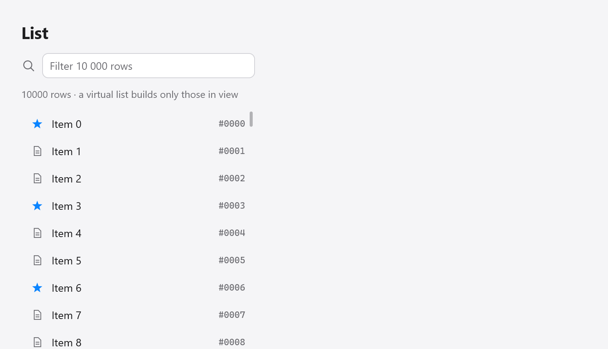
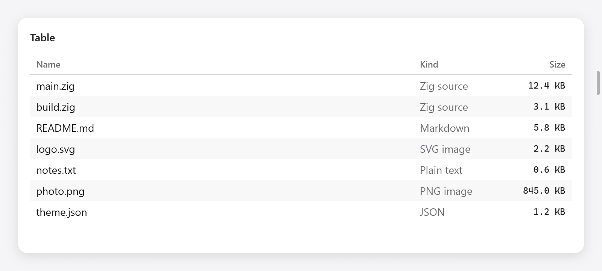
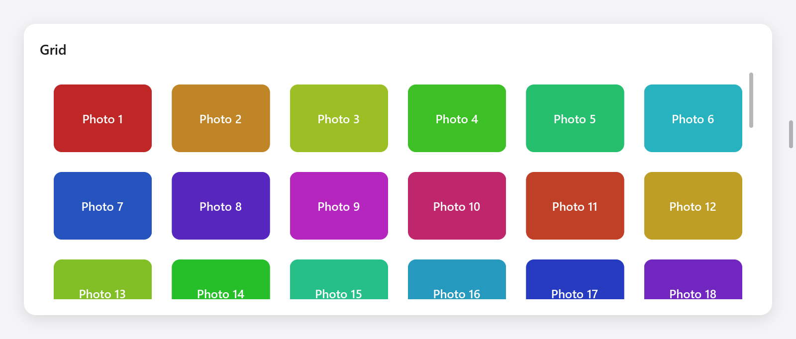

<a id="lists-trees-tables-and-grid-views"></a>

# Danh sách, cây, bảng và dạng xem lưới

Bộ sưu tập các mục: danh sách ảo hóa, cây cối, đường viền, bảng và view dạng lưới. Tất cả trừ cây chỉ xây dựng các hàng trong view (và một số hàng xung quanh chúng), do đó, một danh sách gồm một trăm nghìn hàng có chi phí tương đương với một màn hình. Lựa chọn họ đưa ra là của ứng dụng, được giữ ở trạng thái của nó; `end` của họ trả về những gì đã xảy ra trong khung này.

| Tiện ích | cho | Bản dựng |
|---|---|---|
| `ui.list` | hàng có cùng chiều cao | các hàng trong view |
| `ui.tree` | một cây nhỏ, mỗi phần tử bên trong cây mẹ của nó | mỗi mục được hiển thị |
| `ui.outline` | một cây có kích thước bất kỳ, dưới dạng view danh sách của Finder | các hàng trong view |
| `ui.table` | các hàng trong các cột có thể sắp xếp dưới tiêu đề | các hàng trong view |
| `ui.gridView` | các mục trong lưới bao bọc, dưới dạng thư viện Ảnh | các hàng trong view |

Để có bố cục các ô theo hàng và cột chứa mọi ô con (biểu mẫu, bảng thông tin), thay vào đó, hãy sử dụng [`ui.grid`](grid.md).

<a id="lists"></a>



*Danh sách ảo gồm 10.000 dòng; chỉ các dòng đang thấy được dựng.*

## Danh sách

`ui.list(c, opts)` là một danh sách ảo hóa, theo cách GPUI's `uniform_list`: các hàng có một chiều cao, trong đó chỉ những hàng trong view mới được tạo. Nó cuộn; `next()` đưa ra chỉ mục của từng hàng cần xây dựng, sau đó `end()` đóng nó lại:

```zig
var rows = ui.list(c, .{ .count = s.items.len, .row_height = 36 });
while (rows.next()) |i| {
    const row = ui.div(c).row().wFull().h(36).px(12).gap(10).itemsCenter().rounded(6).hover(c.theme.surface_hover);
    defer row.end();
    ui.icon(c, "doc.text", .{ .size = 13, .color = c.theme.muted });
    ui.text(c, s.items[i].name, .{});
}
rows.end();
```

Mỗi hàng phải có chiều cao `row_height`: xây dựng hàng đó với chiều cao đó. Danh sách cung cấp cho mỗi hàng một id từ chỉ mục của nó, do đó, một hàng sẽ giữ nguyên trạng thái di chuột và hình ảnh động khi danh sách cuộn; khi các hàng được lọc hoặc sắp xếp lại và trạng thái của chúng phải tuân theo mục đó, hãy khóa nội dung của hàng bằng `ui.key` (xem [View](views.md)).

`ui.ListOptions`:

| trường | Mặc định | |
|---|---|---|
| `count` | | có bao nhiêu hàng |
| `row_height` | | chiều cao của mỗi hàng, tính bằng điểm |
| `width`, `height` | `.fill` | hộp danh sách |
| `gap` | 0 | giữa các hàng |
| `padding` | không có | |
| `overscan` | 4 | các hàng được tạo ngoài mỗi cạnh của view để cuộn mượt mà |
| `scroll_to` | null | cuộn danh sách đến phần bù này, theo điểm, trong khung này |
| `follow_end`, `follow_glide` | false, null | bắt đầu ở cuối và giữ nó ở view khi các hàng đến, lướt tới đó ([layout](layout.md)) |
| `choice` | null | các hàng được chọn (bên dưới) |

Để hiển thị hàng `i`, hãy cuộn tới `i * (row_height + gap)`. Phòng của các hàng phía trên và phía dưới view được giữ bởi các ô trống, vì vậy thanh cuộn là thanh cuộn của toàn bộ danh sách.

<a id="choosing-rows"></a>

### Chọn hàng

Với `choice`, ứng dụng sẽ giữ lại `*ui.ListChoice`, danh sách sẽ tự mở hộp của mỗi hàng (`row_height` cao; tạo nội dung của hàng trong đó) và các hàng của nó được chọn: một cú nhấp chuột sẽ chọn một hàng, các mũi tên, Trang chủ, Kết thúc và Lên xuống Trang sẽ di chuyển `choice.selected` trong khi danh sách có tiêu điểm và Enter hoặc nhấp đúp sẽ gửi nó. `rows.result`, đọc sau `end()`, có `changed`, `submitted`, `focused` và `menu_row`, nhấp chuột phải vào hàng trong khung; `rows.textColor()` là màu của văn bản trên hàng đang được tạo.

Với `choice.selection`, `*ui.Selection` (một tập hợp các phím của hàng), người dùng chọn một số, như trong Finder: Nhấn Shift và Shift bằng các mũi tên sẽ mở rộng lựa chọn từ hàng mà nó bắt đầu, nhấp chuột Cmd (nhấp Ctrl trên máy Mac) thêm một hàng hoặc loại bỏ nó và Cmd+A chọn mọi hàng. Nhấn vào một hàng không được chọn sẽ chọn nó khi con trỏ đi xuống; một cái trên hàng đã chọn đang chờ phát hành. Nhấp chuột phải vào hàng không được chọn sẽ chọn nó trước khi menu ngữ cảnh của nó mở ra, do đó menu sẽ hoạt động trên hàng mà nó được mở; trên một hàng đã chọn sự lựa chọn vẫn còn. `choice.menu_keeps_selection` giữ nguyên lựa chọn (menu chỉ hoạt động trên `menu_row`). Một danh sách không có lựa chọn sẽ không bao giờ được chọn khi nhấp chuột phải.

`choice.key` (`ui.SelectionKey.of(ctx, keyOf)`) cung cấp danh tính cho mỗi mục của hàng: lựa chọn giữ các khóa của mục đó và con trỏ đi theo mục của nó khi các hàng đến, đi và di chuyển, trong khi lựa chọn vẫn giữ nó, do đó, ứng dụng chọn một hàng khác tại chỉ mục của con trỏ (một tệp được dán, sắp xếp ở đó; một mục được đổi tên ở vị trí của nó) sẽ giữ nguyên lựa chọn của ứng dụng.

```zig
s.choice = .{ .selection = &s.chosen, .key = .of(s, State.keyOf) };
var rows = ui.list(c, .{ .count = s.files.len, .row_height = 28, .choice = &s.choice });
while (rows.next()) |i| {
    const name = c.leaf(.{ .padding = .xy(8, 0) }, .{ .text = .{ .str = s.files[i].name, .style = .{}, .color = rows.textColor() } }, null);
    if (ui.rowDoubleClicked(c, name)) s.rename(i);
}
rows.end();
```

`ui.rowDoubleClicked(c, index)` cho biết rằng thao tác nhấp đúp của một hàng đã chạm vào phần tử `index` mà không thực hiện thao tác nhấp chuột từ hàng và tiếp tục chọn (các ô của bảng cũng đọc phần tử đó).

<a id="trees"></a>

## Cây cối


*Thanh bên, cây tệp và outline ảo được bố trí trong các khung chia đôi.*

`ui.tree(c, &chosen, opts)` là một cái cây có các vật phẩm được xây dựng bên trong vật phẩm mà chúng thuộc về, con của chúng hiển thị khi nó mở. Các mục được đặt tên theo khóa mà ứng dụng lưu giữ (đường dẫn, id); `chosen.*` là chìa khóa của mục được chọn.

```zig
var tr = ui.tree(c, &s.chosen, .{});
if (tr.item("src", "src", &s.src_open)) {
    defer tr.endChildren();
    if (tr.item("src/ui", "ui", &s.ui_open)) {
        defer tr.endChildren();
        _ = tr.item("src/ui/list.zig", "list.zig", null);
        _ = tr.item("src/ui/tree.zig", "tree.zig", null);
    }
    _ = tr.item("src/main.zig", "main.zig", null);
}
_ = tr.item("build.zig", "build.zig", null);
if (tr.end().submitted) s.open(s.chosen);
```

`item(key, label, open)` thêm một mục; null `open` tạo thành một chiếc lá. Nó trả về true trong khi phần tử con của mục này hiển thị: xây dựng chúng, sau đó `endChildren()`.

Một cú nhấp chuột vào mũi tên của một mục sẽ mở hoặc đóng nó; một cú nhấp chuột vào nơi khác sẽ chọn nó. Trong khi cây tập trung vào bàn phím, Up và Down chọn các mục xung quanh, Phải mở mục hoặc đi đến con đầu tiên của nó, Trái đóng nó hoặc đi đến cha mẹ của nó và Enter (hoặc nhấp đúp) gửi lựa chọn. `ui.TreeOptions` có `width` (`.fill`), `height` (`.auto`), `row_height` (26) và `indent` (16, mỗi cấp độ thêm gì vào trước mũi tên của một vật phẩm). Kết quả có `changed`, `submitted` và `focused`.

Một cái cây xây dựng mọi mục mà nó hiển thị. Đối với hàng nghìn mục, hãy sử dụng dàn ý.

<a id="outlines"></a>

## Phác thảo

`ui.outline(T, c, &state, roots, provider, opts)` hiển thị một cây gồm các mục thuộc loại `T` dưới dạng view phác thảo của AppKit và view danh sách của Finder: bên dưới mỗi mục đang mở là các mục con của nó, được thụt lề, có mũi tên mở và đóng mục đó. Nó chỉ xây dựng các hàng trong view.

Ứng dụng giữ `ui.OutlineState(T)`, các mục đang mở và mục được chọn (`selected`). `provider.children(item)` trả về phần tử con của một mục, trống đối với một mục không có mục nào; `provider` là bất kỳ giá trị nào với phương thức đó, thường là trạng thái của ứng dụng:

```zig
const Files = struct {
    folders: ui.OutlineState(u32) = .{},
    roots: []const u32 = &.{ 0, 1, 2, 3 },
    kids: [20]u32 = undefined,

    pub fn children(s: *Files, item: u32) []const u32 {
        if (item >= 1_000_000) return &.{};
        for (&s.kids, 0..) |*v, f| v.* = 1_000_000 + item * 100 + @as(u32, @intCast(f));
        return &s.kids;
    }

    fn view(s: *Files, c: *ui.Context) void {
        var rows = ui.outline(u32, c, &s.folders, s.roots, s, .{ .row_height = 24 });
        while (rows.next()) |r| {
            const folder = r.item < 1_000_000;
            ui.icon(c, if (folder) "folder" else "doc", .{ .size = 12, .color = c.theme.muted });
            ui.text(c, if (folder) c.print("Folder {d}", .{r.item}) else "A file", .{});
        }
        if (rows.end().submitted) s.openItem(s.folders.selected.?);
    }
};
```

`next()` mở từng hàng trong view, thụt lề và mũi tên của nó đã được thêm và trả về `ui.OutlineRow(T)`: `item`, `depth`, `has_children` và hàng `parent` của nó. Thêm nội dung của hàng; `next()` tiếp theo sẽ đóng nó lại.

Các mục được so sánh theo giá trị và các chuỗi (`[]const u8`) theo byte của chúng, vì vậy các đường dẫn hoạt động như các mục. `isOpen(item)`, `setOpen(gpa, item, open)` và `isSelected(item)` của tiểu bang mở các thư mục từ mã (để hiển thị một tệp); giải phóng nó bằng `deinit(gpa)`.

Trong khi dàn bài có tiêu điểm, Lên, Xuống, Trang chủ, Kết thúc và Trang Up và Down chọn các hàng, Bên phải mở mục đã chọn hoặc chuyển đến mục con đầu tiên của nó, Bên trái đóng mục đó hoặc đi đến cấp độ gốc của nó và Enter (hoặc bấm đúp) gửi mục đó. Đóng một mục có con được chọn sẽ chọn mục đó. Các hàng giữ danh tính của chúng (di chuột) khi các mục mở và đóng phía trên chúng. `ui.OutlineOptions` có `row_height` (26), `indent` (16), `width` và `height` (`.fill`) và `padding` (`.all(4)`).

<a id="tables"></a>

## Bàn



*Bảng tệp với các cột Name, Kind và Size có thể sắp xếp.*

`ui.table(c, &state, columns, count, opts)` hiển thị `count` hàng trong `columns` dưới tiêu đề, được tạo khi chúng hiển thị. `next()` mở từng hàng trong view, `cell()` mỗi cột của nó, sau đó `end()`:

```zig
const columns: []const ui.TableColumn = &.{
    .{ .title = "Name", .sortable = true },
    .{ .title = "Kind", .width = 120, .sortable = true },
    .{ .title = "Size", .width = 90, .alignment = .end, .sortable = true },
};

var tb = ui.table(c, &s.table, columns, files.len, .{});
while (tb.next()) |row| {
    const f = files[s.order[row]];
    while (tb.cell()) |col| switch (col) {
        0 => ui.text(c, f.name, .{ .color = tb.textColor() }),
        1 => ui.text(c, f.kind, .{ .color = c.theme.muted }),
        else => ui.text(c, c.print("{d} KB", .{f.size / 1000}), .{ .mono = true, .size = 12 }),
    };
}
if (tb.end().sorted) s.sortFiles(); // by s.table.sort
```

`ui.TableColumn` có `title`, `width` về điểm (0 chia sẻ số điểm mà các cột khác để lại), `alignment` (`.start`, `.center` hoặc `.end`) và `sortable`.

Ứng dụng giữ `ui.TableState`: `selected`, hàng được chọn và `sort`, `ui.TableSort` (`column`, `descending`) hoặc null. Nhấp chuột vào tiêu đề của cột có thể sắp xếp sẽ sắp xếp theo cột đó, tăng dần và nhấp chuột thứ hai sẽ đảo ngược thứ tự: tiêu đề hiển thị một mũi tên, `end()` báo cáo `sorted` và ứng dụng sắp xếp các hàng của nó như `state.sort` cho biết. Bảng không bao giờ tự sắp xếp lại dữ liệu của ứng dụng: `row` là một vị trí trong thứ tự mà ứng dụng giữ nguyên.

Một cú nhấp chuột chọn một hàng; trong khi bảng có tiêu điểm thì các mũi tên, Trang chủ, Kết thúc và Lên xuống Trang và Enter (hoặc bấm đúp) sẽ gửi nó. `textColor()` là màu của văn bản trên hàng đang được tạo: văn bản có dấu trên hàng được chọn trong khi bảng có tiêu điểm.

`ui.TableOptions` có `row_height` (28), `header_height` (28), `width` và `height` (`.fill`), `striped` (mỗi hàng khác được tô màu, true), `drag_select`, `cells` và `cell_menu` (bên dưới). Kết quả có `changed`, `sorted`, `submitted`, `focused`, `drag_selecting` và `menu_row` và `menu_col`, hàng và cột được nhấp chuột phải vào khung.

<a id="choosing-rows-and-cells"></a>

### Chọn hàng và ô

Với `drag_select`, thao tác kéo qua các hàng sẽ chọn những hàng mà nó đi qua từ hàng được nhấn, cuộn bảng khi con trỏ đến gần hoặc đi qua đỉnh hoặc đáy của bảng và nhấp Shift hoặc Shift bằng các mũi tên sẽ mở rộng lựa chọn: các hàng được chọn là những hàng từ `state.anchor` đến `state.selected` (`state.rows()`, `state.rowChosen(i)`). Nhấn vào một hàng không được chọn sẽ chọn hàng đó khi con trỏ đi xuống, giống như bảng tính; một cái trên hàng đã chọn sẽ chờ phát hành, do đó, việc kéo lựa chọn sẽ giữ nó. `drag_selecting` báo cáo một sự cản trở đang diễn ra, đối với công việc tuân theo sự lựa chọn (tổng số những gì được chọn) để đợi cho đến khi nó kết thúc.

Với `cells`, bảng chọn một khối ô: các hàng được chọn nhân với các cột từ `state.cols[0]` đến `state.cols[1]`, theo thứ tự hiển thị. Một cú nhấp chuột sẽ chọn một ô, một cú nhấp chuột Shift sẽ mở rộng các hàng và cột vào ô đó và thao tác kéo sẽ chọn các ô mà nó đi qua. Trái và Phải di chuyển cột của con trỏ, Shift khi chúng mở rộng các cột, các phím di chuyển các hàng sẽ rời khỏi một cột trừ khi dùng Shift và Cmd+A (Ctrl+A) chọn mọi hàng và cột. Các ô của khối hiển thị bằng màu nhấn trong khi bảng có tiêu điểm; các hàng đã chọn không được tô màu toàn bộ. `t.cellSelected(row, col)` cho trình tạo ô biết ô của nó có được chọn hay không và `textColor()` là văn bản có dấu trong đó:

```zig
var tb = ui.table(c, &s.sheet, columns, rows.len, .{ .cells = true });
while (tb.next()) |row| {
    while (tb.cell()) |col| ui.text(c, rows[row][col], .{ .color = tb.textColor() });
}
_ = tb.end();
```

Với `state.selection` (a `*ui.Selection` và `state.key` dưới dạng danh sách), các hàng được chọn là một tập hợp: Nhấp chuột Cmd sẽ thêm hàng và loại bỏ chúng (và giữ nguyên các cột), Shift mở rộng từ hàng có lần nhấp cuối cùng và Cmd+A chọn mọi hàng. Nhấp chuột phải vào một hàng hoặc với `cells` trên một ô, bên ngoài lựa chọn sẽ chọn nó trước khi menu của nó mở ra; bên trong, sự lựa chọn vẫn ở lại; `state.menu_keeps_selection` cứ để nguyên như vậy.

Cột `row_header`, dưới dạng số hàng của bảng tính, sẽ chọn toàn bộ các hàng có `cells`: một cú nhấp chuột hoặc kéo trên các ô của nó sẽ chọn các hàng có mỗi cột và một cú nhấp chuột vào tiêu đề của cột đó ở mỗi hàng. Nó không sắp xếp.

`cell_menu` (a `ui.TableCellMenu`: `ctx` và `build(ctx, menu, row, col)`) cung cấp cho các ô một menu ngữ cảnh trên toàn bộ ô, bao gồm phần đệm, được xây dựng dưới dạng [menu ngữ cảnh](menus.md). Một menu được tạo không có mục sẽ không mở và thay vào đó, menu ngữ cảnh chứa nội dung của ô sẽ nhấp chuột phải vào nó.

```zig
const cols: []const ui.TableColumn = &.{ .{ .title = "#", .width = 48, .row_header = true }, .{ .title = "Name" } };
var tb = ui.table(c, &s.grid, cols, rows.len, .{ .cells = true, .cell_menu = .{ .ctx = s, .build = State.cellMenu } });
```

<a id="grid-views"></a>

## View lưới



*Lưới ảo gồm các ô ảnh có thể chọn.*

`ui.gridView(c, &state, opts)` hiển thị các mục trong lưới bao bọc, dưới dạng thư viện Ảnh và view biểu tượng của Finder: càng nhiều cột càng phù hợp với các mục có chiều rộng tối thiểu `min_item_width`, chia sẻ chiều rộng bên trái, theo hàng cao `row_height`. `next()` mở từng mục trong view, ô của nó đã sẵn sàng cho nội dung của nó:

```zig
var g = ui.gridView(c, &s.grid, .{ .count = s.photos.len, .min_item_width = 96, .row_height = 80 });
while (g.next()) |i| {
    ui.column(c, .{ .width = .fill, .height = .fill, .radius = 8, .align_items = .center, .justify = .center, .background = c.theme.surface });
    ui.text(c, s.photos[i].name, .{ .size = 12 });
    ui.end(c);
}
if (g.end().submitted) s.openPhoto(s.grid.selected.?);
```

Ứng dụng giữ `ui.GridState`, trong đó `selected` là mục được chọn. Một cú nhấp chuột sẽ chọn một mục; trong khi lưới có tiêu điểm, các mũi tên sẽ di chuyển lựa chọn theo cả hai hướng, Home và End về đầu và cuối, PageUp và PageDown di chuyển một màn hình và Enter (hoặc nhấp đúp) sẽ gửi nó.

`ui.GridViewOptions`:

| trường | Mặc định | |
|---|---|---|
| `count` | | có bao nhiêu món đồ |
| `min_item_width` | 120 | |
| `row_height` | 120 | |
| `gap` | 8 | giữa các mục, cả hai cách |
| `padding` | `.all(8)` | |
| `width`, `height` | `.fill` | |

<a id="dragging-items"></a>

## Kéo các mục

Các hàng và mục có thể kéo được bằng [kéo và thả](drag-and-drop.md): xây dựng nội dung của hàng bên trong hộp `DragDrop.draggable` và đặt mục tiêu cho danh sách.
