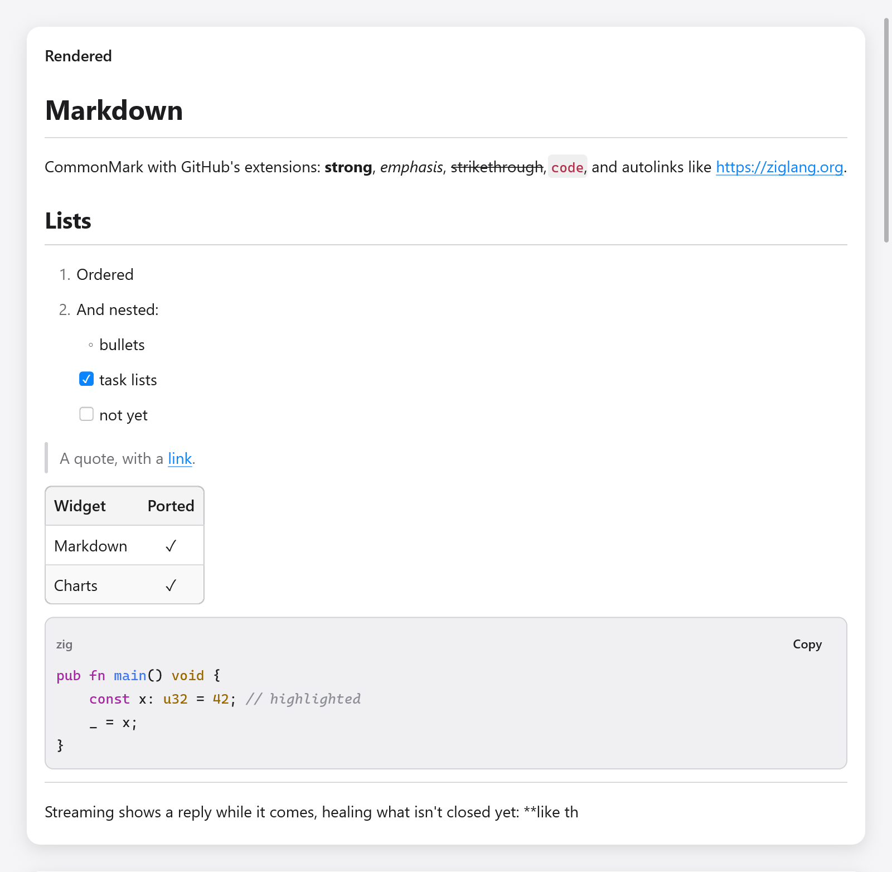

<a id="markdown"></a>

# Giảm giá

`ui.markdown` hiển thị Markdown bằng phông chữ và màu sắc của cửa sổ: CommonMark với các bảng, danh sách tác vụ, gạch ngang và liên kết tự động của GitHub. Văn bản của nó có thể được lựa chọn, các liên kết báo cáo số lần nhấp chuột của chúng và các khối mã được đánh dấu bằng phông chữ đơn cách bằng nút Sao chép. Nó được tạo ra để phát trực tuyến các câu trả lời từ một mô hình: mã thông báo được gắn vào cuối một câu trả lời dài sẽ có giá bằng với giá của nó khi bắt đầu.



*Markdown đã render với danh sách, trích dẫn, bảng và mã Zig tô màu cú pháp.*

```zig
const Message = struct {
    text: []const u8,
    md: ui.Markdown,
    done: bool,
};

fn bubble(m: *Message, c: *ui.Context) void {
    ui.column(c, .{ .width = .fill, .max_width = 700 });
    defer ui.end(c);
    const res = ui.markdown(c, m.text, .{ .state = &m.md, .streaming = !m.done });
    if (res.link) |url| _ = myzig.shell.openUrl(url);
}
```

`zig build run-markdown-chat` hiển thị các câu trả lời trực tiếp trong (`examples/markdown-chat`); headless: `zig-out/bin/markdown-chat --myzig-snapshot=chat.png --myzig-script="wait:3"`.

<a id="keeping-a-state"></a>

## Giữ một trạng thái

Cung cấp `ui.markdown` một `ui.Markdown` được giữ ở trạng thái của ứng dụng, một cái cho mỗi tài liệu được hiển thị và nguồn trên mỗi khung. Tạo nó bằng `ui.Markdown.init(gpa)` và giải phóng nó bằng `deinit()`.

Trạng thái giữ tài liệu được phân tích cú pháp và những gì được tạo từ các khối của nó: hộp và id, nội tuyến, văn bản được hiển thị và các dòng được đánh dấu của chúng. Khi nguồn phát triển, chỉ văn bản được thêm vào mới được phân tích cú pháp: khối ngoài cùng vẫn mở trước nó hoặc chỉ các dòng mới khi không có dòng nào. Các khối trước nó được giữ nguyên, vì vậy view vẫn giữ nguyên những gì nó tạo ra. Bất kỳ thay đổi nào khác của nguồn (bản chỉnh sửa ở giữa) sẽ phân tích lại tất cả, cũng như thay đổi `extensions`.

Nếu không có trạng thái (`.state = null`), nguồn sẽ được phân tích cú pháp toàn bộ trên mọi frame: phù hợp với văn bản ngắn, cố định.

<a id="streaming"></a>

## Truyền phát

Trong khi `streaming` được đặt, phần cuối của văn bản hiển thị cú pháp viết nửa vời của nó rất có thể sẽ trở thành: `**bol` hiển thị in đậm, hàng rào mã mở hiển thị dưới dạng mã, liên kết được viết hiển thị dưới dạng văn bản và các dòng vẫn có thể chuyển thành nội dung khác (`---` có thể là phần gạch chân của tiêu đề) hãy chờ xem nội dung tiếp theo. Đặt `streaming` thành false sau khi trả lời xong và phần cuối được đọc chính xác.

<a id="options"></a>

## Tùy chọn

`ui.MarkdownOptions`:

| lĩnh vực | mặc định | ý nghĩa |
|---|---|---|
| `state` | null | `ui.Markdown` được giữ trên các khung |
| `streaming` | false | văn bản vẫn đang được viết |
| `extensions` | tất cả trên | `ui.MarkdownExtensions` (bên dưới) |
| `size` | 14 | kích thước của nội dung văn bản; tiêu đề, mã và tỷ lệ khoảng cách với nó |
| `leading` | 1.45 | chiều cao dòng, kích thước |
| `selectable` | true | văn bản có thể được chọn và sao chép |
| `wrap_code` | true | khối mã bao bọc các dòng dài thay vì cắt chúng |
| `syntax` | true | khối mã màu trong các ngôn ngữ mà người đánh dấu biết |
| `highlighter` | null | `ui.MarkdownHighlighter` của riêng bạn |
| `max_column_width` | 320 | các cột của bảng chỉ rộng tối đa thế này; kết thúc văn bản của họ |
| `key` | null | chìa khóa của hộp xem |

`ui.MarkdownExtensions` có `tables`, `task_lists`, `strikethrough` và `autolinks`, tất cả đều được bật theo mặc định (`.gfm`); `.commonmark` tắt tất cả chúng, đối với CommonMark nghiêm ngặt.

<a id="what-it-returns"></a>

## Những gì nó trả về

A `ui.MarkdownResult`:

- `link`: đích của liên kết đã nhấp vào khung này.
- `hovered_link`: liên kết bên dưới con trỏ, dưới dạng thanh trạng thái hiển thị liên kết đó.
- `copied`: mã mà nút Sao chép của khối mã được đặt vào khay nhớ tạm (để nâng ly chúc mừng nói như vậy).

Các liên kết không được mở cho bạn: mở chúng bằng `myzig.shell.openUrl` hoặc định tuyến chúng trong ứng dụng.

<a id="code-blocks"></a>

## Khối mã

Bộ tô sáng cú pháp tích hợp hỗ trợ từ khóa, chuỗi, số, chú thích, hàm và kiểu của Zig, JavaScript, TypeScript, Go, Python, JSON và shell; các ngôn ngữ họ C (C, C++, C#, Java, Kotlin, Swift, Rust), ngôn ngữ kịch bản (Ruby, PHP, Lua, Perl, R, Julia, PowerShell, SQL), ngôn ngữ hàm (Haskell, Elm, OCaml, F#, Elixir, Erlang, Lisps, Nix), định dạng cấu hình (YAML, TOML, HCL, CMake, INI) và nhiều ngôn ngữ khác. Ngôn ngữ được chọn theo nhãn của khối code (` ```zig `). Với markup (HTML, XML, SVG, Vue, Svelte), bộ tô sáng phân biệt thẻ, thuộc tính và giá trị, đồng thời dùng JavaScript và CSS cho nội dung trong `<script>` và `<style>`; với Markdown là tiêu đề, trích dẫn, danh sách, nhấn mạnh, code và liên kết; với diff là dòng thêm, dòng xóa và dòng hunk. Mỗi dòng được xử lý từ trạng thái mà dòng trước để lại (đang ở trong chú thích khối hoặc chuỗi nhiều dòng), nên khi một khối được stream vào, chỉ những dòng mới cần tô sáng.

Công cụ tô sáng của riêng bạn là một hàm nối thêm `ui.Span`s (bù vào dòng, với `color`, `weight`, `italic`, ...) cho một dòng trong một ngôn ngữ và trả về false cho một ngôn ngữ mà nó không biết, trở lại văn bản thuần túy:

```zig
fn highlight(_: ?*anyopaque, gpa: std.mem.Allocator, language: []const u8, code: []const u8, dark: bool, out: *std.ArrayList(ui.Span)) bool {
    if (!std.mem.eql(u8, language, "ini")) return false;
    if (std.mem.indexOfScalar(u8, code, '=')) |eq| {
        out.append(gpa, .{ .start = 0, .end = @intCast(eq), .color = if (dark) .hex(0x9cdcfe) else .hex(0x0451a5) }) catch {};
    }
    return true;
}

_ = ui.markdown(c, src, .{ .state = &s.md, .highlighter = .{ .func = highlight } });
```

`Highlighter.ctx` được chuyển trở lại hàm cho công cụ đánh dấu có trạng thái riêng.

<a id="what-is-shown"></a>

## Những gì được hiển thị

- Tiêu đề (ATX và settext), đoạn văn, ngắt quãng cứng và mềm.
- Nhấn mạnh, nhấn mạnh, gạch ngang, kéo dài mã.
- Liên kết và hình ảnh theo đích đến hoặc tham chiếu cũng như liên kết tự động (`www.` của GitHub và các URL trần có `autolinks`). Hình ảnh hiển thị mô tả của chúng (văn bản thay thế), in nghiêng, trừ khi các tùy chọn' `images` (a `ui.MarkdownImageReader`) đọc chúng: sau đó mỗi hình ảnh hiển thị bên dưới đoạn văn của nó (a `ui.MarkdownImage`: byte bên dưới một khóa hoặc SVG) và chỉ một đoạn hình ảnh sẽ không có mô tả. Ví dụ: ứng dụng tự giải quyết các đích đến, chỉ các tệp cục bộ.
- Chặn dấu ngoặc kép, danh sách theo thứ tự và dấu đầu dòng, lồng nhau, chặt chẽ và lỏng lẻo cũng như danh sách nhiệm vụ bằng các hộp kiểm của chúng.
- Khối mã có hàng rào và thụt vào.
- Các bảng với sự căn chỉnh của các cột.
- Nghỉ giải lao theo chủ đề. Các khối HTML và nội tuyến HTML được hiển thị dưới dạng văn bản nên không có gì ẩn trong chúng.

Trình phân tích cú pháp chuyển các ví dụ về đặc tả CommonMark 0.31.2 và các phần mở rộng của GitHub, mỗi phần được phân tích cú pháp toàn bộ, nối thêm một byte mỗi lần và theo khối (`src/ui/markdown/tests_spec_*.zig`).

<a id="the-document"></a>

## Tài liệu

`ui.MarkdownDocument` là tài liệu được phân tích cú pháp, dành cho các ứng dụng muốn có cấu trúc thay vì dạng xem: `MarkdownDocument.parse(gpa, source, extensions)` phân tích toàn bộ văn bản và tài liệu được tạo bằng `init(gpa, extensions)` lấy văn bản có `set(source)` và `append(more)`. Các khối là một mảng phẳng theo thứ tự tài liệu, theo sau mỗi khối là các phần tử con của nó: `len()`, `block(i)` (`kind`, `level`, `parent`, `start` và `end` trong nguồn, ...), `children(i)` để lặp lại `language(i)` của một khối mã, `alignments(table)` và `inlines(i)`, được phân tích cú pháp lần đầu tiên được yêu cầu. Giải phóng nó bằng `deinit()`.

<a id="testing"></a>

## Kiểm tra

Markdown là văn bản và các hộp, vì vậy Người kiểm tra sẽ tìm thấy nó như tìm thấy bất kỳ văn bản nào:

```zig
// Chat's view calls ui.markdown and keeps a clicked link in s.clicked.
var s: Chat = .{ .md = .init(gpa) };
defer s.md.deinit();
var t: ui.Tester = undefined;
try t.init(gpa, .init(&s, Chat.view), .{});
defer t.deinit();
try std.testing.expect(t.hasText("LRU cache"));
try t.clickText("the docs"); // a link
try std.testing.expectEqualStrings("https://ziglang.org", s.clicked.?);
```

Xem [Testing](testing.md) và [Rich text](rich-text.md) để biết trình chỉnh sửa đọc và ghi Markdown.
