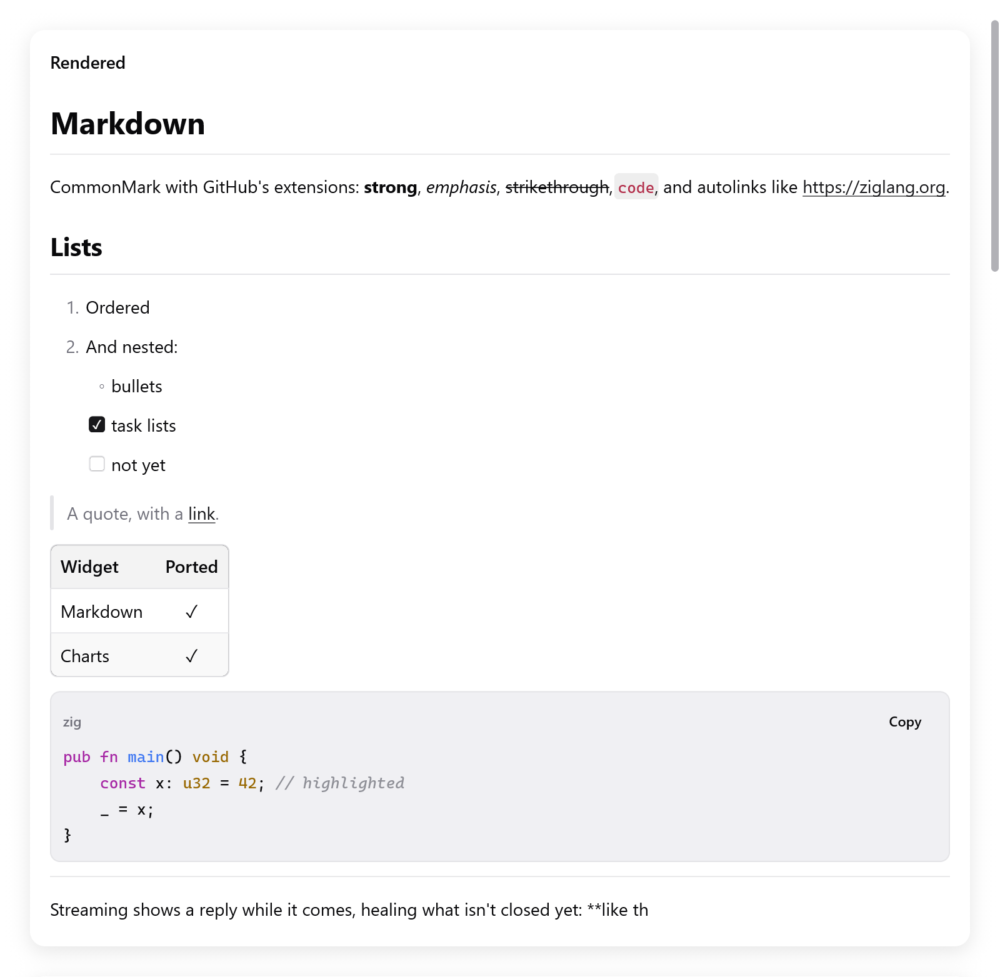

<a id="markdown"></a>

# Markdown

`ui.markdown` hiển thị Markdown bằng font và màu của cửa sổ: CommonMark cùng bảng, task list, gạch ngang và autolink của GitHub.

- Chữ chọn được, và link báo về khi được bấm.
- Code block được tô màu cú pháp, dùng font monospace, có nút Copy.
- Nó được làm cho các câu trả lời stream về từ model. Một token thêm vào cuối một câu trả lời dài tốn đúng bằng khi thêm ở đầu.

<!-- demo: markdown height=520 -->



*Markdown đã render với danh sách, trích dẫn, bảng và code Zig được tô màu.*

```zig
const Message = struct {
    text: []const u8,
    md: ui.Markdown,
    done: bool,
};

fn bubble(m: *Message, c: *ui.Context) void {
    ui.column(c, .{ .width = .fill, .max_width = 700 });
    defer ui.end(c);
    const res = ui.markdown(c, m.text, .{ .state = &m.md, .streaming = !m.done });
    if (res.link) |url| _ = myzig.shell.openUrl(url);
}
```

`zig build run-markdown-chat` cho xem các câu trả lời đang stream về (`examples/markdown-chat`). Chạy headless: `zig-out/bin/markdown-chat --myzig-snapshot=chat.png --myzig-script="wait:3"`.

<a id="keeping-a-state"></a>

## Giữ một state

Truyền cho `ui.markdown` một `ui.Markdown` giữ trong state của app, mỗi tài liệu hiển thị một cái, cùng với văn bản nguồn ở mọi frame. Tạo bằng `ui.Markdown.init(gpa)` và giải phóng bằng `deinit()`.

State giữ tài liệu đã parse và những gì đã dựng từ các block: box và id của chúng, các inline, chữ đã render và các dòng đã tô màu.

- Khi văn bản nguồn dài thêm, chỉ phần thêm vào được parse. Block ngoài cùng còn mở ngay trước nó, nếu có, cũng được parse lại.
- Các block phía trước giữ nguyên, nên view giữ lại những gì đã dựng từ chúng.
- Mọi thay đổi khác của văn bản nguồn, như sửa ở giữa, sẽ parse lại toàn bộ. Đổi `extensions` cũng vậy.

Không có state (`.state = null`) thì văn bản nguồn được parse toàn bộ ở mọi frame. Như vậy vẫn ổn với một đoạn chữ ngắn, cố định.

<a id="streaming"></a>

## Streaming

Khi bật `streaming`, phần cuối văn bản hiển thị thứ mà cú pháp viết dở nhiều khả năng sẽ thành:

- `**bol` hiện in đậm.
- Một code fence đang mở hiện như code.
- Một link đang viết hiện bằng chữ của nó.
- Những dòng còn có thể thành thứ khác thì chờ phần tiếp theo, như một dòng `---` có thể là gạch chân của heading.

Đặt `streaming` về false khi câu trả lời xong, và phần cuối được đọc chính xác.

<a id="options"></a>

## Tùy chọn

`ui.MarkdownOptions`:

| Trường | Mặc định | Ý nghĩa |
|---|---|---|
| `state` | null | `ui.Markdown` giữ qua các frame |
| `streaming` | false | văn bản vẫn đang được viết |
| `extensions` | bật hết | `ui.MarkdownExtensions` (bên dưới) |
| `size` | 14 | cỡ chữ thân bài; heading, code và khoảng cách co giãn theo nó |
| `leading` | 1.45 | chiều cao dòng, tính theo cỡ chữ |
| `selectable` | true | chữ chọn và copy được |
| `wrap_code` | true | code block xuống dòng với dòng dài thay vì cắt bớt |
| `syntax` | true | tô màu code block với các ngôn ngữ mà bộ tô màu biết |
| `highlighter` | null | một `ui.MarkdownHighlighter` của riêng bạn |
| `max_column_width` | 320 | cột của bảng rộng tối đa chừng này; chữ trong đó xuống dòng |
| `key` | null | key của box chứa view |
| `images` | null | một `ui.MarkdownImageReader` để hiện ảnh ([bên dưới](#what-is-shown)) |

`ui.MarkdownExtensions` có `tables`, `task_lists`, `strikethrough` và `autolinks`, mặc định bật hết (`.gfm`). `.commonmark` tắt hết, cho CommonMark chuẩn.

<a id="what-it-returns"></a>

## Giá trị trả về

Một `ui.MarkdownResult`:

- `link`: đích của link được bấm trong frame này.
- `hovered_link`: link dưới con trỏ, như thanh trạng thái hiển thị.
- `copied`: đoạn code mà nút Copy của code block vừa đưa vào clipboard (để hiện một toast báo việc đó).

Link không được tự mở. Mở bằng `myzig.shell.openUrl`, hoặc điều hướng trong app.

<a id="code-blocks"></a>

## Code block

Info string của fence (` ```zig `) chọn ngôn ngữ. Bộ tô màu có sẵn tô từ khóa, chuỗi, số, comment, hàm và kiểu của:

- Zig, JavaScript và TypeScript, Go, Python, JSON và shell;
- các ngôn ngữ họ C: C, C++, C#, Java, Kotlin, Swift, Rust;
- các ngôn ngữ script: Ruby, PHP, Lua, Perl, R, Julia, PowerShell, SQL;
- các ngôn ngữ hàm: Haskell, Elm, OCaml, F#, Elixir, Erlang, các Lisp, Nix;
- các định dạng cấu hình: YAML, TOML, HCL, CMake, INI;
- và nhiều nữa.

Một số ngôn ngữ được tô những thứ khác:

- Markup (HTML, XML, SVG, Vue, Svelte): tag, thuộc tính và giá trị của chúng. Code trong `<script>` được tô như JavaScript, các rule trong `<style>` như CSS.
- Markdown: heading, trích dẫn, danh sách, nhấn mạnh, code và link.
- Diff: các dòng thêm, dòng xóa và dòng hunk.

Nó tô từng dòng một, từ trạng thái mà dòng trước để lại (đang trong block comment, chuỗi nhiều dòng). Nhờ vậy một block đang stream về chỉ tô các dòng mới.

```zig
fn highlight(_: ?*anyopaque, gpa: std.mem.Allocator, language: []const u8, code: []const u8, dark: bool, out: *std.ArrayList(ui.Span)) bool {
    if (!std.mem.eql(u8, language, "ini")) return false;
    if (std.mem.indexOfScalar(u8, code, '=')) |eq| {
        out.append(gpa, .{ .start = 0, .end = @intCast(eq), .color = if (dark) .hex(0x9cdcfe) else .hex(0x0451a5) }) catch {};
    }
    return true;
}

_ = ui.markdown(c, src, .{ .state = &s.md, .highlighter = .{ .func = highlight } });
```

Bộ tô màu của riêng bạn là một hàm thêm các `ui.Span` cho một dòng thuộc một ngôn ngữ. Span là các offset trong dòng, kèm `color`, `weight`, `italic`, ... Hàm trả về false với ngôn ngữ nó không biết, khi đó dòng hiện như chữ thường. `Highlighter.ctx` được truyền lại cho hàm, dành cho bộ tô màu có state riêng.

<a id="what-is-shown"></a>

## Những gì được hiển thị

- Heading (ATX và setext), đoạn văn, ngắt dòng cứng và mềm.
- Nhấn mạnh, nhấn mạnh mạnh, gạch ngang, code span.
- Link và ảnh theo đích hoặc theo tham chiếu, và autolink. Với `autolinks`, có thêm `www.` và URL trần như GitHub.
- Trích dẫn, danh sách có thứ tự và gạch đầu dòng, lồng nhau, sát và thưa, và task list với checkbox.
- Code block dạng fence và dạng thụt lề.
- Bảng, với cách căn của các cột.
- Đường kẻ ngang. HTML block và HTML inline hiện như chữ, nên không có gì bị giấu trong đó.

**Ảnh** hiện phần mô tả (chữ thay thế), in nghiêng. Khi `images` của tùy chọn (một `ui.MarkdownImageReader`) đọc được ảnh:

- mỗi ảnh hiện dưới đoạn văn của nó, dạng `ui.MarkdownImage`: dữ liệu byte theo một key, hoặc một SVG;
- một đoạn văn chỉ có ảnh thì bỏ phần mô tả;
- app tự phân giải đích của ảnh, chẳng hạn chỉ cho file cục bộ.

Bộ parse vượt qua các ví dụ của đặc tả CommonMark 0.31.2 và các phần mở rộng của GitHub. Mỗi ví dụ được parse nguyên khối, thêm vào từng byte một và theo từng đoạn (`src/ui/markdown/tests_spec_*.zig`).

<details>
<summary>Nhấn mạnh trong tiếng Trung, Nhật và Hàn</summary>

Các ngôn ngữ này không đặt khoảng trắng quanh phần nhấn mạnh, nên một quy tắc được nới lỏng. Cạnh một ký tự CJK, dấu câu toàn độ rộng hoặc dấu ngoặc kép cong, `*` và `~~` vẫn mở và đóng ở cả những chỗ mà CommonMark sẽ chặn vì dấu câu. Vì vậy `**结论。**后文` được in đậm.

`_` và một dấu `~` đơn giữ quy tắc của CommonMark. Không ví dụ nào của đặc tả có chữ CJK ở đó, nên tất cả vẫn qua.

</details>

<a id="the-document"></a>

## Tài liệu

`ui.MarkdownDocument` là tài liệu đã parse, dành cho app cần cấu trúc chứ không cần view. Giải phóng bằng `deinit()`.

- `MarkdownDocument.parse(gpa, source, extensions)` parse toàn bộ một văn bản.
- Tài liệu tạo bằng `init(gpa, extensions)` nhận văn bản qua `set(source)` và `append(more)`.

Các block là một mảng phẳng theo thứ tự trong tài liệu, mỗi block theo sau là các phần tử con của nó:

| Phương thức | |
|---|---|
| `len()` | số block |
| `block(i)` | `kind`, `level`, `parent`, `start` và `end` trong văn bản nguồn, ... |
| `children(i)` | để duyệt |
| `language(i)` | của một code block |
| `alignments(table)` | của các cột trong bảng |
| `inlines(i)` | được parse ở lần đầu được hỏi tới |

<a id="testing"></a>

## Test

Markdown là chữ và box, nên `ui.Tester` tìm thấy nó như mọi chữ khác:

```zig
// View của Chat gọi ui.markdown và giữ link được bấm trong s.clicked.
var s: Chat = .{ .md = .init(gpa) };
defer s.md.deinit();
var t: ui.Tester = undefined;
try t.init(gpa, .init(&s, Chat.view), .{});
defer t.deinit();
try std.testing.expect(t.hasText("LRU cache"));
try t.clickText("the docs"); // một link
try std.testing.expectEqualStrings("https://ziglang.org", s.clicked.?);
```

Xem [Testing](testing.md), và [Rich text](rich-text.md) cho một trình soạn thảo đọc và ghi Markdown.
