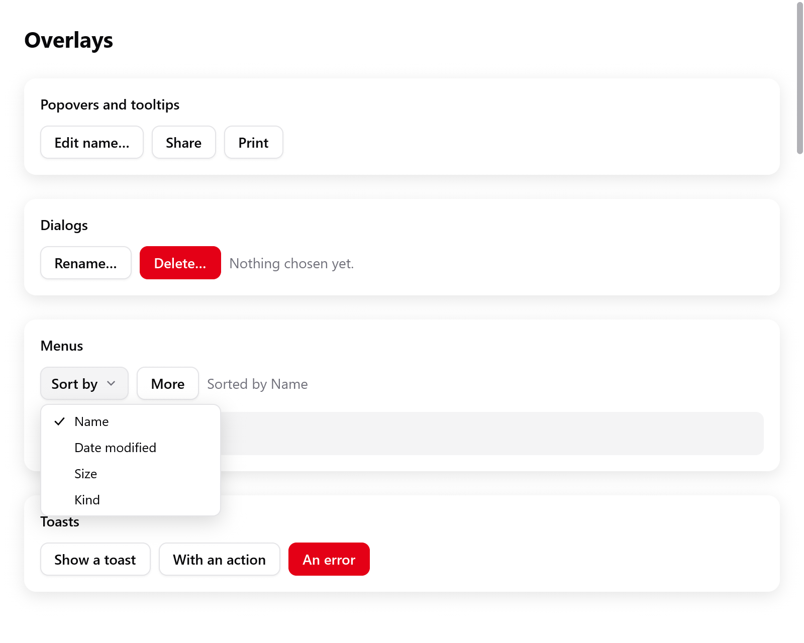
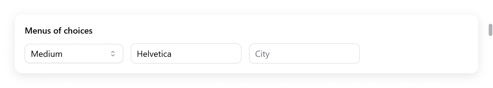

<a id="menus-and-selects"></a>

# Menu và select

Các menu do myzig vẽ ngay trong cửa sổ:

- context menu mở bằng chuột phải;
- menu của một nút, và menu button;
- các mục có dấu check, hiện shortcut, separator và submenu;
- select: drop-down chọn một chuỗi trong một danh sách.

Thanh menu của app, context menu và tray menu của hệ thống nằm ở trang [Menus](../menus.md). Các lệnh mà app đưa ra cùng lúc dưới dạng mục menu, nút và shortcut nằm ở [Actions](navigation.md#actions).

<!-- demo: menu height=520 -->



*Menu Sort by đang mở, mục Name được chọn.*

<a id="a-menu-s-state-and-items"></a>

## State và các mục của menu

State của một menu là một `ui.Menu` do app giữ, mỗi menu một cái:

```zig
const State = struct {
    sort: ui.Menu = .{},
    more: ui.Menu = .{},
    ctx: ui.Menu = .{},
    sort_by: usize = 0,
    pinned: bool = false,
};
```

Mọi cách hiển thị menu đều trả về một `*ui.MenuPanel` khi menu đang mở, null khi đóng. Dựng các mục khi menu đang mở, rồi gọi `end` của nó:

```zig
if (ui.contextMenu(c, &s.ctx, row)) |m| {
    defer m.end();
    if (m.item("Rename", .{ .shortcut = "F2" })) s.rename.show();
    if (m.item("Pinned", .{ .checked = s.pinned })) s.pinned = !s.pinned;
    if (m.submenu("Move to")) |sub| {
        defer sub.end();
        for (folders) |f| if (sub.item(f, .{})) s.moveTo(f);
    }
    m.separator();
    if (m.item("Delete", .{ .disabled = s.locked })) s.alert.show();
}
```

`MenuPanel.item(label, opts)` là true trong frame mục được chọn: được bấm, hoặc nhấn Enter hay Space trên nó. Chọn xong thì menu đóng.

| `ui.MenuItemOptions` | Mặc định | |
|---|---|---|
| `shortcut` | `""` | tổ hợp phím hiện cạnh mục, là shortcut làm cùng việc: nó chỉ hiển thị thôi |
| `checked` | null | dấu check cạnh mục khi true, và chừa chỗ cho dấu check khi false |
| `disabled` | false | bị làm xám: không chọn được |
| `icon` | `""` | một SF Symbol (hoặc icon nét cùng tên của myzig ngoài macOS) trước label |

**Shortcut.** Viết chúng bằng ký hiệu của Mac. `ui.keys.label` viết lại theo cách của nền tảng: `ui.keys.label("⇧⌘S")` là `⇧⌘S` trên macOS và `Ctrl+Shift+S` trên Linux và Windows.

Mục menu chỉ hiển thị shortcut. Tự xử lý phím bằng `c.shortcut(...)`. Hoặc đặt tên lệnh một lần dưới dạng [action](navigation.md#actions): mục menu của nó vừa hiện shortcut vừa xử lý phím.

- `separator()` vẽ một đường kẻ giữa các nhóm mục.
- `submenu(label)` thêm một mục mở ra submenu. Submenu mở khi con trỏ dừng trên mục, hoặc khi nhấn Right hay Enter. Nó trả về panel của submenu khi đang mở.
- Submenu lồng tối đa bốn cấp (`max_depth` trong `src/ui/menu.zig`).
- Bàn phím di chuyển trong 64 mục đầu tiên của menu.

**Phím và con trỏ:**

- Up và Down di chuyển giữa các mục, bỏ qua mục bị disable.
- Right và Left mở và đóng submenu.
- Escape đóng menu trong cùng.
- Menu đang mở nhận cú bấm bên ngoài nó, như menu của hệ thống. Cú bấm đó đóng menu và không đi tiếp.
- Con trỏ chỉ highlight một mục khi nó di chuyển. Nên menu mở ra dưới con trỏ đứng yên vẫn giữ highlight của bàn phím.

<a id="context-menus"></a>

## Context menu

`ui.contextMenu(c, &menu, target)` gắn một menu cho phần tử `target`. `target` là interaction của box phần tử đó, đã build cùng phần tử con. Menu mở tại chỗ bấm chuột phải, hoặc bên dưới phần tử khi nhấn Shift+F10 lúc nó có focus:

```zig
const row = ui.pressable(c, .{ .width = .fill, .padding = .all(12), .radius = 8, .background = c.theme.surface_hover }, null);
ui.text(c, "A note (right click me)", .{});
ui.end(c);
if (ui.contextMenu(c, &s.ctx, row)) |m| {
    defer m.end();
    if (m.item("Rename", .{})) s.rename.show();
}
```

Gọi nó sau các phần tử nằm trong `target`. Khi đó phần tử có menu nằm trong cùng sẽ nhận cú bấm: một hàng của list có menu riêng, nằm trong list có menu cho phần nền.

<a id="menus-of-a-button"></a>

## Menu của nút

`ui.buttonMenu(c, &menu, button)` gắn menu cho một nút.

```zig
const more = ui.button(c, "More", .{});
if (ui.buttonMenu(c, &s.more, more)) |m| {
    defer m.end();
    if (m.item("Duplicate", .{ .shortcut = ui.keys.label("⌘D") })) s.duplicate();
    if (m.item("Export…", .{})) s.exportIt();
}
```

- Menu mở bên dưới nút ngay khi con trỏ nhấn xuống, như pop-up button của hệ thống.
- Nên nhấn, kéo tới một mục rồi thả tay là chọn mục đó.
- Bấm lần hai thì menu đóng.

`ui.menuButton(c, title, &menu, opts)` là một nút riêng, hiện `title` kèm mũi tên. Nó mở menu bên dưới khi con trỏ nhấn xuống, hoặc khi nhấn Enter, Space hay Down lúc nút có focus.

```zig
if (ui.menuButton(c, "Sort by", &s.sort, .{})) |m| {
    defer m.end();
    for (sorts, 0..) |by, i| if (m.item(by, .{ .checked = s.sort_by == i })) {
        s.sort_by = i;
    };
}
```

`ui.MenuButtonOptions` có `size` (14), `disabled` và `width` (`.auto`).

<a id="opening-a-menu-from-code"></a>

## Mở menu từ code

`ui.menu(c, &menu)` dựng menu `menu` ở nơi nó được mở. Các hàm ở trên đều gọi nó.

- `Menu.openAt(point)` mở menu với góc trên bên trái tại một điểm của cửa sổ.
- `Menu.openBelow(rect)` mở menu bên dưới một hình chữ nhật, hoặc bên trên nếu không đủ chỗ.
- `close()` đóng nó. `isOpen()` cho biết nó có đang mở không.

```zig
if (c.shortcut(.{ .key = 'k', .cmd = true })) s.palette.openAt(.{ .x = 200, .y = 80 });
if (ui.menu(c, &s.palette)) |m| {
    defer m.end();
    if (m.item("New note", .{})) s.newNote();
}
```

<a id="selects"></a>

## Select

<!-- demo: selects height=168 -->



*Select, combobox và autocomplete đang đóng.*

`ui.select(c, &selected, options, &state, opts)` là một drop-down. Nó chọn một trong `options` (các chuỗi) và ghi chỉ số vào `selected.*`. State của nó là một `ui.SelectState` do app giữ:

```zig
const sizes = [_][]const u8{ "Small", "Medium", "Large" };
// Trong state của app: size: usize = 1, size_box: ui.SelectState = .{},

if (ui.select(c, &s.size, &sizes, &s.size_box, .{ .width = .{ .px = 160 } }).changed) s.save();
```

- Bấm vào thì các lựa chọn mở ra bên dưới, hoặc bên trên nếu không đủ chỗ. Enter, Space, Up hay Down lúc nó có focus cũng vậy.
- Phím mũi tên, Home và End di chuyển giữa các lựa chọn. Enter, Space hoặc bấm chuột để chọn.
- Escape hoặc bấm bên ngoài sẽ đóng danh sách. Danh sách nhận luôn cú bấm đó, như pop-up menu của hệ thống.
- Focus trở lại select.
- Khi số lựa chọn nhiều hơn chỗ trong cửa sổ, danh sách cao bằng phần chỗ ở phía rộng hơn của select. Các lựa chọn scroll được.

| `ui.SelectOptions` | Mặc định | |
|---|---|---|
| `width` | `.{ .px = 200 }` | |
| `size` | 14 | cỡ chữ |
| `placeholder` | `"Choose…"` | hiện khi `selected.*` vượt quá số lựa chọn |
| `disabled` | false | |
| `label` | `""` | tên cho công nghệ hỗ trợ |

`ui.SelectResult` có `changed` (một lựa chọn mới được chọn trong frame này), `open` và `focused`.

Với một trường mà chữ gõ vào lọc các lựa chọn, dùng `ui.combobox`. Với gợi ý bên dưới một ô nhập chữ tự do, dùng `ui.autocomplete`. Cả hai nằm ở [Text input](text-input.md).
