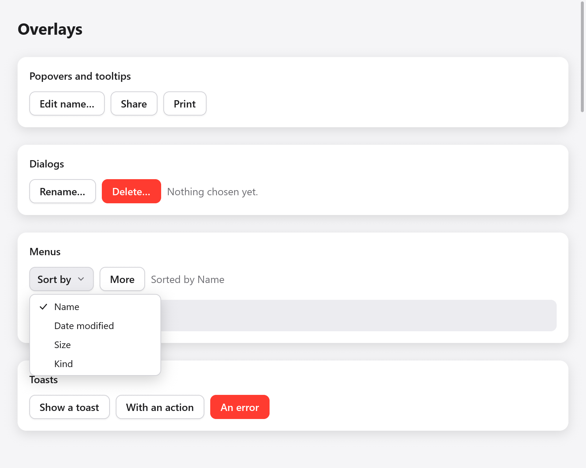
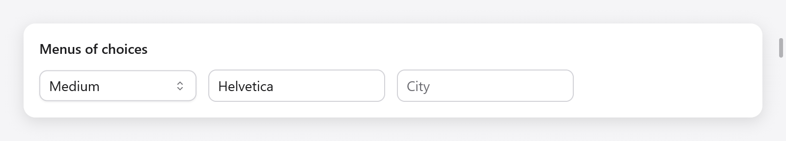

<a id="menus-and-selects"></a>

# Menu và lựa chọn

Menu được vẽ trong cửa sổ bởi myzig: menu ngữ cảnh được mở bằng nhấp chuột phải, menu của một nút, nút menu, với các mục, dấu kiểm, phím tắt được hiển thị, dấu phân cách và menu con; và chọn, trình đơn thả xuống chọn một trong danh sách các chuỗi. Để biết về thanh menu của ứng dụng cũng như các menu ngữ cảnh và menu khay của chính hệ thống, hãy xem [Menu](../menus.md); để biết các lệnh mà ứng dụng cung cấp dưới dạng mục menu, nút và phím tắt cùng lúc, hãy xem [Hành động](navigation.md#actions).

<a id="a-menu-s-state-and-items"></a>



*Menu Sort by đang mở, với Name được chọn.*

## Trạng thái và các mục của menu

Trạng thái của menu là `ui.Menu` được ứng dụng lưu giữ, mỗi trạng thái một menu:

```zig
const State = struct {
    sort: ui.Menu = .{},
    more: ui.Menu = .{},
    ctx: ui.Menu = .{},
    sort_by: usize = 0,
    pinned: bool = false,
};
```

Mọi cách hiển thị menu đều trả về `*ui.MenuPanel` khi nó mở (null khi đóng). Các hạng mục của nó được xây dựng khi nó mở cửa; thì đó là `end`:

```zig
if (ui.contextMenu(c, &s.ctx, row)) |m| {
    defer m.end();
    if (m.item("Rename", .{ .shortcut = "F2" })) s.rename.show();
    if (m.item("Pinned", .{ .checked = s.pinned })) s.pinned = !s.pinned;
    if (m.submenu("Move to")) |sub| {
        defer sub.end();
        for (folders) |f| if (sub.item(f, .{})) s.moveTo(f);
    }
    m.separator();
    if (m.item("Delete", .{ .disabled = s.locked })) s.alert.show();
}
```

`MenuPanel.item(label, opts)` là true trong khung mà mục được chọn (được nhấp vào hoặc Enter hoặc Space trên đó), thao tác này sẽ đóng menu. `ui.MenuItemOptions`:

| trường | Mặc định | |
|---|---|---|
| `shortcut` | `""` | một tổ hợp phím được nó hiển thị, giống như phím tắt thực hiện tương tự: nó chỉ hiển thị nó |
| `checked` | null | đánh dấu vào đó khi true và nhường chỗ cho một dấu kiểm khi false |
| `disabled` | false | chuyển sang màu xám: không thể chọn được |
| `icon` | `""` | Biểu tượng SF (hoặc biểu tượng dòng của myzig của tên đó ở ngoài macOS) trước nhãn |

Viết các phím tắt bằng các ký hiệu của máy Mac và để `ui.keys.label` viết chúng giống như nền tảng thực hiện: `ui.keys.label("⇧⌘S")` là `⇧⌘S` trên macOS và `Ctrl+Shift+S` trên Linux và Windows. Một mục chỉ hiển thị lối tắt của nó; tự trả lời các phím bằng `c.shortcut(...)` hoặc đặt tên lệnh một lần dưới dạng [hành động](navigation.md#actions), có mục menu hiển thị lối tắt và trả lời lệnh đó.

`separator()` vẽ ranh giới giữa các nhóm mục. `submenu(label)` thêm một mục mở menu con khi con trỏ nằm trên đó hoặc cho Right hoặc Enter; nó trả về bảng điều khiển của menu con khi nó đang mở. Các menu con có chiều sâu bốn (`max_depth` trong `src/ui/menu.zig`) và bàn phím di chuyển giữa 64 mục đầu tiên của menu.

Di chuyển Up và Down giữa các mục (bỏ qua những mục bị vô hiệu hóa), các menu con Phải và Trái mở và đóng, và Escape đóng menu trong cùng. Giống như các menu của hệ thống, một menu đang mở sẽ đưa nút nhấn ra bên ngoài nó, thao tác này sẽ đóng nó lại và không đi xa hơn nữa. Con trỏ chỉ làm nổi bật một mục khi nó di chuyển, do đó, việc mở menu bên dưới con trỏ nằm yên sẽ giữ lại điểm nổi bật của bàn phím.

<a id="context-menus"></a>

## Menu ngữ cảnh

`ui.contextMenu(c, &menu, target)` cung cấp cho phần tử `target` (một tương tác của hộp của nó, được xây dựng với các phần tử con của nó) một menu mở ra ở nơi nó được nhấp chuột phải hoặc bên dưới nó cho Shift+F10 trong khi nó có tiêu điểm:

```zig
const row = ui.pressable(c, .{ .width = .fill, .padding = .all(12), .radius = 8, .background = c.theme.surface_hover }, null);
ui.text(c, "A note (right click me)", .{});
ui.end(c);
if (ui.contextMenu(c, &s.ctx, row)) |m| {
    defer m.end();
    if (m.item("Rename", .{})) s.rename.show();
}
```

Gọi nó theo tên các phần tử bên trong `target`, để phần tử trong cùng có menu nhận được cú nhấp chuột: hàng của danh sách có menu riêng, bên trong danh sách có một menu làm nền.

<a id="menus-of-a-button"></a>

## Menu của một nút

`ui.buttonMenu(c, &menu, button)` cung cấp cho một nút một menu, mở ra bên dưới nó khi con trỏ đi xuống nút đó (giống như các nút bật lên của hệ thống, do đó, nhấn, kéo đến một mục và thả ra sẽ chọn mục đó) và đóng khi nhấn lần thứ hai:

```zig
const more = ui.button(c, "More", .{});
if (ui.buttonMenu(c, &s.more, more)) |m| {
    defer m.end();
    if (m.item("Duplicate", .{ .shortcut = ui.keys.label("⌘D") })) s.duplicate();
    if (m.item("Export…", .{})) s.exportIt();
}
```

`ui.menuButton(c, title, &menu, opts)` là một nút riêng hiển thị `title` và một mũi tên, mở menu bên dưới nút đó: khi con trỏ đi xuống nút đó hoặc nhấn Enter, Space hoặc Down khi nút đó có tiêu điểm.

```zig
if (ui.menuButton(c, "Sort by", &s.sort, .{})) |m| {
    defer m.end();
    for (sorts, 0..) |by, i| if (m.item(by, .{ .checked = s.sort_by == i })) {
        s.sort_by = i;
    };
}
```

`ui.MenuButtonOptions` có `size` (14), `disabled` và `width` (`.auto`).

<a id="opening-a-menu-from-code"></a>

## Mở menu từ mã

`ui.menu(c, &menu)` xây dựng menu `menu` bất cứ nơi nào nó được mở và đó là chức năng mà các chức năng trên gọi. Mở nó bằng `Menu.openAt(point)` (góc trên cùng bên trái của nó tại một điểm của cửa sổ) hoặc `Menu.openBelow(rect)` (bên dưới hình chữ nhật hoặc phía trên hình chữ nhật nếu không có chỗ) và đóng nó bằng `close()`; `isOpen()` cho biết nó có mở hay không.

```zig
if (c.shortcut(.{ .key = 'k', .cmd = true })) s.palette.openAt(.{ .x = 200, .y = 80 });
if (ui.menu(c, &s.palette)) |m| {
    defer m.end();
    if (m.item("New note", .{})) s.newNote();
}
```

<a id="selects"></a>

## Lựa chọn



*Select, combobox chọn phông chữ và ô tự động gợi ý thành phố.*

`ui.select(c, &selected, options, &state, opts)` là trình đơn thả xuống chọn một trong `options` (chuỗi) thành `selected.*`, một chỉ mục. Trạng thái của nó là `ui.SelectState` được ứng dụng lưu giữ:

```zig
const sizes = [_][]const u8{ "Small", "Medium", "Large" };
// In the app's state: size: usize = 1, size_box: ui.SelectState = .{},

if (ui.select(c, &s.size, &sizes, &s.size_box, .{ .width = .{ .px = 160 } }).changed) s.save();
```

Một cú nhấp chuột vào nó hoặc Enter, Space, Up hoặc Down trong khi nó có tiêu điểm, sẽ mở các tùy chọn bên dưới nó (phía trên nơi không còn chỗ); các mũi tên, Home và End di chuyển giữa chúng, Enter, Space hoặc một cú nhấp chuột sẽ chọn một và Escape hoặc nhấn bên ngoài sẽ đóng chúng, danh sách sẽ thực hiện thao tác này, giống như các menu bật lên của hệ thống. Tiêu điểm quay trở lại vùng chọn. Với nhiều tùy chọn hơn số chỗ mà cửa sổ có thể chứa, danh sách sẽ cao bằng khoảng trống ở phía lớn hơn của vùng chọn và các tùy chọn của nó sẽ cuộn.

`ui.SelectOptions`:

| trường | Mặc định | |
|---|---|---|
| `width` | `.{ .px = 200 }` | |
| `size` | 14 | kích thước phông chữ |
| `placeholder` | `"Choose…"` | hiển thị khi `selected.*` vượt quá các tùy chọn |
| `disabled` | false | |
| `label` | `""` | đặt tên cho công nghệ hỗ trợ |

`ui.SelectResult` có `changed` (một tùy chọn mới đã được chọn trong khung này), `open` và `focused`.

Đối với trường có văn bản lọc các tùy chọn theo kiểu người dùng, hãy sử dụng `ui.combobox`; để biết các đề xuất trong trường văn bản tự do, `ui.autocomplete` (cả trong [Nhập văn bản](text-input.md)).
