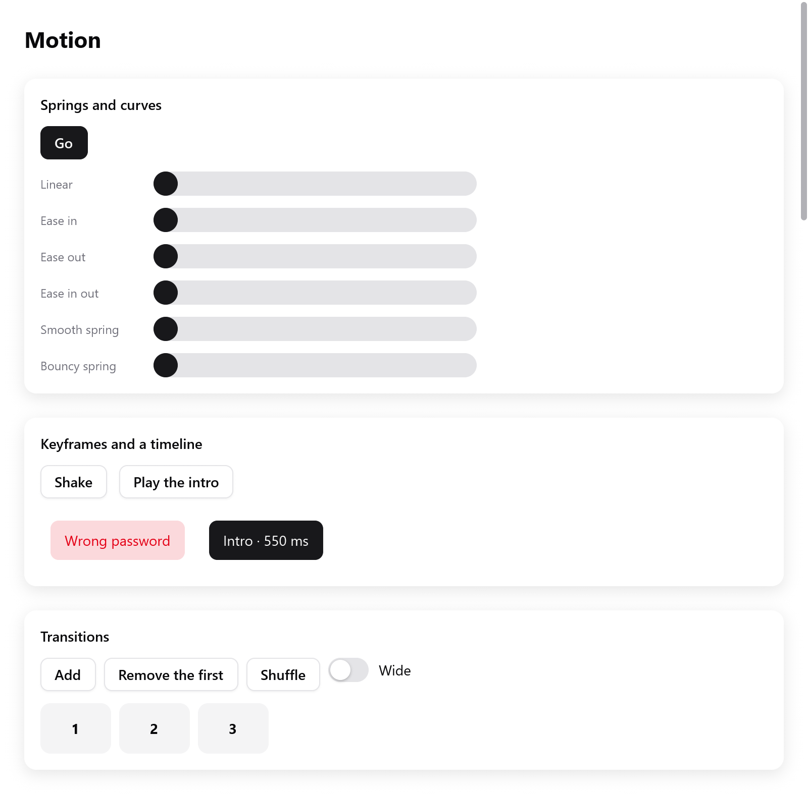

<a id="motion"></a>

# Chuyển động

View nói mọi thứ nằm ở đâu; motion tìm đường đi tới đó.

- Một giá trị đưa cho `ui.motion` sẽ chuyển dần về target mà view đưa ở mỗi frame. Nó dùng một spring giữ nguyên vận tốc, hoặc một đường cong có thời lượng.
- Box có thể di chuyển mượt tới chỗ layout đặt nó, và xuất hiện hay biến mất (`motion.transition`).
- Mọi thứ chạy theo đồng hồ của context (`c.time`, do `ui.Tester` điều khiển).
- Frame chỉ được vẽ khi có thứ đang chuyển động: app đứng yên thì không vẽ gì.

<!-- demo: motion height=520 -->



*Một frame tĩnh của demo motion: easing, spring, keyframe và transition.*

```zig
const motion = myzig.ui.motion;

fn view(s: *State, c: *ui.Context) void {
    const id = c.peekId("card");
    const x = motion.animateTo(c, id, "x", if (s.open) 200 else 0, .snappy);
    _ = c.open(.{ .width = .{ .px = 80 }, .height = .{ .px = 80 }, .radius = 12,
        .background = c.theme.accent, .transform = .translation(x, 0) }, "card");
    c.end();
}
```

Khi `s.open` đổi, tấm card trượt tới chỗ mới trong các frame tiếp theo. `zig build run-gallery` có mọi animation trong trang Motion (`examples/gallery/motion.zig`).

<a id="values-and-their-ids"></a>

## Giá trị và id của chúng

Một giá trị thuộc về id của một box và một key để phân biệt các giá trị của box đó (`"x"`, `"scale"`, ...).

- `c.peekId(key)` cho id của box bạn sắp mở.
- `c.node(index).id` cho id của một box đã mở.
- `motion.to(c, key, target, a)` dùng box đang mở.

Giá trị bắt đầu ở target đầu tiên của nó, nên view hiện lần đầu không có chuyển động nào. Target mới giữa chừng sẽ tiếp quản từ chỗ giá trị đang đứng. Spring giữ nguyên vận tốc: card bị quay đầu giữa đường sẽ chậm lại rồi quay về, chứ không nhảy cóc.

<a id="animations"></a>

## Animation

`motion.Animation` cho biết một giá trị đi tới target mới như thế nào:

| trường | ý nghĩa |
|---|---|
| `duration` | số giây của đường cong; 0 (mặc định) thì dùng `spring` |
| `ease` | `motion.Easing` của đường cong (mặc định `.ease_out`) |
| `spring` | `motion.Spring` dùng khi `duration` là 0 |
| `delay` | số giây giá trị còn đi tiếp như cũ trước khi đổi hướng |

Có sẵn ba spring, theo SwiftUI: `.smooth` (không nảy), `.snappy` (nảy một chút) và `.bouncy` (nảy rõ). `motion.Animation.curve(seconds, ease)` tạo một đường cong:

```zig
const a: motion.Animation = .curve(0.3, .ease_in_out);
const b: motion.Animation = .{ .spring = .{ .duration = 0.4, .bounce = 0.2 } };
```

`motion.animate(c, id, key, target, seconds)` là `animateTo` với đường cong dài `seconds` giây, kiểu ease out.

<a id="easing"></a>

### Easing

`motion.Easing` là các timing function của CSS:

- `.linear`, `.ease_in`, `.ease_out`, `.ease_in_out`;
- `.cubic`, tạo bằng `Easing.cubicBezier(x1, y1, x2, y2)`, như `cubic-bezier()` của CSS;
- `.custom`: hàm của riêng bạn, từ thời gian (0 đến 1) ra tiến độ.

<a id="springs"></a>

### Spring

`motion.Spring` được đặt theo cảm nhận:

| trường | mặc định | |
|---|---|---|
| `duration` | 0,5 s | khoảng thời gian để tới nơi |
| `bounce` | 0 | từ 0 (không vượt quá) tới gần 1 |
| `stiffness`, `damping` | `null` | đặt một trong hai để chuyển sang thông số vật lý; nếu không đặt thì là 170 và 26 như react-spring |
| `mass` | 1 | dùng cùng `stiffness` và `damping` |
| `precision` | 0.001 | cách target bao nhiêu, theo đơn vị của giá trị, thì coi như đã tới |
| `velocity` | `null` | vận tốc gán cho giá trị khi target đổi, ví dụ vận tốc của một cú vuốt |

Spring được giải chính xác, không tính từng bước. Nhờ vậy nó trông như nhau ở mọi tốc độ frame.

<a id="colors"></a>

## Màu

`motion.animateColor(c, id, key, target, a)` chuyển một màu dần về `target`. Màu được trộn với alpha premultiplied (`motion.mixPremultiplied`). Nhờ vậy màu hiện dần từ trong suốt vẫn giữ sắc độ, không đi qua màu xám.

<a id="poses-that-only-paint"></a>

## Pose chỉ ảnh hưởng tới việc vẽ

`motion.pose(c, index, p, a)` chuyển box `index` dần về một `motion.Pose`. Box đó đang mở, hoặc đã được build trong frame này.

| `motion.Pose` | |
|---|---|
| `x`, `y` | dời nó đi |
| `scale` | co giãn nó; 0 giữ nguyên kích thước |
| `rotate` | xoay nó, tính bằng độ |
| `fade` | 0 là đục, 1 là biến mất |

Pose tác động sau transform của chính box, và nhân vào độ đục của nó. Nó chỉ đổi cách box được vẽ; layout vẫn giữ nguyên.

```zig
const card = c.open(.{ .padding = .all(16), .radius = 12, .background = c.theme.surface }, "card");
ui.text(c, "Hello", .{});
motion.pose(c, card, .{ .scale = if (s.pressed) 0.96 else 1, .fade = if (s.hidden) 1 else 0 }, .snappy);
c.end();
```

<a id="when-it-is-done"></a>

## Khi nào xong

- `motion.settled(c, id, key)`: giá trị đang đứng yên ở target.
- `motion.arrived(c, id, key)`: true đúng một frame, khi giá trị dừng lại sau khi chuyển động. View có thể làm tiếp: gỡ thứ đã mờ hẳn, bắt đầu bước kế tiếp.
- `motion.velocity(c, id, key)`: giá trị đi nhanh cỡ nào, tính bằng đơn vị mỗi giây.

<a id="gestures"></a>

## Cử chỉ

Trong lúc ngón tay hoặc con trỏ kéo một thứ, đặt giá trị của nó bằng `motion.jump(c, id, key, value)`. Giá trị đi theo ngay, và motion theo dõi tốc độ của nó. Khi thả tay, `animateTo` với một spring tiếp quản ở đúng vận tốc đó. Nhờ vậy thứ đó tiếp tục đi theo hướng nó bị ném.

Hai hàm phụ, theo iOS:

- `motion.project(value, velocity)`: một cú vuốt mang giá trị đi tới đâu. Dùng nó để chọn chỗ dừng: trang gần nhất, một snap point.
- `motion.rubberband(value, lo, hi, dimension)`: giá trị bị giữ trong khoảng `lo` và `hi`, như nội dung bị kéo quá mép. Càng kéo xa, nó càng đi ít.

<a id="keyframes"></a>

## Keyframe

`motion.keyframes(c, id, key, frames, options)` chạy một chuỗi `motion.Keyframe`, rồi giữ giá trị cuối. Một `motion.Keyframe` có:

- `at`: số giây tính từ lúc bắt đầu;
- `value`;
- `ease`: đường cong của đoạn đi tới keyframe đó.

Đổi `options.run` để chạy lại. Nó bắt đầu từ giá trị đang hiện, nên một cú lắc bắt đầu giữa cú lắc khác không bị giật.

```zig
const dx = motion.keyframes(c, c.peekId("shake"), "dx", &.{
    .{ .value = 0 },
    .{ .at = 0.08, .value = -12 },
    .{ .at = 0.16, .value = 12 },
    .{ .at = 0.24, .value = -8 },
    .{ .at = 0.32, .value = 8 },
    .{ .at = 0.4, .value = 0, .ease = .ease_out },
}, .{ .run = s.shakes });
_ = c.open(.{ .padding = .xy(14, 10), .transform = .translation(dx, 0) }, "shake");
```

`motion.KeyframeOptions` còn có:

- `repeat`: lặp thêm bao nhiêu lần; `-1` thì lặp mãi;
- `alternate`: cứ mỗi lần thứ hai thì chạy ngược;
- `delay` và `repeat_delay`.

<a id="timelines"></a>

## Timeline

Timeline đặt các tween nối tiếp nhau, cùng lúc, hoặc tại những thời điểm, như timeline của GSAP. `motion.timeline(c, id, key, options)` trả về một `Timeline`. Hàm `tween` của nó trả về giá trị hiện tại của từng tween:

```zig
var tl = motion.timeline(c, c.peekId("intro"), "intro", .{ .run = s.intro });
const slide = tl.tween(.{ .from = -60, .to = 0, .duration = 0.4 }, .{});
const fade = tl.tween(.{ .from = 0, .to = 1, .duration = 0.3, .ease = .linear }, .with(0.1));
const grow = tl.tween(.{ .from = 0.8, .to = 1, .duration = 0.3 }, .after(-0.1));
_ = c.open(.{ .opacity = fade,
    .transform = ui.Affine.scaling(grow, grow).then(.translation(slide, 0)) }, "intro");
```

`motion.Placement` cho biết tween bắt đầu ở đâu:

- `.after(offset)` (mặc định, offset 0): sau khi tween trước kết thúc; offset âm thì chồng lên tween trước.
- `.with(offset)`: sau khi tween trước bắt đầu.
- `.at(seconds)`: tại một thời điểm của timeline.
- `.atLabel(name, offset)`: sau một label đặt bằng `tl.label(name, placement)`.

`motion.TimelineOptions` điều khiển việc chạy:

| trường | |
|---|---|
| `run` | đổi nó để chạy lại |
| `repeat`, `alternate`, `delay`, `repeat_delay` | như với keyframe |
| `paused`, `reverse` | |
| `seek` | giữ đầu phát tại một thời điểm |
| `progress` | giữ đầu phát tại một phần của tổng thời lượng, cho thanh tua |

Timeline cho biết `duration()`, `time()`, `progress()`, `settled()` và `arrived()`.

<a id="transitions"></a>

## Transition

`motion.transition(c, index, t)` gắn cho box một transition:

- nó di chuyển mượt tới chỗ layout đổi nó, từ chỗ frame trước đã hiện nó;
- khi xuất hiện, nó đi ra từ `enter`;
- khi rời đi, nó đi tới `exit`.

Gọi hàm này khi các phần tử con của box đã được build (collapse cần đo chúng), trước khi đóng box:

```zig
for (s.items[0..s.count]) |n| {
    const box = c.open(.{ .width = .{ .px = 70 }, .height = .{ .px = 50 }, .radius = 10,
        .background = c.theme.surface_hover }, c.print("item-{d}", .{n}));
    ui.text(c, c.print("{d}", .{n}), .{ .weight = .bold });
    motion.transition(c, box, .{
        .animation = .snappy,
        .enter = .{ .opacity = 0, .scale = 0.6, .y = 12 },
        .exit = .{ .opacity = 0, .scale = 0.6, .collapse = true },
    });
    c.end();
}
```

Hãy cho các box này key ổn định (`c.print("item-{d}", .{n})`, `ui.key`). Khi đó box giữ được id khi danh sách đổi thứ tự.

Các trường của `motion.Transition`:

| trường | ý nghĩa |
|---|---|
| `animation` | cách nó chuyển động; nếu không có thì là đường cong dài `duration` (0,2 s) theo `ease` |
| `position` | animate vị trí của nó trong phần tử cha |
| `size` | animate kích thước (tính bằng điểm) |
| `colors` | animate nền và viền |
| `enter` | `motion.Motion` mà nó đi ra từ đó khi xuất hiện |
| `exit` | `motion.Motion` mà nó đi tới khi rời đi |

Khi không đặt `position`, `size` hay `colors`, cả ba đều được animate.

`motion.Motion` là một pose tương đối so với chỗ của box:

- `x`, `y`, `opacity`;
- `scale`: 0 giữ nguyên kích thước;
- `rotate`: số độ quay quanh tâm;
- `collapse`: thu chiều cao của nó về 0 trong một cột, hoặc chiều rộng trong một hàng. Nó cắt nội dung, nên các phần tử bên cạnh khép lại.

**Hoạt động**

- Box đang rời đi được vẽ như frame trước đã vẽ, nằm dưới các phần tử bên cạnh, không chiếm chỗ, cho đến khi exit kết thúc.
- Box chỉ xuất hiện với `enter` trong phần tử cha đã có mặt ở frame trước. Nhờ vậy một trang hiện ra cùng lúc không làm mọi box trong đó cùng animate.
- `motion.transitioning(c, id)` cho biết box `id` còn đang trên đường đi không.
- Con trỏ tương tác với box ở đúng chỗ animation đang vẽ nó.

<a id="without-animation"></a>

## Không animation

`motion.disableAnimations(c)` cho giá trị, màu, pose và transition của frame này tới target ngay, như `disablesAnimations` của SwiftUI. Dùng nó cho thay đổi không nên hiện thành chuyển động: đổi kích thước cửa sổ, chuyển tài liệu. Keyframe và timeline vẫn chạy tiếp.

<a id="less-motion"></a>

## Giảm chuyển động

Khi hệ thống yêu cầu giảm chuyển động, `motion.reduced(c)` là true:

- giá trị tới target ngay;
- màu và độ mờ vẫn đổi mượt;
- enter hoặc exit chỉ làm mờ mà không collapse thì mờ dần tại chỗ.

`motion.setReducedMotion(c, true)` ghi đè thiết lập của hệ thống; `null` thì theo hệ thống trở lại. Test không bao giờ hỏi hệ thống: ở đó giảm chuyển động tắt, trừ khi test bật nó.

<a id="loops-and-your-own-motion"></a>

## Vòng lặp và chuyển động tự làm

- `motion.loop(c, seconds)` là vị trí của đồng hồ trong một chu kỳ, từ 0 đến 1, cho spinner và hiệu ứng nhấp nháy. Nó tự xin frame.
- View tự animate từ `c.time` thì gọi `c.animationFrame()` để xin frame kế tiếp.
- `c.frameIn(seconds)` dành cho thứ thỉnh thoảng mới đổi, như giây của đồng hồ. Nó không vẽ mọi lần làm tươi ở giữa.
- `c.animate(id, salt, target, speed)` là cách tiến dần theo hàm mũ, đơn giản hơn, mà các widget có sẵn dùng cho hover và bấm.

<a id="testing-motion"></a>

## Test chuyển động

Đồng hồ của `ui.Tester` chỉ chạy khi test bảo. Nhờ vậy animation được test mà không phải chờ:

```zig
s.target = 200;
t.frame();
t.advance(0.1); // một phần mười giây sau
try std.testing.expect(s.shown > 20 and s.shown < 200);
t.settle(3);    // chạy frame cho đến khi không còn gì chuyển động (tối đa 3 s)
try std.testing.expectEqual(@as(f32, 200), s.shown);
try std.testing.expect(!t.ctx.animating);
```

Xem [Test](testing.md), và [Transform](transforms.md) để biết một giá trị có thể làm dịch chuyển những gì.
