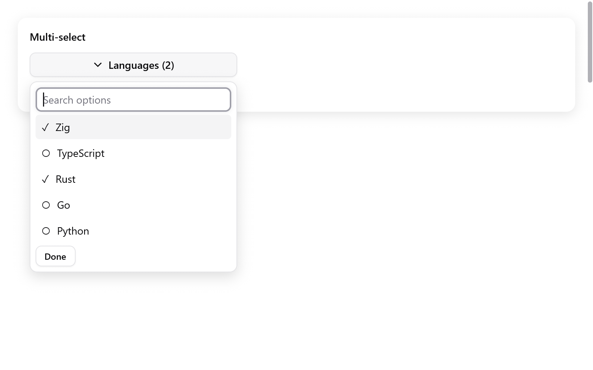

# Multi-select

Ô tìm kiếm phía trên một danh sách checkbox, để chọn nhiều mục.

<!-- demo: multi-select height=520 -->



```zig
// State của app:
languages: [3]bool = .{ true, false, false },
language_picker: ui.MultiSelectState = .{},

// Trong view:
if (ui.multiSelect(c, &s.language_picker,
    &.{ "Zig", "TypeScript", "Rust" }, &s.languages,
    .{ .label = "Languages" },
)) savePreferences();
```

- Giữ state và mảng cờ qua các frame. Không cần allocator hay deinit.
- Danh sách mục và mảng cờ có cùng độ dài.
- Chỉ số định danh các mục: đổi thứ tự mục thì đổi thứ tự cờ theo.
- Hàm chỉ trả về true khi lựa chọn thay đổi.

| `MultiSelectOptions` | Mặc định | |
|---|---|---|
| `label` | `"Choose options"` | chữ trên nút mở, kèm số mục đã chọn |
| `placeholder` | `"Search options"` | của ô tìm kiếm |
| `empty_label` | `"No matching options"` | hiện khi không có mục nào khớp |
| `width`, `max_height` | 280, 240 | |
| `disabled` | `false` | |
| `disabled_items` | `null` | mảng cờ ứng với từng mục; mục bị khóa vẫn giữ lựa chọn nhưng không đổi được |

**Hoạt động**

- Gõ để lọc, không phân biệt hoa thường. Các lựa chọn ngoài bộ lọc vẫn được giữ, và chỉ số vẫn là chỉ số gốc.
- Up và Down bỏ qua mục bị khóa. Home và End tới hai đầu. Enter bật hoặc tắt mục đang chọn.
- Bấm một mục thì popup vẫn mở và focus quay về ô tìm kiếm.
- Done, Escape hoặc bấm ra ngoài thì đóng. Escape trả focus về nút mở.

Xem **Actions & choices** trong Gallery, và [combobox chọn một mục](menus.md).
