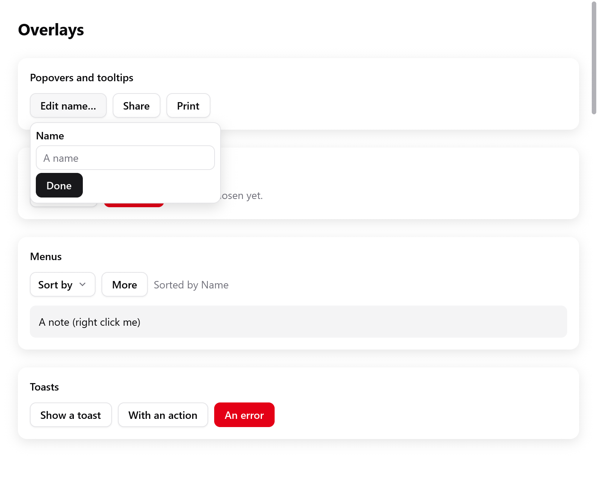
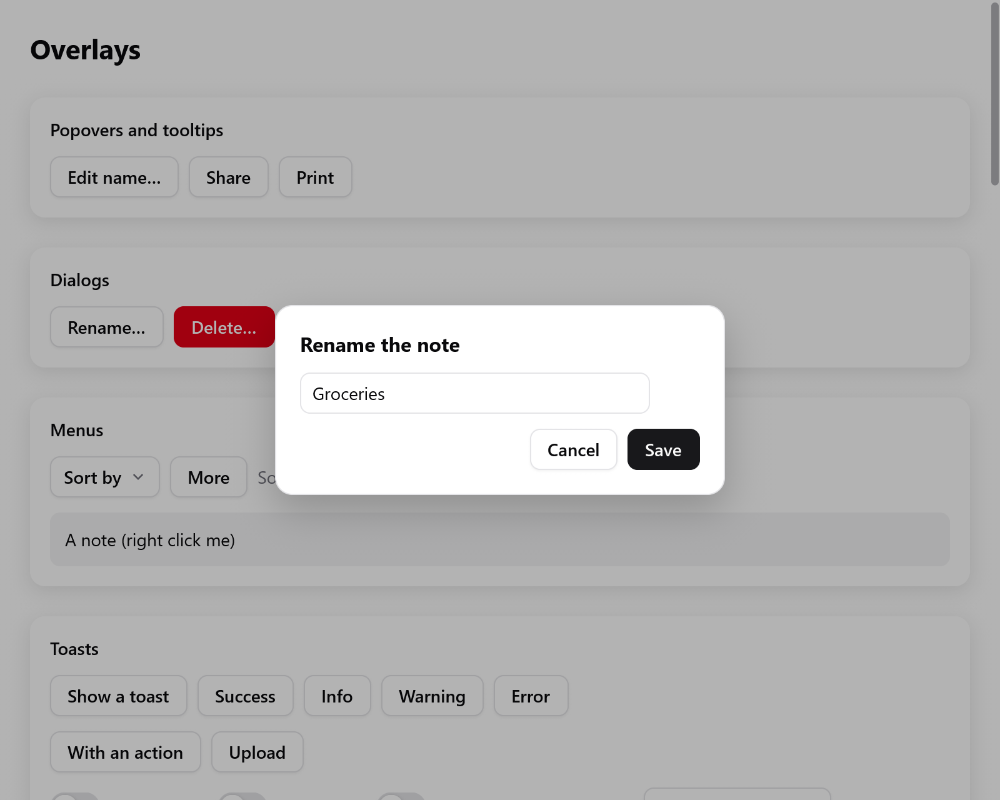
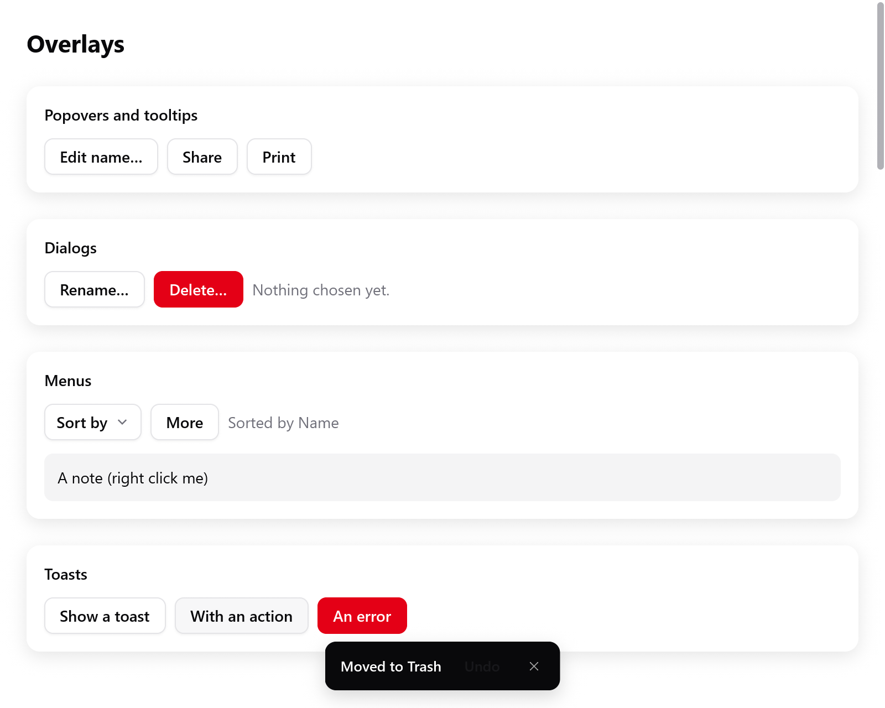

<a id="overlays"></a>

# Overlay

Overlay là những box được vẽ đè lên mọi thứ khác trong cửa sổ:

- popover cạnh một phần tử;
- tooltip;
- dialog phía trên cửa sổ bị làm mờ, và alert dialog;
- toast.

Menu và select cũng là overlay; chúng có [trang riêng](menus.md).

Overlay được dựng ở đúng chỗ của nó trong view, cạnh thứ mở ra nó. Nó được layout phía trên cửa sổ (`Context.openOverlay`), và nhận con trỏ trước các box nằm dưới.

<!-- demo: popover height=520 -->



*Một popover đang mở, gắn với nút Edit name.*

```zig
const State = struct {
    pop: ui.OverlayState = .{},
    rename: ui.OverlayState = .{},
    alert: ui.OverlayState = .{},
    toasts: ui.Toasts = .{},
    name: ui.TextBuffer = .{},
};
```

Overlay có hiện hay không là state của app: một `ui.OverlayState` giữ trong struct của app. App mở nó, và widget đóng nó khi người dùng gạt nó đi.

- `OverlayState` có `show`, `close` và `toggle`, và trường `open`.
- Trong frame mà người dùng đóng nó (Escape, bấm ra ngoài), cờ `dismissed` được đặt. Overlay nào phải mở tiếp thì lúc đó đặt `open` lại thành `true`.
- Khi mở, nó nhớ focus bàn phím. Khi đóng, nó trả focus lại, nên Tab đi tiếp từ nút đã mở nó.

<a id="popovers"></a>

## Popover

```zig
const more = ui.button(c, "Edit name…", .{});
if (more.clicked) s.pop.toggle();
if (ui.popover(c, &s.pop, more, .{})) |p| {
    defer p.end();
    ui.text(c, "Name", .{ .weight = .semibold });
    _ = ui.textField(c, &s.name, .{ .placeholder = "A name" });
    if (ui.button(c, "Done", .{ .variant = .primary }).clicked) s.pop.close();
}
```

`ui.popover(c, &state, anchor, opts)` hiện một panel cạnh phần tử `anchor` khi `state.open`. Anchor là một `ui.Interaction` bất kỳ: của một nút, của một `ui.pressable`. Hàm trả về null khi đang đóng. Các phần tử con theo sau, rồi đến `end` của panel.

**Đóng**

- Bấm ra ngoài popover hoặc Escape sẽ đóng nó. Cú bấm vẫn đi tiếp tới thứ nằm dưới con trỏ, như popover trên web.
- Nên bấm vào một nút khác sẽ đóng popover và bấm luôn nút đó. Bấm vào anchor thì đóng popover, vì anchor bật tắt nó.
- Escape đến trước với thứ bên trong panel (danh sách đang mở của một select, popover riêng của một field), rồi mới tới panel.

`ui.PopoverOptions`:

| Trường | Mặc định | |
|---|---|---|
| `side` | `.below` | `.below`, `.above`, `.right` hoặc `.left` của anchor |
| `align` | `.start` | `.start` (thẳng với đầu của anchor) hoặc `.center` |
| `gap` | 6 | số điểm giữa anchor và panel |
| `padding` | `.all(8)` | padding của panel |
| `gap_children` | 4 | gap giữa các phần tử con của panel |
| `width` | `.auto` | chiều rộng của panel |
| `max_width` | 360 | |
| `bare` | false | không có giao diện riêng: tự style bằng `Panel.style()` |

**Vị trí**

- Không đủ chỗ ở `side` thì panel sang phía đối diện.
- Dọc theo phía đó, nó thẳng hàng ở đầu, hoặc ở cuối nếu thẳng ở đầu sẽ tràn ra ngoài cửa sổ.
- Sau đó nó được dời vào trong cửa sổ, cách các mép 4 điểm.
- Panel hiện dần trong vài frame đầu.

```zig
if (ui.popover(c, &s.pop, more, .{ .bare = true })) |p| {
    defer p.end();
    const st = p.style();
    st.background = c.theme.accent;
    st.radius = 12;
    st.padding = .all(12);
    ui.text(c, "Saved", .{ .color = .white });
}
```

Popover bare không có nền, viền, bo góc hay bóng. `Panel.style()` của nó trả về `*ui.Style` của box panel, để bạn tự style.

<a id="tooltips"></a>

## Tooltip

```zig
const share = ui.button(c, "Share", .{});
ui.tooltip(c, share, "Share with others");
```

`ui.tooltip(c, anchor, tip)` hiện `tip` phía trên phần tử `anchor`, căn giữa. Không đủ chỗ phía trên thì nó hiện phía dưới.

- Nó hiện khi con trỏ dừng trên phần tử được `0.6` giây.
- Nó hiện ngay khi phần tử có focus bàn phím.
- Nó cũng hiện ngay nếu một tooltip khác vừa tắt chưa tới `0.4` giây. Nên khi rê dọc một toolbar, mỗi tooltip hiện ngay.
- Nó tắt khi con trỏ rời đi. Bấm vào phần tử hoặc Escape sẽ ẩn nó cho tới khi con trỏ rời đi rồi quay lại.
- Con trỏ đi xuyên qua nó.
- Trình đọc màn hình đọc tooltip sau tên của phần tử, dù tooltip có đang hiện hay không.
- Thời gian của nó là đồng hồ của context, nên test chỉ cần cho đồng hồ của `ui.Tester` chạy tới thay vì chờ (xem [Testing](testing.md)).

`tooltip_delay` của theme, tính bằng giây, đổi thời gian chờ:

- 0 giữ 0.6 giây;
- số âm thì tooltip hiện ngay;
- thời gian "còn ấm" theo đó bằng hai phần ba.

Đặt nó trên `c.theme` quanh một phần của view, như một toolbar. Tooltip của các phần tử đó sẽ chờ đúng như vậy.

```zig
const info = ui.button(c, "Shortcuts", .{});
if (ui.tooltipBase(c, info)) |box| {
    c.node(box).style.background = c.theme.surface;
    c.node(box).style.border = c.theme.border;
    ui.text(c, "Open", .{ .weight = .semibold });
    ui.kbd(c, ui.keys.label("⌘O"));
    ui.tooltipEnd(c, info);
}
```

Tooltip tự làm: `ui.tooltipBase(c, anchor)` mở box của tooltip và trả về chỉ số node của nó khi đang hiện, ngược lại là null. Thêm nội dung, rồi gọi `ui.tooltipEnd(c, anchor)` để đặt nó cạnh phần tử.

<a id="dialogs"></a>

## Dialog

<!-- demo: overlays height=300 -->



*Dialog Rename phía trên một view bị làm mờ.*

```zig
if (ui.button(c, "Rename…", .{}).clicked) s.rename.show();
if (ui.dialog(c, &s.rename, .{})) |d| {
    defer d.end();
    ui.text(c, "Rename the note", .{ .weight = .bold, .size = 16 });
    if (ui.textField(c, &s.name, .{ .width = .{ .px = 280 } }).submitted) s.rename.close();
    ui.row(c, .{ .gap = 8, .justify = .end, .width = .fill });
    defer ui.end(c);
    if (ui.button(c, "Cancel", .{}).clicked) s.rename.close();
    if (ui.button(c, "Save", .{ .variant = .primary }).clicked) s.rename.close();
}
```

`ui.dialog(c, &state, opts)` hiện một panel ở giữa cửa sổ bị làm mờ khi `state.open`. Hàm trả về một `ui.Dialog`, null khi đang đóng. Các phần tử con theo sau, rồi đến `end`.

Dialog giữ cửa sổ cho riêng nó:

- Lớp nền mờ nhận con trỏ.
- Bấm vào lớp nền sẽ đóng dialog, trừ khi `dismissible` là false.
- Escape đóng nó, trừ khi `escape` là false, sau khi không có gì bên trong nhận Escape trước.
- Focus phía sau bị bỏ khi nó mở, và được trả lại khi nó đóng.
- Tab và Shift+Tab chỉ đi giữa các control đang bật của nó. Chỉ đặt `trap_focus` thành false khi app tự xử lý focus.

`ui.DialogOptions`:

| Trường | Mặc định | |
|---|---|---|
| `width` | `.{ .px = 360 }` | chiều rộng của panel |
| `padding` | `.all(20)` | |
| `gap` | 12 | giữa các phần tử con của panel |
| `dismissible` | true | bấm vào lớp nền sẽ đóng nó |
| `escape` | true | Escape đóng nó |
| `bare` | false | không có giao diện: style bằng `Dialog.backdropStyle()` và `Dialog.panelStyle()` |
| `animated` | true | hiện dần khi mở |
| `trap_focus` | true | Tab và Shift+Tab ở lại trong dialog |

<a id="alert-dialogs"></a>

## Alert dialog

```zig
if (ui.button(c, "Delete…", .{ .variant = .danger }).clicked) s.alert.show();
switch (ui.alertDialog(c, &s.alert, "Delete “Groceries”?", "You can't undo this.", &.{ "Cancel", "Delete" })) {
    .none => {},
    .chosen => |i| if (i == 1) s.deleteNote(),
    .dismissed => {},
}
```

`ui.alertDialog(c, &state, title, message, buttons)` hỏi về một việc quan trọng, như alert của AppKit. Nó hiện một tiêu đề, một thông điệp và một hàng nút.

- Nút cuối cùng là nút mặc định. Nó được vẽ bằng màu accent, và Enter bấm nó.
- Chọn một nút sẽ đóng alert.
- Escape đóng nó mà không chọn nút nào. Bấm ra ngoài không làm gì.

Hàm trả về một `ui.AlertResult`:

- `.chosen` mang chỉ số của nút được bấm (nút cuối, khi nhấn Enter).
- `.dismissed` nghĩa là Escape đã đóng nó, giống như hủy.

Với hộp thoại thông báo của chính hệ thống, xem `myzig.dialog` trong [System](../system.md). Hệ điều hành vẽ chúng, và chúng chặn cho tới khi được trả lời.

<a id="toasts"></a>

## Toast

Thông báo ngắn ở một góc cửa sổ, tự biến mất sau vài giây: bản port của [sonner](https://sonner.emilkowal.ski), toast mà shadcn/ui dùng.

<!-- demo: toasts height=300 -->



*Các toast xếp chồng ở góc dưới bên phải, cái mới nhất có Undo ở phía trước.*

Giữ một `ui.Toasts` cho mỗi cửa sổ, thêm toast ở bất kỳ đâu, và dựng nó cuối cùng trong view:

```zig
if (ui.button(c, "Save", .{}).clicked) _ = s.toasts.success("Saved");
if (ui.button(c, "Delete", .{}).clicked) s.undo = s.toasts.showAction("Moved to Trash", "Undo");

// Cuối view:
const r = ui.toasts(c, &s.toasts);
if (r.action) |id| if (id == s.undo) s.restore();
```

**Thêm toast.** `show`, `success`, `info`, `warning` và `failure` nhận một tiêu đề. `add` nhận một `ui.Toast`:

| Trường | Mặc định | |
|---|---|---|
| `title`, `description` | | description là dòng thứ hai, màu nhạt |
| `kind` | `.normal` | `.info`, `.success`, `.warning`, `.@"error"`, hoặc `.loading` (vòng xoay cho đến khi được đổi) |
| `timeout` | 0 | số giây: 4 khi là 0 (8 nếu có action); âm thì hiện đến khi đóng |
| `action`, `cancel` | `""` | các nút đóng toast, báo về qua `r.action` và `r.cancel` |
| `key` | tiêu đề | thêm lại cùng key thì đổi toast đó ngay tại chỗ |
| `icon` | | một biểu tượng thay cho biểu tượng của loại |
| `content` | `null` | một `ui.View` dựng thay cho biểu tượng, tiêu đề và mô tả |
| `dismissible` | `true` | vuốt, nút đóng và Cancel đóng được nó |
| `close_button`, `rich_colors` | `null` | ghi đè thiết lập của `ui.Toasts` cho riêng toast này |

**Việc chạy lâu** (như `toast.promise` của sonner): một toast loading, rồi cùng key đó với kết quả.

```zig
_ = s.toasts.loading("Uploading report.pdf…", "upload");
// Khi xong:
_ = s.toasts.add(.{ .title = "report.pdf uploaded", .kind = .success, .key = "upload" });
```

**Cách hiển thị**, các trường của `ui.Toasts`:

| Trường | Mặc định | |
|---|---|---|
| `position` | `.bottom_right` | một góc bất kỳ, hoặc `.top_center` / `.bottom_center` |
| `expand` | `false` | luôn xòe ra, không chỉ khi con trỏ ở trên |
| `visible` | 3 | số toast hiện cùng lúc |
| `gap`, `offset` | 14, 24 | khoảng cách giữa các toast; tới mép cửa sổ |
| `rich_colors` | `false` | nhuộm màu theo loại: xanh lá, xanh dương, vàng, đỏ |
| `close_button` | `false` | nút đóng ở góc mỗi toast |
| `invert` | `false` | toast tối trên theme sáng, toast sáng trên theme tối |
| `swipe_directions` | các mép toast đang nằm | những hướng vuốt sẽ đóng toast |
| `hotkey` | `true` | Alt+T đưa bàn phím tới toast; Escape trả lại |

**`ui.toasts` báo về** trong frame này, qua `ui.ToastResult`: `action`, `cancel`, `closed` (bằng nút đóng hoặc vuốt) và `timed_out`. `close(id)`, `closeAll()`, `has(id)` và `count()` làm đúng như tên gọi.

**Hành vi**

- Toast mới nhất ở trước, các toast cũ nhô ra phía sau; khi con trỏ ở trên, cả chồng xòe ra.
- Vuốt 45 điểm, hoặc vuốt nhanh, về phía mép thì đóng toast; vuốt ngắn hơn thì toast bật về.
- Thời gian dừng khi con trỏ hoặc bàn phím ở trên toast. Đây là đồng hồ của context, nên `ui.Tester` điều khiển được.
- Cửa sổ hẹp dưới 600 điểm thì toast chiếm hết bề ngang.
- Trình đọc màn hình đọc từng toast khi nó xuất hiện hoặc thay đổi.

<a id="building-overlays-of-your-own"></a>

## Tự làm overlay

Popover, menu, select và combobox được làm từ các phần trong `ui.overlays` (`overlay_base.zig`). Widget của bạn cũng dùng được chúng.

**Mở một box phía trên cửa sổ**

- `overlays.overlay(c, style, seed)` mở một box phía trên cửa sổ (`Context.openOverlay`), id của nó lấy từ `seed`.
- Nhờ vậy các box dựng sau nó giữ nguyên id khi nó xuất hiện và biến mất. Một tooltip hiện lên không được làm đổi id của nút bên cạnh.
- `overlays.seedOf(&state)` tạo seed từ địa chỉ của state.

**State của nó**

- `OverlayState.sync(c)` ghi lại frame mà nó mở, và trả focus khi nó đóng. Hàm trả về nó có đang hiện không.
- `justOpened(c)` là true trong frame đầu tiên của nó.
- `record(c, lo)` ghi lại các box nó đã dựng.
- `pressedOutside(c, anchor_id)` cho biết cú bấm của frame này có rơi ra ngoài các box đó và ngoài anchor không.
- `dismiss(c)` đóng nó như khi người dùng đóng.

**Vị trí, phím và hiện dần**

- `overlays.attach(anchor, size, window, side, align, gap)` tính chỗ đặt một panel.
- `overlays.place(c, index, anchor, side, align, gap)` đo box overlay và dời nó tới đó, như panel làm khi kết thúc.
- Panel có scroll thì trước hết được cắt cho vừa khoảng trống ở phía rộng hơn của anchor (`overlays.roomAlong`), và scroll ở đó.
- `overlays.takeKey(c, key)` lấy một phím khỏi sự kiện này, nên những gì dựng sau không thấy nó: overlay trên cùng nhận Escape trước.
- `overlays.fadeIn(c, id, opened)` là độ mờ đục của một panel đang hiện dần.

Xem [Custom widget](custom-widgets.md) về các box, tương tác và giá trị animation tạo nên chúng.
