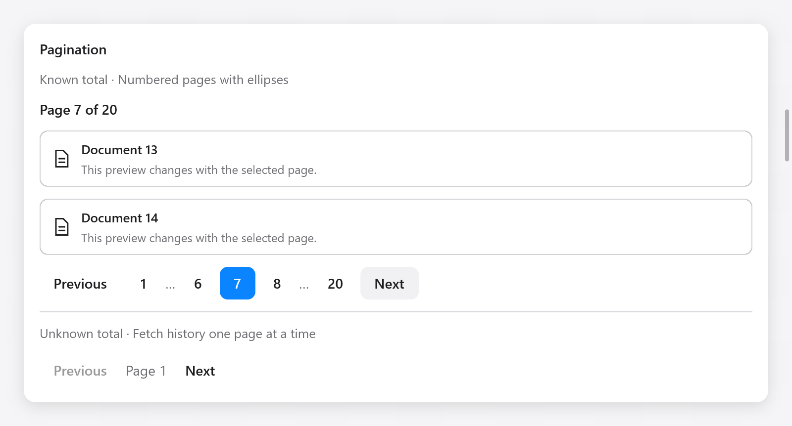

# Pagination

`ui.pagination` chọn trang độc lập với table, list hoặc grid. App giữ số
trang hiện tại và tải hoặc cắt dữ liệu khi số trang thay đổi. Virtualization
giới hạn số hàng được render; Pagination giới hạn dữ liệu cần tải.



```zig
// Trong state: page: usize = 1,
if (ui.pagination(c, &s.page, .{ .page_count = 20 })) {
    s.loadPage(s.page);
}
```

`page` **bắt đầu từ 1**. Nếu tổng bằng 0, widget đặt trang về 0 và vô hiệu
hóa cả hai nút điều hướng. Các trường hợp khác được giới hạn vào khoảng
hợp lệ. Hàm trả về true mỗi khi giá trị thay đổi, kể cả việc chuẩn hóa
sau khi tổng số trang giảm. Tải dữ liệu bất đồng bộ để không chặn main thread.

## Tổng đã biết và chưa biết

Chế độ đánh số hiển thị trang đầu, trang cuối, trang hiện tại, các trang
lân cận và dấu `…` cho khoảng bị lược bỏ. Khoảng nhỏ hiển thị đủ mọi trang.
Lượng công việc của widget có giới hạn, không tăng theo tổng số trang.

Với API không trả tổng, để `page_count` là null và cập nhật `has_next`
từ phản hồi:

```zig
_ = ui.pagination(c, &s.history_page, .{
    .has_next = s.next_cursor != null,
    .disabled = s.loading,
    .label = "Các trang lịch sử",
    .previous_label = "Trước",
    .next_label = "Sau",
    .page_label = "Trang",
});
```

Chế độ này hiển thị nút trước, nhãn trang hiện tại và nút sau. App tự giữ
cursor hoặc dữ liệu đã tải để quay lại; widget chỉ xử lý điều hướng.
`has_next` không được dùng khi đã có `page_count`.

| `PaginationOptions` | Mặc định | Ý nghĩa |
|---|---|---|
| `page_count` | `null` | Tổng số trang, null nếu chưa biết |
| `has_next` | `false` | Còn trang tiếp theo khi chưa biết tổng |
| `siblings` | `1` | Số trang lân cận mỗi bên, từ 0 đến 3 |
| `disabled` | `false` | Vô hiệu hóa điều hướng, ví dụ khi đang tải |
| `label` | `"Pagination"` | Tên nhóm cho công nghệ hỗ trợ |
| `previous_label` | `"Previous"` | Chữ trên nút trước |
| `next_label` | `"Next"` | Chữ trên nút sau |
| `page_label` | `"Page"` | Tiền tố tên trang trong accessibility và nhãn khi chưa biết tổng |

## Bàn phím và accessibility

- Tab đi vào nhóm ở trang hiện tại trong lần đầu và ra khỏi nhóm trong
  một bước. Khi quay lại, nhóm nhớ điều khiển từng có focus.
- Trái/Phải chuyển focus giữa các điều khiển đang bật; Home/End đến đầu
  hoặc cuối. Các phím này chưa tải trang cho đến khi kích hoạt nút.
- Enter/Space kích hoạt nút đang focus. Bỏ qua nút disabled và dấu `…`.
  Giao diện RTL đảo hướng các phím ngang.
- Nút số trang có tên như “Trang 6” và trạng thái đang chọn. Đổi các label
  để bản địa hóa widget.

Nếu tổng hoặc số trang lân cận thay đổi làm mất nút đang focus, focus chuyển
về trang hiện tại, hoặc điều khiển đầu tiên đang bật khi chưa biết tổng.
Pager trống hoặc bị disabled sẽ xóa focus của chính nó.

Với bố cục hẹp, giảm `siblings` hoặc đặt widget trong hàng cuộn ngang.
Widget không tự xuống dòng các nút.

Xem [Gallery](../../../examples/gallery/composites.zig), [Item](items.md)
và [danh sách, cây và bảng](lists.md).
