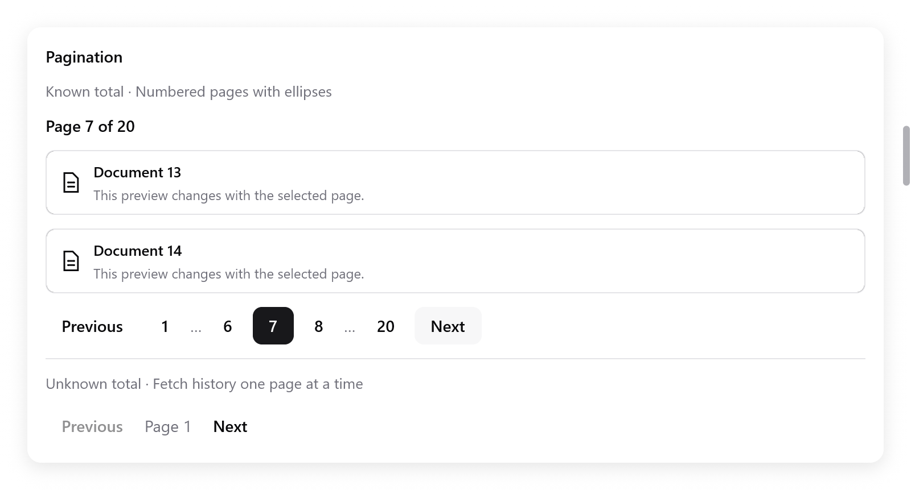

# Pagination

`ui.pagination` chọn trang, tách biệt khỏi mọi table, list hay grid. App giữ số trang, và tải hoặc cắt dữ liệu khi số này đổi. Virtualization giới hạn số hàng được render; pagination giới hạn lượng dữ liệu phải tải.

<!-- demo: pagination height=455 -->



```zig
// Trong state của app: page: usize = 1,
if (ui.pagination(c, &s.page, .{ .page_count = 20 })) {
    s.loadPage(s.page);
}
```

- `page` **bắt đầu từ 1**.
- Khi biết tổng là 0 trang, nó đặt `page` về 0 và vô hiệu hóa cả hai nút. Ngoài ra, nó bị kẹp vào khoảng hợp lệ.
- Hàm trả về true mỗi khi giá trị đổi, kể cả khi bị kẹp lại vì tổng số trang giảm.
- Hãy tải dữ liệu bất đồng bộ: đừng bao giờ chặn main thread trong view.

<a id="known-and-unknown-totals"></a>

## Biết và chưa biết tổng số trang

Chế độ đánh số hiện trang đầu, trang cuối, trang hiện tại, các trang kề trang hiện tại, và dấu ba chấm cho những khoảng bị lược. Khoảng nhỏ thì hiện đủ mọi trang. Lượng việc của nó không tăng theo số trang.

Với API không trả về tổng, để `page_count` là null và đặt `has_next` theo phản hồi:

```zig
_ = ui.pagination(c, &s.history_page, .{
    .has_next = s.next_cursor != null,
    .disabled = s.loading,
    .label = "History pages",
});
```

- Chế độ này hiện Previous, label của trang hiện tại và Next.
- App tự giữ các cursor hoặc các trang đã cache để quay lại. Widget chỉ lo việc chuyển trang.
- Khi đã biết `page_count` thì `has_next` bị bỏ qua.

| `PaginationOptions` | Mặc định | Ý nghĩa |
|---|---|---|
| `page_count` | `null` | Tổng số trang, hoặc null nếu chưa biết |
| `has_next` | `false` | Còn trang sau, khi chưa biết tổng |
| `siblings` | `1` | Số trang kề hiện ở mỗi bên, từ 0 đến 3 |
| `disabled` | `false` | Tắt mọi điều hướng, ví dụ khi đang tải |
| `label` | `"Pagination"` | Tên của nhóm cho trình đọc màn hình |
| `previous_label` | `"Previous"` | Chữ trên nút trước |
| `next_label` | `"Next"` | Chữ trên nút sau |
| `page_label` | `"Page"` | Tiền tố cho tên trang trong accessibility và cho label khi chưa biết tổng |

<a id="keyboard-and-accessibility"></a>

## Bàn phím và accessibility

- Lần đầu, Tab vào nhóm ở trang hiện tại, và ra khỏi nhóm chỉ trong một bước. Quay lại thì về control có focus gần nhất.
- Trái/Phải chuyển focus giữa các control đang bật; Home/End tới control đầu hoặc cuối. Chúng không tải trang nào cho đến khi một control được kích hoạt.
- Enter/Space kích hoạt control đang có focus. Control bị tắt và dấu ba chấm bị bỏ qua.
- Với layout từ phải sang trái, các phím mũi tên ngang bị đảo chiều.
- Nút số trang có tên như “Page 6”, kèm trạng thái đang chọn. Đổi các label để bản địa hóa widget.
- Nếu tổng hoặc `siblings` đổi làm mất nút đang có focus, focus chuyển về trang hiện tại. Khi chưa biết tổng, nó chuyển về control đầu tiên đang bật.
- Pager rỗng hoặc bị tắt thì tự bỏ focus của mình.

Nó không tự xuống dòng các control. Ở layout hẹp, giảm `siblings`, hoặc đặt pager trong một hàng scroll ngang.

Xem [Gallery](../../../examples/gallery/composites.zig), [item](items.md) và [danh sách, cây và bảng](lists.md).
