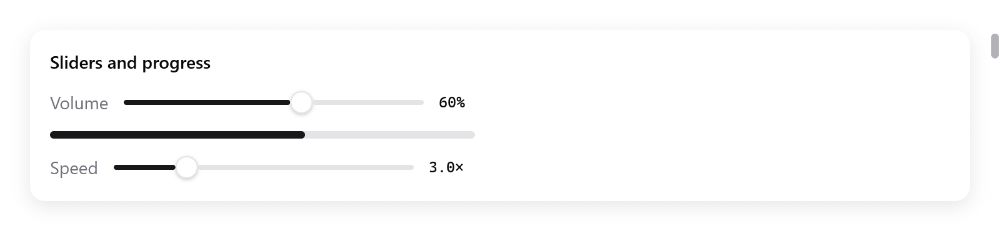
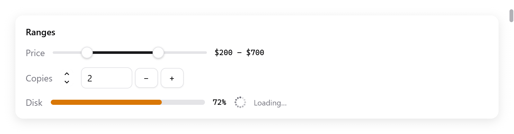

<a id="ranges"></a>

# Khoảng giá trị

Các control cho một con số:

- slider và range slider đặt giá trị;
- stepper và ô nhập số tăng giảm theo bước;
- meter, thanh tiến trình và spinner hiển thị giá trị, hoặc cho thấy công việc đang chạy.

<!-- demo: sliders height=130 -->



*Hai slider kèm giá trị số và một thanh tiến trình.*

<a id="sliders"></a>

## Slider

```zig
ui.row(c, .{ .gap = 12, .align_items = .center });
defer ui.end(c);
ui.text(c, "Volume", .{ .color = c.theme.muted });
_ = ui.slider(c, &s.volume, .{ .width = .{ .px = 240 }, .label = "Volume" });
ui.textf(c, .{ .mono = true, .size = 12 }, "{d:.0}%", .{s.volume * 100});
```

`ui.slider(c, &value, options)` đặt một `f32` trong khoảng giới hạn. Kéo núm hoặc bấm vào rãnh. Nó trả về true trong lúc đang đổi giá trị.

| `ui.SliderOptions` | Mặc định | |
|---|---|---|
| `min`, `max` | 0, 1 | các giới hạn |
| `width` | 200 điểm | một `ui.Length` |
| `label` | `""` | tên cho công nghệ hỗ trợ |
| `held` | `null` | một `*bool`, mỗi frame được gán là có đang bị kéo giữ hay không |

- Núm nhận focus bàn phím. Khi đó Left và Right dịch nó một phần hai mươi của khoảng giá trị.
- Công nghệ hỗ trợ đọc nó như một slider kèm giá trị và giới hạn, và có thể tăng giảm nó theo bước.

<a id="range-sliders"></a>

## Range slider

<!-- demo: ranges height=233 -->



*Một khoảng giá, stepper, ô nhập số, meter và spinner đang tải.*

```zig
_ = ui.rangeSlider(c, &s.low, &s.high, .{ .min = 0, .max = 1000, .step = 10, .width = 240 });
ui.text(c, c.print("${d:.0} – ${d:.0}", .{ s.low, s.high }), .{ .mono = true, .size = 12 });
```

`ui.rangeSlider(c, &low, &high, options)` đặt hai `f64` bằng hai núm, như khi chọn khoảng giá. Nó trả về true khi một giá trị thay đổi.

- Mỗi núm nhận focus bàn phím. Phím mũi tên, Home và End di chuyển nó.
- Bấm vào rãnh thì núm gần nhất nhảy tới đó.
- Hai núm không bao giờ vượt qua nhau.

| `ui.RangeSliderOptions` | Mặc định | |
|---|---|---|
| `min`, `max` | 0, 1 | các giới hạn |
| `width` | 200 điểm | một `f32` |
| `step` | 0 | lớn hơn 0 thì giá trị bắt vào `min` cộng bội số của nó, và rãnh có vạch chia |

<a id="steppers"></a>

## Stepper

```zig
_ = ui.stepper(c, &s.copies, .{ .min = 1, .max = 20 });
```

`ui.stepper(c, &value, options)` là một cặp mũi tên đổi một `f64` theo bước, như stepper của AppKit đặt cạnh một trường. Nó trả về true khi giá trị thay đổi.

- Mỗi cú bấm đi một bước.
- Giữ một mũi tên thì nó tiếp tục đi, và nhanh dần sau một lúc.
- Khi có focus bàn phím, Up, Down, Home và End đi theo bước.

`ui.StepperOptions`: `min` (0), `max` (100) và `step` (1).

<a id="number-inputs"></a>

## Ô nhập số

```zig
const State = struct {
    copies: f64 = 2,
    copies_text: ui.TextBuffer = .{},
};

_ = ui.stepper(c, &s.copies, .{ .min = 1, .max = 20 });
_ = ui.numberInput(c, &s.copies, &s.copies_text, .{ .min = 1, .max = 20 });
```

`ui.numberInput(c, &value, &text, options)` là một ô văn bản sửa một `f64` trong khoảng giới hạn, có nút − và + bên cạnh. `text` là `ui.TextBuffer` của ô, giữ trong state của bạn cạnh giá trị. Nó trả về true khi giá trị thay đổi.

- Up và Down, cùng hai nút, đổi giá trị theo bước.
- Nội dung gõ vào có hiệu lực ngay khi nó là một số nằm trong khoảng.
- Khi ô mất focus, giá trị được hiển thị làm tròn theo số chữ số thập phân của bước.
- Stepper và ô nhập số cùng trỏ vào một giá trị thì luôn khớp nhau, như ví dụ trên.

| `ui.NumberInputOptions` | Mặc định | |
|---|---|---|
| `min`, `max` | 0, 100 | các giới hạn |
| `step` | 1 | |
| `width` | 80 điểm | một `ui.Length` |

<a id="meters"></a>

## Meter

```zig
ui.meter(c, s.disk_used, .{ .warning = 0.7, .critical = 0.9, .width = .{ .px = 240 } });
// Pin: giá trị thấp mới là xấu, vì critical nằm dưới warning.
ui.meter(c, s.battery, .{ .warning = 0.2, .critical = 0.1 });
```

`ui.meter(c, value, options)` hiển thị một giá trị trong khoảng giới hạn, như level indicator của AppKit và `<meter>` của web. Nó có màu success, hoặc màu warning (cam) và danger tính từ các mức đã cho.

| `ui.MeterOptions` | Mặc định | |
|---|---|---|
| `min`, `max` | 0, 1 | các giới hạn |
| `warning`, `critical` | `null` | các mức; mặc định không có |
| `width` | 160 điểm | |

Khi `critical` nhỏ hơn `warning`, giá trị thấp mới là giá trị xấu.

<a id="progress-bars"></a>

## Thanh tiến trình

```zig
ui.progress(c, s.downloaded, .{ .px = 340 });
ui.progress(c, s.done, .fill);
```

`ui.progress(c, value, width)` là một thanh được tô tới `value`, từ 0 đến 1. Khi giá trị đổi, thanh chuyển dần tới đó có easing.

- Công nghệ hỗ trợ đọc nó như một chỉ báo tiến trình kèm giá trị.
- Để hiện tiến trình của cửa sổ trên nút taskbar, xem [`Window.setProgress`](../windows.md). Cách này chạy trên Windows, và trên các launcher Linux có hỗ trợ.

<a id="spinners"></a>

## Spinner

```zig
ui.row(c, .{ .gap = 8, .align_items = .center });
defer ui.end(c);
ui.spinner(c, .{});
ui.text(c, "Loading…", .{ .size = 12, .color = c.theme.muted });
```

`ui.spinner(c, options)` cho thấy công việc chưa biết bao lâu xong, như chỉ báo xoay của AppKit. Các chấm chạy quanh một vòng tròn và mờ dần phía sau chấm dẫn đầu.

- Nó đi một phần mười hai vòng sau mỗi một phần mười hai của 0,9 giây, theo đồng hồ của context.
- Nó chỉ xin frame ở mỗi bước (`c.frameIn`), không phải ở mỗi lần làm mới màn hình. Cửa sổ có spinner gần như vẫn rảnh.
- Trong test, cho đồng hồ của `ui.Tester` chạy tới để spinner đi bước.

`ui.SpinnerOptions`: `size` (18 điểm) và `color` (mặc định là màu chữ muted).
