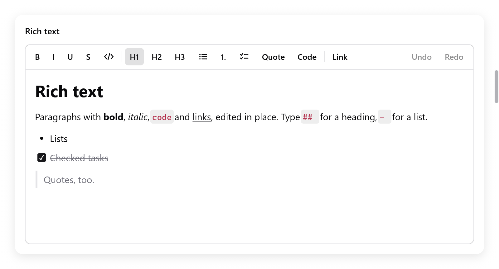

<a id="rich-text-editor"></a>

# Trình soạn thảo rich text

`ui.richTextEditor` soạn văn bản có định dạng, như Notes và Google Docs. `ui.richTextToolbar` là thanh công cụ cho các định dạng đó.

- Kiểu đoạn: heading, trích dẫn, code, và danh sách gạch đầu dòng, đánh số, task, lồng nhau theo cấp.
- Định dạng trên chữ (mark): đậm, nghiêng, gạch chân, gạch ngang, code, link, màu chữ và màu nền highlight.
- Undo, bộ gõ (input method) và phím tắt Markdown ngay khi gõ.
- Clipboard: bản sao rich của riêng nó, văn bản thuần và Markdown.
- Nó chỉ dựng các block đang nằm trong view.

<!-- demo: rich-text height=456 -->



*Trình soạn thảo rich text và thanh công cụ, với heading, định dạng trong dòng, task và một trích dẫn.*

```zig
const Note = struct {
    rt: ui.RichText,

    fn view(n: *Note, c: *ui.Context) void {
        ui.column(c, .{ .width = .fill, .height = .fill });
        defer ui.end(c);
        _ = ui.richTextToolbar(c, &n.rt, .{});
        if (ui.richTextEditor(c, &n.rt, .{ .placeholder = "Write" }).changed) n.save();
    }
};

var note: Note = .{ .rt = .initMarkdown(gpa, "# Groceries\n\n- [ ] Milk") };
defer note.rt.deinit();
```

`zig build run-notes` là một app ghi chú dựng trên nó (`examples/notes`). App có danh sách ghi chú ở sidebar, một thanh nhập link, và clipboard dạng văn bản thuần hoặc Markdown.

<a id="the-state"></a>

## State

Một `ui.RichText` giữ:

- tài liệu (`doc`) và vùng chọn (`sel`);
- lịch sử undo;
- phần đang soạn của bộ gõ;
- những gì view giữ lại giữa các frame.

Tạo nó bằng `ui.RichText.init(gpa)` (rỗng) hoặc `initMarkdown(gpa, md)`. Giải phóng bằng `deinit()`.

| Phương thức | Tác dụng |
|---|---|
| `setMarkdown(md)` | thay tài liệu bằng Markdown đọc vào |
| `markdown(gpa)` | tài liệu viết ra dạng Markdown |
| `text(gpa)` | văn bản thuần, mỗi block một dòng riêng |
| `selectedText(gpa)` | văn bản thuần của vùng chọn |
| `takeChanged()` | có bị sửa kể từ lần gọi trước hay không |
| `select(anchor, caret)`, `collapse(pos)`, `selectAll()` | vùng chọn |
| `insert(s)` | gõ `s` tại con trỏ soạn thảo, với các mark mà việc gõ ở đó đang có |
| `deleteBackward()`, `deleteForward()`, `deleteSelection()` | |
| `newline()` | Enter: tách block (hoặc bỏ lại một mục danh sách rỗng) |
| `undo()`, `redo()`, `canUndo()`, `canRedo()` | |
| `toggle(t)` | bật/tắt một `ui.richtext.Toggle` (`.bold`, `.italic`, `.underline`, `.strike`, `.code`) trên vùng chọn |
| `setMark(m)` | đặt một `ui.richtext.Mark` (`.{ .color = c }`, `.{ .highlight = null }`, ...) trên vùng chọn |
| `setLink(url)` | gắn link cho vùng chọn (hoặc link tại con trỏ soạn thảo); `""` thì gỡ link |
| `setKind(kind)` | kiểu của các block đang chọn |
| `indent(delta)` | cấp của danh sách, hoặc độ thụt lề của đoạn, thêm `delta` |
| `toggleChecked(block)` | tick hoặc bỏ tick một task |
| `formatting()` | `ui.richtext.Formatting` của vùng chọn, dùng cho toolbar |
| `pasteMarkdown(md)` | dán Markdown tại con trỏ soạn thảo |

- `version` tăng sau mỗi lần sửa, undo và redo.
- Vị trí là `ui.richtext.Pos`: chỉ số `block` và offset tính bằng byte `off` trong block đó.
- Vùng chọn (`ui.richtext.Sel`) có `anchor` và `caret`.

<a id="the-document"></a>

## Tài liệu

`ui.richtext.Doc` là một danh sách block. Mỗi block (`ui.richtext.Block`) có một kiểu, và chữ chia thành các đoạn theo mark.

| Kiểu | Chứa |
|---|---|
| `ui.richtext.BlockStyle` | `kind`; `indent`, cấp của mục danh sách hoặc độ thụt lề của đoạn, tối đa 6; `checked`, của task |
| `ui.richtext.Kind` | `.paragraph`, `.heading1`, `.heading2`, `.heading3`, `.quote`, `.code`, `.bullet`, `.numbered`, `.task` |
| `ui.richtext.Marks` | `bold`, `italic`, `underline`, `strike`, `code`; `link`, chỉ số URL của nó trong tài liệu cộng một (0 là không có); `color` và `highlight`, các màu tùy chọn |

- Đọc và dựng tài liệu bằng `doc.count()`, `doc.block(i)` (với `str()` và `marksAt(i)` của nó), `doc.append(style, text, marks)`, `doc.url(link)` và `doc.text(gpa)`.
- Chuyển đổi bằng `ui.richtext.parseMarkdown(gpa, md)` và `ui.richtext.writeMarkdown(gpa, doc)`.
- Chữ gõ ngay sau một link hoặc code không nối dài chúng, như trong NSTextView.
- Bật một định dạng khi không chọn gì thì nó áp dụng cho chữ gõ tiếp theo, cho đến khi con trỏ soạn thảo di chuyển.

<a id="options"></a>

## Tùy chọn

| `ui.RichTextOptions` | Mặc định | |
|---|---|---|
| `width`, `height` | `.fill` | |
| `size` | 15 | cỡ chữ của thân bài; heading và code tính theo nó |
| `placeholder` | `""` | hiện khi rỗng |
| `read_only` | false | chọn, sao chép và bấm link được, nhưng không sửa được |
| `bare` | false | không có box riêng (viền, nền, vòng focus) |
| `padding` | 16 × 12 | quanh chữ |
| `markdown_shortcuts` | true | gõ `# `, `- `, `**bold**` thì tự định dạng |
| `clipboard` | `.plain` | thứ mà copy ghi thêm ngoài bản sao rich, và cách dán chữ từ nơi khác: `.plain` hoặc `.markdown` |

Nó trả về một `ui.RichTextResult`:

- `changed` và `focused`;
- `first_block` và `last_block`, các block đã dựng;
- `link_clicked`: URL của link vừa được bấm, kèm Command hoặc Control khi đang sửa được;
- `link_requested`: Command-K hoặc Control-K vừa xin một link. Hãy hiện một ô nhập, rồi gọi `setLink`.

`ui.richTextEditorBase(c, rt, box, options)` là trình soạn thảo nằm trong một box do bạn tự tạo kiểu (một `ui.Style`).

<a id="links"></a>

## Link

Trình soạn thảo không tự hỏi URL: nó báo cho app. Đây là một thanh nằm dưới toolbar, như trong ví dụ notes:

```zig
const tb = ui.richTextToolbar(c, &n.rt, .{});
const r = ui.richTextEditor(c, &n.rt, .{ .bare = true });
if (tb.link_requested or r.link_requested) {
    s.asking_link = true;
    s.link.set(n.rt.formatting().link orelse "https://");
}
if (s.asking_link) {
    const f = ui.textField(c, &s.link, .{ .width = .fill, .placeholder = "https://" });
    if (ui.button(c, "Set", .{ .variant = .primary }).clicked or f.submitted) {
        n.rt.setLink(s.link.text());
        s.asking_link = false;
        c.focus = n.rt.id; // quay lại trình soạn thảo
    }
}
if (r.link_clicked) |url| _ = myzig.shell.openUrl(url);
```

<a id="the-toolbar"></a>

## Toolbar

`ui.richTextToolbar(c, rt, options)` có các nút cho:

- đậm, nghiêng, gạch chân, gạch ngang và code;
- heading, danh sách, trích dẫn và block code;
- link;
- undo và redo, khi bật `history`.

Các nút hiện định dạng của vùng chọn, lấy từ `formatting()`. Bấm một nút thì định dạng trình soạn thảo và trả lại bàn phím cho nó.

- `ui.RichTextToolbarOptions`: `border` và `history`, cả hai mặc định là true.
- Nó trả về `changed` (vừa áp dụng một định dạng) và `link_requested`.

<a id="keys"></a>

## Phím tắt

Command trên macOS, Control ở nơi khác, theo cách các trình soạn thảo văn bản thường gán:

| Phím | Tác dụng |
|---|---|
| Mod+B, Mod+I, Mod+U | đậm, nghiêng, gạch chân |
| Mod+Shift+X | gạch ngang |
| Mod+E (macOS), Ctrl+Shift+E | code |
| Mod+K | xin một link |
| Mod+Option+1, 2, 3, 0 | heading 1 đến 3, đoạn thường |
| Mod+Shift+7, 8, L, 9 | danh sách đánh số, gạch đầu dòng, task, trích dẫn |
| Mod+Option+C | block code |
| Mod+], Mod+[, Tab, Shift+Tab | thụt vào và thụt ra (Tab trong danh sách) |

Di chuyển, xóa, chọn, clipboard và undo hoạt động như trong [text area](text-area.md#editing). Bấm vào ô của một task thì tick nó.

<a id="markdown-shortcuts"></a>

## Phím tắt Markdown

Chữ gõ vào tự định dạng.

| Gõ | Tạo ra |
|---|---|
| `# ` đến `### ` | heading |
| `- `, `* `, `+ ` | danh sách gạch đầu dòng |
| `1. ` | danh sách đánh số |
| `[ ] `, `[x] ` | task |
| `> ` | trích dẫn |
| ```` ``` ```` rồi Enter | block code |
| `**bold**`, `*italic*`, `_italic_`, `` `code` ``, `~~struck~~` | định dạng tương ứng, ngay khi gõ dấu đóng |

- Các phím tắt cho block chỉ có tác dụng ở đầu một đoạn.
- Dấu gạch dưới nằm giữa một từ, như `snake_case`, vẫn là dấu gạch dưới.
- Mỗi phím tắt là một bước undo riêng. Undo đưa nó về đúng chữ đã gõ.

<a id="the-clipboard"></a>

## Clipboard

- Copy đặt văn bản thuần lên clipboard hệ thống, hoặc Markdown khi `clipboard = .markdown`.
- Nó cũng giữ chính vùng chọn, kèm kiểu và mark.
- Dán lại đúng đoạn chữ đó trong app thì dán nguyên bản sao, nên chữ được chuyển đi cùng định dạng.
- Chữ từ nơi khác được dán dạng thuần, hoặc đọc như Markdown.

<a id="testing"></a>

## Testing

```zig
var n: Note = .{ .rt = .init(gpa) };
defer n.rt.deinit();
var t: ui.Tester = undefined;
try t.init(gpa, .init(&n, Note.view), .{});
defer t.deinit();
try t.clickText("Write");
t.typeText("# Title");
try std.testing.expectEqual(ui.richtext.Kind.heading1, n.rt.doc.block(0).style.kind);
```

Xem `src/ui/tests_richtext*.zig` và [Testing](testing.md).
