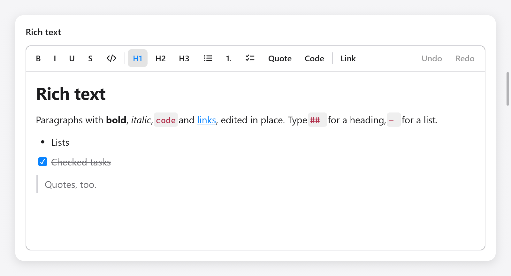

<a id="rich-text-editor"></a>

# Trình soạn thảo văn bản phong phú

`ui.richTextEditor` chỉnh sửa văn bản có định dạng, giống như Notes và Google Docs thực hiện: các đoạn văn có kiểu (tiêu đề, trích dẫn, mã, dấu đầu dòng, đánh số và danh sách nhiệm vụ được lồng theo cấp độ) của văn bản có dấu (in đậm, in nghiêng, gạch chân, gạch ngang, mã, liên kết, màu sắc và đánh dấu). Nó có tính năng hoàn tác, bảng nhớ tạm (bản sao đa dạng thức, văn bản thuần túy và Markdown của riêng nó), phương thức nhập, phím tắt Markdown khi bạn nhập và chỉ xây dựng các khối trong view. `ui.richTextToolbar` là một thanh công cụ có định dạng.



*Trình soạn thảo rich text và thanh công cụ, gồm tiêu đề, định dạng, task và trích dẫn.*

```zig
const Note = struct {
    rt: ui.RichText,

    fn view(n: *Note, c: *ui.Context) void {
        ui.column(c, .{ .width = .fill, .height = .fill });
        defer ui.end(c);
        _ = ui.richTextToolbar(c, &n.rt, .{});
        if (ui.richTextEditor(c, &n.rt, .{ .placeholder = "Write" }).changed) n.save();
    }
};

var note: Note = .{ .rt = .initMarkdown(gpa, "# Groceries\n\n- [ ] Milk") };
defer note.rt.deinit();
```

`zig build run-notes` là một ứng dụng ghi chú được xây dựng trên nó (`examples/notes`): ghi chú trong thanh bên, các liên kết được yêu cầu trong một thanh và bảng tạm dưới dạng văn bản thuần túy hoặc Markdown.

<a id="the-state"></a>

## Nhà nước

`ui.RichText` chứa tài liệu (`doc`), lựa chọn (`sel`), lịch sử, thành phần của phương thức nhập và nội dung mà view giữ giữa các khung. Tạo nó bằng `ui.RichText.init(gpa)` (trống) hoặc `initMarkdown(gpa, md)`, giải phóng nó bằng `deinit()`.

| phương pháp | làm |
|---|---|
| `setMarkdown(md)` | thay thế tài liệu bằng Markdown đã đọc |
| `markdown(gpa)` | tài liệu được viết dưới dạng Markdown |
| `text(gpa)` | văn bản đơn giản của nó, các khối trên dòng riêng của chúng |
| `selectedText(gpa)` | văn bản đơn giản của vùng chọn |
| `takeChanged()` | liệu nó có được chỉnh sửa kể từ cuộc gọi cuối cùng không |
| `select(anchor, caret)`, `collapse(pos)`, `selectAll()` | sự lựa chọn |
| `insert(s)` | gõ `s` vào dấu mũ, với các dấu gõ có ở đó |
| `deleteBackward()`, `deleteForward()`, `deleteSelection()` | |
| `newline()` | Enter: chia khối (hoặc để lại một mục danh sách trống) |
| `undo()`, `redo()`, `canUndo()`, `canRedo()` | |
| `toggle(t)` | chuyển đổi `ui.richtext.Toggle` (`.bold`, `.italic`, `.underline`, `.strike`, `.code`) trên vùng chọn |
| `setMark(m)` | đặt `ui.richtext.Mark` (`.{ .color = c }`, `.{ .highlight = null }`, ...) trên vùng chọn |
| `setLink(url)` | liên kết vùng chọn (hoặc liên kết ở dấu mũ); `""` xóa nó đi |
| `setKind(kind)` | phong cách của các khối được chọn |
| `indent(delta)` | cấp độ của danh sách hoặc mức thụt lề của đoạn văn bởi `delta` |
| `toggleChecked(block)` | kiểm tra hoặc bỏ chọn một nhiệm vụ |
| `formatting()` | lựa chọn của `ui.richtext.Formatting`, cho thanh công cụ |
| `pasteMarkdown(md)` | dán Markdown vào dấu mũ |

`version` bị ảnh hưởng bởi mỗi lần chỉnh sửa, hoàn tác và làm lại.

Các vị trí là `ui.richtext.Pos`: chỉ mục `block` và độ lệch byte `off` trong đó. Lựa chọn (`ui.richtext.Sel`) có `anchor` và `caret`.

<a id="the-document"></a>

## Tài liệu

`ui.richtext.Doc` là danh sách các khối. Một khối (`ui.richtext.Block`) có kiểu và văn bản theo nhiều dấu:

- `ui.richtext.BlockStyle`: `kind`, `indent` (cấp của mục danh sách hoặc khoảng cách thụt lề của đoạn văn, tối đa 6) và `checked` (của nhiệm vụ).
- `ui.richtext.Kind`: `.paragraph`, `.heading1`, `.heading2`, `.heading3`, `.quote`, `.code`, `.bullet`, `.numbered`, `.task`.
- `ui.richtext.Marks`: `bold`, `italic`, `underline`, `strike`, `code`, `link` (chỉ mục URL của nó trong tài liệu, cộng thêm một; 0 không), `color` và `highlight` (màu tùy chọn).

`doc.count()`, `doc.block(i)` (`str()` và `marksAt(i)`), `doc.append(style, text, marks)`, `doc.url(link)` và `doc.text(gpa)` đọc và xây dựng nó. `ui.richtext.parseMarkdown(gpa, md)` và `ui.richtext.writeMarkdown(gpa, doc)` chuyển đổi nó.

Văn bản được nhập ngay sau liên kết hoặc mã không mở rộng chúng, như trong NSTextView; một định dạng được chuyển đổi mà không có mục nào được chọn sẽ áp dụng cho nội dung được nhập tiếp theo cho đến khi dấu mũ di chuyển.

<a id="options"></a>

## Tùy chọn

`ui.RichTextOptions`:

| lĩnh vực | mặc định | ý nghĩa |
|---|---|---|
| `width`, `height` | `.fill` | |
| `size` | 15 | kích thước cơ thể; tiêu đề và tỷ lệ mã từ nó |
| `placeholder` | `""` | hiển thị khi trống |
| `read_only` | false | có thể lựa chọn, có thể sao chép và các liên kết của nó có thể nhấp vào được, không thể chỉnh sửa được |
| `bare` | false | không có hộp riêng (viền, tô màu, vòng lấy nét) |
| `padding` | 16 × 12 | xung quanh văn bản |
| `markdown_shortcuts` | true | gõ các định dạng `# `, `- `, `**bold**` |
| `clipboard` | `.plain` | bản sao nào ghi bên cạnh bản sao đa dạng thức và văn bản nào từ nơi khác được dán dưới dạng: `.plain` hoặc `.markdown` |

Nó trả về `ui.RichTextResult`: `changed`, `focused`, `first_block` và `last_block` (các khối được tạo), `link_clicked` (một liên kết được nhấp vào, với Command hoặc Control trong khi có thể chỉnh sửa: URL của nó) và `link_requested` (Command-K hoặc Control-K yêu cầu liên kết: hiển thị một trường, sau đó gọi `setLink`).

`ui.richTextEditorBase(c, rt, box, options)` là trình chỉnh sửa trong hộp do bạn tự tạo kiểu (`ui.Style`).

<a id="links"></a>

## Liên kết

Trình chỉnh sửa không yêu cầu chính URL: nó sẽ thông báo cho ứng dụng. Một thanh bên dưới thanh công cụ, như trong ví dụ về ghi chú:

```zig
const tb = ui.richTextToolbar(c, &n.rt, .{});
const r = ui.richTextEditor(c, &n.rt, .{ .bare = true });
if (tb.link_requested or r.link_requested) {
    s.asking_link = true;
    s.link.set(n.rt.formatting().link orelse "https://");
}
if (s.asking_link) {
    const f = ui.textField(c, &s.link, .{ .width = .fill, .placeholder = "https://" });
    if (ui.button(c, "Set", .{ .variant = .primary }).clicked or f.submitted) {
        n.rt.setLink(s.link.text());
        s.asking_link = false;
        c.focus = n.rt.id; // back to the editor
    }
}
if (r.link_clicked) |url| _ = myzig.shell.openUrl(url);
```

<a id="the-toolbar"></a>

## Thanh công cụ

`ui.richTextToolbar(c, rt, options)` có các nút in đậm, in nghiêng, gạch chân, gạch ngang và mã, tiêu đề, danh sách, trích dẫn và khối mã, một liên kết và, với `history`, hoàn tác và làm lại. Các nút của nó hiển thị các định dạng của lựa chọn (từ `formatting()`) và một cú nhấp chuột sẽ định dạng trình chỉnh sửa và đưa nó trở lại bàn phím. `ui.RichTextToolbarOptions` có `border` và `history` (cả true). Nó trả về `changed` (một định dạng đã được áp dụng) và `link_requested`.

<a id="keys"></a>

## Phím

Lệnh trên macOS, Điều khiển ở nơi khác, vì trình xử lý văn bản liên kết chúng:

| phím | làm |
|---|---|
| Mod+B, Mod+I, Mod+U | in đậm, in nghiêng, gạch chân |
| Mod+Shift+X | gạch ngang |
| Mod+E (macOS), Ctrl+Shift+E | mã |
| Mod+K | yêu cầu một liên kết |
| Mod+Tùy chọn+1, 2, 3, 0 | tiêu đề từ 1 đến 3, đoạn |
| Mod+Shift+7, 8, L, 9 | danh sách đánh số, danh sách có dấu đầu dòng, nhiệm vụ, báo giá |
| Mod+Tùy chọn+C | khối mã |
| Mod+], Mod+[, Tab, Shift+Tab | thụt lề và thụt lề (Tab trong danh sách) |

và chuyển động, xóa, chọn, bảng tạm và hoàn tác của văn bản, dưới dạng [vùng văn bản](text-area.md#editing). Một cú nhấp chuột vào hộp của nhiệm vụ sẽ kiểm tra nó.

<a id="markdown-shortcuts"></a>

## Phím tắt đánh dấu

Nội dung được tự định dạng khi gõ. Ở đầu đoạn, `# ` đến `### ` tạo tiêu đề; `- `, `* ` và `+ ` tạo danh sách dấu đầu dòng; `1. ` tạo danh sách đánh số; `[ ] ` và `[x] ` tạo mục công việc; `> ` tạo trích dẫn; gõ ```` ``` ```` rồi Enter để tạo khối code. Khi bao quanh từ, `**bold**`, `*italic*`, `_italic_`, `` `code` `` và `~~struck~~` áp dụng định dạng ngay khi gõ dấu đóng; dấu gạch dưới ở giữa từ, như `snake_case`, vẫn giữ nguyên. Mỗi phím tắt là một bước hoàn tác riêng, cho phép quay lại nội dung đã gõ.

<a id="the-clipboard"></a>

## Bảng nhớ tạm

Việc sao chép sẽ đặt văn bản thuần túy (hoặc, với `clipboard = .markdown`, Markdown) vào khay nhớ tạm của hệ thống và giữ nguyên vùng chọn cùng với các kiểu và dấu của nó: dán lại văn bản đó, trong ứng dụng, dán toàn bộ bản sao, để văn bản di chuyển theo các định dạng của nó. Văn bản từ nơi khác được dán đơn giản hoặc đọc dưới dạng Markdown.

<a id="testing"></a>

## Kiểm tra

```zig
var n: Note = .{ .rt = .init(gpa) };
defer n.rt.deinit();
var t: ui.Tester = undefined;
try t.init(gpa, .init(&n, Note.view), .{});
defer t.deinit();
try t.clickText("Write");
t.typeText("# Title");
try std.testing.expectEqual(ui.richtext.Kind.heading1, n.rt.doc.block(0).style.kind);
```

Xem `src/ui/tests_richtext*.zig` và [Thử nghiệm](testing.md).
