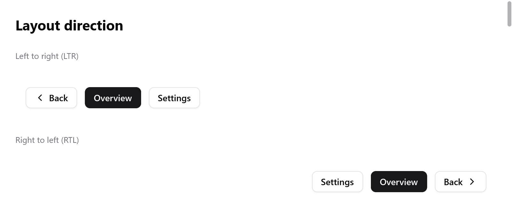

<a id="right-to-left"></a>

# Phải sang trái

Tiếng Ả Rập, Do Thái, Ba Tư và Urdu đọc từ phải sang trái, và giao diện của app trong các ngôn ngữ đó cũng vậy. Một hàng bắt đầu từ bên phải, sidebar nằm bên phải, mũi tên quay lại chỉ sang phải.

Native UI bố trí cửa sổ theo cách này khi được yêu cầu, giống `TextDirection` của Flutter, `LayoutDirection` của SwiftUI và `direction` của CSS (`src/ui/direction.zig`, theo bản của mygo).

Giống Godot, hệ tọa độ không bị lật: x vẫn tăng sang phải trong các hình chữ nhật, trong canvas và trong vị trí con trỏ. Chỉ layout bị lật.

<!-- demo: right-to-left height=344 -->



*Cùng các control, bố trí từ trái sang phải và từ phải sang trái.*

<a id="the-direction"></a>

## Hướng

```zig
fn view(s: *App, c: *ui.Context) void {
    ui.direction.fromLocale(c, myzig.i18n.locale());
    // ...
}
```

`ui.Direction` là `.ltr` hoặc `.rtl`. Cửa sổ đi từ trái sang phải cho đến khi view đặt hướng khác:

- `ui.direction.set` đặt hướng.
- `ui.direction.fromLocale` đặt hướng theo ngôn ngữ của app. Nó trả về phải sang trái cho tiếng Ả Rập, Do Thái, Ba Tư và Urdu (nó đọc `i18n.direction` của tag).

Cửa sổ giữ hướng này. Đặt lại mỗi frame chỉ tốn một lần tra cứu. Đổi hướng thì frame được dựng lại, để các widget dựng trước lúc đổi đọc được hướng mới.

<a id="a-direction-of-its-own"></a>

### Hướng riêng cho một box

```zig
const player = c.open(.{ .direction = .row, .gap = 8 }, "player");
ui.direction.scope(c, player, .ltr);
_ = ui.button(c, "", .{ .icon = "backward.fill" });
_ = ui.button(c, "", .{ .icon = "play.fill" });
_ = ui.button(c, "", .{ .icon = "forward.fill" });
c.end();
```

Mỗi box lấy hướng của box chứa nó. Muốn box có hướng riêng, gọi `ui.direction.scope` ngay sau khi mở nó, trước các phần tử con. Số điện thoại, đoạn code mẫu hay các nút điều khiển trình phát media vẫn đi từ trái sang phải trong một cửa sổ phải sang trái.

<a id="reading-the-direction"></a>

### Đọc hướng

```zig
const forward = if (ui.direction.current(c) == .rtl) "chevron.left" else "chevron.right";
ui.icon(c, forward, .{});
```

Widget tự viết mà vẽ thứ gì chỉ theo một đường thì đọc hướng của phần đang được dựng:

| Hàm | |
|---|---|
| `ui.direction.current(c)` | `.ltr` hoặc `.rtl` |
| `ui.direction.isRtl(c)` | như trên, dạng `bool` |
| `ui.direction.arrows(c)` | các phím đi lùi và tiến dọc một đường: `.back` và `.forth` là Left và Right, đảo lại khi phải sang trái |
| `ui.direction.alongLine(c, t)` | đổi một tỉ lệ tính từ đầu đường thành tỉ lệ tính từ bên trái, như giá trị của slider dưới con trỏ |

<a id="what-mirrors"></a>

## Những gì được lật

Layout đặt cây box từ trái sang phải trước. Sau đó `ui.direction.mirror` (do `layout.arrange` chạy) chuyển mỗi box nằm trong một box phải sang trái sang phía bên kia, cùng mọi thứ bên trong:

- Một hàng xếp phần tử con từ bên phải; `align_items` và `justify` bắt đầu từ bên phải.
- Padding đặt bên trái chuyển sang bên phải, và một box absolute cách lề trái thì thành cách lề phải.
- [Grid](grid.md) xếp các cột từ bên phải.
- [Focus group](navigation.md) chuyển sang mục kế tiếp bằng phím Left.
- Các trang được push vào [router](navigation.md) trượt vào từ bên trái.

Overlay giữ vị trí mà widget của nó đã đặt, theo tọa độ cửa sổ. Phần bên trong overlay được bố trí theo hướng của cửa sổ.

<a id="what-does-not"></a>

## Những gì không được lật

- Chữ, icon, hình ảnh và những gì [canvas](drawing.md) vẽ không bị lật: dấu tích, kính lúp hay biểu đồ vẫn đọc như khi trái sang phải. Thứ gì cần chỉ theo hướng ngược lại thì vẽ sau khi đọc `ui.direction.current`.
- Slider, progress bar và switch tự vẽ dọc theo một đường. Phần tô và núm của chúng theo layout đã lật của box. Chúng chưa đọc hướng để chọn phía tô và phím mũi tên như bản của mygo. Code nào cần thì đọc `alongLine` và `arrows`.
- [Inspector](inspector.md) luôn đọc từ trái sang phải.

<a id="trying-it"></a>

## Thử nghiệm

Nút **RTL** của [inspector](inspector.md) chuyển cửa sổ của nó sang phải sang trái, hoặc ngược lại. Nó giúp thử giao diện trước khi dịch.

Một [`ui.Tester`](testing.md) bố trí cửa sổ của nó từ phải sang trái sau `ui.direction.set(&t.ctx, .rtl)`, như một test layout sẽ làm:

```zig
var t: ui.Tester = undefined;
try t.init(gpa, .init(&page, Page.view), .{ .width = 400, .height = 300 });
defer t.deinit();
ui.direction.set(&t.ctx, .rtl);
t.frame();
const back = t.findText("Back").?;
try std.testing.expect(back.x > 200); // hàng bắt đầu từ bên phải
```

`src/ui/tests_direction.zig` test:

- hàng, căn chỉnh, padding và offset;
- một box giữ trái sang phải bên trong;
- overlay;
- hướng lấy từ locale;
- các phím mũi tên mà widget đọc.

Hướng theo ngôn ngữ của app đến từ [i18n](../i18n.md): `i18n.direction(tag)`. Locale giả `ar-XB` (`i18n.pseudo_bidi`) cũng đọc từ phải sang trái.
