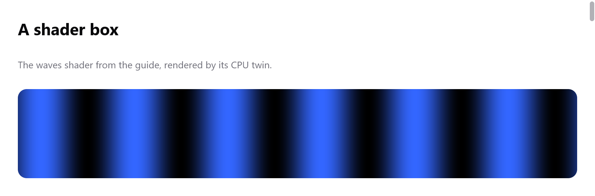

<a id="shaders"></a>

# Shader

Một view có thể tô một box bằng shader của riêng nó: một hàm nhận một điểm trong box và trả về một màu, chạy cho từng pixel. Bạn viết nó một lần bằng ZSL, một ngôn ngữ nhỏ theo cú pháp Zig. `ui.shader.compile` biên dịch nó ngay lúc compile thành:

- HLSL (Direct3D 11);
- GLSL (OpenGL 3.3, OpenGL ES 3.0 và WebGL 2);
- Metal;
- một bản song sinh chạy trên CPU bằng code Zig, vẽ ra đúng các pixel đó (sai khác do làm tròn), dùng ở nơi không có GPU vẽ: CPU renderer và `ui.Tester`.

Vì vậy một shader chạy được trên mọi nền tảng và trong test, và một lỗi trong shader là lỗi compile của app.

<!-- demo: shaders height=288 -->



*Shader waves trong hướng dẫn này, render bằng bản song sinh CPU của myzig.*

```zig
const waves = ui.shader.compile("waves",
    \\uniform time: f32;
    \\pub fn fragment(pos: vec2) vec4 {
    \\    const v = 0.5 + 0.5 * sin(pos.x / 20 + time);
    \\    return vec4(v * 0.2, v * 0.4, v, 1);
    \\}
);

fn view(_: *State, c: *ui.Context) void {
    _ = ui.shaderBox(c, &waves, .{}, .{ .width = .fill, .height = .{ .px = 120 }, .radius = 12 });
    c.end();
}
```

Shader dài hơn nằm trong file riêng, đuôi `.zsl`, rồi được nhúng vào:

```zig
pub const shader = ui.shader.compile("wind", @embedFile("wind.zsl"));
```

Các ví dụ được làm từ shader. Chạy bằng `zig build run-blackhole` và tương tự:

- `blackhole`: ánh sáng được dò đường qua trọng lực; kéo chuột để xoay camera quanh nó.
- `wind`: một mặt các ký tự bị gió khuấy động.
- `chat-glow`: một quả cầu, một vòng tròn, ánh sáng viền và hiệu ứng lấp lánh, dùng chung một bảng màu.
- `effort-slider`, `mayoi` và gallery.

<a id="shader-boxes"></a>

## Shader box

`ui.shaderBox(c, &shader, values, style)` mở một box có style là `style`, được tô bằng shader. Các phần tử con theo sau cho tới `c.end()`.

- Shader thay cho nền của box, bị cắt theo các góc bo tròn của nó.
- `values` là một struct, mỗi trường đặt một uniform của shader (xem bên dưới).
- `ui.shaderBoxWith(c, &shader, values, style, options)` nhận thêm `ui.ShaderBoxOptions`. Trường `blur` của nó làm mờ phần bên dưới box trước khi shader đọc nó bằng `backdrop(p)`.

`ui.shaderEffect(c, &shader, values, last_rect, options)` biến shader thành một effect cho `Style.effect` của box bất kỳ, cấp phát cho frame này. Box được vẽ từ những gì nằm dưới nó, giống kính mờ ([Biến đổi và hiệu ứng](transforms.md#backdrop-effects)). `last_rect` là rect của box ở lần layout trước, dùng cho uniform `pointer`.

```zig
const id = c.peekId("lens");
const fx = ui.shaderEffect(c, &lens, .{ .strength = 0.4 }, c.rects.get(id), .{ .blur = 2 });
_ = c.open(.{ .width = .{ .px = 200 }, .height = .{ .px = 120 }, .radius = 16, .effect = fx }, "lens");
c.end();
```

<a id="the-fragment-function"></a>

## Hàm fragment

```zig
pub fn fragment(pos: vec2) vec4 { ... }
```

- `pos` là điểm trong box, tính bằng điểm từ góc trên bên trái.
- Hàm trả về màu của pixel, đã nhân trước alpha: `vec4(r * a, g * a, b * a, a)`.
- Màu được vẽ đè lên những gì nằm dưới box. Alpha 0 để nguyên phần bên dưới.

<a id="uniforms"></a>

## Uniform

`uniform name: type;` ở đầu khai báo một giá trị mà view đưa vào mỗi frame:

```zig
const root = ui.shaderBox(c, &shader, .{
    .seed = w.seed,                               // u32
    .time = t,                                    // f32
    .heading = [2]f32{ @cos(w.heading), @sin(w.heading) }, // vec2
    .tap = s.tap,                                 // vec3, dạng [3]f32
}, .{ .width = .fill, .height = .fill });
defer c.end();
```

| uniform | trường |
|---|---|
| `f32`, `i32`, `u32` | một số |
| `bool` | một `bool` |
| vector | một mảng hoặc vector số thực |
| `vec3`, `vec4` | hoặc một `ui.Color` |
| `vec2` | hoặc một `ui.Point` |

Trường không ứng với uniform nào là lỗi compile. Uniform bị bỏ qua thì bằng 0, trừ hai trường hợp:

- `time`, một `f32`, nếu bỏ qua thì lấy đồng hồ của context (`c.time`), và khi đó box vẽ lại mọi frame. Tự đưa `time` vào để đóng băng nó (như test làm) hoặc để nó bắt đầu từ 0.
- `pointer`, một `vec2`, nếu bỏ qua thì là vị trí con trỏ, tính bằng điểm của box. Đặt `c.wants_moves = true` để có frame mỗi khi con trỏ di chuyển.

Các uniform dùng chung mười sáu số thực của effect. Mười lăm số là của chúng (một `vec3` chiếm ba), số cuối giữ số pixel trên một điểm. `ui.shader.params(&shader, values, scale)` đóng gói các giá trị vào tham số của effect, cho một `ui.Effect` tự dựng bằng tay.

<a id="the-language"></a>

## Ngôn ngữ

ZSL là cú pháp Zig cho những gì một shader cần:

- Ở cấp trên cùng: `uniform name: type;`, `const name = value;` và các hàm, trong đó có `pub fn fragment`.
- Một hàm có dạng `fn name(a: f32, b: vec2) f32 { ... }`, tối đa tám tham số. Các hàm gọi nhau theo thứ tự nào cũng được, nhưng không tự gọi chính nó: shader không đệ quy.
- Kiểu: `bool`, `i32`, `u32`, `f32`, `vec2`, `vec3`, `vec4`.
- Câu lệnh: biến cục bộ `const` và `var`, phép gán (`=`, `+=` và các phép khác, gán từng thành phần như `v.xy = ...`), `if` / `else`, `while (c) : (i += 1)`, `for (0..n) |i|`, `break`, `continue`, `return`.
- Số không có kiểu sẽ nhận kiểu mà chỗ dùng cần, như trong Zig. Chuyển kiểu bằng `f32(x)`, `i32(x)`, `u32(x)`.
- Tạo vector bằng `vec3(v.xy, 1)` hoặc `vec3(0)`. Một số thực đơn lẻ dùng chung được với vector (`v * 0.5`). `.xyzw` và `.rgba` để swizzle.
- Số nguyên tràn thì quay vòng. `<<`, `>>`, `&`, `|`, `^`, `~` và `%` dành cho số nguyên, còn `mod()` dành cho số thực.
- Hàm băm trên `u32` (PCG và tương tự) cho cùng kết quả trên mọi backend.
- Comment là `//`.

Các hàm có sẵn gồm của GLSL: `sin`, `cos`, `tan`, `asin`, `acos`, `atan`, `atan2`, `sinh`, `cosh`, `tanh`, `exp`, `exp2`, `log`, `log2`, `pow`, `sqrt`, `inversesqrt`, `abs`, `sign`, `floor`, `ceil`, `fract`, `round`, `trunc`, `mod`, `min`, `max`, `clamp`, `mix`, `step`, `smoothstep`, `length`, `distance`, `dot`, `cross`, `normalize`, `reflect`; và của myzig:

| hàm | là |
|---|---|
| `size()` | kích thước của box, tính bằng điểm |
| `pixel_scale()` | số pixel trên một điểm |
| `pixel()` | tâm của pixel, tính bằng pixel của cửa sổ |
| `backdrop(p)` | những gì được vẽ dưới box tại điểm `p` của nó, đã làm mờ theo `blur` của box, đã nhân trước alpha |

Một ví dụ ngắn dùng phần lớn những thứ trên, lấy từ phần đầu ví dụ wind:

```zig
uniform seed: u32;
uniform time: f32;
uniform pointer: vec2;

const cell_w = 9.0;
const tau = 6.2831853;

fn pcg(v: u32) u32 {
    const s = v * 747796405 + 2891336453;
    const w = ((s >> ((s >> 28) + 4)) ^ s) * 277803737;
    return (w >> 22) ^ w;
}

pub fn fragment(pos: vec2) vec4 {
    const cell = floor(pos / vec2(cell_w, 18));
    const h = f32(pcg(u32(cell.x) * 7919 + u32(cell.y) + seed) & 1023) / 1023;
    const glow = 1 - smoothstep(0, 120, distance(pos, pointer));
    const v = 0.5 + 0.5 * sin(h * tau + time);
    return vec4(vec3(v * 0.3 + glow * 0.5), 1);
}
```

Ghép tiền tố là một cách dùng chung code. `chat-glow` compile từng shader của nó từ `palette ++ @embedFile("orb.zsl")`, trong đó palette là một file chứa các hàm mà mọi shader đều dùng.

<a id="errors"></a>

## Lỗi

Lỗi là lỗi compile của app, kèm tên shader, dòng và cột:

```
shader 'waves':3:24: mismatched types i32 and f32
```

- Kiểu được kiểm tra như Zig kiểm tra. Không có chuyển đổi ngầm giữa `i32`, `u32` và `f32`, ngoài các số chưa có kiểu.
- Tên phải được khai báo.
- Shader quá dài so với các bảng của nó là lỗi (`shader 'x' is too long`), đệ quy cũng vậy.
- `ui.shader.checkSource(&program, src, msg)` compile lúc chạy, dùng cho test của trình biên dịch.

<a id="how-it-is-drawn"></a>

## Cách nó được vẽ

Shader box là một backdrop effect ([Biến đổi và hiệu ứng](transforms.md)):

1. Bước paint đánh dấu nó theo thứ tự vẽ.
2. Tới chỗ đánh dấu, mỗi renderer đọc những gì nó đã vẽ quanh box, làm mờ nếu được yêu cầu.
3. Nó vẽ box bằng shader, rồi vẽ tiếp.

- Direct3D, OpenGL, WebGL và Metal compile mã nguồn đã sinh một lần cho mỗi shader, ở lần đầu vẽ nó.
- CPU renderer chạy bản song sinh, một hàm sinh ra từ cùng chương trình đó lúc compile.
- Mã nguồn đã sinh nằm trong `shader.effect` (`hlsl`, `glsl`, `msl`). Cách bố trí các uniform nằm trong `shader.uniforms`.

Shader box để `time` theo đồng hồ sẽ xin mọi frame, nên app cứ vẽ liên tục khi nó đang hiện. Shader box không dùng đồng hồ thì được vẽ cùng những frame mà phần còn lại của view xin, như mọi box khác.

<a id="testing-shaders"></a>

## Test shader

Bản song sinh CPU vẽ được trong `ui.Tester`, nên test có thể render view và xem các pixel của nó. Đóng băng `time` bằng cách tự đưa giá trị vào:

```zig
var s: Pane = .{ .frozen = 4 }; // view của nó truyền .time = s.frozen
var t: ui.Tester = undefined;
try t.init(gpa, .init(&s, Pane.view), .{ .width = 240, .height = 160, .scale = 1 });
defer t.deinit();
t.settle(1);
const px = try t.render(gpa);
defer px.deinit(gpa);
// px.bytes: BGRA, px.width × px.height
```

- View của các ví dụ được test theo cách này. `zig build test` chạy test trong `examples/blackhole`, `wind`, `chat-glow`, `effort-slider` và `mayoi`.
- `src/ui/shader/tests_gpu.zig` vẽ các shader dùng mọi phần của ngôn ngữ bằng Direct3D 11 (trên Windows) và OpenGL (qua EGL, trên Linux). Nó kiểm tra kết quả khớp với bản song sinh CPU, sai khác không quá một hai mức.
- `ui.gpu_testing` cung cấp phép so sánh này cho test của plugin.
